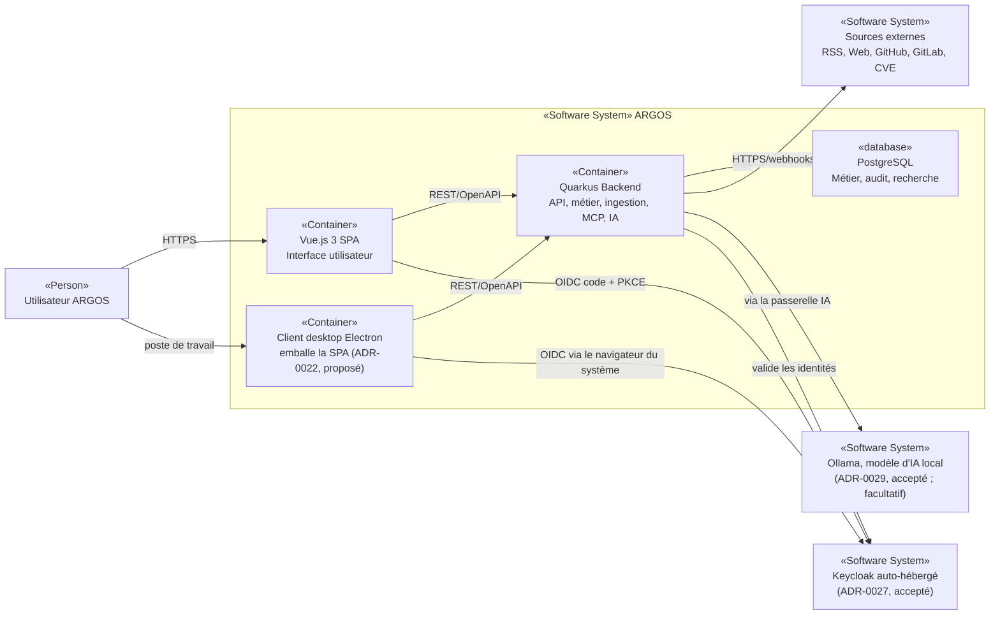
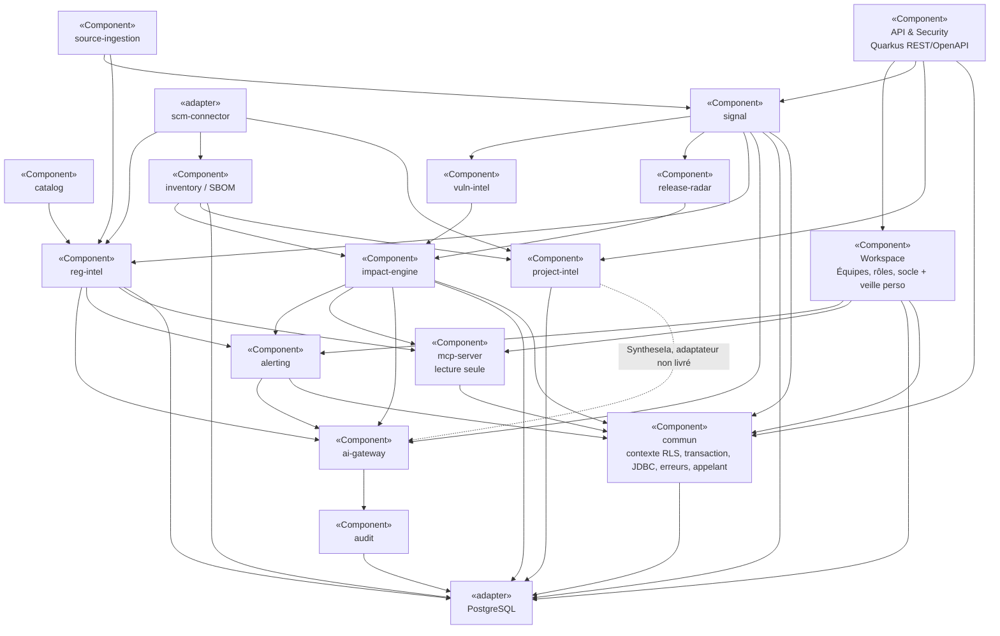
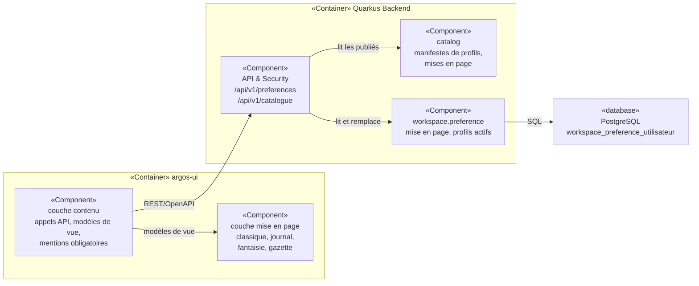
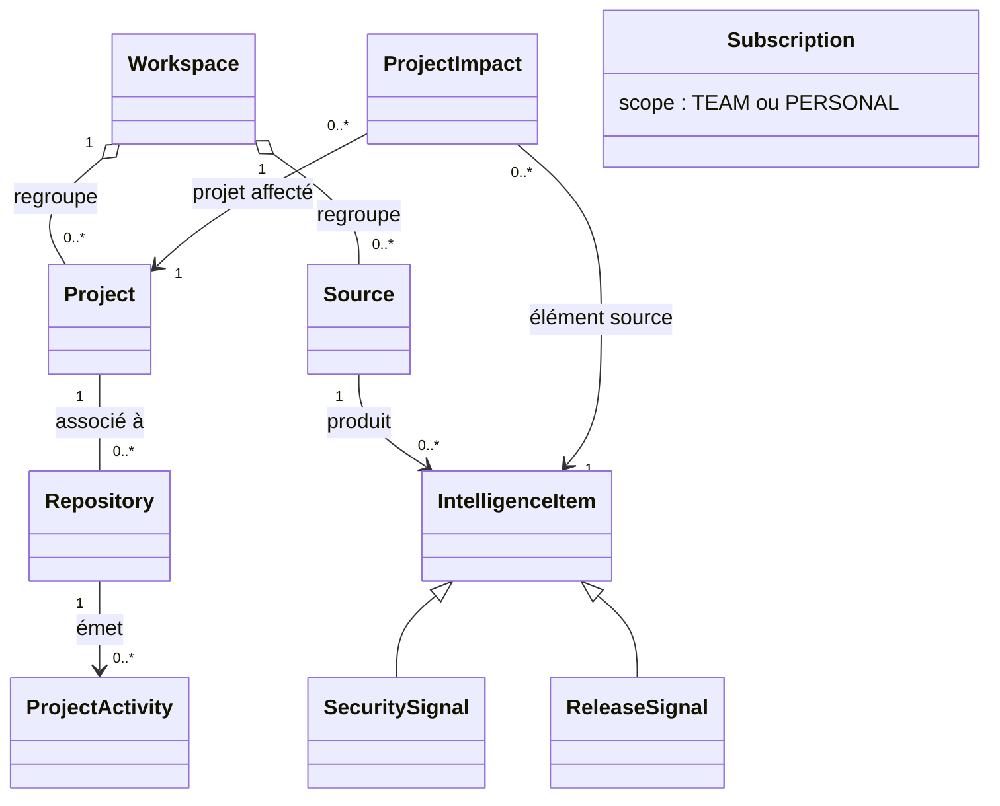

# 5. Vue des blocs

Cette section décrit les niveaux **C4 Container** puis **C4 Component**. La stack est fixée par ADR-0019 : Java 17 minimum, Quarkus, Vue.js 3 et PostgreSQL.

## 5.1 C4 Container

### Vue.js 3 SPA

- navigation, tableaux de bord, recherche et préférences ;
- socle de veille d’équipe + veille personnelle ;
- aucune logique métier critique dans l’IHM ;
- session OIDC (exigences ACC-07 à ACC-10 de la capacité [`comptes-acces`](../../specifications/comptes-acces.md), livrées ; ADR-0033, Accepté) : code d’autorisation + PKCE S256 auprès de Keycloak, jetons en mémoire seulement, jeton porteur joint aux appels de `/api/v1` sauf l’identité du serveur ; toute vue sauf l’état du serveur exige une session.

### Client desktop Electron (proposé, ADR-0022)

- même build Vue.js 3 que la SPA, servi par un protocole interne (`app://argos`) ;
- notifications natives et icône de zone de notification ;
- ni base de données ni serveur embarqué : client de l’API REST uniquement ;
- alertes du poste (capacité [`notifications-poste`](../../specifications/notifications-poste.md)) : la couche contenu de l’IHM lit les alertes `DESKTOP` en attente et confirme leur remise ; le processus principal affiche la notification (titre, gravité, nombre de projets), tient le compteur d’alertes ouvertes de la zone de notification et les réglages du poste (notifications du poste, démarrage avec la session désactivé par défaut) ; il n’appelle pas l’API ;
- fenêtre fermée, l’application reste dans la zone de notification ; quittée, plus rien ne tourne (aucun service en arrière-plan) ;
- connexion OIDC ([PROPOSITION], ADR-0033) : l’autorisation s’ouvre dans le navigateur du système ; le processus principal écoute le retour sur `127.0.0.1` (port éphémère, RFC 8252) et le rend à l’IHM, qui échange le code ; la CSP n’ajoute que l’origine du fournisseur d’identité configuré.

### Quarkus Backend

- **Java 17 minimum** ;
- API REST/OpenAPI ;
- règles métier, ingestion, corrélation, alerting, AI Gateway et serveur MCP ;
- monolithe modulaire proposé ;
- aucune dépendance du domaine aux SDK externes.

### PostgreSQL

- persistance principale ;
- JSONB, FTS et RLS ;
- pgvector uniquement si besoin démontré.

## 5.2 C4 Component — Quarkus Backend

Tous les modules métier dépendent de `commun` (ADR-0037) ; seules quelques arêtes sont tracées.

## 5.3 Responsabilités et frontières

| Composant | Responsabilité | Ne doit pas |
|---|---|---|
| API & Security | REST/OpenAPI, authn/authz, validation ; contrôle du rôle avant toute écriture demandée (`Access.administrator`, `Access.contributor`) ; contrat servi sur `/q/openapi`, dont l'instantané `argos-ui/src/api/openapi.json` est vérifié par `ContratClientIhmTest` | contenir les règles métier ; écrire en base sans passer par le module propriétaire |
| commun | contexte RLS (`ContexteBase`), frontière transactionnelle JTA, utilitaire JDBC (`Jdbc`, `Conversions`, `ErreurBase`), erreurs du domaine partagées ; `commun.securite` : appelant (`Caller`, `CallerResolver`) et limiteur de débit (`LimiteurDebit`) ; `commun.http` : fabrique des clients HTTP sortants et lecture bornée des réponses (`ClientsHttp`, `LectureBornee`, ADR-0039) (`io.argos.commun`, ADR-0037) | dépendre d'un module ; contenir une règle métier ; citer une table |
| workspace | équipes, rôles, abonnements TEAM/PERSONAL, vues ; lectures publiées pour les autres modules (`LectureMembres`, `PreferencesService`, vue `compte_nom_public`) | confondre préférence de veille et autorisation |
| source-ingestion | collecte, idempotence, normalisation ; synchronisation lancée par l'exploitant poursuivie en tâche de fond (`LancementSynchronisation`, ADR-0039) ; lecture OSV par archive d'écosystème au-delà d'un seuil | connaître la présentation UI ; appeler une source dans une transaction |
| catalog | technologies, standards, domaines métier | dépendre d’un fournisseur externe |
| inventory | projets, dépôts (un ou plusieurs par projet, inventaire = union des dépôts), SBOM, PURL ; import quotidien planifié des inventaires depuis les forges, sérialisé avec l'import manuel par projet (`ImportPlanifie`, changement `automatiser-chaine-veille`) ; création de projet, rattachement et détachement de dépôt, imports manuels demandés par `api` après son contrôle de rôle, par les mêmes traitements (`ProjectDirectory`, `InventoryService`, INV-12, INV-13) | calculer seul l’impact sécurité ; dépendre d'`impact-engine` (la recorrélation passe par l'événement `InventoryReplaced`) ; exposer un point d'entrée entrant (webhook) |
| release-radar | calendrier public endoflife.date (copie locale, fraîcheur), échéances par technologie du référentiel (`io.argos.releaseradar`, fiche [`radar-standards`](../../specifications/radar-standards.md)) | décider d’un statut du référentiel ; utiliser la correspondance produit d’un autre espace |
| impact-engine | corrélation déterministe ; état de traitement des impacts (`ouvert`, `confirmé`, `écarté`, `résolu`), transitions et historique, résolution système d'un impact devenu sans objet (`TraitementImpacts`, volet C de `automatiser-chaine-veille`) ; dette de version et projets touchés par une échéance ou un changement de standard (`RadarProjets`) ; suggestions de l'IA sur les versions recommandées arrivées en fin de support, demandées à `ai-gateway` et enregistrées en attente par `catalog` (`SuggestionsRadar`, RAD-08, §6.9) | modifier le référentiel des standards ; déléguer la décision au LLM ; contrôler le rôle d'un appelant (rôle résolu par `api`, garanti par la RLS) |
| ai-gateway | point d'appel unique au modèle local Ollama : prompts versionnés, classes de données, plafond et quotas journaliers, sorties validées par schéma, mention IA, journal `ia_appel` via `audit` (`io.argos.aigateway`, fiche [`passerelle-ia`](../../specifications/passerelle-ia.md), ADR-0029 accepté) ; appelé par `alerting` (résumé d'alerte), `signal.web` (résumé d'actualité), `impact` (analyse complémentaire, désactivée par défaut ; suggestion `HOLD` du référentiel, prompt `suggestion-standard`) et `regintel` (résumé de fiche et domaine proposé) | exposer le fournisseur au domaine ; décider d'un impact ; recevoir une donnée CONFIDENTIAL ou RESTRICTED |
| mcp-server | huit outils MCP en lecture seule sur `POST /mcp` (Streamable HTTP : sans session en protocole 2026-07-28 ; session en mémoire, négociations limitées et fermée après 30 minutes d'inactivité, pour une version antérieure ; jeton exigé à chaque requête) ; appelant établi par `api.security`, limitation de débit, journal des appels (`audit`), contenu externe balisé et tronqué (`io.argos.mcp`, fiche [`serveur-mcp`](../../specifications/serveur-mcp.md)) | modifier le domaine ; dépendre de `api` hors `api.security` |
| reg-intel | collecte quotidienne des archives JORF de la DILA, qualification par le dictionnaire de l'espace puis proposition IA marquée, fiche en attente de validation, correction et validation par l'expert, cycle de vie, demande d'évolution GitHub ou GitLab, échéances (`io.argos.regintel`, fiche [`veille-reglementaire`](../../specifications/veille-reglementaire.md), ADR-0030 accepté) | produire un avis juridique ; diffuser une fiche non validée |
| vuln-intel | enrichissement des signaux à CVE par NVD, CISA KEV, FIRST EPSS et CERT-FR (`Enricher`) ; file d'enrichissement traitée et rattrapée par `TraitementEnrichissements` (tâches `vulnintel-enrichissement` et `vulnintel-rattrapage`, COL-04) | bloquer l'enregistrement d'un signal faute d'enrichissement |
| alerting | règles d’alerte et digests ; tâche quotidienne du radar (`RappelsRadar` : actualisation, suggestions de l'IA par `impact`, rappels d’échéance) et annonces de standard ; rappels des entrées en vigueur réglementaires (`RappelsReglementaires`) ; liens des messages vers les vues de l'IHM, gabarits `/#/…` centralisés (`LiensIhm`, ALR-09) | accorder des droits d’accès ; viser un chemin que l'IHM ne sert pas |
| scm-connector | GitLab/API/webhooks/SBOM ; SBOM et manifestes de la branche principale remis à `inventory`, dépôt introuvable, jeton refusé et quota épuisé distingués d'un fichier absent (`RepositoryFiles`, `DepotIntrouvable`, `AccesRefuse`, `QuotaEpuise`) ; activité GitHub et GitLab en lecture seule, sans identité, quotas (`RepositoryActivity`) | injecter les payloads fournisseurs dans le domaine ; écrire dans un dépôt |
| project-intel | collecte planifiée et agrégation par jour de l'activité des dépôts, avancement des jalons avec dénominateur, synthèse IA marquée par le point d'extension `SyntheseIa`, purge à 13 mois (`io.argos.projectintel`, fiche [`activite-projets`](../../specifications/activite-projets.md)) | stocker ou restituer une identité de personne ; laisser l'IA calculer un indicateur |

### 5.3.1 Propriété des tables

Chaque table et chaque vue des migrations a un module propriétaire : lui seul l'écrit. `ProprieteTablesTest` porte la même
table (« ajouter d'abord au test, puis à arc42 ») et vérifie que le SQL d'un module ne cite que ses tables, celles d'un module
dont il peut dépendre (§5.6) ou une vue publiée par leur propriétaire ; les préférences d'un utilisateur ne se lisent que par
le service de `workspace`.

| Module propriétaire | Tables et vues |
|---|---|
| workspace | `compte`, `espace`, `appartenance`, `invitation`, `subscription`, `subscription_opt_out`, `suivi_profil`, `suivi_rappels`, `workspace_preference_utilisateur`, `workspace_vue`, vue `compte_nom_public` |
| catalog | `domaine_metier`, `expert_domaine`, `regle_dictionnaire`, `standard_technologie`, `standard_suggestion`, `standard_historique` |
| inventory | `project`, `project_repository`, `inventory`, `repository_inventory`, `component`, `component_occurrence`, `inventory_import_failure` |
| signal | `signal`, `signal_alias`, `signal_package`, `signal_version`, `actualite`, `actualite_source`, `source_web`, `source_profil`, `opportunite` |
| vulnintel | `enrichment`, `enrichissement_attente` |
| releaseradar | `cycle_vie`, `cycle_vie_produit` |
| regintel | `texte_officiel`, `fiche_reglementaire`, `fiche_domaine`, `fiche_historique`, `reg_source`, `reg_parametres`, `reg_collecte_jour` |
| impact | `project_impact`, `project_impact_transition`, `actualite_impact`, `dette_version` |
| alerting | `alerte`, `resume_element`, `radar_parametres` |
| projectintel | `activite_collecte`, `activite_compteur`, `activite_jalon` |
| aigateway | `ia_prompt`, `ia_quota_jour` |
| audit | `ia_appel`, `mcp_appel`, `refus_acces` |
| ingestion | `source`, `sync_run`, `sync_attempt`, `sync_cursor`, `ingestion_failure`, `ops_event` |

Lectures croisées autorisées (le module lecteur dépend du propriétaire, §5.6) : `alerting` lit `appartenance`, `compte` et
`project_impact` ; `catalog` lit `compte` ; `impact` lit `actualite`, `signal`, `signal_package`, `signal_version`, `project` et
`component` ; `inventory` lit `espace` ; `regintel` lit `domaine_metier` ; `vulnintel` lit `signal_alias`. `impact` lit le nom
des comptes par la vue `compte_nom_public`, publiée par `workspace` (migration V23) ; `catalog` lit les appartenances par
`workspace.LectureMembres` et `alerting` lit les préférences par `workspace.preference.PreferencesService`.

## 5.4 Personnalisation

Une `Subscription` possède un `scope` :

- `TEAM` : socle d’équipe, éventuellement obligatoire ;
- `PERSONAL` : veille ajoutée volontairement par l’utilisateur.

Le scope de veille n’accorde **aucun droit supplémentaire** sur les projets. RBAC/RLS reste la source d’autorisation.

### 5.4.1 Profils de veille et mise en page (ADR-0023, ADR-0024 — acceptés)

Un utilisateur choisit sa **mise en page** et un ou plusieurs **profils de veille**. Ces préférences décident de ce qu’il voit parmi ce qu’il a le droit de voir, et de la façon dont il le voit ; elles ne décident jamais d’un droit.

| Composant | Responsabilité | Ne doit pas | Code |
|---|---|---|---|
| catalog | publier les manifestes de profils (format 1, validés au démarrage) et la liste des mises en page ; retirer un élément du catalogue | connaître les préférences d’un utilisateur | `io.argos.catalog.profil`, `io.argos.catalog.miseenpage` |
| workspace | enregistrer la mise en page et les profils actifs de chaque utilisateur ; au moins un profil actif | accorder un droit ; lire le catalogue | `io.argos.workspace.preference` |
| API & Security | confronter les préférences au catalogue (défaut `classique`, profils par défaut) et les exposer avec le catalogue | appliquer une règle d’affichage | `io.argos.api.preference`, `io.argos.api.catalogue` |
| IHM — couche contenu | appeler l’API et construire les modèles de vue avec leurs mentions obligatoires | dépendre d’une mise en page | `argos-ui/src/contenu`, `argos-ui/src/views` |
| IHM — couche mise en page | présenter les modèles de vue selon le style choisi | appeler l’API, filtrer un élément ou omettre une mention | `argos-ui/src/mises-en-page` |

Les préférences ne sont lues que par `api`, `mcp` et `alerting` (destinataires d'un profil, par `PreferencesService` ; `PreferencesIsolationTest`) ; une mise en page n’importe ni le client API ni le reste de la couche contenu (`argos-ui/tests/architecture.test.mjs`). Les quatre mises en page reçoivent le même modèle de données (`argos-ui/src/mises-en-page/modele.ts`) ; le composant affiché est choisi par `MiseEnPage.vue` d’après la préférence. Leurs couleurs sont des jetons dont les contrastes sont contrôlés par les tests de l’IHM, leurs polices sont embarquées (ADR-0023 point 5) ; audit d’accessibilité : [rapport](../quality/audit-accessibilite-mises-en-page.md).

**D-15 — Type : C4 Component. Portée : préférences d’affichage et de veille, du serveur à l’IHM. Statut : implémenté pour le catalogue, les préférences et les couches de l’IHM ; restitution de la veille par profils à venir.**

### 5.4.2 Profil de veille `artiste` (ADR-0024 — accepté)

Le profil `artiste` est un pack du catalogue (changement `ajouter-profil-artiste`, fiche [`profil-artiste`](../../specifications/profil-artiste.md)). Il ajoute des listes fermées d'objets suivis au manifeste (disciplines, territoires) et une stratégie de rapprochement sans identifiant de composant.

| Composant | Responsabilité | Ne doit pas | Code |
|---|---|---|---|
| catalog | publier le manifeste `artiste` : rubriques, listes de disciplines et de territoires, garde-fous `AUCUN_AVIS_ELIGIBILITE` et `SOURCES_VERIFIEES` | connaître les suivis d'un utilisateur | `io.argos.catalog.profil` (`artiste.json`) |
| workspace | enregistrer les objets suivis et les jours de rappel de chaque compte, sous RLS | accorder un droit ; lire le catalogue | `io.argos.workspace.suivi` |
| source-ingestion | lire une réponse de l'API data.culture.gouv.fr en texte brut ; récupérer par le collecteur de la veille web | récupérer une adresse lue dans un contenu | `io.argos.ingestion.culture`, `io.argos.ingestion.web` |
| signal | registre des sources du profil et de leurs conditions d'usage ; collecte des seules sources vérifiées ; opportunités | collecter une source non vérifiée | `io.argos.signal.opportunite` |
| impact-engine | stratégie discipline + territoire + date limite ; gabarit de résumé sans avis d'éligibilité | décider par l'IA ; lire les préférences | `io.argos.impact` (`StrategieDisciplineTerritoire`, `RapprochementOpportunites`, `ResumeOpportunite`) |
| alerting | rappels de date limite aux jours de rappel du compte | accorder un droit | `io.argos.alerting.RappelsOpportunites` |
| API & Security | vérifier que le profil est actif, confronter les suivis aux listes du pack, réserver le registre des sources à l'administrateur plateforme | appliquer la stratégie | `io.argos.api.artiste`, `io.argos.api.preference.RubriquesResource` |

Le paquet `workspace.suivi` ne dépend d'aucune classe de `workspace` hors de lui-même, utilise le contexte RLS du noyau commun (`ContexteBase`) et ne lit aucune donnée d'autorisation (`SuiviIsolationTest`). Aucune dépendance de module n'est ajoutée à §5.6.

### 5.4.3 Veille réglementaire (ADR-0030 — accepté)

La veille réglementaire du profil `expert-metier` (changement `suivre-veille-reglementaire`, fiche [`veille-reglementaire`](../../specifications/veille-reglementaire.md)) repose sur les domaines, le dictionnaire et les experts de chaque espace.

| Composant | Responsabilité | Ne doit pas | Code |
|---|---|---|---|
| source-ingestion | lire les archives JORF de la DILA : index, archives `.tar.gz` bornées, XML sans DTD ni entité externe | connaître les espaces ou les domaines | `io.argos.ingestion.legi` |
| catalog | domaines métier, règles de rattachement et experts de chaque espace, sous RLS ; lecture technique des dictionnaires | qualifier un texte | `io.argos.catalog.dictionnaire` |
| reg-intel | collecte et reprise des jours manqués, textes uniques par identifiant officiel, qualification, fiche, validation, cycle de vie, demande d'évolution, échéances ; point d'extension MCP `FichesReglementaires` | diffuser une fiche non validée ; produire un avis juridique | `io.argos.regintel` |
| scm-connector | reconnaître un ticket ou une demande de fusion GitHub ou GitLab et lire son état en lecture seule | écrire dans une forge | `io.argos.scm.DemandesEvolution` |
| alerting | rappels J-90, J-30, J-7 (réglables par espace) aux experts et aux membres au profil `expert-metier` actif | accorder un droit | `io.argos.alerting.RappelsReglementaires` |
| API & Security | réserver la configuration aux administrateurs de l'espace et l'expertise aux experts du domaine ; état et rejeu de la collecte pour l'administrateur plateforme | appliquer les règles de rattachement | `io.argos.api.reglementaire` |

Dépendances de module ajoutées (règles de `ModuleBoundariesTest`) : `regintel` → `ingestion`, `scm` ; `alerting` → `regintel` ; `catalog` → `workspace` (`LectureMembres`).

## 5.5 Règles de dépendance

1. le domaine ne dépend pas des SDK externes ;
2. les adapters dépendent des ports, jamais l’inverse ;
3. l’AI Gateway est le seul composant autorisé à appeler le fournisseur LLM ;
4. les contrôleurs Quarkus ne parlent pas directement à la base ;
5. les événements externes sont normalisés avant usage métier ;
6. les préférences personnelles sont séparées des politiques d’autorisation ;
7. les mécanismes techniques partagés (contexte RLS, transaction, JDBC, erreurs du domaine, appelant, limiteur de débit) vivent dans le noyau commun `io.argos.commun`, autorisé à tous les modules et sans dépendance vers eux (ADR-0037) ; aucune règle métier ni aucun nom de table n'y entre.

## 5.6 C4 Code

Le socle `argos-server/` matérialise chaque composant de §5.2 par un paquet Java `io.argos.<module>` (par exemple `impact` pour `impact-engine`, `ingestion` pour `source-ingestion`). Les dépendances autorisées entre modules sont vérifiées par `argos-server/src/test/java/io/argos/architecture/ModuleBoundariesTest.java`, dont la table `ALLOWED` est la liste fermée des modules : toute classe de `io.argos` réside dans un paquet de premier niveau qui y figure, sinon le test échoue (règle `chaqueClasseResideDansUnModuleDeclare`, prouvée contre une classe factice par `laRegleRefuseUnModuleNonDeclare`), et la table n'autorise que les dépendances que le code utilise. Un nouveau module, ou une nouvelle dépendance entre modules, s'ajoute à la table dans la pull request qui l'introduit. Table au 2026-11-24 (50 dépendances autorisées, toutes utilisées) :

| Module | Peut dépendre de |
|---|---|
| `api` | `workspace`, `catalog`, `inventory`, `signal`, `vulnintel`, `releaseradar`, `regintel`, `impact`, `alerting`, `projectintel`, `audit` |
| `mcp` | `workspace`, `catalog`, `inventory`, `signal`, `vulnintel`, `releaseradar`, `regintel`, `impact`, `alerting`, `audit` |
| `alerting` | `impact`, `workspace`, `aigateway`, `regintel` |
| `impact` | `signal`, `releaseradar`, `inventory`, `aigateway`, `catalog` |
| `regintel` | `catalog`, `aigateway`, `ingestion`, `scm` |
| `signal` | `ingestion`, `catalog`, `aigateway` |
| `inventory` | `workspace`, `catalog`, `scm` |
| `projectintel` | `inventory`, `scm` |
| `vulnintel` | `signal` |
| `releaseradar` | `catalog` |
| `catalog` | `workspace` (`LectureMembres`) |
| `aigateway` | `audit` |
| `workspace`, `ingestion`, `scm`, `audit` | aucun module |
| `observabilite`, `horloge`, `execution`, `commun` (techniques, transverses) | aucun module métier ; tout module peut en dépendre ; `commun` ne dépend d'aucun module |

Les modules techniques transverses (table `TRANSVERSES` de `ModuleBoundariesTest`) ne portent aucun code métier et ne dépendent d'aucun module métier ; ils peuvent dépendre les uns des autres. `observabilite` tient la corrélation des journaux, le filtre des jetons, l'observation des tâches planifiées, leur contrôle de santé (ADR-0036, §8.6) et les erreurs imprévues retenues aux frontières (§8.5) ; `horloge` produit le `Clock` commun (§8.16) ; `execution` fournit l'exécuteur borné possédé par un bean CDI (§8.5), qui propage la corrélation d'`observabilite`.

Les paquets `ingestion`, `signal`, `vulnintel`, `scm`, `inventory`, `impact`, `workspace`, `audit` et `api` portent la chaîne sécurité du POC (changement `formaliser-chaine-securite-poc`) ainsi que les comptes, les espaces et les rôles (changement `gerer-comptes-et-acces`) ; `catalog`, `workspace.preference` et `api` portent le catalogue des profils et des mises en page et les préférences utilisateur (§5.4.1) ; `mcp` porte le serveur MCP (changement `exposer-serveur-mcp`), qui lit le référentiel des standards, le calendrier des sorties et les fiches réglementaires par les points d'extension `catalog.standard`, `releaseradar` et `regintel` ; `ingestion.web`, `signal.web` et `impact` portent la veille RSS/Atom et les pages surveillées (changement `collecter-veille-rss-web`, ADR-0028) ; `alerting` porte les alertes et les résumés (changement `diffuser-alertes-et-digests`) ; `impact` (`RechercheVeille`), `api.recherche` et `workspace.vue` portent la recherche plein texte, ses filtres et les vues enregistrées, et l'outil MCP `search_signals` emploie la même requête (changement `rechercher-et-filtrer`) ; `catalog.standard`, `releaseradar`, `impact` (`RadarProjets`, `SuggestionsRadar`) et `alerting` (`RappelsRadar`) portent le référentiel des standards, le radar des sorties et les suggestions de l'IA (changements `construire-radar-et-standards` et `alimenter-inventaire-et-completer-ihm`, §8.15) ; `impact` lit le référentiel de `catalog` pour la dette de version et les annonces ; `aigateway` porte la passerelle IA (changement `encadrer-appels-ia`), appelée par `alerting`, `signal.web`, `impact` et `regintel` par son seul contrat, l'adaptateur Ollama et les quotas restant internes (règle `seuleLaPasserelleConnaitLeFournisseur`) ; `projectintel`, `scm` et `api` portent l'activité des projets (changement `mesurer-activite-projets`) ; `catalog.profil`, `workspace.suivi`, `ingestion.culture`, `signal.opportunite`, `impact` et `alerting` (`RappelsOpportunites`) portent le profil de veille `artiste` (changement `ajouter-profil-artiste`, §5.4.2) ; `ingestion.legi`, `catalog.dictionnaire`, `regintel`, `scm` (`DemandesEvolution`), `alerting` (`RappelsReglementaires`) et `api.reglementaire` portent la veille réglementaire (changement `suivre-veille-reglementaire`, §5.4.3) ; les autres paquets ne contiennent aucun code métier.

## 5.7 Modèle métier conceptuel (D-05)

**Type : UML classDiagram. Portée : concepts du domaine nommés en §4.2 (P2), §5.4 et au glossaire (§12). Statut : Hypothèse à valider.**

Le diagramme ne représente que les concepts et relations écrits dans la documentation. Points non établis, à valider :

- cardinalité `Project` ↔ `Repository` : le glossaire laisse ouverte la question « projet métier, dépôt ou agrégat de plusieurs dépôts » ;
- spécialisation `SecuritySignal` / `ReleaseSignal` de `IntelligenceItem` : §4.2 les cite comme concepts distincts, la généralisation est une hypothèse de modélisation ;
- `Source` rattachée à un `Workspace` selon le glossaire, alors qu’ADR-0016 indique que les signaux sont globaux ;
- `Subscription` n’est reliée à aucune entité d’autorisation (§5.4) ; son propriétaire (équipe ou utilisateur) est détaillé dans la fiche [`abonnements-veille`](../../specifications/abonnements-veille.md).

Les modèles détaillés par capacité sont maintenus dans les fiches de [`docs/specifications/`](../../specifications/README.md).
