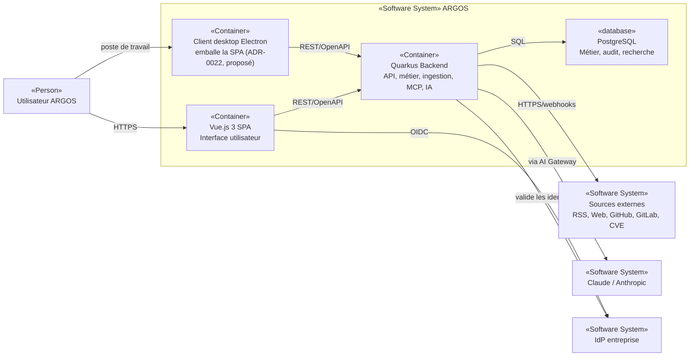
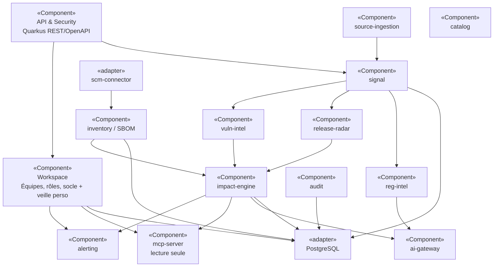
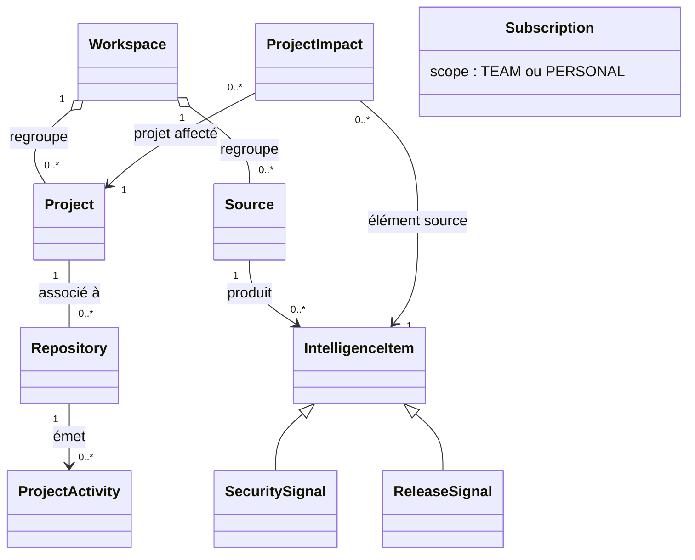

# 5. Vue des blocs

Cette section décrit les niveaux **C4 Container** puis **C4 Component**. La stack est fixée par ADR-0019 : Java 17 minimum, Quarkus, Vue.js 3 et PostgreSQL.

## 5.1 C4 Container

### Vue.js 3 SPA

- navigation, tableaux de bord, recherche et préférences ;
- socle de veille d’équipe + veille personnelle ;
- aucune logique métier critique dans l’IHM.

### Client desktop Electron (proposé, ADR-0022)

- même build Vue.js 3 que la SPA, servi par un protocole interne (`app://argos`) ;
- notifications natives et icône de zone de notification ;
- ni base de données ni serveur embarqué : client de l’API REST uniquement.

### Quarkus Backend

- **Java 17 minimum** ;
- API REST/OpenAPI ;
- règles métier, ingestion, corrélation, alerting, AI Gateway et serveur MCP ;
- monolithe modulaire proposé ;
- aucune dépendance du domaine aux SDK externes.

### PostgreSQL

- persistance principale ;
- JSONB, FTS et RLS ;
- pgvector uniquement si besoin démontré.

## 5.2 C4 Component — Quarkus Backend

## 5.3 Responsabilités et frontières

| Composant | Responsabilité | Ne doit pas |
|---|---|---|
| API & Security | REST/OpenAPI, authn/authz, validation | contenir les règles métier |
| workspace | équipes, rôles, abonnements TEAM/PERSONAL, vues | confondre préférence de veille et autorisation |
| source-ingestion | collecte, idempotence, normalisation | connaître la présentation UI |
| catalog | technologies, standards, domaines métier | dépendre d’un fournisseur externe |
| inventory | projets, dépôts, SBOM, PURL | calculer seul l’impact sécurité |
| impact-engine | corrélation déterministe | déléguer la décision au LLM |
| ai-gateway | prompts, modèles, quotas, structured output, audit | exposer Claude directement au domaine |
| mcp-server | outils MCP lecture seule | modifier le domaine au MVP |
| alerting | règles d’alerte et digests | accorder des droits d’accès |
| scm-connector | GitLab/API/webhooks/SBOM | injecter les payloads fournisseurs dans le domaine |

## 5.4 Personnalisation

Une `Subscription` possède un `scope` :

- `TEAM` : socle d’équipe, éventuellement obligatoire ;
- `PERSONAL` : veille ajoutée volontairement par l’utilisateur.

Le scope de veille n’accorde **aucun droit supplémentaire** sur les projets. RBAC/RLS reste la source d’autorisation.

## 5.5 Règles de dépendance

1. le domaine ne dépend pas des SDK externes ;
2. les adapters dépendent des ports, jamais l’inverse ;
3. l’AI Gateway est le seul composant autorisé à appeler le fournisseur LLM ;
4. les contrôleurs Quarkus ne parlent pas directement à la base ;
5. les événements externes sont normalisés avant usage métier ;
6. les préférences personnelles sont séparées des politiques d’autorisation.

## 5.6 C4 Code

Le socle `argos-server/` matérialise chaque composant de §5.2 par un paquet Java `io.argos.<module>` (par exemple `impact` pour `impact-engine`, `ingestion` pour `source-ingestion`). Les dépendances autorisées entre modules sont vérifiées par `argos-server/src/test/java/io/argos/architecture/ModuleBoundariesTest.java`. Les paquets `ingestion`, `signal`, `vulnintel`, `scm`, `inventory`, `impact`, `workspace`, `audit` et `api` portent la chaîne sécurité du POC (changement `formaliser-chaine-securite-poc`) ; les autres ne contiennent encore aucun code métier.

## 5.7 Modèle métier conceptuel (D-05)

**Type : UML classDiagram. Portée : concepts du domaine nommés en §4.2 (P2), §5.4 et au glossaire (§12). Statut : Hypothèse à valider.**

Le diagramme ne représente que les concepts et relations écrits dans la documentation. Points non établis, à valider :

- cardinalité `Project` ↔ `Repository` : le glossaire laisse ouverte la question « projet métier, dépôt ou agrégat de plusieurs dépôts » ;
- spécialisation `SecuritySignal` / `ReleaseSignal` de `IntelligenceItem` : §4.2 les cite comme concepts distincts, la généralisation est une hypothèse de modélisation ;
- `Source` rattachée à un `Workspace` selon le glossaire, alors qu’ADR-0016 indique que les signaux sont globaux ;
- `Subscription` n’est reliée à aucune entité d’autorisation (§5.4) ; son propriétaire (équipe ou utilisateur) est détaillé dans la fiche [`abonnements-veille`](../../specifications/abonnements-veille.md).

Les modèles détaillés par capacité sont maintenus dans les fiches de [`docs/specifications/`](../../specifications/README.md).
