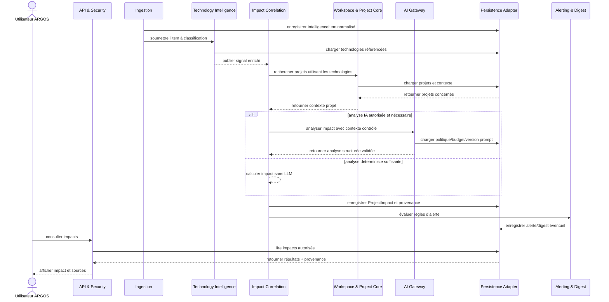
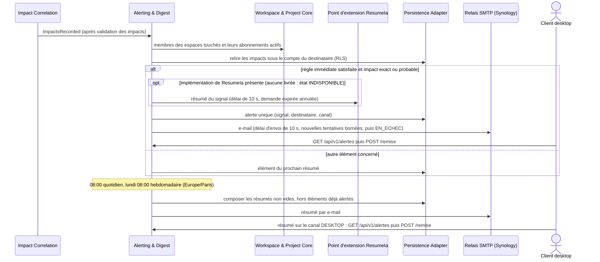
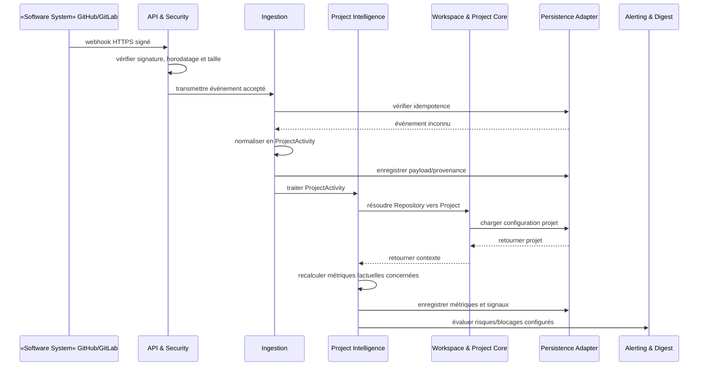
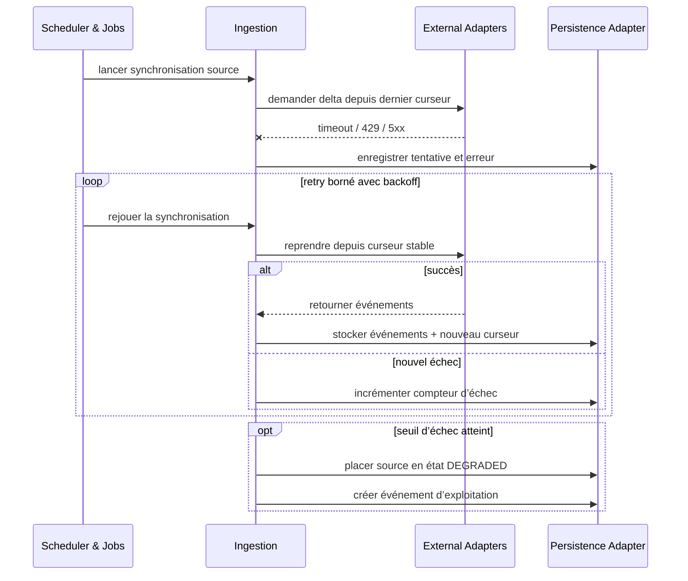
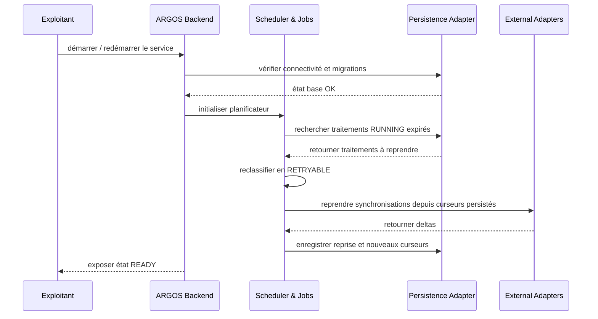

# 6. Vue d’exécution

Cette section décrit des scénarios dynamiques. Ses participants portent des noms de responsabilités qui ne coïncident pas tous avec les composants de la section 5 ; la table suivante donne la correspondance.

| Participant (§6) | Composant(s) de la section 5 | Remarque |
|---|---|---|
| `API & Security` | `API & Security` | identique |
| `Ingestion` | `source-ingestion` | — |
| `Technology Intelligence` | `signal`, `vuln-intel`, `release-radar` | regroupement de plusieurs composants |
| `Impact Correlation` | `impact-engine` | — |
| `Workspace & Project Core` | `workspace`, `inventory` | regroupement |
| `AI Gateway` | `ai-gateway` | — |
| `Persistence Adapter` | adaptateur `PostgreSQL` | — |
| `Alerting & Digest` | `alerting` | — |
| `External Adapters` | `scm-connector` et adaptateurs des sources | seul `scm-connector` est nommé en §5 |
| `Project Intelligence` | aucun | composant absent de §5 (Project Intelligence complet en phase 3, baseline v2.3 §2.4) |
| `Relais SMTP (Synology)` | aucun | système externe : serveur d’e-mails du NAS (§6.1.1) |
| `Client desktop` | aucun | conteneur `argos-desktop` (ADR-0022), hors du backend (§6.1.1) |
| `Scheduler & Jobs` | aucun | composant absent de §5 ; tâches planifiées Quarkus Scheduler dans les modules qui les portent (`alerting` §6.1.1, collecte de la veille web) ; aucun conteneur séparé (§6.5) |

Les vues métier des fiches de [`docs/specifications/`](../../specifications/README.md) emploient les noms de la section 5.

## 6.1 Scénario nominal — signal technologique vers impact projet

**Type : UML sequence diagram. Portée : traitement d’un `IntelligenceItem`.**

### Invariants

- aucune synthèse ne remplace la source ;
- toute analyse LLM doit être associée à la version du prompt/modèle ;
- la politique de confidentialité doit être évaluée avant l’appel à `AI Gateway` ;
- l’opération doit être idempotente sur la source + l’identifiant externe.

### 6.1.1 Alerte immédiate et résumé périodique

**Type : UML sequence diagram. Portée : comportement implémenté (capacité [`alertes-digests`](../../specifications/alertes-digests.md)).**

L’indisponibilité de l’IA ou du serveur d’e-mails ne bloque ni les impacts ni l’enregistrement des alertes ; une alerte en échec d’envoi reste consultable dans Argos. L’évaluation est synchrone dans le fil de la corrélation : chaque signal qui produit une alerte attend au plus le délai du résumé IA (10 s) puis, par alerte e-mail, le délai d’envoi SMTP (`quarkus.mailer.timeout`, 10 s). Aucun verrou ni aucune transaction n’est tenu pendant l’envoi ; chaque tentative est comptée, quelle que soit la cause de l’échec. Le module `alerting` ne dépend pas d’`ai-gateway` (`ModuleBoundariesTest`) : le résumé passe par l’interface `ResumeIa`, sans implémentation livrée.

## 6.2 Scénario nominal — activité GitHub/GitLab vers Project Intelligence

**Type : UML sequence diagram. Portée : réception d’un webhook projet.**

## 6.3 Scénario d’erreur — API externe indisponible

**Type : UML sequence diagram. Portée : synchronisation planifiée.**

### Règles proposées

- ne jamais avancer le curseur avant persistance durable ;
- distinguer erreurs transitoires et permanentes ;
- respecter `Retry-After` et les rate limits ;
- ne pas boucler indéfiniment ;
- rendre visible la source dégradée dans l’observabilité.

## 6.4 Scénario d’exploitation — redémarrage/reprise

**Type : UML sequence diagram. Portée : reprise du `ARGOS Backend`.**

## 6.5 Hypothèses et validation

### Hypothèses à valider

- présence d’un scheduler interne au backend ;
- persistance des curseurs et statuts de job dans PostgreSQL ;
- retry sans broker externe au MVP.

### Preuves nécessaires

- tests d’intégration avec GitHub/GitLab/FreshRSS ;
- tests d’idempotence ;
- test de reprise après arrêt forcé ;
- métriques de retry et backlog ;
- simulation 429/5xx/timeouts.

### Risques

- doubles traitements si clé d’idempotence mal définie ;
- perte d’événement si le curseur est avancé trop tôt ;
- tempête de retry ;
- webhooks reçus dans le désordre.

### Fichiers source concernés

- futurs services d’ingestion et jobs ;
- futurs adapters ;
- futures migrations ;
- futurs tests d’intégration et de résilience.
