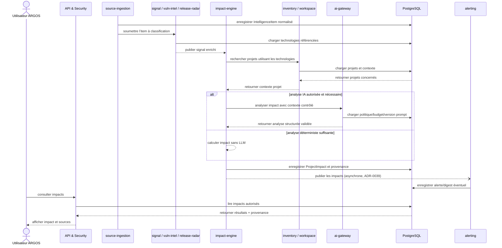
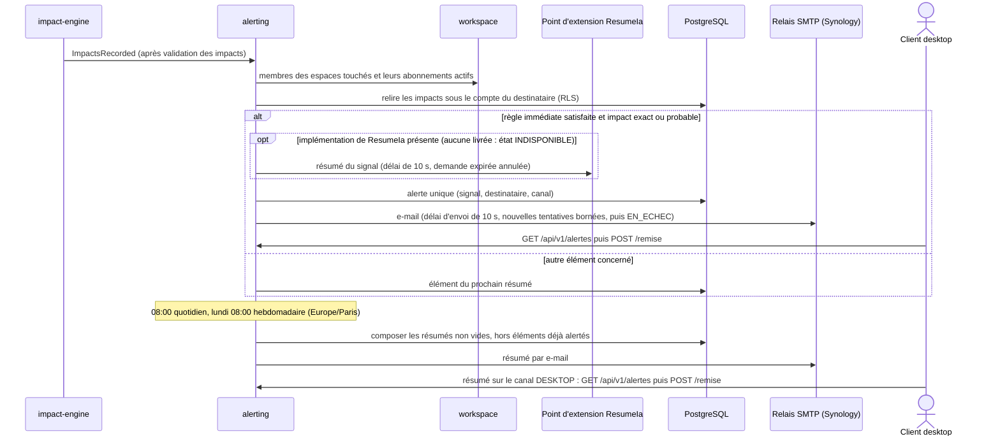
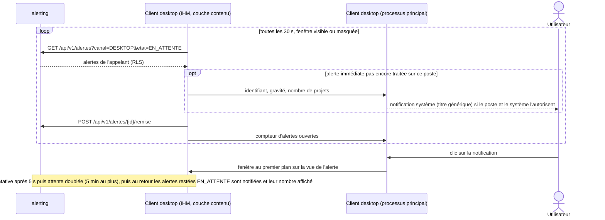
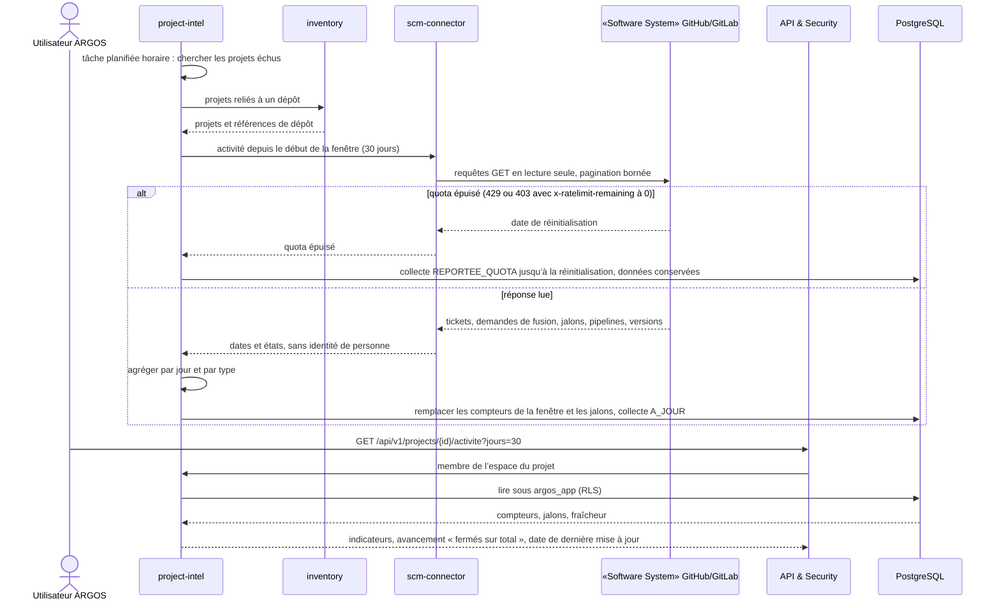
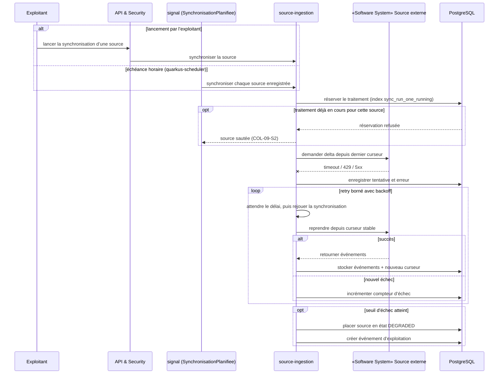
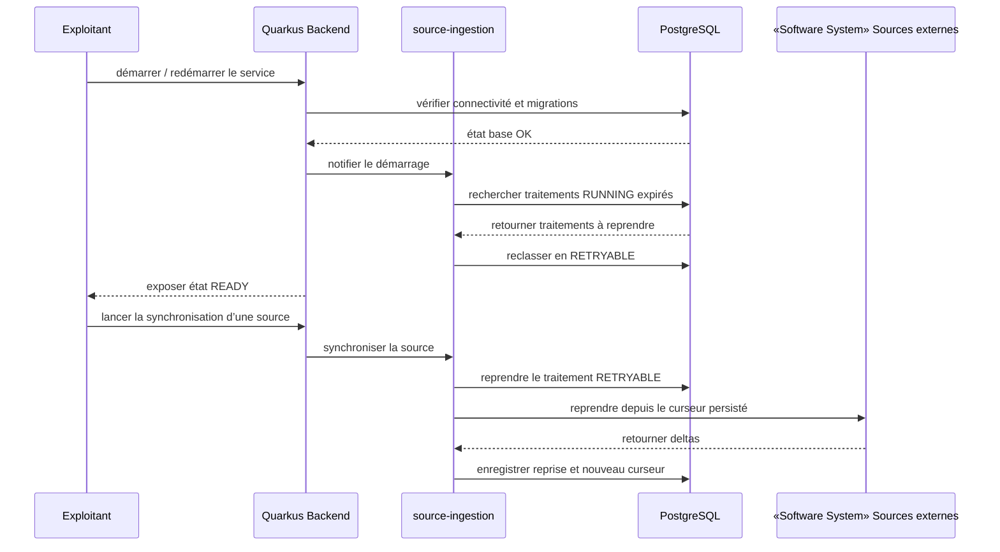
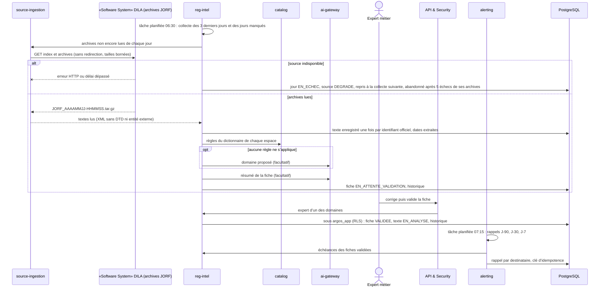
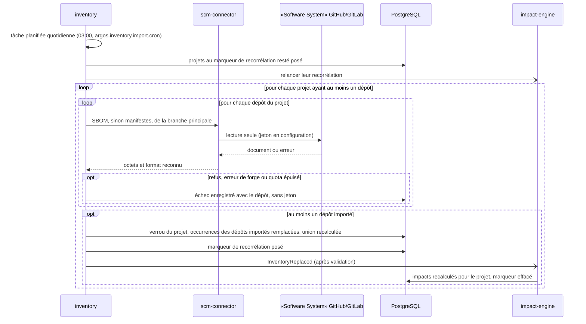
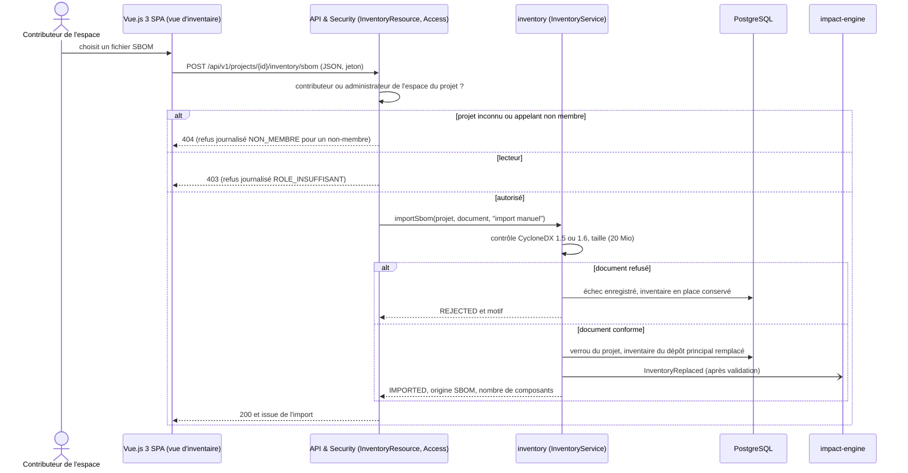
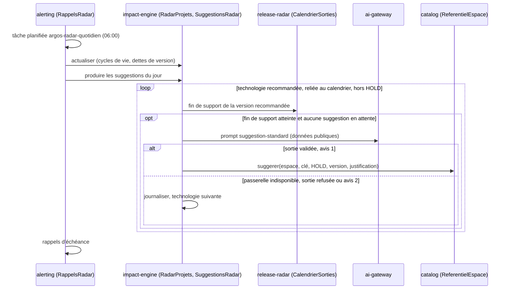

# 6. Vue d’exécution

Cette section décrit des scénarios dynamiques. Les participants des diagrammes portent les noms des composants de la section 5 ; une tâche planifiée figure comme un appel du module qui la porte (`quarkus-scheduler`, ADR-0031).

Les vues métier des fiches de [`docs/specifications/`](../../specifications/README.md) emploient aussi les noms de la section 5.

## 6.1 Scénario nominal — signal technologique vers impact projet

**Type : UML sequence diagram. Portée : traitement d’un `IntelligenceItem`.**

### Invariants

- aucune synthèse ne remplace la source ;
- toute analyse LLM doit être associée à la version du prompt/modèle ;
- la politique de confidentialité doit être évaluée avant l’appel à `ai-gateway` ;
- l’opération doit être idempotente sur la source + l’identifiant externe.
- l’enrichissement par les sources secondaires et l’évaluation des alertes ne s’exécutent ni dans une transaction ouverte ni dans le fil d’une requête (file d’enrichissement, observateur asynchrone : ADR-0039, arc42 §8).

### 6.1.1 Alerte immédiate et résumé périodique

**Type : UML sequence diagram. Portée : comportement implémenté (capacité [`alertes-digests`](../../specifications/alertes-digests.md)).**

L’indisponibilité de l’IA ou du serveur d’e-mails ne bloque ni les impacts ni l’enregistrement des alertes ; une alerte en échec d’envoi reste consultable dans Argos. L’évaluation est synchrone dans le fil de la corrélation : chaque signal qui produit une alerte attend au plus le délai du résumé IA (10 s) puis, par alerte e-mail, le délai d’envoi SMTP (`quarkus.mailer.timeout`, 10 s). Aucun verrou ni aucune transaction n’est tenu pendant l’envoi ; chaque tentative est comptée, quelle que soit la cause de l’échec. Le résumé passe par l’interface `ResumeIa`, implémentée par `ResumeIaPasserelle` sur le contrat d’`ai-gateway` (changement `encadrer-appels-ia`) : appel imputé au premier espace concerné dont le quota n’est pas épuisé, alerte envoyée sans résumé si le plafond ou les quotas sont atteints, si Ollama est injoignable ou si la sortie est rejetée.

### 6.1.2 Alerte sur le poste, clic et reprise après coupure

**Type : UML sequence diagram. Portée : comportement implémenté (capacité [`notifications-poste`](../../specifications/notifications-poste.md)).**

Une alerte non confirmée reste `EN_ATTENTE` côté serveur : elle revient à la lecture suivante, sans perte ; les identifiants déjà traités, gardés dans la mémoire locale de l'IHM, évitent une seconde notification, y compris après un rechargement de la fenêtre. La fenêtre masquée garde ses minuteries (`backgroundThrottling` désactivé).

## 6.2 Scénario nominal — activité GitHub/GitLab vers Project Intelligence

**Type : UML sequence diagram. Portée : collecte planifiée de l’activité d’un projet relié à un dépôt, puis consultation (changement `mesurer-activite-projets`).**

La collecte remplace les compteurs des jours de sa fenêtre : rejouée, elle produit le même résultat. Aucune donnée d’identité n’est conservée ; l’historique est supprimé au-delà de 13 mois par une tâche quotidienne.

## 6.3 Scénario d’erreur — API externe indisponible

**Type : UML sequence diagram. Portée : synchronisation d’une source lancée par l’exploitant (`POST /api/v1/ops/sources/{id}/synchronizations`) ou par la tâche planifiée `signal-synchronisation-sources` du module `signal` (toutes les heures par défaut, `argos.ingestion.planification.cadence` ; COL-09, changement `automatiser-chaine-veille`, 2026-11-19 ; ADR-0031).**

### Règles proposées

- ne jamais avancer le curseur avant persistance durable ;
- distinguer erreurs transitoires et permanentes ;
- respecter `Retry-After` et les rate limits ;
- ne pas boucler indéfiniment ;
- rendre visible la source dégradée dans l’observabilité ;
- à chaque échéance planifiée, rafraîchir les index d’enrichissement (CERT-FR, KEV) sans bloquer la synchronisation, retenter une source `DEGRADED` et ne jamais lancer une seconde synchronisation d’une source déjà en cours (COL-09).

## 6.4 Scénario d’exploitation — redémarrage/reprise

**Type : UML sequence diagram. Portée : reprise du conteneur `Quarkus Backend`.**

## 6.5 Hypothèses et validation

### Hypothèses à valider

- présence d’un scheduler interne au backend ;
- persistance des curseurs et statuts de job dans PostgreSQL ;
- retry sans broker externe au MVP.

### Preuves nécessaires

- tests d’intégration avec GitHub, GitLab et les flux RSS/Atom ;
- tests d’idempotence ;
- test de reprise après arrêt forcé ;
- métriques de retry et backlog ;
- simulation 429/5xx/timeouts.

### Risques

- doubles traitements si clé d’idempotence mal définie ;
- perte d’événement si le curseur est avancé trop tôt ;
- tempête de retry ;
- webhooks reçus dans le désordre.

### Fichiers source concernés

- futurs services d’ingestion et jobs ;
- futurs adapters ;
- futures migrations ;
- futurs tests d’intégration et de résilience.

## 6.6 Scénario nominal — texte officiel vers fiche validée

**Type : UML sequence diagram. Portée : collecte quotidienne du Journal officiel, qualification, fiche, validation par l’expert et rappel (changement `suivre-veille-reglementaire`, ADR-0030 accepté).**

Une fiche en attente n’est restituée qu’aux experts de ses domaines, par la base elle-même ; l’API REST, le serveur MCP et les rappels ne voient que des fiches validées pour les autres utilisateurs. Sans IA, la fiche est préparée sans résumé et l’expert le rédige avant de valider.

## 6.7 Scénario nominal — import quotidien des inventaires et recorrélation

**Type : UML sequence diagram. Portée : import planifié des inventaires depuis les dépôts GitHub/GitLab de chaque projet, puis recorrélation (changement `automatiser-chaine-veille`, volet B ; décisions J3, J4 et J6 du porteur du projet, 2026-11-19).**

Aucun flux n'entre depuis une forge ou une CI : seule la tâche planifiée, ou un import manuel, déclenche un import. L'import manuel prend le même verrou consultatif par projet, si bien que deux imports d'un même projet s'exécutent l'un après l'autre. Un dépôt en échec garde son dernier import réussi ; une recorrélation en échec laisse le marqueur posé, et le passage suivant la relance. La tâche est désactivée dans le profil de test et dans la pile E2E.

## 6.8 Scénario nominal — import manuel d'une SBOM par l'API

**Type : UML sequence diagram. Portée : import manuel d'une SBOM CycloneDX JSON depuis la vue d'inventaire de l'IHM (INV-13, changement `alimenter-inventaire-et-completer-ihm`, DC-1 de sa conception ; décision du porteur du projet, 2026-11-26).**

L'API contrôle le rôle, le module `inventory` écrit : le traitement est celui de l'import planifié (§6.7), avec le même verrou par projet et la même recorrélation après validation (INV-08, INV-09). Un refus de rôle n'écrit rien. L'import de manifestes (`…/inventory/manifests`), la relance depuis les dépôts (`…/inventory/refresh`, 409 `PROJET_SANS_DEPOT` sans dépôt) et la collecte immédiate de l'activité (`…/activite/collecte`) suivent la même séquence de contrôle ; la création d'un projet et le rattachement ou le détachement d'un dépôt exigent le rôle d'administrateur de l'espace (INV-12). Un corps HTTP au-delà de 24 Mio (`quarkus.http.limits.max-body-size`) est refusé par le serveur HTTP (413) avant l'API.

## 6.9 Scénario nominal — suggestions de l'IA sur le référentiel des standards

**Type : UML sequence diagram. Portée : production des suggestions `HOLD` par la tâche quotidienne du radar (RAD-08, changement `alimenter-inventaire-et-completer-ihm`, DC-2 de sa conception ; ADR-0029).**

La suggestion est enregistrée `EN_ATTENTE` et n'a d'effet qu'acceptée par un administrateur de l'espace, depuis l'API ou la vue radar de l'IHM (RAD-02, RAD-09) ; le référentiel n'est jamais modifié par la tâche. Une erreur d'accès aux données d'un espace est journalisée et n'arrête que cet espace ; une erreur imprévue est retenue dans le bilan de la tâche et relancée en fin de passage (§8.5).

