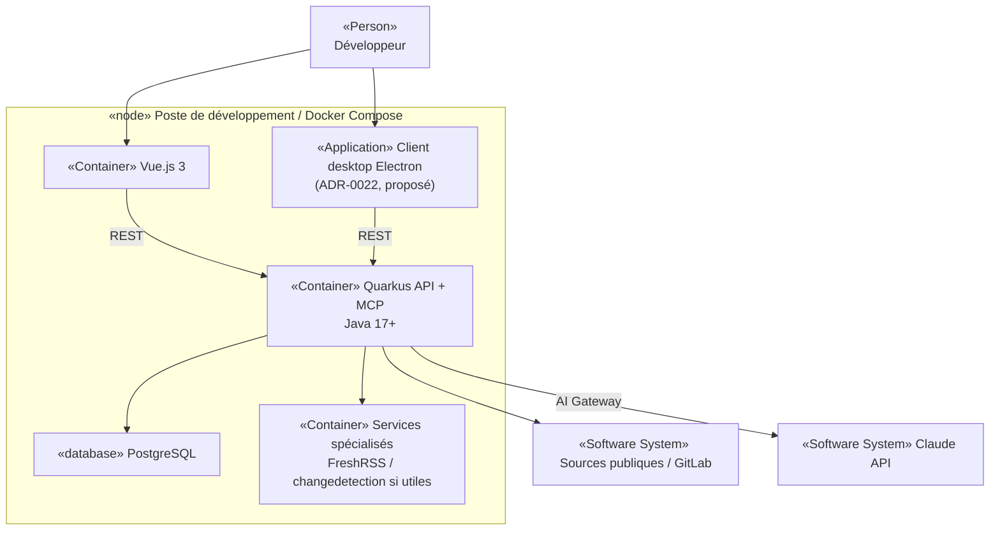
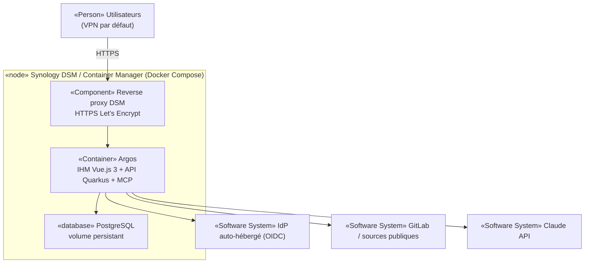

# 7. Vue de déploiement

La v2.4 distinguait POC local, VM interne et cible entreprise. Depuis ADR-0025 et ADR-0026, la cible est le **serveur Synology du porteur** ; un hébergement en ligne viendra plus tard.

## 7.1 Environnements

| Environnement | Objectif | Statut |
|---|---|---|
| Local Docker Compose | développement, POC technique, démonstration sans attendre la VM | retenu pour le POC |
| Serveur Synology du porteur (Container Manager) | POC partagé puis premières versions | retenu (ADR-0026) |
| Hébergement en ligne | version publique hébergée | plus tard, ADR à venir |
| VM Linux interne Ciril | — | abandonnée (ADR-0025) |

## 7.2 POC local

Objectif : démontrer la chaîne verticale sans dépendre du délai de mise à disposition de la VM.

## 7.3 Serveur Synology (ADR-0026)

### Principes

- même stack applicative qu’en local ;
- secrets hors dépôt ;
- volumes persistants sur le NAS ; export PostgreSQL quotidien copié hors site (Hyper Backup) ;
- aucun port ouvert par défaut : accès distant par VPN ; exposition publique seulement via le reverse proxy de DSM en HTTPS ;
- OIDC avec un fournisseur d’identité auto-hébergé ;
- image x86-64 unique (NAS DS1522+ et PC), même `compose.yaml` partout ; guide : [`/docs/deploiement/synology-et-pc.md`](/docs/deploiement/synology-et-pc.md).

## 7.4 Hébergement en ligne (plus tard)

La haute disponibilité, plusieurs nœuds applicatifs, PITR, coffre-fort de secrets et observabilité centralisée ne sont introduits qu’après validation du besoin.

## 7.5 Dépendances organisationnelles

La charge technique et la durée calendaire ne sont pas équivalentes. Le POC est estimé à **20–24 j.h** de travail effectif, mais VM, proxy/SSO, RSSI/DPO, équipes pilotes et urgences quotidiennes peuvent porter la durée à **6–10 semaines**.

Les demandes d’infrastructure doivent donc être lancées dès le début, en parallèle du POC local.

## 7.6 RPO/RTO proposés

- POC/MVP : RPO ≤ 24 h ; RTO ≤ 8 h ;
- production interne standard : RPO ≤ 1 h ; RTO ≤ 4 h.

Ces valeurs restent à valider.

## 7.7 Preuves nécessaires

- `compose.yaml` (PC et NAS) ;
- build `argos-desktop` (Electron) pointant vers l’API locale ;
- `Dockerfile` unique (IHM + API) ;
- configuration PostgreSQL ;
- procédure de déploiement sur le Synology (Container Manager) ;
- configuration TLS/réseau/SSO ;
- backup/restore testé.

## 7.8 Risques

- attendre la VM avant de développer ;
- différences non maîtrisées entre poste local et VM ;
- absence de test de restauration ;
- exposition accidentelle de services internes.
