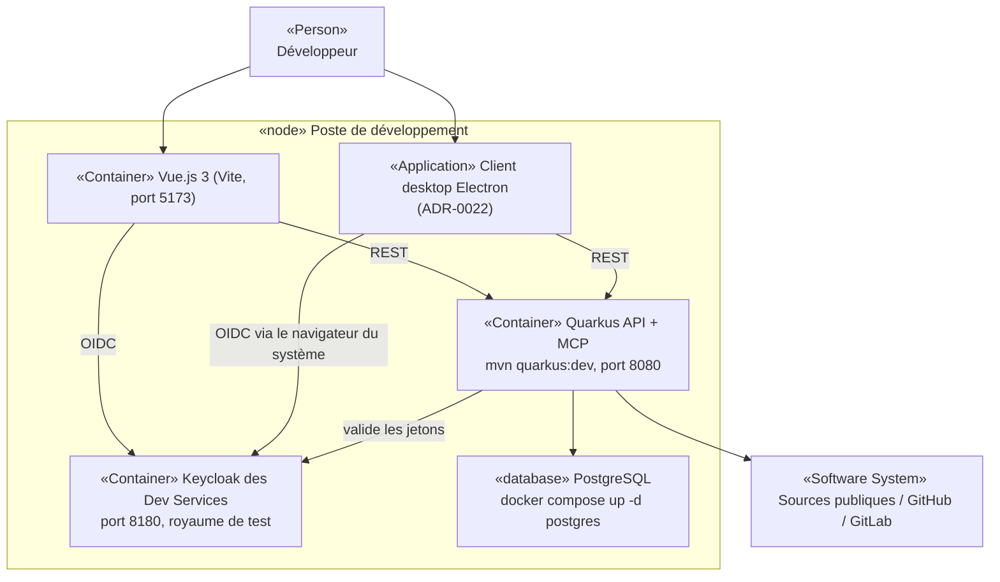
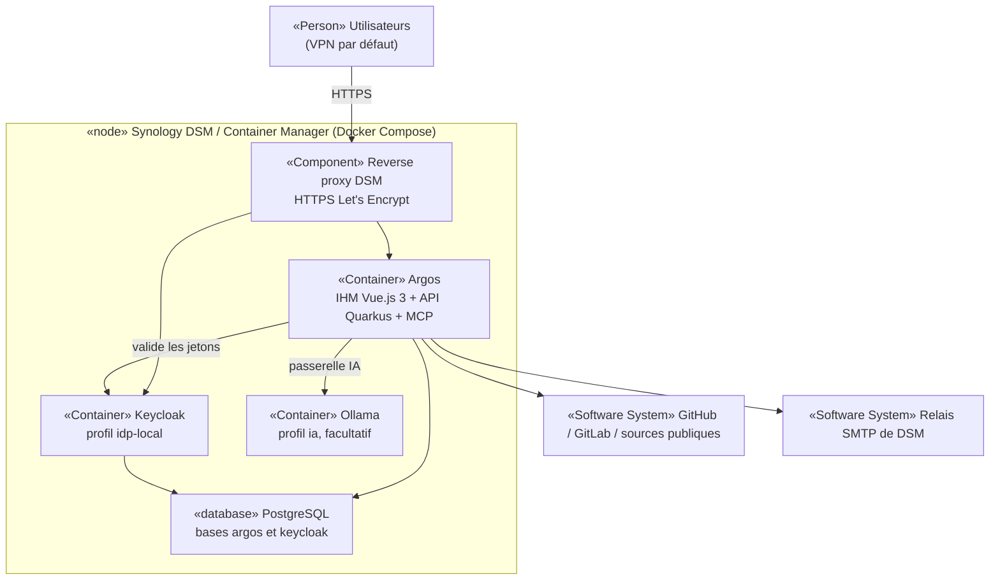
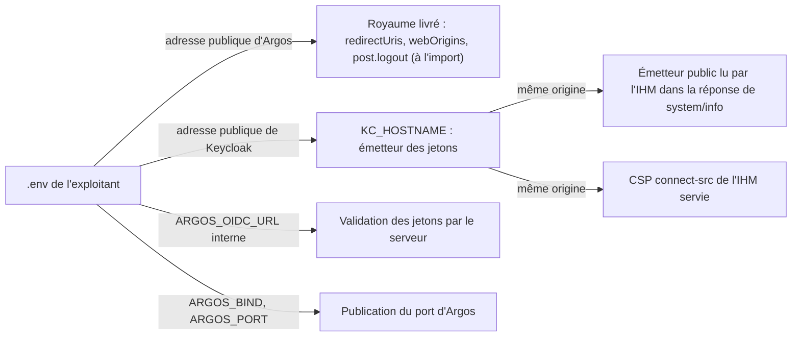

# 7. Vue de déploiement

La cible est le **serveur Synology du porteur** ([ADR-0025](../adr/0025-produit-ouvert-projet-personnel.md), [ADR-0026](../adr/0026-hebergement-synology.md)) ; le même `compose.yaml` sert sur un PC. Un hébergement en ligne viendra plus tard.

## 7.1 Environnements

| Environnement | Objectif | Statut |
|---|---|---|
| Poste de développement | développement : `docker compose up -d postgres`, `mvn quarkus:dev` (Keycloak des Dev Services), Vite ou Electron | retenu |
| PC sous Docker Compose | instance complète sur un poste | retenu (même `compose.yaml`) |
| Serveur Synology du porteur (Container Manager) | instance partagée | retenu (ADR-0026) |
| Hébergement en ligne | version publique hébergée | plus tard, ADR à venir |

## 7.2 Poste de développement

Le modèle d'IA n'est pas démarré en développement : la passerelle IA est désactivée par défaut et Argos fonctionne en mode déterministe.

## 7.3 Serveur Synology (ADR-0026)

### Principes

- même stack applicative qu’en local ;
- secrets hors dépôt ;
- volumes persistants sur le NAS ; export quotidien des bases `argos` et `keycloak`, vérifié, en 0600, dont l'échec se signale par le code de sortie de la tâche DSM, copié hors site (Hyper Backup) ; restauration des deux bases par un script rejouable, Keycloak démarré après elle (EXP-01 à EXP-04) ;
- une instance PostgreSQL, un compte par usage : administration (superutilisateur), propriétaire et rôle de connexion d'Argos, compte de Keycloak propriétaire de sa seule base ; aucun mot de passe par défaut (ADR-0035, Proposé ; EXP-05, EXP-06) ;
- configuration transmise en entier au conteneur `argos` et décrite par `.env.example`, contrôlée par l'intégration continue ; profil `idp-local` refusé sans ses variables obligatoires (EXP-07, EXP-08) ;
- contrôle de santé et journaux bornés sur chaque conteneur ; plafonds mémoire cumulés de 4,75 Gio avec les profils `ia` et `idp-local` sur les 8 Go du DS1522+, pools de connexions sous `max_connections` ; conteneur `argos` en lecture seule, sans capacité système ni élévation de privilèges (EXP-09 à EXP-12), de même que `postgres`, `keycloak` (image optimisée construite localement) et `ollama` (EXP-16) ;
- aucun port ouvert par défaut : accès distant par VPN ; exposition publique seulement via le reverse proxy de DSM en HTTPS ;
- OIDC avec Keycloak auto-hébergé, fourni par le profil `idp-local` sur une machine sans Keycloak (ADR-0027) ;
- image x86-64 unique (NAS DS1522+ et PC), même `compose.yaml` partout ; guide : [`/docs/deploiement/synology-et-pc.md`](/docs/deploiement/synology-et-pc.md).

### Adresses de l'instance

Trois adresses distinctes coexistent ; l'exploitant les règle dans `.env` (D-20, `rendre-portail-deployable`, ACC-11) :

Le royaume Keycloak livré n'est importé qu'une fois ; il est durci avant toute ouverture hors de `127.0.0.1` (force brute, politique de mot de passe, TLS exigé hors réseau privé, adresses de retour exactes). Le client desktop reçoit à l'emballage l'adresse publique d'Argos et l'émetteur public. Guide : [`/docs/deploiement/synology-et-pc.md`](/docs/deploiement/synology-et-pc.md#adresses-de-linstance).

Le détail de cette cible au niveau des conteneurs réellement décrits (Ollama facultatif, Keycloak, relais SMTP, sauvegarde, clients desktop et MCP) est D-11 : [`../diagrams/d-11-deploiement-cible.md`](../diagrams/d-11-deploiement-cible.md).

## 7.4 Hébergement en ligne (plus tard)

La haute disponibilité, plusieurs nœuds applicatifs, PITR, coffre-fort de secrets et observabilité centralisée ne sont introduits qu’après validation du besoin.

## 7.5 RPO/RTO proposés

- instance sur le Synology : RPO ≤ 24 h (export quotidien) ; RTO ≤ 8 h ;
- hébergement en ligne : à fixer avec son ADR.

Ces valeurs restent à valider.

## 7.6 Preuves

- `compose.yaml` (PC et NAS), `Dockerfile` unique (IHM + API), `deploiement/` (image Keycloak, royaume livré, comptes PostgreSQL) ;
- guide de déploiement rejoué sur un PC le 2026-11-27 ; NAS, machine vierge, second poste et client desktop emballé à rejouer (recette R-8 de [`recette-poste.md`](/docs/deploiement/recette-poste.md)) ;
- backup/restore testé : [`scripts/essai-sauvegarde-restauration.sh`](/scripts/essai-sauvegarde-restauration.sh) et exercice de bout en bout sur une instance vierge (recette R-6 de [`recette-poste.md`](/docs/deploiement/recette-poste.md), tâche 5.1 de `fiabiliser-sauvegarde-et-roles-base`) ; à rejouer selon une périodicité à fixer (Q-4 de ce changement).

## 7.7 Risques

- différences non maîtrisées entre le PC et le NAS (Container Manager, profils Compose) ;
- restauration non rejouée depuis longtemps (périodicité à fixer, R-10) ;
- migration manuelle d'un volume antérieur aux comptes distincts (sauvegarde, volume neuf, restauration ; retour arrière par copie de l'ancien volume) ;
- exposition accidentelle de services internes.
