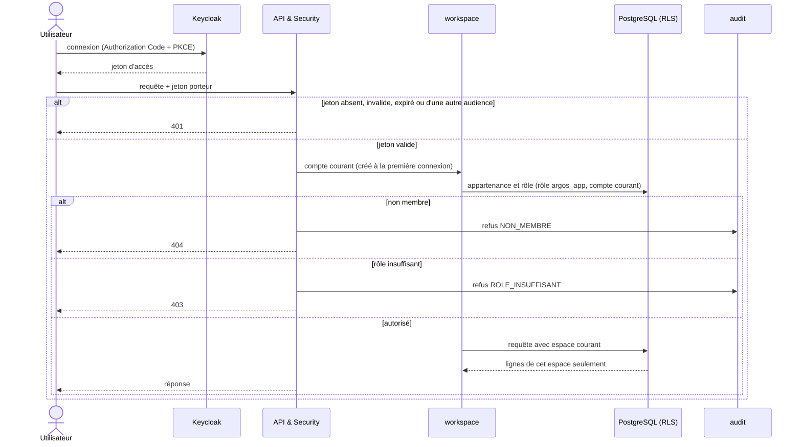

# 8. Concepts transverses

## 8.1 Identité et accès

Capacité [`comptes-acces`](../../specifications/comptes-acces.md) (exigences ACC-01 à ACC-06, changement `gerer-comptes-et-acces`).

**Authentification** (ADR-0008, ADR-0027, Proposés) : OIDC auprès d’un Keycloak auto-hébergé. L’IHM et le client desktop obtiennent un jeton par Authorization Code + PKCE ; `API & Security` (`quarkus-oidc`, mode `service`) vérifie à chaque requête la signature, l’émetteur, l’audience `argos-server` et l’expiration. Toutes les routes exigent un jeton, sauf `/api/v1/system/info` et `/q/health` (`application.properties`).

**Comptes** : un compte Argos est créé à la première connexion réussie, sans aucun espace. L’inscription se fait sur invitation : sans invitation en attente pour son e-mail vérifié, une personne authentifiée reçoit un refus explicite (403) et aucun compte. À la création, l’événement `CompteCree` enregistre le profil de veille `developpeur` dans les préférences du compte (`io.argos.api.preference.ActivationProfilParDefaut`). Les préférences sont rattachées au compte (`workspace_preference_utilisateur.compte_id`), jamais au nom du principal.

**Rôles d’espace** (ADR-0016) : `LECTEUR`, `CONTRIBUTEUR`, `ADMINISTRATEUR`. Un espace garde toujours au moins un administrateur ; un changement de rôle ou un retrait verrouille la ligne de l’espace (`SELECT … FOR UPDATE`), si bien que deux retraits concurrents ne peuvent pas le laisser sans administrateur. L’administrateur plateforme est un attribut du compte, sans aucun accès implicite aux espaces. L’autorisation reste indépendante des préférences de veille (ABO-05, PRF-05).

**Cloisonnement en deux temps** (ADR-0016) :

1. le module `workspace` relit l’appartenance et le rôle à chaque requête ; une révocation s’applique donc dès la requête suivante ;
2. chaque transaction applicative bascule sur le rôle PostgreSQL `argos_app`, non super-utilisateur, et transmet `argos.compte_courant`, `argos.sujet_courant`, `argos.email_courant` et `argos.espace_courant` (migration `V2__comptes_et_acces.sql`). Les politiques RLS exposent alors :
   - pour `espace` et `appartenance`, les appartenances du compte courant et les espaces dont il est membre ou créateur, même sans espace courant (liste « mes espaces »), et les autres lignes d’un espace courant dont il est membre ;
   - pour `invitation`, les invitations d’un espace courant qu’il administre et celles adressées à son e-mail vérifié ;
   - pour `compte`, son compte et les comptes qui partagent un espace avec lui ;
   - pour les données de veille (`project`, `inventory`, `component`, `project_impact`, abonnements `TEAM`), les lignes des espaces dont il est membre, restreintes à l’espace courant s’il est transmis (`argos_espace_lisible`) ; pour ses préférences et ses abonnements `PERSONAL`, ses seules lignes.

   Sans aucun contexte, aucune ligne n’est visible.

Convention pour toute table portant un identifiant d’espace : clé étrangère vers `espace(id)`, `ENABLE ROW LEVEL SECURITY` (non forcée), droits minimaux accordés à `argos_app` (colonnes modifiables comprises), politiques fondées sur `argos_espace_autorise` (données de gestion de l’espace) ou `argos_espace_lisible` (données de veille), et accès applicatif sous `argos_app` : `ContexteBase` (`io.argos.workspace`) ou, pour les modules qui ne peuvent pas en dépendre (`impact`, `workspace.subscription`, `workspace.preference`), le même protocole de deux instructions. Les traitements techniques (collecte, import d’inventaire, corrélation, contrôle d’intégrité, journal des refus) s’exécutent sous l’utilisateur de connexion, propriétaire des tables, pour qui la RLS n’est pas forcée. Les fonctions de contexte ne sont exécutables que par `argos_app` et le propriétaire. La migration crée le rôle `argos_app` : l’utilisateur de migration doit être superutilisateur ou disposer de `CREATEROLE`. Les tests qui prouvent la RLS s’exécutent sous `argos_app` (`CloisonnementTest`, `DefenseEnProfondeurTest`, `CorrelationTest`, `PreferencesResourceTest`).

**Appelant de la veille** : `CallerResolver` (`io.argos.api.security`) a une seule implémentation, `OidcCallerResolver`, qui établit le compte depuis le jeton OIDC et lit ses appartenances par `EspacesService` ; l’administrateur plateforme y porte le rôle d’exploitation.

**Réponses de refus** : non authentifié 401 ; non-membre ou ressource existante d’un autre espace 404, qui ne révèle pas l’existence de la ressource ; rôle insuffisant 403. Chaque refus d’accès de toute l’API (espaces, impacts, inventaires, abonnements, exploitation) est journalisé dans la table unique `refus_acces` du module `audit` (compte, méthode et chemin, motif `NON_MEMBRE` ou `ROLE_INSUFFISANT`, horodatage), sans donnée de la ressource. Une ressource inexistante, ou une invitation qui n’est pas adressée au compte, répond 404 sans entrée de journal.

### D-14 — Contrôle d’une requête authentifiée

## 8.2 Personnalisation équipe + utilisateur

ARGOS distingue deux niveaux d’abonnement :

- `TEAM` : socle de veille défini pour une équipe, lié à ses projets, technologies, responsabilités et obligations ;
- `PERSONAL` : veille facultative ajoutée par un utilisateur sur des technologies, thèmes, éditeurs ou sources de son choix.

Exemple : un développeur de l’équipe RH reçoit le socle RH mais peut suivre Rust, Kubernetes ou une technologie IA sans lien direct avec ses projets courants afin d’apprendre ou de préparer un futur besoin.

**Règle de sécurité :** suivre un sujet n’accorde aucun droit supplémentaire. Les projets et données internes restent filtrés par RBAC/RLS.

Une `Subscription` doit donc porter au minimum :

- `scope` : `TEAM` ou `PERSONAL` ;
- propriétaire équipe/utilisateur ;
- filtres ;
- canal/fréquence ;
- caractère obligatoire ou facultatif ;
- date de création et état.

Le module `alerting` exécute le canal et la fréquence d’un abonnement (capacité [`alertes-digests`](../../specifications/alertes-digests.md)) : canaux `EMAIL` et `DESKTOP`, fréquences `IMMEDIATE`, `DAILY` (08:00) et `WEEKLY` (lundi 08:00, Europe/Paris), gravité minimale portée par un critère `SEVERITY`. Une alerte immédiate n’est émise que pour un impact exact ou probable, une seule fois par signal, utilisateur et canal ; le reste entre dans les résumés.

## 8.3 Sécurité

Principes : deny-by-default, validation des entrées externes, secrets hors dépôt, chiffrement en transit, contrôle SSRF, rate limiting, séparation par workspace et contenu Internet traité comme donnée non fiable.

Classification minimale : `PUBLIC`, `INTERNAL`, `CONFIDENTIAL`, `RESTRICTED`. Les deux dernières classes ne sortent pas vers un LLM externe par défaut.

## 8.4 Interfaces et versionnement

- API REST/OpenAPI Quarkus ;
- Vue.js 3 consomme les contrats HTTP ;
- adapters externes indépendants du domaine ;
- contract tests sur GitHub/GitLab/FreshRSS/changedetection/MCP ;
- stratégie de dépréciation documentée.

## 8.5 Résilience

- timeouts explicites ;
- retry borné avec backoff/jitter ;
- idempotence ;
- curseurs de synchronisation persistés ;
- table d’échec / DLQ logique au MVP ;
- replay contrôlé ;
- health/readiness distincts.

## 8.6 Observabilité

OpenTelemetry/Micrometer côté Quarkus, logs structurés, métriques et traces lorsque pertinent.

Métriques clés : fraîcheur des sources, impacts détectés, couverture SBOM, alertes, latence API/MCP, tokens/coût IA, erreurs de structured output, refus pour politique de confidentialité.

## 8.7 Persistance

PostgreSQL est **Accepté** comme stockage principal : relationnel, JSONB, FTS et RLS. `pgvector` n’est activé que si un besoin est démontré.

## 8.8 IA et coûts

Tous les appels runtime passent par l’AI Gateway : quotas, prompts versionnés, schémas de sortie, audit et plafond.

Le budget d’abonnement utilisé par le développeur pour Claude/Claude Code est distinct du budget Claude API/Console consommé par ARGOS.

## 8.9 Messaging

Aucun broker n’est imposé au MVP. Une file/broker ne sera introduite qu’après mesure d’un besoin réel de backlog, multi-consommateurs ou scalabilité indépendante.

## 8.10 Performance

Cibles initiales : API/MCP p95 < 500 ms hors appels externes/IA, pagination des collections, ingestion découplée de l’affichage et aucun appel LLM bloquant pour une page standard.

## 8.11 Tests

- unitaires domaine ;
- tests d’architecture Quarkus/ArchUnit ;
- intégration PostgreSQL ;
- contract tests adapters et MCP ;
- E2E critiques ;
- sécurité ;
- résilience ;
- tests IA avec jeu de référence.

## 8.12 Déploiement

POC local Docker Compose, puis VM Linux interne pour le POC partagé/MVP. Voir ADR-0017 et section 7.

## 8.13 Questions ouvertes

- coffre-fort imposé ? (IdP : Keycloak auto-hébergé, ADR-0027)
- stack d’observabilité imposée ?
- durées de conservation ?
- mécanisme Teams/e-mail ?
- Flyway ou Liquibase ?

## 8.14 Profils de veille et taxonomie extensible des signaux

**Statut : proposé (ADR-0024).** Le dossier v2.4 §8.2 fixe une taxonomie fermée des signaux (`SECURITY`, `RELEASE`, `UPCOMING`…). Avec les profils de veille, elle devient extensible :

- le **noyau commun** d’un signal ne change pas : identifiant, source, dates, provenance, gravité, empreinte (ADR-0003) ;
- chaque profil déclare dans son manifeste ses **rubriques** (par exemple `securite`, `versions` et `fins-de-support` pour `developpeur` ; `reglementation` et `normes-declaratives` pour `expert-metier`) et, plus tard, ses attributs propres ;
- `signal` porte les rubriques sans les interpréter ; seul le profil leur donne un sens ;
- ajouter un profil ajoute des rubriques sans modifier le noyau ni les rubriques des autres profils (PRF-04).

Un manifeste ne déclare que des briques existantes : connecteurs, stratégies de rapprochement déterministes (ADR-0013) et garde-fous parmi `VALIDATION_HUMAINE`, `IA_SANS_DECISION` et `AUCUN_AVIS_JURIDIQUE`. Un manifeste invalide empêche le serveur de démarrer. Les rubriques existent aujourd’hui dans les manifestes ; leur rattachement aux signaux attend le modèle de signal (changement `formaliser-chaine-securite-poc`).
