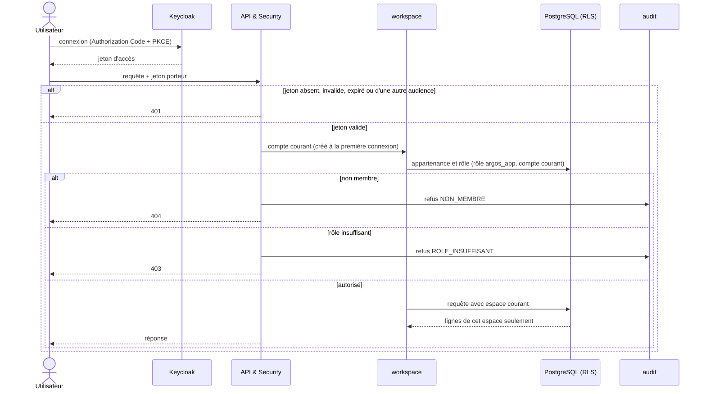
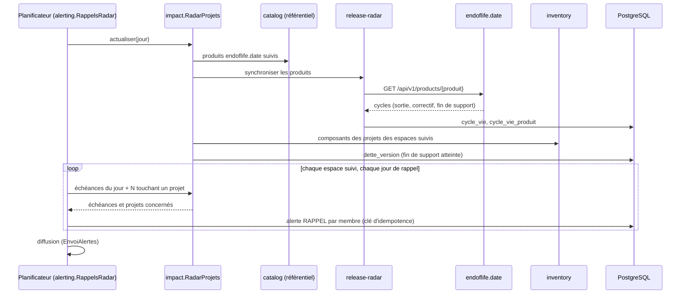

# 8. Concepts transverses

## 8.1 Identité et accès

Capacité [`comptes-acces`](../../specifications/comptes-acces.md) (exigences ACC-01 à ACC-06, changement `gerer-comptes-et-acces` ; exigences ACC-07 à ACC-10, changement `connecter-ihm-oidc`, tous deux archivés).

**Authentification** (ADR-0008, Proposé ; ADR-0027, Accepté) : OIDC auprès d’un Keycloak auto-hébergé. L’IHM et le client desktop obtiennent un jeton par Authorization Code + PKCE ; `API & Security` (`quarkus-oidc`, mode `service`) vérifie à chaque requête la signature, l’émetteur, l’audience `argos-server` et l’expiration. Toutes les routes exigent un jeton, sauf `/api/v1/system/info` et `/q/health` (`application.properties`).

**Session de l’IHM** (exigences ACC-07 à ACC-10, livrées ; ADR-0033, Accepté) : jetons en mémoire seulement, renouvelés avant expiration ; state vérifié et adresse nettoyée au retour ; un 401 de l’API ramène à l’écran de connexion (« session expirée »), un 403 `INSCRIPTION_SUR_INVITATION` ouvre l’écran « aucun compte ARGOS ». Le client desktop se connecte dans le navigateur du système, avec une redirection vers l’interface de bouclage `127.0.0.1` (RFC 8252).

**Comptes** : un compte Argos est créé à la première connexion réussie, sans aucun espace. L’inscription se fait sur invitation : sans invitation en attente pour son e-mail vérifié, une personne authentifiée reçoit un refus explicite (403) et aucun compte. À la création, l’événement `CompteCree` enregistre le profil de veille `developpeur` dans les préférences du compte (`io.argos.api.preference.ActivationProfilParDefaut`). Les préférences sont rattachées au compte (`workspace_preference_utilisateur.compte_id`), jamais au nom du principal.

**Rôles d’espace** (ADR-0016) : `LECTEUR`, `CONTRIBUTEUR`, `ADMINISTRATEUR`. Un espace garde toujours au moins un administrateur ; un changement de rôle ou un retrait verrouille la ligne de l’espace (`SELECT … FOR UPDATE`), si bien que deux retraits concurrents ne peuvent pas le laisser sans administrateur. L’administrateur plateforme est un attribut du compte, sans aucun accès implicite aux espaces. L’autorisation reste indépendante des préférences de veille (ABO-05, PRF-05).

**Cloisonnement en deux temps** (ADR-0016) :

1. le module `workspace` relit l’appartenance et le rôle à chaque requête ; une révocation s’applique donc dès la requête suivante ;
2. chaque transaction applicative bascule sur le rôle PostgreSQL `argos_app`, non super-utilisateur, et transmet `argos.compte_courant`, `argos.sujet_courant`, `argos.email_courant` et `argos.espace_courant` (migration `V2__comptes_et_acces.sql`). Les politiques RLS exposent alors :
   - pour `espace` et `appartenance`, les appartenances du compte courant et les espaces dont il est membre ou créateur, même sans espace courant (liste « mes espaces »), et les autres lignes d’un espace courant dont il est membre ;
   - pour `invitation`, les invitations d’un espace courant qu’il administre et celles adressées à son e-mail vérifié ;
   - pour `compte`, son compte et les comptes qui partagent un espace avec lui ;
   - pour les données de veille (`project`, `inventory`, `component`, `project_impact`, abonnements `TEAM`), les lignes des espaces dont il est membre, restreintes à l’espace courant s’il est transmis (`argos_espace_lisible`) ; pour ses préférences et ses abonnements `PERSONAL`, ses seules lignes.

   Sans aucun contexte, aucune ligne n’est visible.

Convention pour toute table portant un identifiant d’espace : clé étrangère vers `espace(id)`, `ENABLE ROW LEVEL SECURITY` (non forcée), droits minimaux accordés à `argos_app` (colonnes modifiables comprises), politiques fondées sur `argos_espace_autorise` (données de gestion de l’espace) ou `argos_espace_lisible` (données de veille), et accès applicatif sous `argos_app` : `ContexteBase` (`io.argos.workspace`) ou, pour les modules qui ne peuvent pas en dépendre (`impact`, `workspace.subscription`, `workspace.preference`), le même protocole de deux instructions. Les traitements techniques (collecte, import d’inventaire, corrélation, contrôle d’intégrité, journal des refus) s’exécutent sous l’utilisateur de connexion, propriétaire des tables, pour qui la RLS n’est pas forcée. Les fonctions de contexte ne sont exécutables que par `argos_app` et le propriétaire. La migration crée le rôle `argos_app` : l’utilisateur de migration doit être superutilisateur ou disposer de `CREATEROLE`. Les tests qui prouvent la RLS s’exécutent sous `argos_app` (`CloisonnementTest`, `DefenseEnProfondeurTest`, `CorrelationTest`, `PreferencesResourceTest`).

**Appelant de la veille** : `CallerResolver` (`io.argos.api.security`) a une seule implémentation, `OidcCallerResolver`, qui établit le compte depuis le jeton OIDC et lit ses appartenances par `EspacesService` ; l’administrateur plateforme y porte le rôle d’exploitation.

**Réponses de refus** : non authentifié 401 ; non-membre ou ressource existante d’un autre espace 404, qui ne révèle pas l’existence de la ressource ; rôle insuffisant 403. Chaque refus d’accès de toute l’API (espaces, impacts, inventaires, abonnements, exploitation) est journalisé dans la table unique `refus_acces` du module `audit` (compte, méthode et chemin, motif `NON_MEMBRE` ou `ROLE_INSUFFISANT`, horodatage), sans donnée de la ressource. Une ressource inexistante, ou une invitation qui n’est pas adressée au compte, répond 404 sans entrée de journal.

### D-14 — Contrôle d’une requête authentifiée

## 8.2 Personnalisation équipe + utilisateur

ARGOS distingue deux niveaux d’abonnement :

- `TEAM` : socle de veille défini pour une équipe, lié à ses projets, technologies, responsabilités et obligations ;
- `PERSONAL` : veille facultative ajoutée par un utilisateur sur des technologies, thèmes, éditeurs ou sources de son choix.

Exemple : un développeur de l’équipe RH reçoit le socle RH mais peut suivre Rust, Kubernetes ou une technologie IA sans lien direct avec ses projets courants afin d’apprendre ou de préparer un futur besoin.

**Règle de sécurité :** suivre un sujet n’accorde aucun droit supplémentaire. Les projets et données internes restent filtrés par RBAC/RLS.

Une `Subscription` doit donc porter au minimum :

- `scope` : `TEAM` ou `PERSONAL` ;
- propriétaire équipe/utilisateur ;
- filtres ;
- canal/fréquence ;
- caractère obligatoire ou facultatif ;
- date de création et état.

Le module `alerting` exécute le canal et la fréquence d’un abonnement (capacité [`alertes-digests`](../../specifications/alertes-digests.md)) : canaux `EMAIL` et `DESKTOP`, fréquences `IMMEDIATE`, `DAILY` (08:00) et `WEEKLY` (lundi 08:00, Europe/Paris), gravité minimale portée par un critère `SEVERITY`. Une alerte immédiate n’est émise que pour un impact exact ou probable, une seule fois par signal, utilisateur et canal ; le reste entre dans les résumés.

## 8.3 Sécurité

Principes : deny-by-default, validation des entrées externes, secrets hors dépôt, chiffrement en transit, contrôle SSRF, rate limiting, séparation par workspace et contenu Internet traité comme donnée non fiable.

Classification minimale : `PUBLIC`, `INTERNAL`, `CONFIDENTIAL`, `RESTRICTED`. Les deux dernières classes ne sortent pas vers un LLM externe par défaut.

Les zones de confiance, les flux qui les franchissent et le contrôle appliqué à chacun sont D-12 : [`../diagrams/d-12-frontieres-confiance.md`](../diagrams/d-12-frontieres-confiance.md).

### Veille RSS/Atom et pages surveillées (ADR-0028, Accepté)

[PROPOSITION — `collecter-veille-rss-web`] Le collecteur web intégré (`source-ingestion`, paquet `io.argos.ingestion.web`) applique ces principes à toute adresse proposée par un utilisateur :

- **contrôle SSRF (R-12)** : schéma `http` ou `https`, aucun identifiant dans l'adresse, 2 000 caractères au plus ; port dans `argos.veille-web.ports-autorises` (80 et 443 par défaut) ; toutes les adresses IP de l'hôte, après résolution DNS, hors des plages refusées (IPv4 0.0.0.0/8, 10.0.0.0/8, 100.64.0.0/10, 127.0.0.0/8, 169.254.0.0/16, 172.16.0.0/12, 192.0.0.0/24, 192.0.2.0/24, 192.88.99.0/24, 192.168.0.0/16, 198.18.0.0/15, 198.51.100.0/24, 203.0.113.0/24, 224.0.0.0/3 ; IPv6 non spécifiée, bouclage, fe80::/10, fec0::/10, fc00::/7, ff00::/8, 2001:db8::/32, 100::/64, Teredo 2001::/32, 64:ff9b::/32 hors du préfixe NAT64 bien connu (dont 64:ff9b:1::/48), et toute adresse dont l'IPv4 embarquée est refusée : compatible (::/96), mappée (::ffff:0:0/96), NAT64 (64:ff9b::/96), 6to4 (2002::/16)) ; contrôle refait à chaque collecte et à chaque redirection, suivie une à une, 5 au plus (`argos.veille-web.redirections-max`) ;
- **réponses sans indice réseau** : un hôte introuvable reçoit le même refus qu'un hôte interdit (`ADRESSE_INTERDITE`) ; le message renvoyé et le motif enregistré pour une source en erreur sont propres au motif et ne contiennent ni hôte, ni adresse IP, ni statut HTTP, ni destination de redirection ; le détail est écrit dans le journal applicatif ;
- **bornes** : 10 s par récupération, lecture du contenu comprise (`argos.veille-web.delai`), 2 Mio de contenu (`argos.veille-web.taille-max-octets`), 100 éléments enregistrés par flux et par collecte, DOCTYPE refusés dans les flux ; une source en échec passe `EN_ERREUR` avec le motif, la tentative suivante attend la fréquence × 2^(échecs − 1), au plus × 8 ;
- **planification** : un passage collecte au plus 200 sources échues (`argos.veille-web.sources-par-passage`), une à une, et n'en commence plus après 4 minutes (`argos.veille-web.duree-max-passage`) ; la collecte d'une source est sérialisée par un verrou consultatif PostgreSQL : une collecte à la demande pendant une autre collecte de la même source reçoit 409 `COLLECTE_EN_COURS`, le planificateur passe la source ;
- **cloisonnement du contenu** : une actualité appartient au périmètre de la source qui la reçoit (le propriétaire pour une source personnelle, l'espace pour une source d'espace) ; la déduplication par empreinte se fait dans ce périmètre, si bien qu'une source ne fixe ni ne révèle le contenu vu dans un autre périmètre ; un rapprochement ne vise qu'une actualité de son espace (clé composée en base) ; RLS sous `argos_app` : actualité visible dans son périmètre et citée par une source visible ;
- **contenu non fiable (R-11)** : texte brut extrait (balises et scripts retirés), restitué comme citation marquée `CITATION_EXTERNE`, `fiable = false` ; des entités doublement encodées sont décodées en caractères de balisage conservés en clair dans le texte, que l'IHM échappe à l'affichage ; aucun lien d'un contenu collecté n'est récupéré ; aucun contenu n'est interprété comme une instruction ;
- **abus** : 50 sources personnelles par utilisateur au plus ; sources d'espace réservées aux administrateurs ; ajout d'une source (réussi ou refusé) et collecte à la demande limités ensemble à 10 requêtes par minute et par compte (`argos.veille-web.debit.requetes-par-minute`, fenêtre glissante, même limiteur que le serveur MCP) ; au-delà, réponse 429 `LIMITE_DEBIT` avec `Retry-After: 60`, refus inscrit au journal des refus.

Risque résiduel : rebinding DNS entre le contrôle et la connexion ; un mandataire de sortie filtrant reste la parade complète.

## 8.4 Interfaces et versionnement

- API REST/OpenAPI Quarkus ;
- Vue.js 3 consomme les contrats HTTP ; les statuts HTTP lus par l'IHM sont des constantes nommées d'un module partagé unique, `argos-ui/src/api/statuts-http.ts` (204, 400, 401, 403, 404, 409, 429), utilisé par tous les écrans et modules d'`argos-ui` ; aucune comparaison de statut n'écrit le nombre en dur, ce que vérifie `argos-ui/tests/statuts-http.test.mjs` ([DÉCISION] du porteur du projet, 2026-11-19, H4) ;
- adapters externes indépendants du domaine ;
- contract tests sur GitHub/GitLab/FreshRSS/changedetection/MCP ;
- stratégie de dépréciation documentée.

## 8.5 Résilience

- timeouts explicites ;
- retry borné avec backoff/jitter ;
- idempotence ;
- curseurs de synchronisation persistés ;
- table d’échec / DLQ logique au MVP ;
- replay contrôlé ;
- health/readiness distincts.

## 8.6 Observabilité

OpenTelemetry/Micrometer côté Quarkus, logs structurés, métriques et traces lorsque pertinent.

Métriques clés : fraîcheur des sources, impacts détectés, couverture SBOM, alertes, latence API/MCP, tokens/coût IA, erreurs de structured output, refus pour politique de confidentialité.

## 8.7 Persistance

PostgreSQL est **Accepté** comme stockage principal : relationnel, JSONB, FTS et RLS. `pgvector` n’est activé que si un besoin est démontré.

Le schéma est versionné par des migrations SQL Flyway appliquées au démarrage (ADR-0032, Accepté) ; le modèle physique qu'elles produisent est D-13 : [`../diagrams/d-13-modele-physique.md`](../diagrams/d-13-modele-physique.md).

Liste à jour des migrations, dans `argos-server/src/main/resources/db/migration/` (état au 2026-11-19). ADR-0032 porte la décision et décrit V1 à V16, état de sa date d'acceptation ; il n'est pas modifié et cette liste tient l'inventaire à jour des migrations ([DÉCISION] du porteur du projet, 2026-11-19). La prochaine migration porte le numéro V18.

| Version | Fichier | Objet | Changement OpenSpec |
|---|---|---|---|
| V1 | `V1__socle.sql` | aucune table : vérifie que la chaîne Flyway fonctionne | socle |
| V2 | `V2__comptes_et_acces.sql` | comptes, espaces, appartenances, invitations, journal des refus d'accès (`refus_acces`) ; rôle `argos_app`, fonctions de contexte et politiques RLS (ADR-0016) | `gerer-comptes-et-acces` |
| V3 | `V3__collecte_avis_securite.sql` | sources, avis de sécurité (`signal`, alias, paquets, versions), enrichissements, synchronisations, tentatives, curseurs, zone d'échec, événements d'exploitation | `formaliser-chaine-securite-poc` (tâche 2.1) |
| V4 | `V4__projets_et_inventaires.sql` | projets suivis, inventaire de référence, composants, échecs d'import | `formaliser-chaine-securite-poc` (tâche 3.1) |
| V5 | `V5__impacts_projet.sql` | impacts projet (`project_impact`) et leur RLS | `formaliser-chaine-securite-poc` (tâche 4.1) |
| V6 | `V6__abonnements_veille.sql` | abonnements de veille `TEAM` et `PERSONAL`, retraits d'un abonnement facultatif | `formaliser-chaine-securite-poc` (tâche 5.1) |
| V7 | `V7__preferences_utilisateur.sql` | préférences d'affichage et de veille d'un compte | `personnaliser-profils-et-affichage` |
| V8 | `V8__alertes_et_resumes.sql` | alertes immédiates et résumés périodiques, éléments des résumés | `diffuser-alertes-et-digests` |
| V9 | `V9__journal_appels_mcp.sql` | journal des appels d'outils MCP (`mcp_appel`) | `exposer-serveur-mcp` |
| V10 | `V10__veille_rss_web.sql` | sources de veille web (flux et pages surveillées), actualités, rapprochements (ADR-0028) | `collecter-veille-rss-web` |
| V11 | `V11__recherche_veille.sql` | recherche plein texte bilingue sur `signal` et `actualite`, fonction `argos_rechercher_veille`, vues enregistrées (ADR-0015) | `rechercher-et-filtrer` |
| V12 | `V12__radar_et_standards.sql` | référentiel des standards, suggestions et historique, cycles de vie, radar, dette de version ; colonne `alerte.cle_radar` (clé d’idempotence des messages du radar) | `construire-radar-et-standards` |
| V13 | `V13__passerelle_ia.sql` | journal des appels IA, prompts versionnés, quotas journaliers | `encadrer-appels-ia` |
| V14 | `V14__activite_projets.sql` | compteurs d'activité des projets, jalons, état de la collecte, sans identité de personne | `mesurer-activite-projets` |
| V15 | `V15__profil_artiste.sql` | objets suivis par profil, rappels, sources vérifiées, opportunités (ADR-0024) | `ajouter-profil-artiste` |
| V16 | `V16__veille_reglementaire.sql` | domaines métier, experts, dictionnaire, sources et textes officiels, fiches réglementaires et leur historique | `suivre-veille-reglementaire` |
| V17 | `V17__composants_ignores_import.sql` | colonnes `ignored_count` et `ignored_components` de `inventory` : composants ignorés faute de PURL au dernier import (INV-01, décision D6 du 2026-11-18) | `formaliser-chaine-securite-poc` |

## 8.8 IA et coûts

Tous les appels runtime passent par l’AI Gateway : quotas, prompts versionnés, schémas de sortie, audit et plafond.

Passerelle `io.argos.aigateway` (changement `encadrer-appels-ia`, fiche [`passerelle-ia`](../../specifications/passerelle-ia.md)) : fournisseur local Ollama (`argos.ia.ollama.url`, modèle `qwen2.5:1.5b` par défaut, remplaçable par tâche), retenu par [ADR-0029](../adr/0029-passerelle-ia-ollama-local.md) (Accepté), qui remplace ADR-0004 ; coût nul. Chaque demande passe, dans l'ordre, par le refus des entrées CONFIDENTIAL ou RESTRICTED, le refus des secrets et le masquage des données personnelles, la réservation sur le plafond journalier de l'instance (1 000 appels) le quota journalier de l'espace imputé (100 appels) et celui du compte pour ses demandes explicites (20 appels), rendue si le modèle n'a pas pu être joint, l'appel avec le prompt versionné (données entre balises `<donnees>`, séparées des consignes), puis la validation de la sortie par le schéma de la tâche. Le journal `ia_appel` trace modèle, version du prompt, jetons, coût, empreinte des entrées et issue, sans copie des données. Tout contenu produit porte la mention « produit par l'IA » et ses sources. Sans Ollama joignable, chaque demande est refusée comme indisponible et Argos fonctionne en mode déterministe.

Le budget d’abonnement utilisé par le développeur pour Claude/Claude Code est distinct du budget Claude API/Console consommé par ARGOS.

## 8.9 Messaging

Aucun broker n’est imposé au MVP. Une file/broker ne sera introduite qu’après mesure d’un besoin réel de backlog, multi-consommateurs ou scalabilité indépendante.

## 8.10 Performance

Cibles initiales : API/MCP p95 < 500 ms hors appels externes/IA, pagination des collections, ingestion découplée de l’affichage et aucun appel LLM bloquant pour une page standard.

Recherche de veille (changement `rechercher-et-filtrer`, ADR-0015) : recherche plein texte PostgreSQL native, vecteurs `tsvector` bilingues (`french`, `english`, plus `simple` pour les identifiants) indexés en GIN sur `signal` et `actualite`, sans moteur externe. Les opérateurs plein texte n'étant pas « leakproof », la sélection passe par la fonction `argos_rechercher_veille` (migration V11), qui applique explicitement les règles de visibilité de la RLS, puis chaque élément restitué est relu sous le rôle `argos_app`. Résultats paginés (100 par page au plus). Mesure QS-13 du 2026-11-16 sur 120 000 éléments visibles : p95 = 250 ms pour une campagne de recherches filtrées ; un mot présent dans tous les éléments reste hors cible ([rapport](../quality/mesure-qs13-recherche.md)).

## 8.11 Tests

- unitaires domaine ;
- tests d’architecture Quarkus/ArchUnit ;
- intégration PostgreSQL ;
- contract tests adapters et MCP ;
- E2E critiques : parcours du portail web dans Chromium (Playwright, `e2e/`) contre le serveur de développement, le Keycloak de test des Dev Services et une base PostgreSQL jetable, sans requête hors du poste ([guide](../../../e2e/README.md)) ;
- sécurité ;
- résilience ;
- tests IA avec jeu de référence.

## 8.12 Déploiement

POC local Docker Compose, puis VM Linux interne pour le POC partagé/MVP. Voir ADR-0017 et section 7.

## 8.13 Questions ouvertes

- coffre-fort imposé ? (IdP : Keycloak auto-hébergé, ADR-0027)
- stack d’observabilité imposée ?
- durées de conservation ?
- mécanisme Teams/e-mail ?
- Flyway ou Liquibase ?

## 8.14 Profils de veille et taxonomie extensible des signaux

**Statut : accepté (ADR-0024).** Le dossier v2.4 §8.2 fixe une taxonomie fermée des signaux (`SECURITY`, `RELEASE`, `UPCOMING`…). Avec les profils de veille, elle devient extensible :

- le **noyau commun** d’un signal ne change pas : identifiant, source, dates, provenance, gravité, empreinte (ADR-0003) ;
- chaque profil déclare dans son manifeste ses **rubriques** (par exemple `securite`, `versions` et `fins-de-support` pour `developpeur` ; `reglementation` et `normes-declaratives` pour `expert-metier`) et, plus tard, ses attributs propres ;
- `signal` porte les rubriques sans les interpréter ; seul le profil leur donne un sens ;
- ajouter un profil ajoute des rubriques sans modifier le noyau ni les rubriques des autres profils (PRF-04).

Un manifeste ne déclare que des briques existantes : connecteurs, stratégies de rapprochement déterministes (ADR-0013) et garde-fous parmi `VALIDATION_HUMAINE`, `IA_SANS_DECISION` et `AUCUN_AVIS_JURIDIQUE`. Un manifeste invalide empêche le serveur de démarrer. Les rubriques existent aujourd’hui dans les manifestes ; leur rattachement aux signaux attend le modèle de signal (changement `formaliser-chaine-securite-poc`).

## 8.15 Référentiel des standards et radar des sorties

**Statut : implémenté, changement `construire-radar-et-standards` non archivé.** Fiche : [`radar-standards`](../../specifications/radar-standards.md).

- **Statuts du référentiel** (dossier v2.4 §8.3) : `ASSESS` à étudier, `TRIAL` projets pilotes, `ADOPT` standard recommandé (version recommandée obligatoire), `HOLD` ne plus introduire. Chaque entrée porte un responsable, une justification et une date de revue ; chaque création ou modification est historisée.
- **Gouvernance** : chaque espace tient son référentiel (ADR-0025, aucun référentiel modèle) ; seuls ses administrateurs le modifient (API puis RLS de la migration `V12`) ; une suggestion de l’IA reste en attente jusqu’à la décision d’un administrateur.
- **Calendrier** : API publique et gratuite endoflife.date, seule source ; un administrateur relie une technologie à un produit endoflife.date. Adresse fixée par la configuration, identifiant contrôlé, aucune redirection, délai et taille bornés ; un échec conserve les cycles connus et passe le produit `EN_ERREUR`.
- **Rappels** (dossier v2.4 §6.4) : J-30, J-7 et J0 par défaut, paramétrables par espace ; une échéance ne produit un rappel que si elle touche un projet de l’espace. Rappels et annonces de standard sont des messages `RAPPEL` et `ANNONCE` du module `alerting`, idempotents : la clé d'un rappel désigne l'échéance et le jour de rappel, celle d'une annonce l'entrée d'historique du changement ; une clé de plus de 600 caractères est abrégée avec l'empreinte SHA-256 de la clé complète, sans collision.
- **Dette de version** : impact créé lorsqu’une version d’un inventaire a atteint sa fin de support, avec la version recommandée de l’espace ; calcul déterministe, sans IA (ADR-0013).
- **Robustesse de la tâche quotidienne** : une erreur sur un produit (source ou base) passe ce produit `EN_ERREUR` sans interrompre les autres ; une erreur de dette sur un espace n’interrompt pas les autres espaces ; une actualisation en échec n’empêche pas les rappels, calculés sur le calendrier déjà connu. Les jours du radar REST et des rappels se comptent dans le même fuseau (`argos.alerting.fuseau`).

### D-18 — Tâche quotidienne du radar

**Type : UML séquence. Portée : tâche quotidienne telle qu’implémentée. Statut : implémenté.**

La tâche est portée par `alerting` parce que les règles de modules (§5.6) interdisent à `release-radar` d’appeler `inventory` ou `alerting` : `release-radar` ne connaît ni les inventaires ni les messages, `impact` confronte le calendrier aux inventaires, `alerting` émet les messages.

