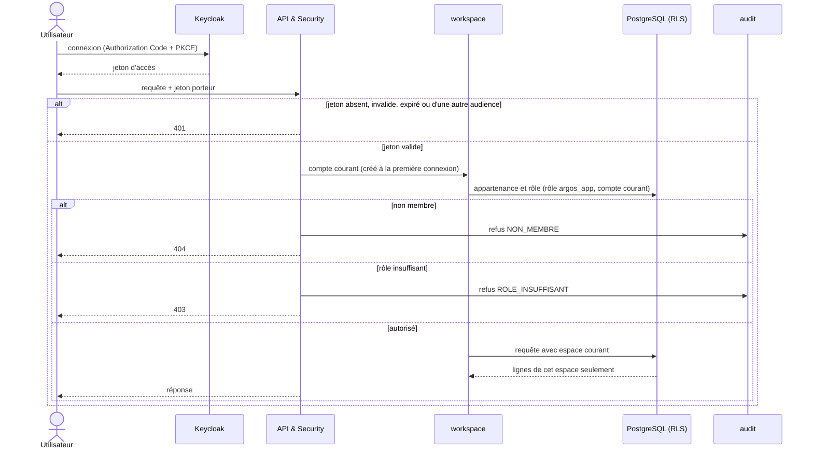
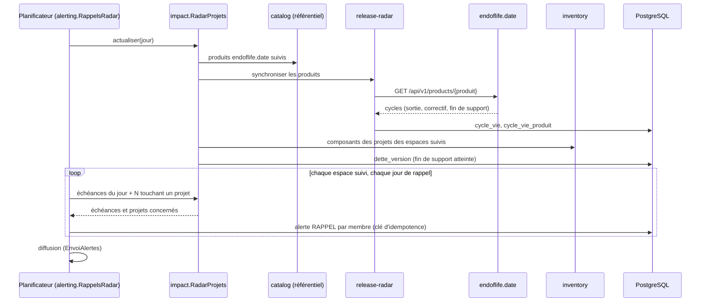

# 8. Concepts transverses

## 8.1 Identité et accès

Capacité [`comptes-acces`](../../specifications/comptes-acces.md) (exigences ACC-01 à ACC-06, changement `gerer-comptes-et-acces` ; exigences ACC-07 à ACC-10, changement `connecter-ihm-oidc`, tous deux archivés).

**Authentification** (ADR-0008, Proposé ; ADR-0027, Accepté) : OIDC auprès d’un Keycloak auto-hébergé. L’IHM et le client desktop obtiennent un jeton par Authorization Code + PKCE ; `API & Security` (`quarkus-oidc`, mode `service`) vérifie à chaque requête la signature, l’émetteur, l’audience `argos-server` et l’expiration. Toutes les routes exigent un jeton, sauf `/api/v1/system/info`, `/q/health` et les ressources statiques de l'IHM servie (`/`, `/index.html`, `/assets/*`, `/licences-polices.txt`, ACC-12) ; un test refuse toute autre route d'API ou technique parmi les chemins publics (`CheminsPublicsTest`).

**Session de l’IHM** (exigences ACC-07 à ACC-10, livrées ; ADR-0033, Accepté) : jetons en mémoire seulement, renouvelés avant expiration ; state vérifié et adresse nettoyée au retour ; un 401 de l’API ramène à l’écran de connexion (« session expirée »), un 403 `INSCRIPTION_SUR_INVITATION` ouvre l’écran « aucun compte ARGOS ». Le client desktop se connecte dans le navigateur du système, avec une redirection vers l’interface de bouclage `127.0.0.1` (RFC 8252). L'IHM lit l'émetteur public et le client OIDC dans la réponse publique de `GET /api/v1/system/info` avant toute connexion, sans valeur par défaut dans le bundle (ACC-11, ADR-0038, Proposé) : une image unique sert toutes les instances.

**Comptes** : un compte Argos est créé à la première connexion réussie, sans aucun espace. L’inscription se fait sur invitation : sans invitation en attente pour son e-mail vérifié, une personne authentifiée reçoit un refus explicite (403) et aucun compte. À la création, l’événement `CompteCree` enregistre le profil de veille `developpeur` dans les préférences du compte (`io.argos.api.preference.ActivationProfilParDefaut`). Les préférences sont rattachées au compte (`workspace_preference_utilisateur.compte_id`), jamais au nom du principal.

**Rôles d’espace** (ADR-0016) : `LECTEUR`, `CONTRIBUTEUR`, `ADMINISTRATEUR`. Un espace garde toujours au moins un administrateur ; un changement de rôle ou un retrait verrouille la ligne de l’espace (`SELECT … FOR UPDATE`), si bien que deux retraits concurrents ne peuvent pas le laisser sans administrateur. L’administrateur plateforme est un attribut du compte, sans aucun accès implicite aux espaces. L’autorisation reste indépendante des préférences de veille (ABO-05, PRF-05).

**Cloisonnement en deux temps** (ADR-0016) :

1. le module `workspace` relit l’appartenance et le rôle à chaque requête ; une révocation s’applique donc dès la requête suivante ;
2. chaque transaction applicative bascule sur le rôle PostgreSQL `argos_app`, non super-utilisateur, et transmet `argos.compte_courant`, `argos.sujet_courant`, `argos.email_courant` et `argos.espace_courant` (migration `V2__comptes_et_acces.sql`). Les politiques RLS exposent alors :
   - pour `espace` et `appartenance`, les appartenances du compte courant et les espaces dont il est membre ou créateur, même sans espace courant (liste « mes espaces »), et les autres lignes d’un espace courant dont il est membre ;
   - pour `invitation`, les invitations d’un espace courant qu’il administre et celles adressées à son e-mail vérifié ;
   - pour `compte`, son compte et les comptes qui partagent un espace avec lui ;
   - pour les données de veille (`project`, `inventory`, `component`, `project_impact`, abonnements `TEAM`), les lignes des espaces dont il est membre, restreintes à l’espace courant s’il est transmis (`argos_espace_lisible`) ; pour ses préférences et ses abonnements `PERSONAL`, ses seules lignes.

   Sans aucun contexte, aucune ligne n’est visible.

Convention pour toute table portant un identifiant d’espace : clé étrangère vers `espace(id)`, `ENABLE ROW LEVEL SECURITY` (non forcée), droits minimaux accordés à `argos_app` (colonnes modifiables comprises), politiques fondées sur `argos_espace_autorise` (données de gestion de l’espace) ou `argos_espace_lisible` (données de veille), et accès applicatif sous `argos_app` par le point d'application unique `ContexteBase` (`io.argos.commun`, ADR-0037) : `SET LOCAL ROLE argos_app` puis les quatre paramètres (compte, sujet, courriel, espace), un paramètre absent valant la chaîne vide. `NoyauCommunSourceTest` interdit ces instructions hors du noyau commun. Les traitements techniques (collecte, import d’inventaire, corrélation, contrôle d’intégrité, journal des refus) s’exécutent sous l’utilisateur de connexion, propriétaire des tables, pour qui la RLS n’est pas forcée. Les fonctions de contexte ne sont exécutables que par `argos_app` et le propriétaire. La migration crée le rôle `argos_app` : l’utilisateur de migration doit être superutilisateur ou disposer de `CREATEROLE`. Les tests qui prouvent la RLS s’exécutent sous `argos_app` (`CloisonnementTest`, `DefenseEnProfondeurTest`, `CorrelationTest`, `PreferencesResourceTest`).

**Appelant de la veille** : `CallerResolver` (`io.argos.commun.securite`) a une seule implémentation, `OidcCallerResolver` (`io.argos.api.security`), qui établit le compte depuis le jeton OIDC et lit ses appartenances par `EspacesService` ; l’administrateur plateforme y porte le rôle d’exploitation.

**Adresse e-mail du compte** [PROPOSITION — `durcir-autorisations-et-debits`, ALR-08] : `compte.email` ne porte que l'adresse que le fournisseur déclare vérifiée dans le dernier jeton, normalisée, ou aucune ; `ComptesService` l'écrit à la création et la met à jour à chaque connexion si elle change (écriture conditionnelle, droit `UPDATE (email)` sur le seul compte du contexte). Sans adresse vérifiée, aucun e-mail ne part (alerte, résumé ni rappel) et l'élément reste visible dans Argos et sur le poste.

**Demande d'évolution** [PROPOSITION — REG-09] : `ExpertiseFiches.associerDemande` contrôle la visibilité de la fiche, l'expertise de l'appelant et l'état « impact produit » dans une transaction terminée avant tout appel à la forge, puis refait ce contrôle dans la transaction d'écriture (DF-REG-2). Un non-membre reçoit la réponse d'une fiche inexistante.

**Matrice des droits** [PROPOSITION — AUD-TST-05] : `MatriceRolesTest` appelle chaque opération du document OpenAPI avec six rôles (anonyme, lecteur, administrateur d'espace, exploitant, administrateur d'un autre espace, expert) et compare les codes reçus à `argos-server/src/test/resources/securite/matrice-roles.tsv` ; une opération absente de la matrice, ou un contrôle de rôle retiré d'une opération, fait échouer le test (I-3).

**Réponses de refus** : non authentifié 401 ; non-membre ou ressource existante d’un autre espace 404, qui ne révèle pas l’existence de la ressource ; rôle insuffisant 403. Chaque refus d’accès de toute l’API (espaces, impacts, inventaires, abonnements, exploitation) est journalisé dans la table unique `refus_acces` du module `audit` (compte, méthode et chemin, motif `NON_MEMBRE` ou `ROLE_INSUFFISANT`, horodatage), sans donnée de la ressource. Une ressource inexistante, ou une invitation qui n’est pas adressée au compte, répond 404 sans entrée de journal.

### D-14 — Contrôle d’une requête authentifiée

## 8.2 Personnalisation équipe + utilisateur

ARGOS distingue deux niveaux d’abonnement :

- `TEAM` : socle de veille défini pour une équipe, lié à ses projets, technologies, responsabilités et obligations ;
- `PERSONAL` : veille facultative ajoutée par un utilisateur sur des technologies, thèmes, éditeurs ou sources de son choix.

Exemple : un développeur de l’équipe RH reçoit le socle RH mais peut suivre Rust, Kubernetes ou une technologie IA sans lien direct avec ses projets courants afin d’apprendre ou de préparer un futur besoin.

**Règle de sécurité :** suivre un sujet n’accorde aucun droit supplémentaire. Les projets et données internes restent filtrés par RBAC/RLS.

Une `Subscription` doit donc porter au minimum :

- `scope` : `TEAM` ou `PERSONAL` ;
- propriétaire équipe/utilisateur ;
- filtres ;
- canal/fréquence ;
- caractère obligatoire ou facultatif ;
- date de création et état.

Le module `alerting` exécute le canal et la fréquence d’un abonnement (capacité [`alertes-digests`](../../specifications/alertes-digests.md)) : canaux `EMAIL` et `DESKTOP`, fréquences `IMMEDIATE`, `DAILY` (08:00) et `WEEKLY` (lundi 08:00, Europe/Paris), gravité minimale portée par un critère `SEVERITY`. Une alerte immédiate n’est émise que pour un impact exact ou probable, une seule fois par signal, utilisateur et canal ; le reste entre dans les résumés.

## 8.3 Sécurité

Principes : deny-by-default, validation des entrées externes, secrets hors dépôt, chiffrement en transit, contrôle SSRF, rate limiting, séparation par workspace et contenu Internet traité comme donnée non fiable.

Classification minimale : `PUBLIC`, `INTERNAL`, `CONFIDENTIAL`, `RESTRICTED`. Les deux dernières classes ne sortent pas vers un LLM externe par défaut.

Comptes de base (ADR-0035, Proposé) : Argos et Keycloak se connectent chacun avec un compte non superutilisateur, propriétaire de sa seule base dans l'instance PostgreSQL partagée (`CONNECT` retiré à `PUBLIC`) ; le rôle de connexion d'Argos n'est ni propriétaire ni BYPASSRLS ; le superutilisateur sert seulement à l'initialisation, à la sauvegarde et à la restauration. Aucun mot de passe de base par défaut : Compose refuse de démarrer sans eux (EXP-06). Les sauvegardes, qui contiennent toutes les données, sont en 0600 (EXP-03).

Conteneurs : système de fichiers racine en lecture seule, aucune capacité système et élévation de privilèges interdite pour chaque service de `compose.yaml` ; seuls leurs volumes et des emplacements en mémoire sont inscriptibles (EXP-12, EXP-16 ; §8.12).

En-têtes de l'IHM servie [PROPOSITION — `rendre-portail-deployable`, ACC-12] : un filtre HTTP (`EnTetesSecurite`, `io.argos.api.security`) pose sur toutes les réponses une politique de sécurité du contenu alignée sur celle du client desktop (`default-src 'self'`, `script-src 'self'`, `connect-src 'self'` et l'origine de l'émetteur public configuré, `object-src 'none'`, `base-uri 'none'`, `frame-ancestors 'none'`), `X-Content-Type-Options: nosniff` et `Referrer-Policy: no-referrer` ; `style-src 'unsafe-inline'` est repris du desktop et reste une faiblesse connue. HSTS est posé par le reverse proxy de DSM.

Royaume Keycloak livré [PROPOSITION — `rendre-portail-deployable`, ACC-13] : protection contre la force brute (5 échecs, attente de 60 s croissante, 15 min au plus), mot de passe de 12 caractères au moins, ni identifiant ni e-mail, historique de 3, `sslRequired: external` (`all` derrière le reverse proxy), adresses du client `argos-ui` exactes et sans joker. `scripts/verifier-royaume.mjs` contrôle le fichier en intégration continue, `RoyaumeLivreTest` importe le royaume dans un Keycloak réel.

Débits par compte [PROPOSITION — `durcir-autorisations-et-debits`, RCH-06, PRF-08] : `LimiteurDebit` (fenêtre glissante d'une minute, par compte, une instance) limite le serveur MCP, la veille web, l'activité, le profil artiste, la veille réglementaire (10 requêtes par minute chacun, MCP 60), la recherche et le rappel d'une vue enregistrée (compteur commun, `argos.recherche.debit.requetes-par-minute`, 60) et « Ma veille » (compteur distinct, `argos.veille.debit.requetes-par-minute`, 60) ; au-delà, 429 avec `Retry-After` et refus journalisé `LIMITE_DEBIT`. La campagne de performance relève la limite de « Ma veille » par configuration.

Appels sortants ([ADR-0039](../adr/0039-traitements-de-fond-evenements-et-appels-sortants.md), Proposé) : chaque client `java.net.http` du serveur (sources d'avis et d'enrichissement, forges, endoflife.date, archives JORF, passerelle IA) est construit par `io.argos.commun.http.ClientsHttp` : redirections refusées, `User-Agent: argos-server`, délai de connexion propre au client ; chaque corps est lu sous une taille maximale par `LectureBornee` (sources : `argos.sources.taille-max-octets`, 64 Mio ; archive OSV : `argos.sources.osv.archive-taille-max-octets`, 1 Gio, copiée dans un fichier temporaire supprimé après la synchronisation). `ClientsHttpCommunsTest` refuse un client construit ailleurs. Le transport épinglé de la veille web (Vert.x, ci-dessous) garde son propre transport et son plafond.

Les zones de confiance, les flux qui les franchissent et le contrôle appliqué à chacun sont D-12 : [`../diagrams/d-12-frontieres-confiance.md`](../diagrams/d-12-frontieres-confiance.md).

### Veille RSS/Atom et pages surveillées (ADR-0028, Accepté)

[PROPOSITION — `collecter-veille-rss-web`] Le collecteur web intégré (`source-ingestion`, paquet `io.argos.ingestion.web`) applique ces principes à toute adresse proposée par un utilisateur :

- **contrôle SSRF (R-12)** : schéma `http` ou `https`, aucun identifiant dans l'adresse, 2 000 caractères au plus ; port dans `argos.veille-web.ports-autorises` (80 et 443 par défaut) ; toutes les adresses IP de l'hôte, après résolution DNS, hors des plages refusées (IPv4 0.0.0.0/8, 10.0.0.0/8, 100.64.0.0/10, 127.0.0.0/8, 169.254.0.0/16, 172.16.0.0/12, 192.0.0.0/24, 192.0.2.0/24, 192.88.99.0/24, 192.168.0.0/16, 198.18.0.0/15, 198.51.100.0/24, 203.0.113.0/24, 224.0.0.0/3 ; IPv6 non spécifiée, bouclage, fe80::/10, fec0::/10, fc00::/7, ff00::/8, 2001:db8::/32, 100::/64, Teredo 2001::/32, 64:ff9b::/32 hors du préfixe NAT64 bien connu (dont 64:ff9b:1::/48), et toute adresse dont l'IPv4 embarquée est refusée : compatible (::/96), mappée (::ffff:0:0/96), NAT64 (64:ff9b::/96), 6to4 (2002::/16)) ; contrôle refait à chaque collecte et à chaque redirection, suivie une à une, 5 au plus (`argos.veille-web.redirections-max`) ;
- **connexion à l'adresse contrôlée (WEB-07)** [PROPOSITION — `epingler-adresse-veille-web`] : le contrôle renvoie les adresses IP de son unique résolution, et le transport (client HTTP de Vert.x, fourni par Quarkus) se connecte à l'une d'elles sans résoudre le nom de nouveau, à chaque saut ; un nom qui change de résolution après le contrôle (rebinding DNS) ne détourne pas la connexion. Les adresses suivantes ne sont essayées qu'après un échec de connexion, dans le délai de la récupération. En HTTPS, le nom d'hôte d'origine porte l'indication SNI et l'en-tête `Host`, et le certificat est vérifié pour ce nom ;
- **réponses sans indice réseau** : un hôte introuvable reçoit le même refus qu'un hôte interdit (`ADRESSE_INTERDITE`) ; le message renvoyé et le motif enregistré pour une source en erreur sont propres au motif et ne contiennent ni hôte, ni adresse IP, ni statut HTTP, ni destination de redirection ; le détail est écrit dans le journal applicatif ;
- **bornes** : 10 s par récupération, lecture du contenu comprise (`argos.veille-web.delai`), 2 Mio de contenu (`argos.veille-web.taille-max-octets`), 100 éléments enregistrés par flux et par collecte, DOCTYPE refusés dans les flux ; une source en échec passe `EN_ERREUR` avec le motif, la tentative suivante attend la fréquence × 2^(échecs − 1), au plus × 8 ;
- **planification** : un passage collecte au plus 200 sources échues (`argos.veille-web.sources-par-passage`), une à une, et n'en commence plus après 4 minutes (`argos.veille-web.duree-max-passage`) ; la collecte d'une source est sérialisée par un verrou consultatif PostgreSQL : une collecte à la demande pendant une autre collecte de la même source reçoit 409 `COLLECTE_EN_COURS`, le planificateur passe la source ;
- **cloisonnement du contenu** : une actualité appartient au périmètre de la source qui la reçoit (le propriétaire pour une source personnelle, l'espace pour une source d'espace) ; la déduplication par empreinte se fait dans ce périmètre, si bien qu'une source ne fixe ni ne révèle le contenu vu dans un autre périmètre ; un rapprochement ne vise qu'une actualité de son espace (clé composée en base) ; RLS sous `argos_app` : actualité visible dans son périmètre et citée par une source visible ;
- **contenu non fiable (R-11)** : texte brut extrait (balises et scripts retirés), restitué comme citation marquée `CITATION_EXTERNE`, `fiable = false` ; des entités doublement encodées sont décodées en caractères de balisage conservés en clair dans le texte, que l'IHM échappe à l'affichage ; aucun lien d'un contenu collecté n'est récupéré ; aucun contenu n'est interprété comme une instruction ;
- **abus** : 50 sources personnelles par utilisateur au plus ; sources d'espace réservées aux administrateurs ; ajout d'une source (réussi ou refusé) et collecte à la demande limités ensemble à 10 requêtes par minute et par compte (`argos.veille-web.debit.requetes-par-minute`, fenêtre glissante, même limiteur que le serveur MCP) ; au-delà, réponse 429 `LIMITE_DEBIT` avec `Retry-After: 60`, refus inscrit au journal des refus.

Risque résiduel : le contrôle repose sur le code d'Argos seul ; aucun filtrage de sortie (pare-feu ou mandataire) ne bloque au niveau du réseau les plages privées et 169.254.0.0/16, parade à ajouter au déploiement pour un hébergement en ligne.

## 8.4 Interfaces et versionnement

- API REST/OpenAPI Quarkus ;
- Vue.js 3 consomme les contrats HTTP ; les statuts HTTP lus par l'IHM sont des constantes nommées d'un module partagé unique, `argos-ui/src/api/statuts-http.ts` (204, 400, 401, 403, 404, 409, 429), utilisé par tous les écrans et modules d'`argos-ui` ; aucune comparaison de statut n'écrit le nombre en dur ([DÉCISION] du porteur du projet, 2026-11-19, H4) ;
- [DÉCISION — porteur du projet, 2026-11-19] moyen de contrôle de H4, qui inclut 204 dans le module partagé : `argos-ui/tests/statuts-http.test.mjs` échoue, hors du module partagé, sur une égalité ou une inégalité à un nombre de 100 à 599, un `case` sur un tel nombre, une liste de tels nombres ou une comparaison d'ordre d'une variable de statut ; une comparaison légitime à un nombre de cette plage passe par une constante nommée ;
- adapters externes indépendants du domaine ;
- contract tests sur GitHub, GitLab, les sources d’avis et MCP ;
- stratégie de dépréciation documentée.

## 8.5 Résilience

- timeouts explicites ;
- retry borné avec backoff/jitter ;
- idempotence ;
- curseurs de synchronisation persistés ;
- table d’échec / DLQ logique au MVP ;
- replay contrôlé ;
- health/readiness distincts : `/q/health/ready` compose le contrôle des connexions à la base, seul à pouvoir rendre le serveur indisponible, et des contrôles non bloquants par tâche planifiée et par dépendance facultative (§8.6, EXP-15).

### Tâches planifiées

Les traitements périodiques sont des méthodes `@Scheduled` de `quarkus-scheduler` (ADR-0031, Accepté), sans chevauchement d'une exécution avec la suivante (`SKIP`), dont l'expression est lue dans la configuration ; la valeur `off` désactive une tâche. ADR-0031 décrit les tâches existantes à sa date d'acceptation ; cette liste tient l'inventaire à jour (15 tâches).

| Identité | Module | Échéance (propriété) | Défaut |
|---|---|---|---|
| `signal-synchronisation-sources` | `signal` | `argos.ingestion.planification.cadence` | toutes les heures (J1) |
| `inventory-import-quotidien` | `inventory` | `argos.inventory.import.cron` | 03:00, fuseau `argos.alerting.fuseau` (J3) |
| `argos-envoi-alertes` | `alerting` | `argos.alerting.envoi.intervalle` | toutes les minutes |
| `argos-resume-quotidien` | `alerting` | `argos.alerting.resume-quotidien.cron` | 08:00 |
| `argos-resume-hebdomadaire` | `alerting` | `argos.alerting.resume-hebdomadaire.cron` | lundi 08:00 |
| `argos-radar-quotidien` | `alerting` | `argos.radar.tache.cron` | 06:00 |
| `argos-activite-collecte` | `projectintel` | `argos.activite.cadence` | toutes les heures |
| `argos-activite-purge` | `projectintel` | `argos.activite.purge.cron` | 04:30 |
| `argos-purge-conservation` | `conservation` | `argos.conservation.cron` | 04:45 ([PROPOSITION] changement `2026-11-27-retenir-importer-et-paginer`) |
| `collecte-veille-web` | `signal.web` | `argos.veille-web.cadence` | toutes les 5 minutes |
| `collecte-reglementaire` | `regintel` | `argos.reglementaire.collecte.cron` | 06:30 |
| `rappels-reglementaires` | `alerting` | `argos.reglementaire.rappels.cron` | 07:15 |
| `collecte-profil-artiste` | `signal.opportunite` | `argos.profil-artiste.collecte.cron` | 05:00 |
| `rappels-profil-artiste` | `alerting` | `argos.profil-artiste.rappels.cron` | 07:00 |
| `vulnintel-enrichissement` | `vulnintel` | `argos.enrichissement.cadence` | toutes les 30 secondes, 5 signaux par passage |
| `vulnintel-rattrapage` | `vulnintel` | `argos.enrichissement.rattrapage.cadence` | toutes les 6 heures |

Exécuteurs (changement `injecter-horloge-et-executeurs`, AUD-QUA-11 ; [DÉCISION] du porteur du projet, 2026-11-24, Q-4 : beans et `@PreDestroy`) : chaque fil créé par le serveur appartient à un bean `@ApplicationScoped`, qui crée son exécuteur à l'initialisation avec les tailles de sa configuration et l'arrête à l'arrêt de l'application (`shutdownNow`, tâches en cours interrompues). `io.argos.execution.ExecuteurBorne` porte le motif « soumettre, attendre avec délai, annuler » et propage la corrélation des journaux : `ExecuteurResumeIa` (résumés IA des alertes, `argos.alerting.resume-ia.fils`, `fils-max`, `file` : 2, 2, 16) et `ExecuteurSyntheseIa` (synthèses d'activité, `argos.activite.synthese.fils`, `fils-max`, `file` : 1, 2, 8), `LancementSynchronisation` (synchronisations lancées par l'exploitant, poursuivies en tâche de fond, `argos.ingestion.lancement.*` : 1, 2, 8 ; file pleine : 409 `LANCEMENT_SATURE`), `ExecuteurEvenements` (observateurs asynchrones, `argos.evenements.*` : 2, 4, 256 ; file pleine : exécution sur le fil émetteur) et `ExecuteurCollecteActivite` (une tâche par forge, `argos.activite.forges.*` : 2, 2, 8, passage borné par `argos.activite.duree-max-passage`) ; `ingestion.web.MinuterieCoupure` coupe la lecture d'une réponse trop lente (`argos.veille-web.minuterie.fils` : 1). Une demande expirée est annulée ; une file pleine vaut résultat indisponible, sauf mention contraire ci-dessus. `ExecuteurBorne.lancer` soumet une tâche de fond sans attendre son issue ; son bean journalise avec sa cause et compte (`argos_traitements_fond_echecs_total`) toute erreur imprévue qui en sort ; `executerTous` soumet un lot et l'attend sous un délai global. Aucun exécuteur statique.

Chaque méthode `@Scheduled` porte `@TacheObservee` (module technique `observabilite`, contrôlé par `TachesObserveesTest`) : son exécution reçoit un identifiant de corrélation et le nom de sa tâche dans le MDC, est mesurée et alimente le contrôle de santé `tache-<identité>` (§8.6). Une échéance manquée (serveur arrêté) n'est pas rattrapée : la tâche s'exécute à l'échéance suivante (ADR-0031). Dans la pile E2E, les tâches qui joindraient une source externe sont désactivées, sauf la synchronisation des sources d'avis et l'import des inventaires, rapprochées (toutes les 5 secondes) et dirigées vers les sources et forges simulées de `e2e/support/sources-simulees.mjs` ([PROPOSITION] PI-1 du changement `automatiser-chaine-veille`).

Conservation des données journalisées ([ADR-0041](../adr/0041-conservation-des-donnees-journalisees.md), Proposé ; [PROPOSITION] changement `2026-11-27-retenir-importer-et-paginer`, EXP-17) : chaque module déclare, par un bean qui implémente `conservation.RegleConservation`, la purge de ses tables de journal, d'échec ou d'historique. La tâche `argos-purge-conservation` applique les règles dans l'ordre de leurs noms, chacune avec sa durée `argos.conservation.<règle>` (ISO-8601), par lots autonomes de `argos.conservation.taille-lot` lignes (`conservation.SuppressionParLots`). Une erreur d'accès à la base pendant une règle est journalisée avec sa cause et comptée (`argos_purges_echecs_total{regle}`), puis la règle suivante s'exécute. Les lignes supprimées sont comptées par `argos_purges_lignes_total{regle}`. Règles : `refus-acces`, `appels-mcp`, `appels-ia` (`audit`) ; `quotas-ia` (`aigateway`) ; `synchronisations`, `avis-mis-a-l-ecart`, `evenements-exploitation` (`ingestion`) ; `echecs-import` (`inventory`) ; `actualites`, `opportunites` (`signal`). `ConservationCompleteTest` tient la liste fermée des tables concernées et la raison de chaque exclusion. Le journal des refus est en outre borné par auteur (`argos.audit.refus.par-minute`, ACC-15).

### Frontières d'erreur

Une **frontière d'erreur** est le point où un traitement itère sur des unités indépendantes (source, projet, espace, produit, texte, message, signal), reçoit un événement d'un autre composant (observateur), s'exécute sans appelant (tâche de fond) ou répond à un client externe (garde MCP). Règle ([DÉCISION] du porteur du projet, 2026-11-24, « isoler puis relancer » ; changement `isoler-erreurs-aux-frontieres`, AUD-QUA-20, AUD-QUA-23) :

1. À l'intérieur d'une unité, les erreurs prévues sont capturées précisément et traduites en résultats typés (rejet, refus, source indisponible, panne d'accès aux données journalisée) ; aucune capture large.
2. Dans une boucle sur des unités indépendantes, l'erreur d'exécution d'une unité est journalisée au niveau erreur avec l'exception en premier argument (`LOG.errorf(erreur, "…")` : pile et causes), l'unité est comptée en échec et les unités suivantes sont traitées ; la première erreur imprévue est ensuite relancée, les suivantes attachées en erreurs supprimées (`observabilite.ErreursImprevues`). Une erreur imprévue n'est jamais absorbée : l'exécution planifiée se termine en échec visible (§8.6). La méthode testable d'un passage rend un bilan portant les erreurs retenues, que son point d'entrée `@Scheduled` relance (`relancerErreurImprevue()`).
3. Observateur, tâche de fond et garde MCP : la panne d'accès aux données est traitée (journalisée ; `INDISPONIBLE` pour un outil MCP). Une erreur imprévue d'un observateur synchrone ou d'une garde MCP est journalisée puis propagée à l'émetteur ou au client (erreur de protocole MCP, sans message interne). Un observateur transactionnel `AFTER_SUCCESS` ne peut plus annuler la transaction validée : le conteneur CDI journalise l'erreur qui en sort, au niveau erreur avec sa pile. Une erreur imprévue d'un observateur asynchrone ou d'une tâche de fond n'a pas d'appelant : `PublicationAsynchrone` ou le bean de l'exécuteur la journalise avec sa cause et la compte (`argos_evenements_asynchrones_echecs_total`, `argos_traitements_fond_echecs_total`, §8.6).
4. Une donnée externe ne fait jamais sortir d'un analyseur une erreur d'exécution non typée : un PURL mal encodé est illisible (`PackageKey.parse` vide) et chaque appelant applique sa règle.
5. `InterruptedException` rétablit l'indicateur d'interruption ; `Error` n'est pas capturée.
6. Chaque frontière a un test qui simule une erreur imprévue autre que la panne d'accès aux données.

Inventaire des frontières :

| Frontière | Module | Unité isolée | Test |
|---|---|---|---|
| synchronisation d'une source (`SourceSynchronizer.synchronize`) | `ingestion` | traitement : `FAILED`/`PERMANENT` puis relance | `ResilienceTest`, `FrontieresCollecteTest` |
| passage planifié des sources (`SynchronisationPlanifiee`) | `signal` | source | `FrontieresCollecteTest` |
| import planifié (`ImportPlanifie`) | `inventory` | projet, relance de recorrélation | `ImportPlanifieTest` |
| tâche quotidienne du radar (`RappelsRadar.executer`) | `alerting` | actualisation, espace | `RadarStandardsTest` |
| dettes de version (`RadarProjets.enregistrerDettes`), cycles de vie (`CyclesDeVie.synchroniser`) | `impact`, `releaseradar` | espace, produit | `RadarStandardsTest` |
| préparation des fiches (`PreparationFiches.preparer`) | `regintel` | texte | `VeilleReglementaireTest` |
| collecte d'activité (`CollecteActivite`) | `projectintel` | projet | `ActiviteProjetsTest` |
| diffusion des alertes (`EnvoiAlertes.envoyer`) | `alerting` | message | `AlertesTest` |
| observateurs asynchrones `StandardModifie`, `AnnonceStandard`, `ImpactsRecorded` | `impact`, `alerting` | événement (règle 3) | `RadarStandardsTest`, `AlertesTest` |
| synchronisation lancée par l'exploitant (`LancementSynchronisation`) | `ingestion` | traitement (règle 3) | `LancementSynchronisationTest` |
| file d'enrichissement (`TraitementEnrichissements.enrichirSignauxEchus`) | `vulnintel` | signal | `EnrichmentTest` |
| garde des outils (`GardeAppels`) | `mcp` | appel d'outil (règle 3) | `ErreursOutilsMcpTest` |
| appel du fournisseur de modèle (`PasserelleIa`) | `aigateway` | pannes prévues = modèle indisponible ; erreur imprévue propagée | `PasserelleIaTest` |

Frontières à aligner (capture de la seule panne d'accès aux données ; une erreur imprévue y interrompt le passage, en échec visible) : `RappelsReglementaires`, `RappelsOpportunites`, `ResumesPeriodiques`, `CollecteOpportunites`, `CollecteWeb`, `CollecteReglementaire`.

## 8.6 Observabilité

Pile retenue par [ADR-0036](../adr/0036-pile-observabilite-serveur.md) (Accepté) : journaux JSON de Quarkus, Micrometer avec registre Prometheus ; traçage distribué (OpenTelemetry) différé jusqu'à l'existence d'un collecteur. Exigences EXP-13 à EXP-15, fiche [`exploitation-plateforme`](../../specifications/exploitation-plateforme.md).

**Journaux.** En production, une ligne JSON par événement (`quarkus.log.console.json.enabled`), texte en développement et en test. Une erreur se journalise avec l'exception en premier argument (`LOG.errorf(erreur, "…")`) : le journal porte son type, son message, sa pile et ses causes. Aucun jeton, mot de passe ni adresse e-mail n'est journalisé ; le filtre `masquage-jetons` (`observabilite.FiltreJetons`) remplace tout jeton JWT cité dans un message, y compris par une extension, et dans le message d'une exception journalisée et de ses causes (pile conservée).

**Corrélation.** Clés du MDC : `correlation` et, pour une exécution planifiée, `tache`. Le filtre HTTP `FiltreCorrelation` crée l'identifiant de chaque requête (API REST, MCP, points d'exploitation), toujours côté serveur, et le restitue dans l'en-tête `X-Request-Id` ; l'intercepteur des méthodes `@TacheObservee` en crée un par exécution. Un traitement soumis à un exécuteur reçoit les valeurs du fil appelant par `Correlation.propager`.

**Métriques.** `/q/metrics`, format texte Prometheus, réservé à l'administrateur plateforme (politique HTTP `admin-plateforme`). Métriques fournies : HTTP, JVM, pool de connexions (`quarkus.datasource.metrics.enabled`). Métriques métier, préfixe `argos_`, étiquettes bornées — jamais un compte, un espace, un projet, un avis ni une adresse :

| Métrique | Étiquettes | Source |
|---|---|---|
| `argos_taches_executions_seconds` (nombre, somme, max) | `tache`, `resultat` (`succes`, `echec`) | intercepteur des tâches planifiées |
| `argos_taches_derniere_duree_seconds` | `tache` | idem |
| `argos_sources` | `etat` (`NOMINAL`, `FAILING`, `DEGRADED`) | contrôle `sources-avis`, passage planifié des sources |
| `argos_alertes_file` | `etat` (`en_attente`, `en_echec` sur 24 h) | contrôle `envoi-alertes`, passage d'envoi |
| `argos_alertes_envois_total` | `issue` (`envoyee`, `a_retenter`, `en_echec`, `ignoree`) | diffusion des alertes |
| `argos_ia_appels_total` | `tache` (tâche IA), `issue` | passerelle IA |
| `argos_ia_duree_seconds` | `tache` | idem |
| `argos_traitements_fond_echecs_total` | `traitement` (`synchronisation`) | tâches de fond (ADR-0039) |
| `argos_evenements_asynchrones_echecs_total` | `evenement` (nom du type d'événement) | observateurs asynchrones (ADR-0039) |

Métriques reportées : couverture SBOM, impacts détectés, coût IA en jetons (le journal `ia_appel` les trace déjà).

**Santé.** `/q/health/ready` (public, sans donnée d'espace) : contrôle des connexions à la base ; `tache-<identité>` par tâche active (état `a-l-heure`, `jamais-executee`, `en-echec` ou `en-retard`, dernière exécution, retard toléré de deux intervalles du déclencheur, `argos.observabilite.taches.facteur-retard`) ; `sources-avis` ; `envoi-alertes` ; `passerelle-ia`. Ces contrôles restent `UP` et publient leur état dégradé dans leurs données ; seule la base rend le serveur indisponible ([DF-EXP-3](../../specifications/exploitation-plateforme.md#df-exp-3--composition-du-contrôle-de-disponibilité)).

## 8.7 Persistance

PostgreSQL est **Accepté** comme stockage principal : relationnel, JSONB, FTS et RLS. `pgvector` n’est activé que si un besoin est démontré.

Le schéma est versionné par des migrations SQL Flyway appliquées au démarrage (ADR-0032, Accepté) ; le modèle physique qu'elles produisent est D-13 : [`../diagrams/d-13-modele-physique.md`](../diagrams/d-13-modele-physique.md).

Comptes de base (ADR-0035, Proposé ; EXP-05) : Flyway applique les migrations sous le propriétaire de la base (`quarkus.flyway.username`, `ARGOS_DB_OWNER`) ; l'application se connecte avec un rôle distinct (`ARGOS_DB_USER`), ni superutilisateur, ni propriétaire, ni BYPASSRLS. Ce rôle bascule sur `argos_app` dans les transactions d'un utilisateur et hérite d'`argos_technique` pour les traitements de plateforme : DML sur toutes les tables sauf `flyway_schema_history`, aucun droit sur le schéma, et sur chaque table sous RLS une politique `<table>_technique` ouverte seulement hors contexte utilisateur (`argos_hors_contexte_utilisateur()`). Les privilèges par défaut donnent ces droits aux objets des migrations suivantes ; une nouvelle table sous RLS reçoit la politique technique dans sa migration (contrôle : `RolesBaseTest`). Les tests Maven et la pile e2e emploient les mêmes rôles, créés par `deploiement/postgres/initialiser-bases.sh`.

**Accès aux données et transactions (ADR-0037)** : le SQL reste explicite, sans ORM. L'utilitaire commun `io.argos.commun.Jdbc` (`lister`, `unique`, `modifier`, sur une connexion donnée ou prise à la source de données) et les convertisseurs `Conversions` (instant, UTC, troncature) portent le squelette JDBC et une seule traduction de `SQLException` en `ErreurBase`. Les modules `signal`, `impact` et `alerting` l'emploient ; les autres modules gardent leur JDBC brut jusqu'à leurs changements propres. Il n'existe qu'un modèle transactionnel : JTA (`@Transactional`, `QuarkusTransaction`, ou `ContexteBase.executer` qui ouvre une transaction neuve et applique le contexte RLS) ; aucune classe n'appelle `Connection.setAutoCommit`, `commit` ni `rollback` (`TransactionsJtaTest`). Pour annuler une transaction `QuarkusTransaction` sans erreur applicative, le code lance une exception interne sans trace et la rattrape hors de la transaction. Chaque table a un module propriétaire (§5.3.1) ; une lecture étrangère passe par un service du propriétaire ou par une vue SQL qu'il publie (`compte_nom_public`, V23, `security_invoker`), et `ProprieteTablesTest` vérifie le SQL des modules.

Liste à jour des migrations, dans `argos-server/src/main/resources/db/migration/` (état au 2026-11-24). ADR-0032 porte la décision et décrit V1 à V16, état de sa date d'acceptation ; il n'est pas modifié et cette liste tient l'inventaire à jour des migrations ([DÉCISION] du porteur du projet, 2026-11-19). V18 à V20 appartiennent au changement `automatiser-chaine-veille` (V18 volet A, V19 volet B, V20 volet C), intégrés ensemble et appliqués dans cet ordre ; V21 appartient au changement `optimiser-ma-veille`, V22 au changement `fiabiliser-sauvegarde-et-roles-base`. V26 est attribuée au changement `retenir-importer-et-paginer` ; la prochaine migration porte le numéro V29. Une migration fusionnée ne se modifie pas : l'intégration continue (§8.11) fait échouer toute pull request qui modifie, renomme ou supprime un fichier existant de ce dossier (statut autre que « ajout » dans `git diff --name-status` contre la base de la branche ; contre l'état précédent de `main` pour un push, ou contre le commit parent si cet état est absent de l'historique), et la correction passe par une nouvelle migration (ADR-0032). Flyway refuse une migration de numéro inférieur à la dernière appliquée (`out-of-order` désactivé) : une base persistante ne reçoit que des branches intégrées.

Retour arrière : les migrations ne sont pas réversibles automatiquement (ADR-0032). Pour V18 à V20, le retour à V17 est manuel et suppose une sauvegarde : V18 se défait en rétablissant `INACTIVE` à la place de `SUSPENDED`, l'ancienne contrainte et la politique `subscription_desactivation`, et en révoquant `DELETE` (un abonnement supprimé n'est pas récupérable) ; V19 en supprimant les trois tables ajoutées et la colonne `repository_id` ; V20 en supprimant d'abord les impacts sans composant (résolus ou écartés), l'historique `project_impact_transition` et les alertes `ANNULEE`, puis la colonne `state` et l'instantané, avant de remettre `component_id` en `NOT NULL` et `ON DELETE CASCADE`. V21 ne crée qu'un index : elle se défait par `DROP INDEX project_impact_recents;`, sans perte de données, et le retrait de sa ligne de `flyway_schema_history`. V27 ne touche que des index : elle se défait en supprimant ses index et en recréant `project_impact_signal`, `project_impact_project` et `project_impact_recents`, sans perte de données. V28 se défait en recréant la fonction `argos_rechercher_veille` de V11 et en supprimant `argos_selectionner_veille` ; l'application doit alors revenir à la version qui l'appelle. V22 se défait en supprimant les politiques `<table>_technique`, en révoquant les droits et privilèges par défaut d'`argos_technique`, puis en supprimant la fonction `argos_hors_contexte_utilisateur` ; une application qui se connecte alors avec un rôle non propriétaire ne lit plus les tables sous RLS hors contexte utilisateur.

| Version | Fichier | Objet | Changement OpenSpec |
|---|---|---|---|
| V1 | `V1__socle.sql` | aucune table : vérifie que la chaîne Flyway fonctionne | socle |
| V2 | `V2__comptes_et_acces.sql` | comptes, espaces, appartenances, invitations, journal des refus d'accès (`refus_acces`) ; rôle `argos_app`, fonctions de contexte et politiques RLS (ADR-0016) | `gerer-comptes-et-acces` |
| V3 | `V3__collecte_avis_securite.sql` | sources, avis de sécurité (`signal`, alias, paquets, versions), enrichissements, synchronisations, tentatives, curseurs, zone d'échec, événements d'exploitation | `formaliser-chaine-securite-poc` (tâche 2.1) |
| V4 | `V4__projets_et_inventaires.sql` | projets suivis, inventaire de référence, composants, échecs d'import | `formaliser-chaine-securite-poc` (tâche 3.1) |
| V5 | `V5__impacts_projet.sql` | impacts projet (`project_impact`) et leur RLS | `formaliser-chaine-securite-poc` (tâche 4.1) |
| V6 | `V6__abonnements_veille.sql` | abonnements de veille `TEAM` et `PERSONAL`, retraits d'un abonnement facultatif | `formaliser-chaine-securite-poc` (tâche 5.1) |
| V7 | `V7__preferences_utilisateur.sql` | préférences d'affichage et de veille d'un compte | `personnaliser-profils-et-affichage` |
| V8 | `V8__alertes_et_resumes.sql` | alertes immédiates et résumés périodiques, éléments des résumés | `diffuser-alertes-et-digests` |
| V9 | `V9__journal_appels_mcp.sql` | journal des appels d'outils MCP (`mcp_appel`) | `exposer-serveur-mcp` |
| V10 | `V10__veille_rss_web.sql` | sources de veille web (flux et pages surveillées), actualités, rapprochements (ADR-0028) | `collecter-veille-rss-web` |
| V11 | `V11__recherche_veille.sql` | recherche plein texte bilingue sur `signal` et `actualite`, fonction `argos_rechercher_veille`, vues enregistrées (ADR-0015) | `rechercher-et-filtrer` |
| V12 | `V12__radar_et_standards.sql` | référentiel des standards, suggestions et historique, cycles de vie, radar, dette de version ; colonne `alerte.cle_radar` (clé d’idempotence des messages du radar) | `construire-radar-et-standards` |
| V13 | `V13__passerelle_ia.sql` | journal des appels IA, prompts versionnés, quotas journaliers | `encadrer-appels-ia` |
| V14 | `V14__activite_projets.sql` | compteurs d'activité des projets, jalons, état de la collecte, sans identité de personne | `mesurer-activite-projets` |
| V15 | `V15__profil_artiste.sql` | objets suivis par profil, rappels, sources vérifiées, opportunités (ADR-0024) | `ajouter-profil-artiste` |
| V16 | `V16__veille_reglementaire.sql` | domaines métier, experts, dictionnaire, sources et textes officiels, fiches réglementaires et leur historique | `suivre-veille-reglementaire` |
| V17 | `V17__composants_ignores_import.sql` | colonnes `ignored_count` et `ignored_components` de `inventory` : composants ignorés faute de PURL au dernier import (INV-01, décision D6 du 2026-11-18) | `formaliser-chaine-securite-poc` |
| V18 | `V18__automatisation_collecte_et_abonnements.sql` | empreinte du contenu normalisé `normalized_hash` de `signal` et `signal_version`, index unique partiel par signal (COL-10) ; état d'abonnement `ACTIVE` ou `SUSPENDED` (`INACTIVE` devient `SUSPENDED`), privilège `DELETE` et politiques RLS `subscription_mise_a_jour` et `subscription_suppression` (ABO-07, ABO-08) | `automatiser-chaine-veille` (volet A, tâche 1.1) |
| V19 | `V19__depots_projet_et_occurrences.sql` | dépôts d'un projet (`project_repository`, alimentée depuis `project.scm_*`), dernier import par dépôt (`repository_inventory`), occurrences des composants par dépôt (`component_occurrence`), dépôt d'un échec d'import, marqueur `inventory.recorrelation_pending` ; RLS de lecture des nouvelles tables (INV-07 à INV-10, décision J6 du 2026-11-19) | `automatiser-chaine-veille` (volet B, tâche 2.1 ; numéro réservé, P-11) |
| V20 | `V20__etat_traitement_impacts.sql` | état de traitement des impacts (`project_impact.state` : `OUVERT`, `CONFIRME`, `ECARTE`, `RESOLU`), instantané paquet / PURL / version, référence au composant en `ON DELETE SET NULL`, historique des transitions (`project_impact_transition`), fonction `argos_traite_impacts` et politiques RLS `project_impact_etat`, `project_impact_transition_lecture` et `project_impact_transition_creation` ; état `ANNULEE` des alertes (COR-09 à COR-12, ALR-07 ; décision J5 du 2026-11-19) | `automatiser-chaine-veille` (volet C, tâche 3.1) |
| V21 | `V21__index_impacts_recents.sql` | index `project_impact_recents (updated_at DESC, id)` : lecture des 200 impacts actifs les plus récents des espaces de l'appelant (« Ma veille », outil MCP `get_security_alerts`) dans l'ordre de l'index, sans lire, filtrer sous la RLS ni trier tous les impacts de l'espace (PRF-07 ; décision K2 du 2026-11-19) ; aucune donnée ni politique modifiée | `optimiser-ma-veille` (tâche 2.2) |
| V22 | `V22__roles_connexion_et_technique.sql` | rôle `argos_technique` (créé s'il manque), fonction `argos_hors_contexte_utilisateur`, droits DML sur toutes les tables sauf `flyway_schema_history`, privilèges par défaut des objets futurs, politique `<table>_technique` sur chaque table sous RLS (EXP-05, ADR-0035) ; aucune donnée modifiée | `fiabiliser-sauvegarde-et-roles-base` (tâche 3.3) |
| V23 | `V23__vue_nom_compte.sql` | vue `compte_nom_public` (id, nom affiché) publiée par `workspace`, avec les droits de l'appelant (`security_invoker`) : lecture du nom de l'acteur d'une transition d'impact par `impact` (ADR-0037) | `extraire-noyau-commun` |
| V24 | `V24__adresse_verifiee_des_comptes.sql` | droit `UPDATE (email)` d'`argos_app` sur `compte` et politique `compte_adresse_verifiee` (compte du contexte seulement) ; effacement des adresses enregistrées (ALR-08) | `durcir-autorisations-et-debits` |
| V27 | `V27__index_requetes_chaudes.sql` | index des clés étrangères `component_id` (`project_impact_composant`, `dette_version_composant`) et des listes d'exploitation (`ingestion_failure_source`, `ops_event_source`, `sync_attempt_run`, `inventory_import_failure_projet`, `inventory_import_failure_depot`) et des purges des journaux (`actualite_recue`, `ingestion_failure_run`) ; suppression des index redondants `project_impact_signal` et `project_impact_project` ; index partiel `project_impact_actifs_recents (workspace_id, updated_at DESC, id)` des impacts `OUVERT` et `CONFIRME` à la place de `project_impact_recents` ; index d'expressions de `signal_package` (écosystème, type et nom de paquet) et `signal_modifie (modified_at DESC, id)` (COR-13, PRF-07) ; aucune donnée ni politique modifiée | `2026-11-27-accelerer-requetes-chaudes` (tâche 1.1) |
| V28 | `V28__recherche_bornee.sql` | fonction `argos_selectionner_veille` : mêmes critères et règles de visibilité que la sélection de V11, au plus `p_plafond` candidats les plus récents, sans calcul de pertinence ; suppression de `argos_rechercher_veille` (RCH-07) | `2026-11-27-accelerer-requetes-chaudes` (tâche 6.1) |

## 8.8 IA et coûts

Tous les appels runtime passent par l’AI Gateway : quotas, prompts versionnés, schémas de sortie, audit et plafond.

Passerelle `io.argos.aigateway` (changement `encadrer-appels-ia`, fiche [`passerelle-ia`](../../specifications/passerelle-ia.md)) : fournisseur local Ollama (`argos.ia.ollama.url`, modèle `qwen2.5:1.5b` par défaut, remplaçable par tâche), retenu par [ADR-0029](../adr/0029-passerelle-ia-ollama-local.md) (Accepté), qui remplace ADR-0004 ; coût nul. Chaque demande passe, dans l'ordre, par le refus des entrées CONFIDENTIAL ou RESTRICTED, le refus des secrets et le masquage des données personnelles, la réservation sur le plafond journalier de l'instance (1 000 appels) le quota journalier de l'espace imputé (100 appels) et celui du compte pour ses demandes explicites (20 appels), rendue si le modèle n'a pas pu être joint, l'appel avec le prompt versionné (données entre balises `<donnees>`, séparées des consignes), puis la validation de la sortie par le schéma de la tâche. Le journal `ia_appel` trace modèle, version du prompt, jetons, coût, empreinte des entrées et issue, sans copie des données. Tout contenu produit porte la mention « produit par l'IA » et ses sources. Sans Ollama joignable, chaque demande est refusée comme indisponible et Argos fonctionne en mode déterministe.

## 8.9 Messaging

Aucun broker n’est imposé au MVP. Une file/broker ne sera introduite qu’après mesure d’un besoin réel de backlog, multi-consommateurs ou scalabilité indépendante. Un travail réseau qui doit survivre au redémarrage est tenu dans une table propre au module et traité par une tâche planifiée (file d'enrichissement `enrichissement_attente`, ADR-0039).

### Événements entre modules

Règle ([ADR-0039](../adr/0039-traitements-de-fond-evenements-et-appels-sortants.md), Proposé ; [DÉCISION] du porteur du projet, 2026-11-26, sur le périmètre) : un événement CDI publié par un module et observé par un autre l'est selon l'un de trois styles.

| Style | Quand | Événements |
|---|---|---|
| `@Observes` synchrone | travail court, local, sans appel réseau, dont l'émetteur ou sa réponse a besoin avant de continuer, ou invalidation en mémoire ; liste fermée (`ObservateursEvenementsTest`) | `EcheanceSynchronisation` → `RafraichissementIndex` ; `CompteCree` → `ActivationProfilParDefaut` |
| `@Observes(during = AFTER_SUCCESS)` | travail court en base qui suit une modification validée | `SignalChanged` → `Enricher` (mise en file), `CorrelationEngine` ; `InventoryReplaced` → `CorrelationEngine` ; `ImpactsTraites` → `AlertesSansObjet` ; `ActualiteRecue` → `RapprochementActualites` |
| `@ObservesAsync` par `PublicationAsynchrone` | travail long, réseau, IA, envoi, ou travail qu'une requête ne doit pas attendre | `StandardModifie` → `RadarProjets` ; `AnnonceStandard` → `RappelsRadar` ; `ImpactsRecorded` → `MoteurAlertes` |

Hors transaction JTA, un observateur `AFTER_SUCCESS` est appelé immédiatement sur le fil de l'émetteur : un travail qu'une requête ne doit pas attendre est donc asynchrone, jamais `AFTER_SUCCESS`. Les observateurs asynchrones s'exécutent sur `ExecuteurEvenements`, avec la corrélation des journaux de l'émetteur ; leurs effets (alertes, annonces) suivent la réponse de la requête. Aucune source externe n'est appelée transaction ouverte (`AppelsReseauHorsTransactionTest`).

## 8.10 Performance

Cibles initiales : API/MCP p95 < 500 ms hors appels externes/IA, pagination des collections, ingestion découplée de l’affichage et aucun appel LLM bloquant pour une page standard.

Pagination des listes ([ADR-0040](../adr/0040-pagination-des-listes-de-l-api.md), Proposé ; [PROPOSITION] changement `2026-11-27-retenir-importer-et-paginer`, PERF-03) : toute liste de l'API REST dont la taille croît avec les données collectées, importées ou journalisées prend les paramètres `page` (à partir de 0) et `size` (50 par défaut, ramenée dans [1, 200]) et rend `{items, page, size, total}`. Le tri, propre à chaque liste, se termine par l'identifiant. Une valeur non entière donne 400 `DONNEE_INVALIDE`. Les types partagés sont `commun.Pagination` et `commun.Page<T>` ; la lecture REST passe par `api.ParametresPagination.pagination`. Les listes bornées par la configuration (catalogue, espaces, membres, abonnements, vues, sources) ne sont pas paginées. La recherche garde son format (`page`, `taille`, `elements`) et les listes bornées par `limite` (alertes, fiches réglementaires, actualités web) gardent ce paramètre ([DÉCISION] du porteur du projet, 2026-11-26) ; `GET /api/v1/me/veille` est paginée dans l'union qu'elle compose, avec le champ `profilsActifs` en plus ([PROPOSITION] changement `2026-11-27-accelerer-requetes-chaudes`, PRF-09).

Recherche de veille (changement `rechercher-et-filtrer`, ADR-0015) : recherche plein texte PostgreSQL native, vecteurs `tsvector` bilingues (`french`, `english`, plus `simple` pour les identifiants) indexés en GIN sur `signal` et `actualite`, sans moteur externe. Les opérateurs plein texte n'étant pas « leakproof », la sélection passe par la fonction `argos_selectionner_veille` (migration V28), qui applique explicitement les règles de visibilité de la RLS et renvoie au plus 1 001 candidats, les plus récents ; la pertinence n'est calculée que pour les 1 000 plus récents et le total restitué est plafonné à 1 000 (RCH-07) ; chaque élément restitué est relu sous le rôle `argos_app`. Résultats paginés (100 par page au plus). Mesure QS-13 du 2026-11-16 sur 120 000 éléments visibles : p95 = 250 ms pour une campagne de recherches filtrées ; un mot présent dans tous les éléments reste hors cible ([rapport](../quality/mesure-qs13-recherche.md)).

## 8.11 Tests

- unitaires domaine ;
- tests d’architecture Quarkus/ArchUnit : frontières des modules et liste fermée des modules (`ModuleBoundariesTest`, §5), règles fines par module, lecture groupée des signaux ; chaque règle qui détecte une construction particulière est prouvée contre une classe d'exemple (`architecture/exemples/`) ;
- intégration PostgreSQL ;
- matrice des rôles : chaque opération d'OpenAPI appelée par chaque rôle, codes attendus versionnés (`MatriceRolesTest`, §8.1) ;
- contract tests adapters et MCP ;
- E2E critiques : parcours du portail web, du client desktop et du serveur MCP (Playwright, `e2e/`) contre l'image construite par le `Dockerfile` (intégration continue) ou le serveur de développement (poste), un Keycloak de test et une base PostgreSQL jetable, sans requête hors du poste ; un port déjà occupé fait échouer le lancement ([guide](../../../e2e/README.md)) ;
- accessibilité : banc des quatre mises en page et écrans réels (vue d'inventaire, actions sur les abonnements, traitement des impacts) audités en contrastes, clavier, focus, noms accessibles et redistribution à 320 px (AUD-TST-23) ;
- artefact empaqueté : `@QuarkusIntegrationTest` (`*IT`, maven-failsafe-plugin, phase `integration-test`) lancé sur le jar construit par `mvn package`, contre les Dev Services (AUD-TST-12) ;
- tests sans Docker (AUD-TST-03) : la logique se teste hors du conteneur (serveur HTTP simulé à instance `testsupport.ServeurHttpSimule`, doublures écrites à la main, horloge fixe) ; la majorité des méthodes de test du serveur s'exécute par `mvn -P sans-docker test`, qui exclut les classes nommées dans `src/test/tests-docker.txt` (liste tenue à jour par `ListeTestsDockerTest`) ;
- sécurité ;
- résilience : un test par frontière d'erreur (§8.5) ;
- tests IA avec jeu de référence ;
- isolation des données entre tests (AUD-TST-08) : `testsupport.TestDb.reset()` lit les tables du schéma `public` dans le catalogue (`pg_tables`) et les vide toutes en un seul `TRUNCATE … CASCADE`, sauf une liste explicite de tables conservées (`flyway_schema_history` ; `compte`, `espace`, `appartenance` et `invitation`, créés par l'API avec des jetons réels, chaque test créant ses propres espaces ; `workspace_preference_utilisateur`, retirées par utilisateur ; `ia_prompt`, inscrite au démarrage) et des référentiels `source` et `reg_source`, dont seules les lignes ajoutées par un test sont retirées et dont l'état de santé revient à l'état nominal. Une table ajoutée par une migration est donc vidée sans autre déclaration. `NettoyageBaseTest` vérifie que chaque table est vidée, conservée ou remise à zéro, qu'aucune table conservée ne référence une table vidée (la cascade la viderait) et qu'après la remise à zéro toute table vidée est vide ;
- couverture par module (AUD-TST-04) : chaque module (`io.argos.<module>`) a ses propres classes de test, qui visent ses cas limites et ses chemins d'échec ; un composant instancié hors du conteneur éprouve une base injoignable avec `testsupport.DataSourceEnPanne`. `scripts/verifier-couverture-modules.mjs` agrège le rapport `argos-server/target/site/jacoco/jacoco.csv` par module (premier segment du paquet après `io.argos.`) et échoue sous les seuils globaux du `pom.xml`, 85 % des lignes et 70 % des branches, pour tout module (options `--lignes` et `--branches` pour un contrôle ponctuel, `--rapport` et `--pom` pour d'autres fichiers) ;
- indépendance du temps réel (AUD-TST-06) : aucun test ne dort (`Thread.sleep` refusé par `TestsSansSommeilTest`) ni ne mesure l'horloge réelle pour décider d'une assertion. Une attente se borne par Awaitility sur une condition observable : verrou en attente lu dans `pg_locks`, requête reçue par le serveur simulé, ligne écrite au journal. Un serveur lent se simule par une réponse retenue (`StubServer.Stub.retenue`, libérée par `StubServer.liberer()` ou à la réinitialisation) ; un fournisseur IA lent par une réponse qui attend un signal, interrompue par l'annulation à l'expiration du délai. Le temps métier se règle par l'horloge réglable `testsupport.HorlogeReglable`, installée à la place du `Clock` du serveur (`QuarkusMock`) ; une dépendance se remplace le temps d'un test par `testsupport.Substitution`.

### Intégration continue

Le workflow GitHub Actions [`.github/workflows/integration-continue.yml`](../../../.github/workflows/integration-continue.yml) ([ADR-0034](../adr/0034-integration-continue-github-actions-renovate.md), Proposé) s'exécute à chaque pull request et à chaque push sur `main`, avec un jeton en lecture seule, sans secret et des actions épinglées par empreinte de commit. Ses tâches, indépendantes, reprennent les commandes du [README](../../../README.md#vérifications-locales) ; le statut échoue dès que l'une d'elles échoue :

| Tâche | Contrôles |
|---|---|
| Serveur | Temurin 17, `mvn -B -f argos-server/pom.xml -P integration-continue clean verify` : tests unitaires, d'intégration (Docker de l'exécuteur), d'architecture et de l'artefact empaqueté, couverture et seuil JaCoCo ; puis `node scripts/verifier-couverture-modules.mjs` : seuils de couverture par module |
| IHM | `npm ci`, `npm test`, `npm run typecheck` (vue-tsc), `npm run build`, `npm audit` dans `argos-ui` |
| Desktop | `npm ci`, `npm run check` (syntaxe, vérification de types `tsc --checkJs`, tests), `npm audit` dans `argos-desktop` |
| Outils | `node --test scripts/*.test.mjs "e2e/performance/*.test.mjs"`, `node scripts/verifier-docs.mjs`, `node scripts/verifier-nommage.mjs`, `node scripts/verifier-configuration.mjs` ; `npm ci`, `npm run typecheck` (`tsc --strict`) et `npm audit` dans `e2e` |
| E2E | image construite (`docker build`), puis campagne Playwright sur cette image (`ARGOS_E2E_IMAGE`, client desktop sous `xvfb-run`) et audit d'accessibilité du banc des mises en page |
| Migrations | garde de la règle d'ADR-0032 (§8.7) : seuls des ajouts sous `db/migration` |
| Licences | `mvn -B -f argos-server/pom.xml -P licences validate`, seulement quand `argos-server/pom.xml` ou `scripts/verifier-licences-serveur.mjs` change |

- **Installations npm** : `npm ci --ignore-scripts` ; aucun script d'installation des paquets ne s'exécute dans l'intégration continue (le binaire d'Electron n'y est pas téléchargé, les tests du desktop remplaçant le module `electron` par un double).
- **JDK** : le profil `integration-continue` impose par maven-enforcer un JDK de la plage `[17,18)`, celle du JRE 17 de l'image ; hors de ce profil, le build accepte Java 17 ou plus. La tâche lance toujours `clean verify`, sans résultat d'un build incrémental.
- **Couverture** : JaCoCo (`jacoco-maven-plugin`, et l'extension de test `quarkus-jacoco` pour les classes chargées par `@QuarkusTest`) produit le rapport `argos-server/target/site/jacoco/`, publié comme artefact `couverture-jacoco` de chaque exécution. Le but `check` fait échouer `mvn verify` sous un seuil global de 85 % des lignes ou de 70 % des branches ([DÉCISION] du porteur du projet, 2026-11-24 ; propriétés `argos.couverture.lignes` et `argos.couverture.branches` du `pom.xml`). Le seuil ne baisse pas sans nouvelle décision du porteur. Les mêmes seuils s'appliquent à chaque module, contrôlés après `mvn verify` par `scripts/verifier-couverture-modules.mjs` (design D10 du changement `alimenter-inventaire-et-completer-ihm`).
- **`npm audit`** : une vulnérabilité de niveau `high` ou `critical` dans `argos-ui`, `argos-desktop` ou `e2e` fait échouer le build ([DÉCISION] du porteur du projet, 2026-11-24) ; les niveaux inférieurs restent visibles dans le journal.
- **Veille des dépendances** : Renovate ([`renovate.json`](../../../renovate.json), préréglage `config:recommended`) ouvre des pull requests de mise à jour Maven, npm (`argos-ui`, `argos-desktop`, `e2e`), d'image du `Dockerfile` et de `compose.yaml` (valeurs par défaut des variables d'image comprises, par exemple `ARGOS_KEYCLOAK_VERSION`) et d'action du workflow, ces dernières regroupées en une seule ; une version n'est proposée que trois jours après sa publication. Les versions majeures des images `node`, `maven` et `eclipse-temurin` ne sont pas proposées : elles suivent Java 17 et Node.js 22 du workflow ([ADR-0019](../adr/0019-stack-java17-quarkus-vue3-postgresql.md)) et se décident avec lui ; `jacoco-maven-plugin` suit l'agent JaCoCo du BOM Quarkus et change avec Quarkus. Chaque pull request passe par le workflow et une relecture ; aucune n'est fusionnée automatiquement.
- **Protection de `main`** : le statut du workflow est rendu obligatoire par un réglage du dépôt GitHub, effectué par le porteur du projet.
- **Hors du workflow** : campagne de performance, qui mesure des temps de réponse sur une pile stable (§10).
- **Binaire Electron** : la tâche E2E exécute le seul script d'installation du paquet `electron` (téléchargement du binaire piloté par le projet `desktop`).

## 8.12 Déploiement

Docker Compose sur un PC ou sur le serveur Synology du porteur (ADR-0026). Voir section 7 et le [guide de déploiement](/docs/deploiement/synology-et-pc.md).

Assemblage Compose (`compose.yaml`, ADR-0026) [PROPOSITION — `completer-configuration-conteneurs`] :

- **configuration** : chaque variable lue par le serveur en production est transmise au conteneur `argos` avec le défaut de `application.properties` et figure dans `.env.example` ; `scripts/verifier-configuration.mjs`, exécuté par l'intégration continue, échoue sur tout écart (EXP-07). Le profil `idp-local` exige ses trois variables avant tout import du royaume, par la commande d'entrée de Keycloak : Compose interpole aussi les services des profils inactifs (EXP-08) ;
- **santé et journaux** : contrôle de santé sur chaque conteneur (`/q/health/ready` pour `argos`, par le `HEALTHCHECK` de l'image, sans outil ajouté) ; journaux `json-file` en trois fichiers de 10 Mio (EXP-09) ;
- **mémoire** : tas de la JVM à 60 % du plafond du conteneur, arrêt sur `OutOfMemoryError` relancé par `restart: unless-stopped` ; réponses compressées (EXP-10) ; plafonds et pools dimensionnés pour le NAS de 8 Go (EXP-11, guide de déploiement) ;
- **adresses de l'instance** : adresse publique d'Argos (`ARGOS_PUBLIC_URL`), émetteur public (`ARGOS_OIDC_ISSUER_PUBLIC`) et adresse publique de Keycloak (`ARGOS_KEYCLOAK_PUBLIC_URL`, `ARGOS_KEYCLOAK_BIND`) se règlent dans `.env` ; la première substitue les adresses du client `argos-ui` à l'import du royaume livré, la seconde alimente l'IHM et la politique de sécurité du contenu, la troisième `KC_HOSTNAME` (D-20, §7.3, ACC-11) ;
- **durcissement** : code de l'application propriété de root, `read_only` avec `/tmp` en mémoire, `cap_drop: [ALL]`, `no-new-privileges` pour le conteneur `argos` (EXP-12).

Durcissement des conteneurs de service [PROPOSITION — `durcir-conteneurs-de-service`] : le fragment `x-durcissement` de `compose.yaml` (`read_only`, `cap_drop: [ALL]`, `no-new-privileges`) est fusionné dans chaque service, sans `cap_add` ; `scripts/verifier-configuration.mjs` échoue sur un service qui ne le fusionne pas ou le contredit. `postgres` s'exécute sous l'utilisateur `postgres` (volume, `/tmp` et socket inscriptibles), `keycloak` depuis une image optimisée construite localement (`deploiement/keycloak/Dockerfile`, `start --optimized` ; `/tmp` et `/opt/keycloak/data` en mémoire), `ollama` sous `root` sans capacité (volume et `/tmp`) (EXP-16).

## 8.13 Questions ouvertes

- coffre-fort imposé ? (IdP : Keycloak auto-hébergé, ADR-0027)
- stack d’observabilité imposée ?
- durées de conservation ?
- mécanisme Teams/e-mail ?
- Flyway ou Liquibase ?

## 8.14 Profils de veille et taxonomie extensible des signaux

**Statut : accepté (ADR-0024).** Le dossier v2.4 §8.2 fixe une taxonomie fermée des signaux (`SECURITY`, `RELEASE`, `UPCOMING`…). Avec les profils de veille, elle devient extensible :

- le **noyau commun** d’un signal ne change pas : identifiant, source, dates, provenance, gravité, empreinte (ADR-0003) ;
- chaque profil déclare dans son manifeste ses **rubriques** (par exemple `securite`, `versions` et `fins-de-support` pour `developpeur` ; `reglementation` et `normes-declaratives` pour `expert-metier`) et, plus tard, ses attributs propres ;
- `signal` porte les rubriques sans les interpréter ; seul le profil leur donne un sens ;
- ajouter un profil ajoute des rubriques sans modifier le noyau ni les rubriques des autres profils (PRF-04).

Un manifeste ne déclare que des briques existantes : connecteurs, stratégies de rapprochement déterministes (ADR-0013) et garde-fous parmi `VALIDATION_HUMAINE`, `IA_SANS_DECISION` et `AUCUN_AVIS_JURIDIQUE`. Un manifeste invalide empêche le serveur de démarrer. Les rubriques existent aujourd’hui dans les manifestes ; leur rattachement aux signaux attend le modèle de signal (changement `formaliser-chaine-securite-poc`).

## 8.15 Référentiel des standards et radar des sorties

**Statut : implémenté, changement `construire-radar-et-standards` non archivé.** Fiche : [`radar-standards`](../../specifications/radar-standards.md).

- **Statuts du référentiel** (dossier v2.4 §8.3) : `ASSESS` à étudier, `TRIAL` projets pilotes, `ADOPT` standard recommandé (version recommandée obligatoire), `HOLD` ne plus introduire. Chaque entrée porte un responsable, une justification et une date de revue ; chaque création ou modification est historisée.
- **Gouvernance** : chaque espace tient son référentiel (ADR-0025, aucun référentiel modèle) ; seuls ses administrateurs le modifient (API puis RLS de la migration `V12`) ; une suggestion de l’IA reste en attente jusqu’à la décision d’un administrateur.
- **Calendrier** : API publique et gratuite endoflife.date, seule source ; un administrateur relie une technologie à un produit endoflife.date. Adresse fixée par la configuration, identifiant contrôlé, aucune redirection, délai et taille bornés ; un échec conserve les cycles connus et passe le produit `EN_ERREUR`.
- **Rappels** (dossier v2.4 §6.4) : J-30, J-7 et J0 par défaut, paramétrables par espace ; une échéance ne produit un rappel que si elle touche un projet de l’espace. Rappels et annonces de standard sont des messages `RAPPEL` et `ANNONCE` du module `alerting`, idempotents : la clé d'un rappel désigne l'échéance et le jour de rappel, celle d'une annonce l'entrée d'historique du changement ; une clé de plus de 600 caractères est abrégée avec l'empreinte SHA-256 de la clé complète, sans collision.
- **Dette de version** : impact créé lorsqu’une version d’un inventaire a atteint sa fin de support, avec la version recommandée de l’espace ; calcul déterministe, sans IA (ADR-0013).
- **Robustesse de la tâche quotidienne** : une erreur sur un produit (source ou base) passe ce produit `EN_ERREUR` sans interrompre les autres ; une erreur de dette sur un espace n’interrompt pas les autres espaces ; une actualisation en échec n’empêche pas les rappels, calculés sur le calendrier déjà connu. Les jours du radar REST et des rappels se comptent dans le même fuseau (`argos.alerting.fuseau`).

### D-18 — Tâche quotidienne du radar

**Type : UML séquence. Portée : tâche quotidienne telle qu’implémentée. Statut : implémenté.**

La tâche est portée par `alerting` parce que les règles de modules (§5.6) interdisent à `release-radar` d’appeler `inventory` ou `alerting` : `release-radar` ne connaît ni les inventaires ni les messages, `impact` confronte le calendrier aux inventaires, `alerting` émet les messages.

## 8.16 Conventions de code

Nommage (décisions du porteur du projet, 2026-11-20) : aucun identifiant d'une ou deux lettres n'est déclaré dans le code Java, TypeScript, JavaScript et Vue. Seuls sont admis `id` et les paramètres de type générique (`T`, `K`, `V`, `E`, `R`…). La règle couvre les types (classes, records, interfaces, énumérations, types TypeScript), les méthodes et les fonctions, les noms locaux des imports, les variables locales, les champs, les paramètres de méthode, de lambda et de callback, les variables de catch et de boucle. Le nom dit ce que l'élément contient ou fait (`connexion`, `requete`, `resultat`, `erreur`, `signal`, `ligne`, `depuis`, `calculer`, `enTantQue`, `ImpactLu`…), en français quand le fichier est en français ; une variable de catch inutilisée s'appelle `ignoree` ou nomme sa cause.

Un nom court qui relève d'un contrat externe garde son nom : propriété JSON de l'API (composants `de` de `TransitionView` et `le` de `EvenementHistorique`), signature d'une API tierce reproduite par une doublure de test (`on()` d'Electron). Ces exceptions sont inscrites, avec leur raison, dans la liste blanche en tête de `scripts/verifier-nommage.mjs`, qui reste minimale : une entrée devenue inutile fait échouer le contrôle. Les clés et propriétés d'objets et d'interfaces, les colonnes SQL et les clés de configuration ne sont pas des déclarations d'identifiants et ne sont pas contrôlées.

Typage : les trois projets TypeScript ou JavaScript sont vérifiés par le compilateur TypeScript, sans émission. `argos-ui` passe par `vue-tsc` en mode `strict` ; `e2e/` par `tsc` en mode `strict` (`e2e/tsconfig.json`), les modules JavaScript qu'il importe ayant une déclaration `.d.mts` ; `argos-desktop`, écrit en JavaScript CommonJS annoté en JSDoc, par `tsc` avec `allowJs` et `checkJs` (`argos-desktop/tsconfig.json`), en mode non strict ([DÉCISION] du porteur du projet, 2026-11-24 : strictness progressive), ce qui vérifie les annotations JSDoc elles-mêmes (type d'une fonction importée écrit `ReturnType<typeof import('./module').fonction>`, formes d'objets décrites par `@typedef`). Une erreur de type se corrige à la source ; `// @ts-ignore` n'est pas employé. Contrôles : `npm --prefix e2e run typecheck`, inclus dans `npm --prefix e2e test`, et `npm --prefix argos-desktop run check`, qui enchaîne syntaxe, types et tests ; tous deux exécutés par l'intégration continue (§8.11).

Heure (changement `injecter-horloge-et-executeurs`, AUD-QUA-10) : l'heure murale vient d'un seul `java.time.Clock`, produit par `io.argos.horloge.ProducteurHorloge` au fuseau `argos.alerting.fuseau` ([DÉCISION] du porteur du projet, 2026-11-24, Q-1 : fuseau configuré) et injecté dans chaque bean qui la lit : instant par `horloge.instant()`, date du jour par `horloge.LectureHeure.jour(horloge)`, `horloge.withZone(...)` pour un autre fuseau ; une méthode statique ou un record reçoit l'instant en paramètre. Seul le paquet `io.argos.horloge` appelle les méthodes `now(...)` de `java.time` ; aucun appel à `now()` sans argument ni à `System.currentTimeMillis()` en production (contrôle : `HorlogeInjecteeTest`, ArchUnit). Une durée mesurée (délai, échéance de lecture, fenêtre d'un limiteur, chronométrage) utilise l'horloge monotone `System.nanoTime()`, qui n'est pas l'heure murale. Une règle qui compare une date en base à une valeur calculée en Java reçoit l'instant Java en paramètre SQL au lieu de `now()` ; les `now()` SQL d'horodatage pur (`cree_le`, `updated_at`, valeurs par défaut) restent ([DÉCISION] du porteur du projet, 2026-11-24, Q-2).

Valeurs fermées : une valeur fermée échangée entre modules est typée par une énumération, jamais par une chaîne. Le niveau d'impact circule sous `io.argos.impact.MatchRules.Level` de la lecture en base aux vues REST, aux sorties MCP et au contenu des alertes (le JSON porte le nom de la constante) ; les issues d'import d'inventaire (`StatutImport`) et l'état de l'analyse complémentaire d'une corrélation (`StatutAnalyse`) sont des énumérations. Une expression `switch` sur ces énumérations n'a pas de branche `default` : le compilateur impose l'exhaustivité. Une valeur inconnue lue en base lève une erreur explicite (`ImpactQueries.niveau`). Une clé composite est un `record`, jamais une chaîne découpée par `split`.

Contrôle : `node scripts/verifier-nommage.mjs` analyse les fichiers suivis par Git et liste chaque violation (`fichier:ligne:nom`, code de sortie 1) ; ses tests (`node --test scripts/*.test.mjs`) l'exécutent sur tout le dépôt.
