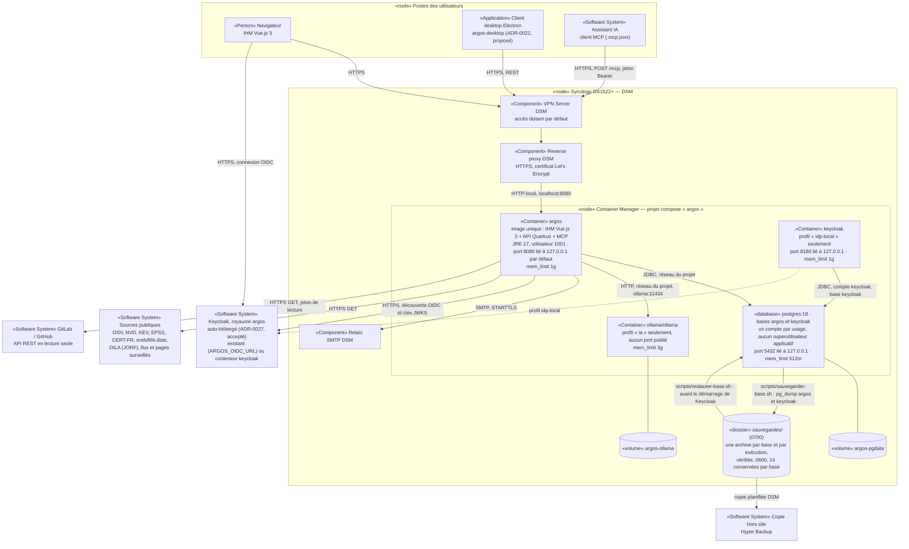

# D-11 — Déploiement cible sur le serveur Synology

Vue de déploiement de la cible retenue par [ADR-0026](../adr/0026-hebergement-synology.md) (Accepté, cible), au niveau des conteneurs réellement décrits par [`compose.yaml`](/compose.yaml) et des réglages de [`application.properties`](/argos-server/src/main/resources/application.properties). Elle détaille D-10 (arc42 [§7.3](../arc42/07-vue-deploiement.md#73-serveur-synology-adr-0026)) ; l'hébergement en ligne d'arc42 §7.4 n'a pas de diagramme tant qu'aucune décision ne le décrit.

## Lecture

| Élément | Fait observé | Source |
|---|---|---|
| Image | image unique x86-64 (DS1522+ et PC) : IHM construite puis servie par Quarkus, JRE 17, utilisateur non privilégié d'UID 1001 ; licences des dépendances du serveur contrôlées à la construction (profil Maven `licences`), avis `NOTICE`, `THIRD-PARTY.txt` et textes des licences retenues (Apache-2.0, MIT, BSD, EPL-2.0, JDOM) dans `/opt/argos/licenses/` ; images de base épinglées par tag | [`Dockerfile`](/Dockerfile) |
| Conteneurs | `argos`, `postgres` (image `postgres:18`), `keycloak` (profil `idp-local`), `ollama` (profil `ia`, désactivé par défaut) dans le projet compose `argos` | `compose.yaml` |
| Comptes de base | superutilisateur d'administration (initialisation, sauvegarde, restauration) ; propriétaire de la base `argos` (migrations) ; rôle de connexion d'Argos, ni propriétaire ni BYPASSRLS ; compte `keycloak` propriétaire de sa seule base ; mots de passe obligatoires | [ADR-0035](../adr/0035-comptes-et-isolation-des-bases.md) (Proposé), [`initialiser-bases.sh`](/deploiement/postgres/initialiser-bases.sh) |
| Exposition | ports d'Argos et de PostgreSQL liés à `127.0.0.1` ; `ARGOS_BIND=0.0.0.0` ouvre Argos au réseau local ou au VPN ; Ollama ne publie aucun port | `compose.yaml` |
| Accès distant | VPN Server de DSM par défaut ; nom de domaine en HTTPS par le reverse proxy de DSM | [`synology-et-pc.md`](/docs/deploiement/synology-et-pc.md) |
| Identité | Keycloak lu par `ARGOS_OIDC_URL` : existant, ou conteneur `keycloak` du profil `idp-local`, dont la base partage l'instance PostgreSQL | ADR-0027 (Accepté), `compose.yaml` |
| Messagerie | relais SMTP du Synology, `ARGOS_SMTP_HOST`, STARTTLS | fiche [`alertes-digests`](../../specifications/alertes-digests.md) |
| Migrations | Flyway appliqué au démarrage d'Argos (`quarkus.flyway.migrate-at-start=true`) | `application.properties`, [ADR-0032](../adr/0032-migrations-flyway.md) (Accepté) |
| Tâches planifiées | exécutées dans le conteneur `argos` par `quarkus-scheduler`, sans ordonnanceur externe | [ADR-0031](../adr/0031-planification-quarkus-scheduler.md) (Accepté) |
| Sauvegarde | export des bases `argos` et `keycloak` par `scripts/sauvegarder-base.sh` (échec signalé par le code de sortie, rotation après succès), restauration par `scripts/restaurer-base.sh`, copie hors du NAS par Hyper Backup | `synology-et-pc.md`, fiche [`exploitation-plateforme`](../../specifications/exploitation-plateforme.md) |

Une seule instance du conteneur `argos` est prévue : les tâches planifiées et la réservation des traitements reposent sur cette hypothèse ou sur des verrous PostgreSQL (ADR-0031).
