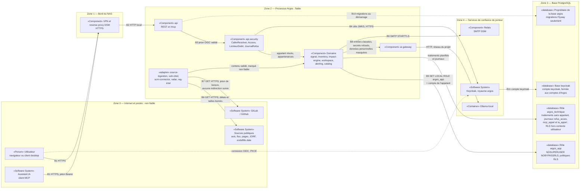

# D-12 — Frontières de confiance

Vue de sécurité d'Argos : zones de confiance, flux qui les franchissent et contrôle appliqué à chaque franchissement. Elle complète arc42 [§8.1](../arc42/08-concepts-transverses.md#81-identité-et-accès) (D-14, contrôle d'une requête authentifiée) et [§8.3](../arc42/08-concepts-transverses.md#83-sécurité) ; le déploiement correspondant est D-11 ([`d-11-deploiement-cible.md`](d-11-deploiement-cible.md)).

## Franchissements et contrôles

| Frontière | Menace principale | Contrôle en place | Preuve |
|---|---|---|---|
| B1 Internet → bord du NAS | écoute, exposition de services internes | VPN par défaut, HTTPS par le reverse proxy de DSM ; Argos et PostgreSQL liés à `127.0.0.1` par défaut | `compose.yaml`, [`synology-et-pc.md`](/docs/deploiement/synology-et-pc.md) |
| B2 bord → Argos | requête anonyme ou forgée | toute ressource `/api/v1` et `/mcp` exige un jeton ; refus par défaut | D-14, fiche [`comptes-acces`](../../specifications/comptes-acces.md) |
| B3 jeton → appelant | usurpation, escalade de rôle | signature, émetteur et audience validés par `quarkus-oidc` ; compte et appartenances relus en base par `CallerResolver` ; rôle vérifié par `Access` ; refus journalisés dans `refus_acces` (`JournalRefus`) ; débit borné par `LimiteurDebit` (MCP : 60 appels par minute et par utilisateur) | tests `io.argos.api`, `io.argos.mcp` |
| B4 Argos → Keycloak | faux fournisseur d'identité | URL du royaume fixée par `ARGOS_OIDC_URL` ; Argos refuse de démarrer sans elle | `application.properties` |
| B5 Argos → base, chemin d'un appelant | fuite entre espaces malgré une erreur applicative | chaque transaction d'un appelant bascule sur `argos_app` par `SET LOCAL ROLE` avec le compte en contexte ; les politiques RLS filtrent les tables cloisonnées | tests RLS sous `argos_app` (`chain/CorrelationTest#rlsAppliqueeSurLeCheminApplicatif`) |
| B6 Argos → sources publiques | contenu malveillant, SSRF, épuisement | adresses proposées par un utilisateur contrôlées contre les plages internes à chaque collecte et à chaque redirection, connexion à l'adresse IP contrôlée sans nouvelle résolution du nom ; délais et tailles bornés ; XML sans DOCTYPE ; contenu restitué comme citation non fiable | arc42 §8.3, fiche [`veille-rss-web`](../../specifications/veille-rss-web.md) |
| B7 Argos → forges | fuite du jeton, chemin hors du dépôt, quota | requêtes `GET` seulement ; aucune redirection suivie ; segments `.` et `..` retirés des chemins ; dépôt GitHub `owner/repo` validé ; réponse bornée (`argos.inventory.max-document-bytes`) ; jeton absent des messages ; jeton refusé (`AccesRefuse`) et dépôt introuvable (`DepotIntrouvable`) distingués d'un fichier absent ; quota épuisé signalé (`QuotaEpuise`) ; délai borné (`argos.sources.http-timeout`) | `chain/ScmContractTest`, `chain/ScmContratEnregistreTest` (réponses GitHub et GitLab enregistrées), `chain/InventoryTest#contratGitLabEtGitHub` |
| B8 domaine → IA | fuite de données, injection de consignes | entrées `CONFIDENTIAL` et `RESTRICTED` refusées, secrets refusés, données personnelles masquées, données séparées des consignes, sortie validée par schéma ; modèle local sans sortie vers Internet | arc42 §8.8, fiche [`passerelle-ia`](../../specifications/passerelle-ia.md) |
| B9 Argos → messagerie | interception | relais SMTP du Synology, STARTTLS paramétrable (`ARGOS_SMTP_STARTTLS`) | fiche [`alertes-digests`](../../specifications/alertes-digests.md) |
| B10 Argos → schéma | modification du schéma par une requête injectée | le rôle de connexion n'est ni propriétaire ni superutilisateur : aucun droit de DDL ; migrations sous le propriétaire, avec ses propres identifiants | `RolesBaseTest` (EXP-05-S4, S5) |
| B11 Argos ↔ Keycloak dans PostgreSQL | lecture de la base de l'autre application (clés de signature du royaume, comptes) | un compte par application, propriétaire de sa seule base, `CONNECT` retiré à `PUBLIC` ; aucun superutilisateur applicatif | `RolesBaseTest` (EXP-05-S1, S2), [ADR-0035](../adr/0035-comptes-et-isolation-des-bases.md) |

Le rôle de connexion à la base (`ARGOS_DB_USER`) exécute, par `argos_technique`, les traitements planifiés sans appelant et l'écriture des journaux `refus_acces`, `mcp_appel` et `ia_appel`, sur lesquels `argos_app` n'a aucun droit ; les migrations s'exécutent sous le propriétaire de la base (ADR-0035, Proposé). Revenue à ce rôle par `RESET ROLE`, une transaction d'appelant garde son contexte et ne lit aucune ligne cloisonnée. La compromission du processus Argos donne accès à ce rôle, hors contexte utilisateur à toutes les lignes : la RLS protège contre une erreur de périmètre dans le code, pas contre un attaquant qui contrôle le processus ; ce rôle ne donne ni le schéma, ni la base de Keycloak, ni les fichiers du serveur.

Risques résiduels connus : aucun filtrage de sortie au niveau du réseau en complément du contrôle des adresses de la veille web (arc42 §8.3) ; jetons de forge et mots de passe de la base lus dans l'environnement du conteneur, sans coffre-fort (arc42 §8.13).
