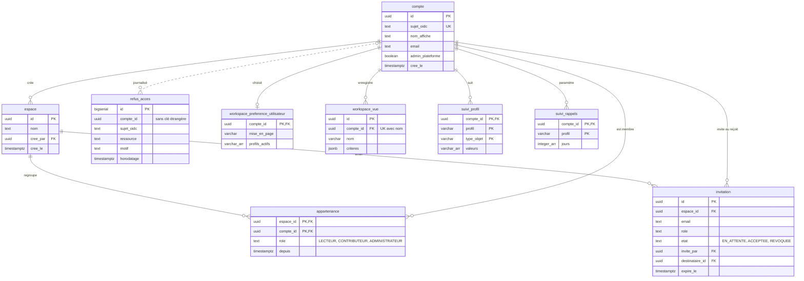
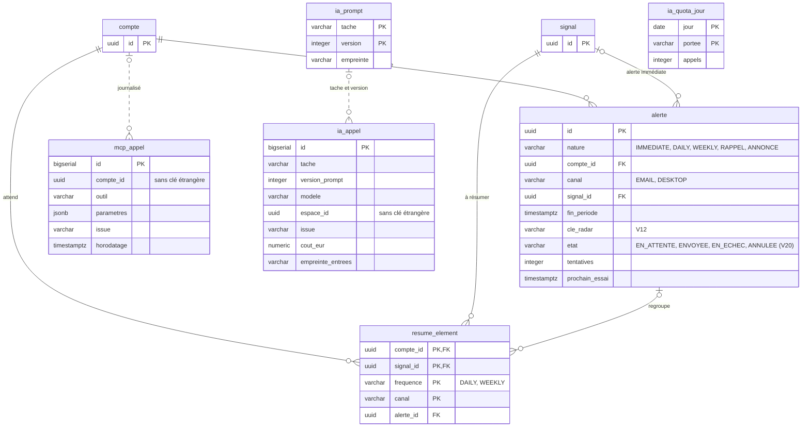
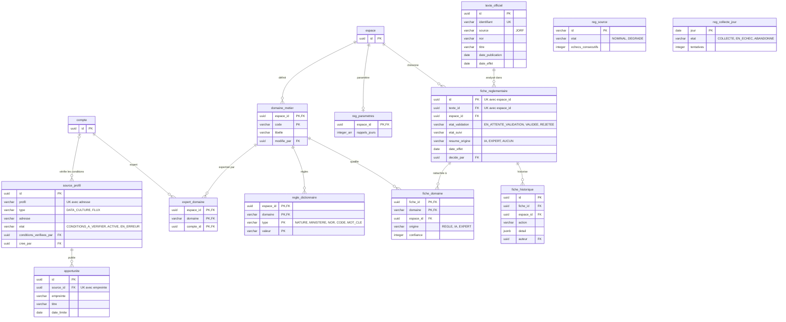

# D-13 — Modèle physique

Modèle physique de la base PostgreSQL d'Argos tel que le produisent les migrations Flyway `V1__socle.sql` à `V21__index_impacts_recents.sql` (V21 n'ajoute qu'un index) ([`argos-server/src/main/resources/db/migration/`](/argos-server/src/main/resources/db/migration/)). Chaque entité porte ses clés et ses colonnes significatives ; la définition complète (types exacts, contraintes `CHECK`, index, fonctions, politiques RLS) reste celle des migrations. Le modèle métier conceptuel est D-05 (arc42 [§5.7](../arc42/05-vue-blocs.md)).

Conventions : `PK` clé primaire, `FK` clé étrangère, `UK` unicité ; un type suffixé `_arr` est un tableau PostgreSQL (`varchar(64)[]`, `integer[]`). Une ligne pointillée relie deux tables par une référence logique, sans clé étrangère. Les entités d'un autre bloc (`compte`, `espace`, `project`, `component`, `signal`) n'y sont répétées qu'avec leur clé.

## D-13.1 — Comptes, espaces et préférences (V2, V7, V11, V15)

## D-13.2 — Chaîne sécurité : collecte, inventaire, impacts, abonnements (V3 à V6, V11, V17 à V20)

```mermaid
erDiagram
    source {
        varchar id PK
        varchar label
        varchar state "NOMINAL, FAILING, DEGRADED"
        integer consecutive_failures
        timestamptz last_success_at
    }
    sync_cursor {
        varchar source_id PK, FK
        varchar position
        timestamptz updated_at
    }
    sync_run {
        uuid id PK
        varchar source_id FK "un seul RUNNING par source"
        varchar state "RUNNING, RETRYABLE, SUCCEEDED, FAILED"
        integer attempts
        timestamptz heartbeat_at
        timestamptz next_attempt_at
    }
    sync_attempt {
        uuid id PK
        uuid run_id FK
        integer attempt_no
        integer http_status
        varchar error_kind "TRANSIENT, PERMANENT"
        bigint retry_after_seconds
    }
    ingestion_failure {
        uuid id PK
        varchar source_id FK
        uuid run_id FK
        varchar external_id
        varchar reason
        text raw_content
    }
    ops_event {
        uuid id PK
        varchar kind
        varchar source_id FK
        timestamptz occurred_at
    }
    signal {
        uuid id PK
        varchar source FK "UK avec external_id"
        varchar external_id
        varchar title
        char content_hash
        char normalized_hash "empreinte normalisée (V18)"
        jsonb affected
        uuid current_version_id FK
        tsvector recherche "V11"
    }
    signal_version {
        uuid id PK
        uuid signal_id FK "UK avec version_no, UK avec content_hash, UK partielle avec normalized_hash (V18)"
        integer version_no
        char content_hash
        char normalized_hash "V18"
        text raw_content
    }
    signal_alias {
        uuid signal_id PK, FK
        varchar alias PK
    }
    signal_package {
        uuid signal_id PK, FK
        varchar package_key PK
        varchar ecosystem
    }
    enrichment {
        uuid signal_id PK, FK
        varchar source PK "NVD, KEV, EPSS, CERTFR"
        varchar reference PK
        jsonb data
    }
    espace {
        uuid id PK
    }
    compte {
        uuid id PK
    }
    project {
        uuid id PK
        uuid workspace_id FK
        varchar name
        varchar scm_provider "GITLAB, GITHUB"
        varchar scm_repository
        varchar scm_branch
        varchar sbom_job
        varchar sbom_path
        varchar manifest_paths
    }
    inventory {
        uuid project_id PK, FK
        varchar origin "SBOM, MANIFEST"
        timestamptz source_date
        varchar spec_version
        uuid import_id
        integer ignored_count "composants sans PURL (V17)"
        jsonb ignored_components "100 au plus (V17)"
        boolean recorrelation_pending "marqueur (V19)"
    }
    component {
        uuid id PK
        uuid project_id FK "UK avec package_key et version"
        varchar package_key
        varchar purl
        varchar version
        boolean transitive
    }
    inventory_import_failure {
        uuid id PK
        uuid project_id FK
        uuid repository_id FK "dépôt (V19)"
        varchar reason
        varchar source_ref
    }
    project_repository {
        uuid id PK
        uuid project_id FK "UK avec provider et repository"
        varchar provider "GITLAB, GITHUB"
        varchar repository
        varchar branch
        boolean principal "au plus un par projet"
    }
    repository_inventory {
        uuid repository_id PK, FK
        uuid project_id FK
        varchar origin "SBOM, MANIFEST"
        timestamptz source_date
        timestamptz imported_at
    }
    component_occurrence {
        uuid component_id FK "UK avec repository_id"
        uuid repository_id FK "nul : import manuel sans dépôt"
        uuid project_id FK
        boolean transitive
    }
    project_impact {
        uuid id PK
        uuid signal_id FK "UK avec project_id et component_id"
        uuid signal_version_id FK
        uuid project_id FK
        uuid workspace_id FK
        uuid component_id FK "nul si retiré (V20, SET NULL)"
        varchar level "EXACT, PROBABLE, A_VERIFIER"
        varchar state "OUVERT, CONFIRME, ECARTE, RESOLU (V20)"
        varchar package_key "instantané (V20)"
        varchar method
        jsonb provenance
    }
    project_impact_transition {
        uuid id PK
        uuid impact_id FK
        uuid workspace_id FK
        varchar from_state
        varchar to_state
        uuid actor_account_id FK "nul si système"
        boolean actor_system
        varchar reason
        timestamptz occurred_at
    }
    subscription {
        uuid id PK
        varchar scope "TEAM, PERSONAL"
        uuid owner_workspace_id FK
        uuid owner_user_id FK
        jsonb filters
        boolean mandatory
        varchar state "ACTIVE, SUSPENDED (V18)"
    }
    subscription_opt_out {
        uuid subscription_id PK, FK
        uuid user_id PK, FK
    }

    source ||--o| sync_cursor : "reprend depuis"
    source ||--o{ sync_run : "exécute"
    sync_run ||--o{ sync_attempt : "tente"
    source ||--o{ ingestion_failure : "rejette"
    sync_run |o--o{ ingestion_failure : "pendant"
    source |o--o{ ops_event : "signale"
    source ||--o{ signal : "publie"
    signal ||--|{ signal_version : "historise"
    signal ||--o{ signal_alias : "alias"
    signal ||--o{ signal_package : "affecte"
    signal ||--o{ enrichment : "enrichi par"
    espace ||--o{ project : "suit"
    project ||--o| inventory : "inventaire de référence"
    inventory ||--o{ component : "liste"
    project ||--o{ inventory_import_failure : "refus d'import"
    project ||--o{ project_repository : "regroupe (V19)"
    project_repository ||--o| repository_inventory : "dernier import"
    project_repository |o--o{ component_occurrence : "contient"
    component ||--|{ component_occurrence : "présent dans"
    project_repository |o--o{ inventory_import_failure : "échec du dépôt"
    signal ||--o{ project_impact : "cause"
    signal_version ||--o{ project_impact : "version corrélée"
    project ||--o{ project_impact : "concerne"
    component |o--o{ project_impact : "via"
    espace ||--o{ project_impact : "cloisonne"
    project_impact ||--o{ project_impact_transition : "historise (V20)"
    espace |o--o{ subscription : "socle TEAM"
    compte |o--o{ subscription : "PERSONAL"
    subscription ||--o{ subscription_opt_out : "quittée par"
    compte ||--o{ subscription_opt_out : "quitte"
```

`signal.current_version_id` référence la version courante dans `signal_version` (contrainte `signal_current_version_fk`, différée).

## D-13.3 — Alertes, journaux d'appels et passerelle IA (V8, V9, V12, V13)

## D-13.4 — Veille web, radar des standards et activité des projets (V10, V12, V14)

```mermaid
erDiagram
    espace {
        uuid id PK
    }
    compte {
        uuid id PK
    }
    project {
        uuid id PK
    }
    component {
        uuid id PK
    }
    source_web {
        uuid id PK
        varchar portee "ESPACE, PERSONNELLE"
        uuid espace_id FK "UK avec adresse"
        uuid proprietaire_id FK
        varchar type "FLUX, PAGE"
        varchar adresse
        varchar etat "ACTIVE, EN_ERREUR"
        timestamptz prochaine_collecte_le
        uuid cree_par FK
    }
    actualite {
        uuid id PK "UK avec espace_id"
        uuid espace_id FK "UK avec empreinte"
        uuid proprietaire_id FK
        varchar empreinte
        varchar type "ARTICLE, CHANGEMENT_PAGE"
        varchar titre
        tsvector recherche "V11"
    }
    actualite_source {
        uuid actualite_id PK, FK
        uuid source_id PK, FK
    }
    actualite_impact {
        uuid id PK
        uuid actualite_id FK "FK composée avec workspace_id"
        uuid project_id FK
        uuid workspace_id FK
        varchar technologie
        varchar niveau "A_VERIFIER"
    }
    standard_technologie {
        uuid id PK
        uuid espace_id FK "UK avec cle"
        varchar cle
        varchar statut "ADOPT, TRIAL, ASSESS, HOLD"
        varchar version_recommandee
        varchar produit_cycle_vie
        uuid modifie_par FK
    }
    standard_historique {
        uuid id PK
        uuid standard_id FK
        uuid espace_id FK
        varchar statut
        varchar origine "SAISIE, SUGGESTION"
        uuid modifie_par FK
    }
    standard_suggestion {
        uuid id PK
        uuid espace_id FK
        varchar cle
        varchar statut
        varchar etat "EN_ATTENTE, ACCEPTEE, REJETEE"
        uuid decide_par FK
    }
    radar_parametres {
        uuid espace_id PK, FK
        integer_arr rappels_jours
        uuid modifie_par FK
    }
    cycle_vie_produit {
        varchar produit PK
        varchar etat "A_JOUR, EN_ERREUR"
    }
    cycle_vie {
        varchar produit PK, FK
        varchar cycle PK
        date fin_support_le
        boolean en_fin_support
    }
    dette_version {
        uuid id PK
        uuid project_id FK "UK avec component_id"
        uuid workspace_id FK
        uuid component_id FK
        varchar cle
        varchar version
        date fin_support_le
    }
    activite_compteur {
        uuid project_id PK, FK
        date jour PK
        varchar type PK
        integer valeur
    }
    activite_jalon {
        uuid project_id PK, FK
        varchar reference PK
        varchar etat "OUVERT, FERME"
        date echeance
    }
    activite_collecte {
        uuid project_id PK, FK
        varchar etat "A_JOUR, REPORTEE_QUOTA, ECHEC"
        timestamptz prochaine_collecte
    }

    espace |o--o{ source_web : "source d'espace"
    compte |o--o{ source_web : "source personnelle"
    source_web ||--o{ actualite_source : "reçoit"
    actualite ||--o{ actualite_source : "citée par"
    espace |o--o{ actualite : "périmètre"
    compte |o--o{ actualite : "périmètre"
    actualite ||--o{ actualite_impact : "rapprochée"
    project ||--o{ actualite_impact : "concerne"
    espace ||--o{ standard_technologie : "référentiel"
    standard_technologie ||--o{ standard_historique : "historise"
    espace ||--o{ standard_suggestion : "reçoit"
    espace ||--o| radar_parametres : "paramètre"
    cycle_vie_produit ||--o{ cycle_vie : "cycles"
    standard_technologie }o..o| cycle_vie_produit : "produit_cycle_vie"
    project ||--o{ dette_version : "dette"
    component ||--o| dette_version : "version en fin de support"
    project ||--o{ activite_compteur : "compte"
    project ||--o{ activite_jalon : "jalons"
    project ||--o| activite_collecte : "état de collecte"
```

## D-13.5 — Profil artiste et veille réglementaire (V15, V16)

## Cloisonnement

Les politiques RLS, appliquées sous le rôle `argos_app` (ADR-0016, migration V2), couvrent les tables : `compte`, `espace`, `appartenance`, `invitation` (V2) ; `project`, `inventory`, `component`, `inventory_import_failure` (V4) ; `project_impact` (V5), `project_impact_transition` (V20) ; `subscription`, `subscription_opt_out` (V6) ; `workspace_preference_utilisateur` (V7) ; `alerte`, `resume_element` (V8) ; `source_web`, `actualite`, `actualite_source`, `actualite_impact` (V10) ; `workspace_vue` (V11) ; `standard_technologie`, `standard_historique`, `standard_suggestion`, `radar_parametres`, `dette_version` (V12) ; `activite_compteur`, `activite_jalon`, `activite_collecte` (V14) ; `suivi_profil`, `suivi_rappels` (V15) ; `domaine_metier`, `expert_domaine`, `regle_dictionnaire`, `reg_parametres`, `fiche_reglementaire`, `fiche_domaine`, `fiche_historique` (V16) ; `project_repository`, `repository_inventory`, `component_occurrence` (V19).

Les tables de la collecte des avis (`source`, `sync_*`, `ingestion_failure`, `ops_event`, `signal*`, `enrichment`), du calendrier des produits (`cycle_vie*`), des sources du profil artiste (`source_profil`, `opportunite`) et de la collecte réglementaire (`texte_officiel`, `reg_source`, `reg_collecte_jour`) sont communes à tous les espaces. `refus_acces`, `mcp_appel`, `ia_prompt`, `ia_appel` et `ia_quota_jour` sont des journaux et compteurs internes, écrits sous l'utilisateur de connexion, sur lesquels `argos_app` n'a aucun droit.
