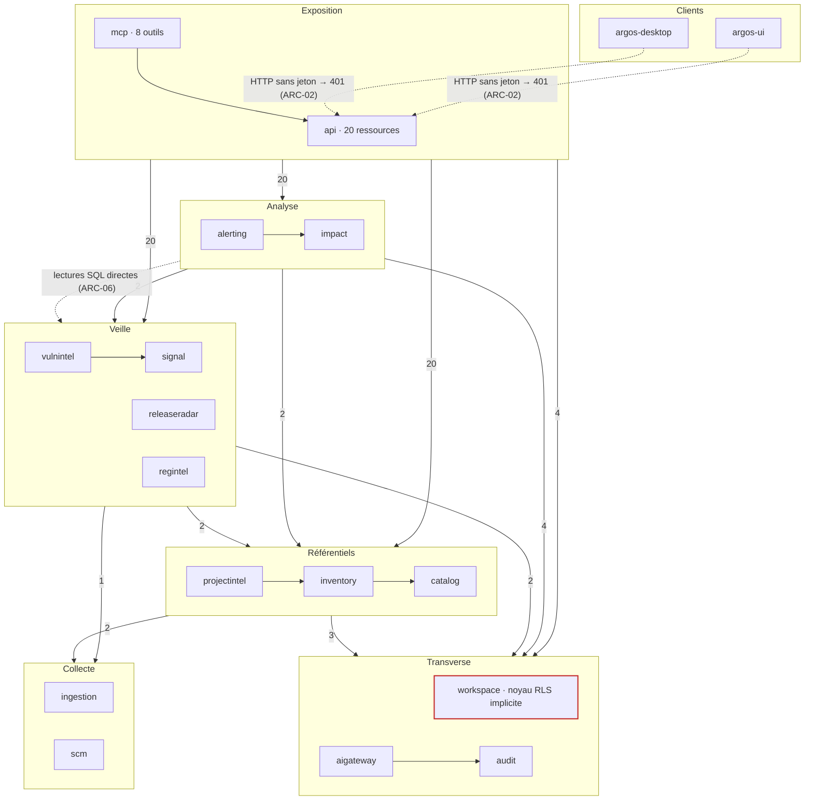

# Architecture observée — 2026-11-17

Base : `origin/main` à 9d96406. Le découpage ci-dessous est celui que montre le code (imports et noms qualifiés de `src/main`), pas celui qu'annonce la documentation.

## Découpage réel

| Famille | Module | Fichiers | Lignes | Rôle observé |
|---|---|---|---|---|
| Clients | argos-ui | 24 | ~1 600 | IHM Vue 3 + Vite + TypeScript strict, partagée par le portail web et le desktop ; `client.ts` écrit à la main (8 appels) |
| Clients | argos-desktop | 6 | ~860 | Electron durci (contextIsolation, sandbox, CSP) ; sert l'IHM depuis `app://argos` |
| Exposition | api | 35 | 2 997 | 20 ressources REST, sécurité (Caller, résolution OIDC, limiteur) ; aucun accès SQL |
| Exposition | mcp | 10 | 1 000 | Serveur MCP en lecture seule, 8 outils, garde d'appels |
| Analyse | impact | 16 | 2 159 | Corrélation, dette de version, radar, recherche plein texte, rapprochement d'opportunités |
| Analyse | alerting | 17 | 2 051 | Moteur d'alertes, envoi, résumés, rappels radar et opportunités |
| Veille | signal | 20 | 2 550 | Signaux normalisés, veille web, opportunités |
| Veille | vulnintel | 9 | 528 | Enrichissement KEV, EPSS, NVD, CERT-FR |
| Veille | releaseradar | 5 | 530 | Cycles de vie endoflife.date |
| Veille | regintel | 3 | 73 | Point d'extension réglementaire (vide) |
| Référentiels | catalog | 19 | 1 292 | Standards par espace, profils de veille, mises en page |
| Référentiels | inventory | 10 | 821 | Projets, composants SBOM — sans point d'entrée d'écriture en production (AUD-QUA-01) |
| Référentiels | projectintel | 10 | 863 | Activité des dépôts, jalons |
| Collecte | ingestion | 23 | 2 020 | OSV, RSS/pages web avec garde d'adresses, data.culture |
| Collecte | scm | 8 | 754 | GitHub/GitLab en lecture seule |
| Transverse | workspace | 26 | 1 693 | Comptes, espaces, rôles, abonnements, suivis — **et** noyau implicite : ContexteBase (RLS) et erreurs communes (AUD-ARC-05) |
| Transverse | aigateway | 13 | 1 057 | Passerelle unique vers Ollama : quotas, filtrage, validation |
| Transverse | audit | 4 | 186 | Journaux : refus d'accès, appels IA, appels MCP |

Serveur : 228 fichiers, ~20 600 lignes ; 15 migrations Flyway ; 9 tâches planifiées.

## Graphe de dépendances

Le sens d'une flèche est celui de la dépendance : `A --> B` signifie « A importe B ». Le nombre sur une flèche entre familles est le nombre d'arêtes module → module qu'elle résume.

## Ce qui tient

- 44 arêtes module → module, **aucun cycle**, toutes autorisées par la table de `ModuleBoundariesTest` (21 tests, verts) ; les 16 modules y sont déclarés (AUD-ARC-01).
- `api` reste une couche mince sans SQL (AUD-ARC-08) ; Collecte est une feuille : `ingestion` et `scm` ne dépendent d'aucun autre module.
- Le delta du lot 4 (profil artiste, opportunités) n'a ajouté **aucune** arête.

## Écarts avec la documentation et frontières contournées

- **arc42 §5.2 ne décrit plus le code** (AUD-ARC-03) : sens inversés (ingestion/signal, signal/vulnintel, scm/inventory…), arêtes absentes (toutes celles de `mcp`, `api` vers catalog/impact/alerting…), et §3/§5.1 citent encore Claude/Anthropic et un IdP d'entreprise au lieu d'Ollama et de Keycloak.
- **Noyau implicite dans workspace** (AUD-ARC-05) : `catalog`, `signal` et `projectintel` n'empruntent à `workspace` que ContexteBase et les erreurs, d'où quatre règles ArchUnit d'exception ; `impact` a recopié le protocole RLS faute de dépendance autorisée (`impact/RlsSession`), une des quatre copies d'AUD-ARC-04.
- **Couplage par le schéma** (AUD-ARC-06) : `impact` lit les tables de `signal` et `inventory`, `alerting` celles de `workspace`, `vulnintel` celles de `signal`. ArchUnit ne voit que les imports ; la propriété des tables n'est documentée nulle part.
- **Clients sans jeton** (AUD-ARC-02) : la règle `/*` authenticated couvre aussi l'IHM statique ; en image Docker, `index.html` reçoit 401.

## Ce que le graphe ne montre pas

Un graphe de modules ne voit pas les défauts internes, qui sont ici le vrai sujet : l'exécution synchrone de toute la chaîne d'ingestion dans le fil appelant (AUD-PER-01, AUD-PER-02), les mécanismes recopiés (RLS, transactions, JDBC, clients HTTP) et l'absence de point d'entrée pour alimenter l'inventaire (AUD-QUA-01).
