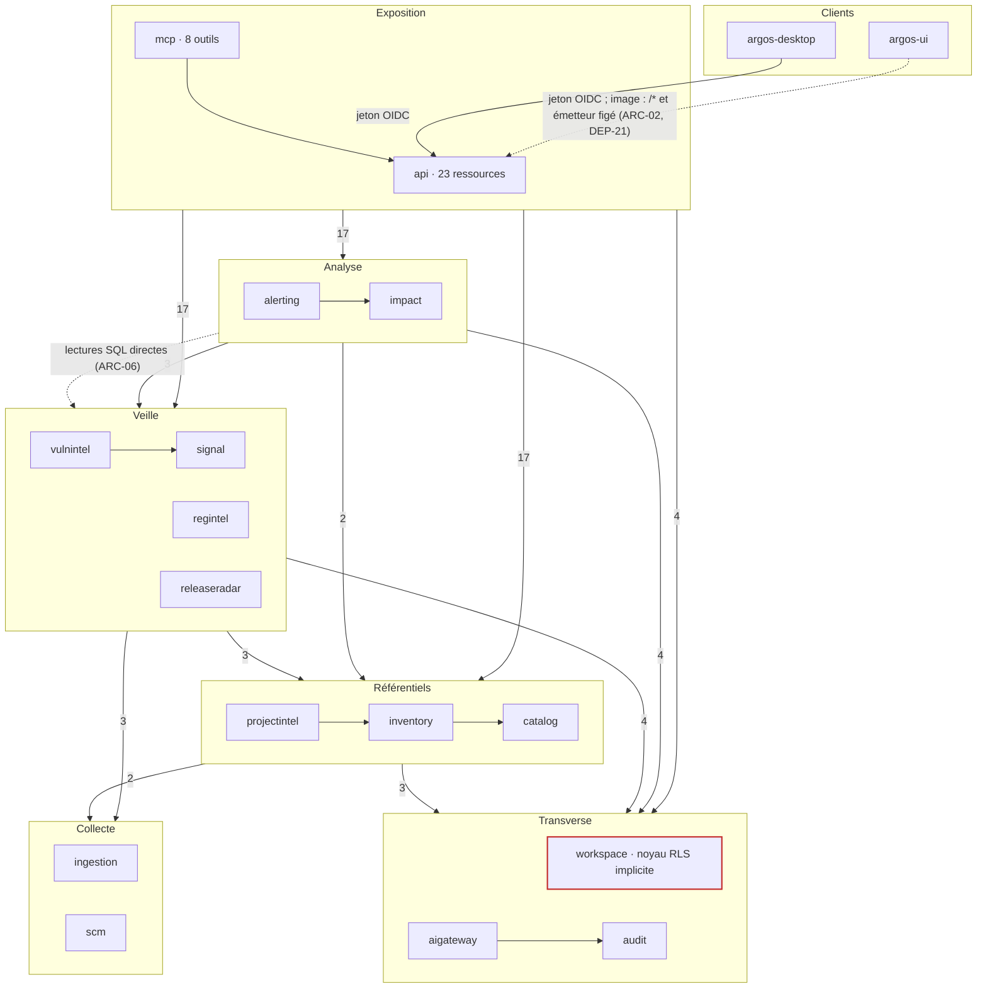

# Architecture observée — mise à jour du 2026-11-20

Base : `origin/main` à 54add78. Découpage tiré du code (imports et noms qualifiés de `src/main`), comparé à la base du 17/11 (9d96406).

## Découpage réel

| Famille | Module | Fichiers | Lignes (17/11 → 20/11) | Rôle observé |
|---|---|---|---|---|
| Clients | argos-ui | 63 | ~1 600 → ~7 900 | IHM Vue 3 ; session OIDC Authorization Code + PKCE (ADR-0033), point d'appel unique `appelerApi` ; contrat écrit à la main (11 racines REST sur 23) |
| Clients | argos-desktop | 23 | ~860 → ~1 150 | Electron durci ; connexion OIDC par le navigateur du système et une écoute 127.0.0.1 |
| Exposition | api | 42 | 2 997 → 4 389 | 23 ressources REST, sécurité ; toujours aucun accès SQL |
| Exposition | mcp | 12 | 1 000 → 1 187 | 8 outils en lecture seule |
| Analyse | impact | 20 | 2 159 → 2 905 | Corrélation (désormais nocturne sur tous les projets), état de traitement des impacts, recherche plein texte |
| Analyse | alerting | 19 | 2 051 → 2 292 | Alertes, résumés, rappels radar, opportunités et réglementaires |
| Veille | signal | 22 | 2 550 → 2 744 | Signaux, veille web, opportunités, abonnements |
| Veille | regintel | 14 | 73 → 2 108 | Veille réglementaire (LEGI, JORF), fiches, demandes d'évolution vers les forges |
| Veille | vulnintel | 10 | 528 → 562 | Enrichissement KEV, EPSS, NVD, CERT-FR |
| Veille | releaseradar | 5 | 530 | endoflife.date |
| Référentiels | catalog | 20 | 1 292 → 1 726 | Standards, profils, mises en page, dictionnaire métier |
| Référentiels | inventory | 11 | 821 → 1 863 | Projets, composants, dépôts, import planifié — sans point d'entrée de création (AUD-QUA-01) |
| Référentiels | projectintel | 10 | 863 | Activité des dépôts |
| Collecte | ingestion | 28 | 2 020 → 2 885 | OSV (synchronisation horaire planifiée), RSS/pages web, data.culture, LEGI |
| Collecte | scm | 13 | 754 → 1 368 | GitHub/GitLab, factorisé, contrats enregistrés |
| Transverse | workspace | 26 | 1 693 → 1 759 | Comptes, espaces, rôles — et noyau implicite RLS/erreurs (AUD-ARC-05) |
| Transverse | aigateway | 13 | 1 057 → 1 069 | Passerelle Ollama |
| Transverse | audit | 4 | 186 | Journaux |

Serveur : 269 fichiers, ~28 400 lignes ; 20 migrations Flyway ; 13 tâches planifiées.

## Graphe de dépendances

`A --> B` signifie « A importe B ». Le nombre sur une flèche entre familles compte les arêtes module → module qu'elle résume.

## Ce qui a changé depuis le 17/11

- **51 arêtes** (44 le 17/11), **aucun cycle**, toutes autorisées par `ModuleBoundariesTest` (AUD-ARC-01). Les 7 nouvelles partent ou arrivent à `regintel` (alerting→regintel, api→regintel, regintel→aigateway, catalog, ingestion, scm, workspace) et ont été déclarées dans la table avant le code (AUD-ARC-18).
- Les quatre nouveaux sous-paquets (api.reglementaire, api.veille, catalog.dictionnaire, ingestion.legi) sont sous des modules déjà contraints.
- Le couplage par le schéma s'étend : 13 tables lues par plusieurs modules (9 le 17/11), dont trois lectures qu'aucune dépendance autorisée ne couvre — impact → `compte`, catalog → rôles d'appartenance, alerting → préférences, ce dernier contournant l'invariant de `PreferencesIsolationTest` (AUD-ARC-06).
- Le noyau implicite de workspace impose maintenant cinq règles ArchUnit d'exception (AUD-ARC-05).

## Écarts avec la documentation

- arc42 §5.1 a été corrigé (Ollama, Keycloak) ; §5.2 mélange toujours flux et dépendances, et §3 et §7 citent encore Claude API et l'IdP d'entreprise (AUD-DOC-02, qui absorbe AUD-ARC-03).
- 14 ADR sur 33 restent « Proposé » alors que le code les applique, dont 0001, 0013, 0014, 0016 et 0021 (AUD-ARC-14).

## Ce que le graphe ne montre pas

Un graphe de modules ne voit pas les défauts internes, qui restent le vrai sujet : l'enrichissement et la corrélation exécutés dans le fil d'ingestion (AUD-PER-02), les mécanismes recopiés (4 contextes RLS, 6 transactions manuelles, 273 `prepareStatement`, 7 clients HTTP) et le fait que l'image Docker ne permet pas de se connecter au portail (AUD-ARC-02, AUD-DEP-21).
