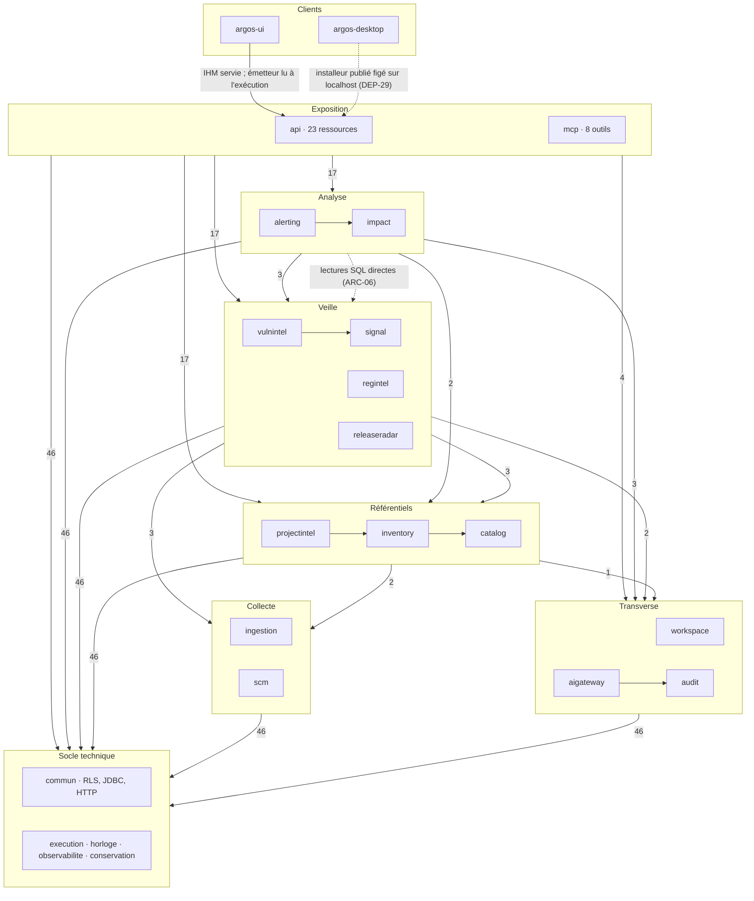

# Architecture observée — mise à jour du 2026-11-28

Base : `origin/main` à 01fea6d, complété à ae4a2da (PR #80 et #82, fusionnées pendant l'audit : la recherche plein texte de la veille passe dans `io.argos.signal.recherche`, AUD-ARC-11 ; aucune arête de module ajoutée, le nouveau paquet ne dépend que de `commun` et de `signal`). Découpage tiré du code (imports et noms qualifiés de `src/main`), comparé aux bases précédentes (17/11 : 9d96406 ; 21/11 : b142695).

## Découpage réel

| Famille | Module | Fichiers | Lignes (17/11 → 28/11) | Rôle observé |
|---|---|---|---|---|
| Clients | argos-ui | 63 | ~1 600 → ~10 000 | IHM Vue 3 ; session OIDC Authorization Code + PKCE (ADR-0033), point d'appel unique `appelerApi`, configuration lue à l'exécution (ADR-0038) ; chemins vérifiés contre l'OpenAPI (ContratClientIhmTest), types encore écrits à la main (AUD-ARC-12) |
| Clients | argos-desktop | 23 | ~860 → ~1 170 | Electron durci ; connexion OIDC par le navigateur du système et une écoute 127.0.0.1 ; mise à jour automatique (ADR-0042) sans signature (AUD-SEC-33) |
| Exposition | api | 42 | 2 997 → 5 133 | 23 ressources REST, sécurité ; toujours aucun accès SQL |
| Exposition | mcp | 12 | 1 000 → 1 227 | 8 outils en lecture seule |
| Analyse | impact | 20 | 2 159 → 3 434 | Corrélation (désormais nocturne sur tous les projets), état de traitement des impacts, recherche plein texte jusqu'à 01fea6d (déplacée dans signal à ae4a2da) |
| Analyse | alerting | 19 | 2 051 → 2 661 | Alertes, résumés, rappels radar, opportunités et réglementaires |
| Veille | signal | 22 | 2 550 → 2 586 | Signaux, veille web, opportunités, abonnements ; recherche plein texte de la veille depuis ae4a2da |
| Veille | regintel | 14 | 73 → 2 226 | Veille réglementaire (LEGI, JORF), fiches, demandes d'évolution vers les forges |
| Veille | vulnintel | 10 | 528 → 832 | Enrichissement KEV, EPSS, NVD, CERT-FR |
| Veille | releaseradar | 5 | 530 → 574 | endoflife.date |
| Référentiels | catalog | 20 | 1 292 → 1 773 | Standards, profils, mises en page, dictionnaire métier |
| Référentiels | inventory | 11 | 821 → 2 192 | Projets, composants, dépôts, import planifié — sans point d'entrée de création (AUD-QUA-01) |
| Référentiels | projectintel | 10 | 863 → 983 | Activité des dépôts |
| Collecte | ingestion | 28 | 2 020 → 3 937 | OSV (synchronisation horaire planifiée), RSS/pages web, data.culture, LEGI |
| Collecte | scm | 13 | 754 → 1 407 | GitHub/GitLab, factorisé, contrats enregistrés |
| Transverse | workspace | 21 | 1 693 → 1 770 | Comptes, espaces, rôles, abonnements, suivis |
| Transverse | aigateway | 13 | 1 057 → 1 308 | Passerelle Ollama |
| Transverse | audit | 5 | 186 → 285 | Journaux |
| Socle technique | commun | 18 | 757 | Noyau commun : contexte RLS unique, erreurs, utilitaire JDBC, fabrique HTTP (ADR-0037) |
| Socle technique | execution, horloge, observabilite, conservation | 20 | 1 252 | Exécuteurs bornés, Clock injecté, métriques et santé, rétention (ADR-0036, ADR-0041) |

Serveur : 21 modules de premier niveau, environ 34 300 lignes ; 28 migrations Flyway. Déploiement : `compose.yaml` avec PostgreSQL (rôles distincts par base, ADR-0035), Argos (IHM servie, émetteur lu à l'exécution, ADR-0038), Ollama (profil `ia`) et Keycloak (profil `idp-local`, royaume durci).

## Graphe de dépendances

`A --> B` signifie « A importe B ». Le nombre sur une flèche entre familles compte les arêtes module → module qu'elle résume.

## Ce qui a changé depuis le 21/11

- **Noyau commun extrait** (ADR-0037, Accepté) : `io.argos.commun` porte le contexte RLS unique, les erreurs, l'utilitaire JDBC et la fabrique HTTP ; les cinq règles ArchUnit d'exception ont disparu (AUD-ARC-04 et AUD-ARC-05 fermés).
- **Socle technique** : `execution`, `horloge`, `observabilite` et `conservation` sont déclarés comme transverses dans `ModuleBoundariesTest` (dépendables par tous, sans dépendance vers les modules métier).
- **91 arêtes, aucun cycle** : 45 entre modules métier (aucune nouvelle) et 46 vers le socle technique ; 6 arêtes ont disparu (signal, regintel, projectintel, impact et inventory vers workspace, mcp vers api).
- **Lectures SQL croisées** : les trois lectures sans dépendance autorisée ont disparu et `ProprieteTablesTest` existe, mais 13 lectures étrangères directes subsistent sur 12 tables, contre la règle « service de lecture ou vue » d'ADR-0037 (AUD-ARC-06, partiel).
- **Événements** (ADR-0039, encore Proposé) : un seul style, traitements de fond sur exécuteurs bornés ; quand l'exécuteur est saturé, l'observateur s'exécute dans le fil appelant (réserve d'AUD-ARC-09).
- 9 package-info sur 16 décrivent encore l'ancienne table des dépendances, et les modules du socle n'en ont pas (AUD-ARC-25).

## Écarts avec la documentation

- arc42 annonce « 50 dépendances, toutes utilisées » alors que la table en compte 46 et qu'une autorisation (inventory → workspace) ne sert qu'à une lecture SQL (réserve d'AUD-ARC-07).
- Six ADR appliqués par le code restent « Proposé » : 0034, 0035 et 0038 à 0041 (AUD-ARC-14) ; ADR-0042 manque à arc42 §9.1 (AUD-DOC-24).

## Ce que le graphe ne montre pas

Les défauts qui restent sont internes aux modules ou aux chaînes de publication : la délégation confuse des routes d'inventaire (AUD-SEC-34), l'installeur desktop publié figé et non authentifié (AUD-DEP-29, AUD-SEC-33), les frontières d'erreur fondées sur IllegalStateException (AUD-QUA-26, AUD-QUA-25) et la file d'enrichissement bloquable (AUD-QUA-24).
