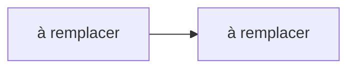

# Fiche capacité : `<capability-path>`

<!--
Modèle de fiche fonctionnelle durable (schéma OpenSpec detailed-uml).
Une fiche décrit la capacité telle qu'elle est (livrée) ou telle qu'elle est proposée, jamais sans le dire.
Statuts : [EXIGENCE] [EXISTANT] [DÉCISION] [PROPOSITION] [QUESTION].
Le contenu introduit par un changement non archivé porte [PROPOSITION] et l'identifiant du changement.
Une section sans objet porte « Non applicable — <raison> ».
Les exigences normatives restent dans openspec/ : la fiche les cite par identifiant, sans les recopier.
-->

| Élément | Valeur |
|---|---|
| Préfixe d'exigences | `<PRÉFIXE>` |
| Spec de référence | `/openspec/specs/<capability-path>/spec.md` — absente tant qu'aucun changement n'est archivé |
| Changements en cours | `<change-id>` (statut) |
| Statut de la capacité | proposée / livrée partiellement / livrée |
| Composants (arc42 §5) | … |

## Objectif

<!-- Ce que la capacité apporte, à qui, et pourquoi. -->

## Acteurs

| Acteur | Interaction | Statut |
|---|---|---|

## Périmètre et exclusions

## Préconditions et déclencheurs

## Entrées, sorties et validations

| Entrée / sortie | Contenu | Validation ou contrainte | Statut |
|---|---|---|---|

## Règles métier

| Règle | Exigence(s) | Source | Statut |
|---|---|---|---|

## Droits d'accès et restrictions

## Effets de bord observables

## Qualités mesurables

<!-- Seulement les cibles présentes dans une source, avec leur statut. Les autres sont des questions. -->

## Diagrammes

<!--
Pour chaque diagramme : identifiant DF-<PRÉFIXE>-<n>, question à laquelle il répond, type exact
(UML séquence / états / classes, organigramme, C4, entité-association), existant ou cible,
exigences concernées, puis explication sous le bloc Mermaid.
-->

### DF-<PRÉFIXE>-1 — <titre>

- **Question** : …
- **Type** : …
- **Portée** : cible proposée / existant vérifié
- **Exigences** : …

<!-- Explication. -->

## Critères d'acceptation

<!-- Renvoyer aux scénarios PRÉFIXE-NN-Sn ; ajouter seulement les critères transverses (ex. scénario qualité QS-xx). -->

## Interprétations introduites par un changement

<!-- Comportements ajoutés pour compléter une règle source, absents des sources : à faire valider. -->

## Écarts constatés

## Questions ouvertes

| ID | Question | Impact | Destinataire |
|---|---|---|---|

## Traçabilité

| Exigence | Scénarios | Conception / diagramme | Tâche | Test ou preuve |
|---|---|---|---|---|
