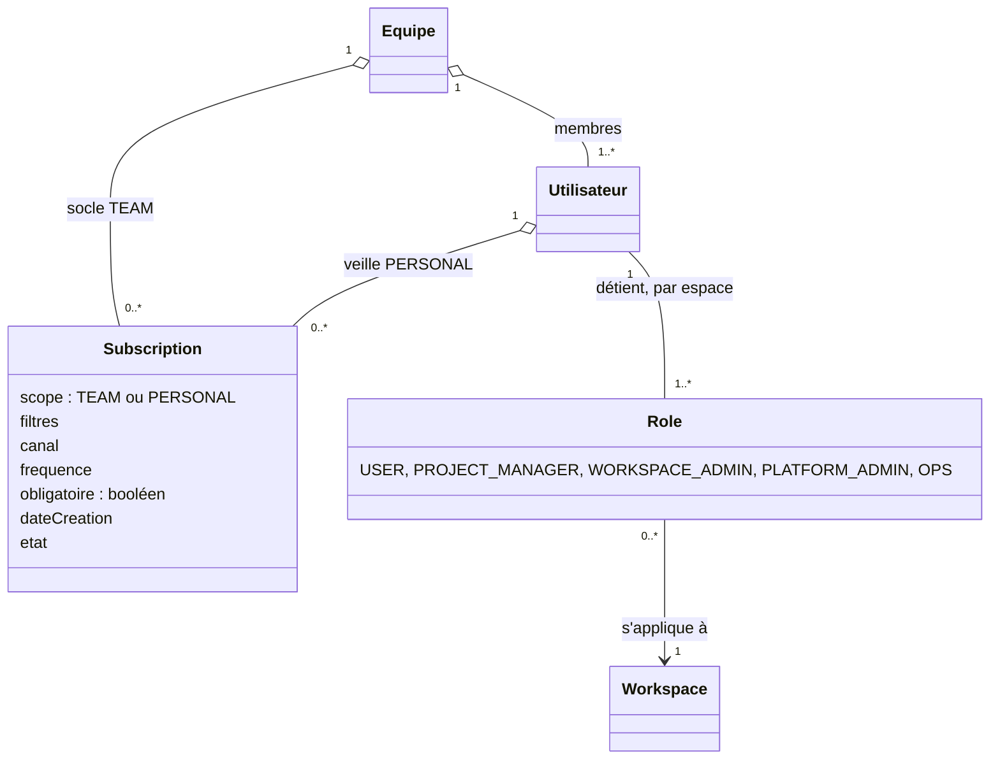
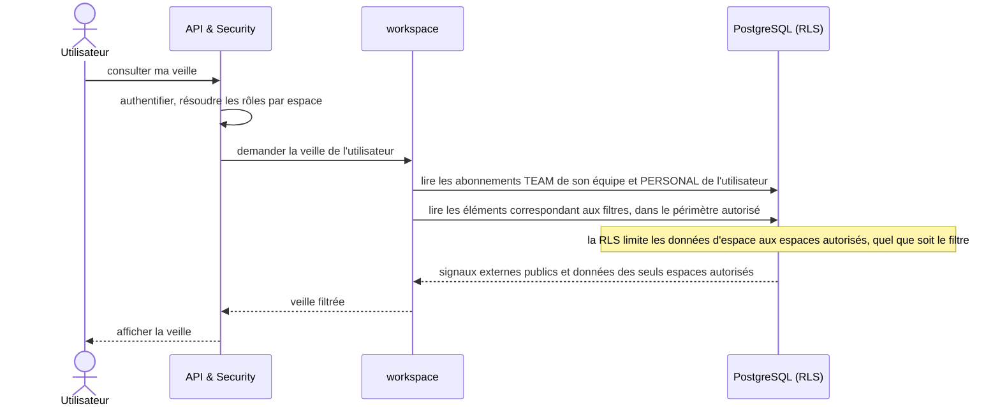
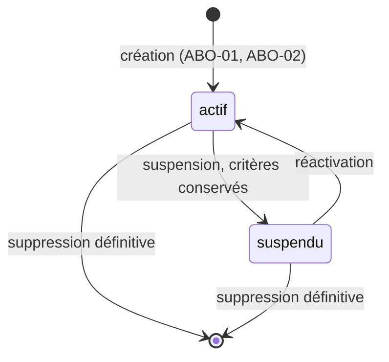

# Fiche capacité : `abonnements-veille`

| Élément | Valeur |
|---|---|
| Préfixe d'exigences | `ABO` |
| Spec de référence | `/openspec/specs/abonnements-veille/spec.md` — absente : capacité non livrée |
| Changement en cours | [`formaliser-chaine-securite-poc`](/openspec/changes/formaliser-chaine-securite-poc/specs/abonnements-veille/spec.md) — proposé, non archivé ; [`automatiser-chaine-veille`](/openspec/changes/automatiser-chaine-veille/specs/abonnements-veille/spec.md) — proposé, non implémenté (ABO-07, ABO-08) |
| Statut de la capacité | **proposée**, implémentée dans `argos-server` (changement non archivé) : paquet `io.argos.workspace.subscription`, autorisations dans `io.argos.api` |
| Composants (arc42 §5) | `workspace`, `API & Security`, `alerting` (canal et fréquence) |

Tout le contenu de cette fiche porte le statut [PROPOSITION] (changement `formaliser-chaine-securite-poc`) sauf mention contraire.

## Objectif

Donner à chaque utilisateur la veille utile à son équipe et lui permettre d'élargir sa veille à titre personnel, pour apprendre ou préparer un besoin futur, sans que cette personnalisation modifie ses droits. Source : baseline v2.4 §1 et §4 ; arc42 §8.2.

## Acteurs

| Acteur | Interaction | Statut |
|---|---|---|
| Utilisateur (développeur) | hérite du socle ; crée sa veille personnelle | [PROPOSITION] — baseline v2.4 §4 |
| Administrateur d'espace (`WORKSPACE_ADMIN`) | seul à créer un abonnement `TEAM` (ABO-06) | [DÉCISION] — Q-5, 2026-11-16 |

## Périmètre et exclusions

- **Inclus** : portées `TEAM` / `PERSONAL`, attributs obligatoires, héritage du socle, veille personnelle libre, absence d'effet sur les droits.
- **Exclu** : diffusion des alertes et digests (canal et fréquence sont enregistrés, leur exécution relève du lot 2), gestion des rôles (ADR-0016).

## Préconditions et déclencheurs

- L'utilisateur est authentifié (ADR-0008, Proposé) et appartient à une équipe.
- Déclencheurs : création d'un abonnement ; arrivée d'un utilisateur dans une équipe.

## Entrées, sorties et validations

| Entrée / sortie | Contenu | Validation ou contrainte | Statut |
|---|---|---|---|
| Entrée : demande d'abonnement | portée, propriétaire, filtres, canal, fréquence, obligatoire/facultatif | tous obligatoires (ABO-01, ABO-02) | [PROPOSITION] |
| Sortie : abonnement | attributs, date de création, état | état `actif` ou `suspendu` [DÉCISION — porteur du projet, 2026-11-19 ; J7, Q-ABO-1] (ABO-07) ; le code porte aujourd'hui `ACTIVE` / `INACTIVE` [EXISTANT — `V6__abonnements_veille.sql`] | [PROPOSITION] |
| Sortie : veille de l'utilisateur | éléments filtrés par ses abonnements et par ses droits | ABO-05 | [PROPOSITION] |

## Règles métier

| Règle | Exigence(s) | Source | Statut |
|---|---|---|---|
| Portée unique `TEAM` ou `PERSONAL` | ABO-01 | baseline v2.4 §4 ; arc42 §8.2 | [PROPOSITION] |
| Attributs minimaux obligatoires | ABO-02 | arc42 §8.2 | [PROPOSITION] |
| Le socle d'équipe s'applique sans action | ABO-03 | baseline v2.4 §4 | [PROPOSITION] |
| Seul un administrateur de l'espace crée un `TEAM` ; un `TEAM` obligatoire ne peut pas être quitté, un `TEAM` facultatif peut l'être | ABO-06 | décision du 2026-11-16 (Q-5) | [PROPOSITION] |
| Veille personnelle libre de lien avec l'équipe | ABO-04 | baseline v2.4 §4 ; arc42 §8.2 (exemple RH / Rust) | [PROPOSITION] |
| Un abonnement n'accorde aucun droit | ABO-05 | baseline v2.4 §4 ; arc42 §5.5 règle 6 | [PROPOSITION] |
| Un abonnement est actif ou suspendu ; suspendre conserve les critères et arrête les notifications ; réactiver les rétablit sans rejouer la période de suspension ; propriétaire d'un `PERSONAL`, administrateur de l'espace d'un `TEAM` | ABO-07 | décision J7 du porteur du projet, 2026-11-19 ; droits et absence de rejeu : propositions P-4, P-8 du changement | [PROPOSITION] — `automatiser-chaine-veille` |
| La suppression est distincte de la suspension : définitive, critères et retraits compris | ABO-08 | décision J7 du porteur du projet, 2026-11-19 | [PROPOSITION] — `automatiser-chaine-veille` |

## Droits d'accès et restrictions

La règle centrale de la capacité est une restriction : la veille est un **filtre de pertinence** appliqué à l'intérieur du périmètre autorisé, jamais une source d'autorisation (arc42 §5.4, §8.2). L'autorisation reste déterminée par RBAC + RLS (ADR-0016) et par les rôles `USER`, `PROJECT_MANAGER`, `WORKSPACE_ADMIN`, `PLATFORM_ADMIN`, `OPS` (arc42 §8.1).

## Effets de bord observables

- création d'un abonnement ;
- modification du contenu de la veille de l'utilisateur ;
- aucune modification des rôles ni des autorisations (ABO-05-S2).

## Qualités mesurables

Non applicable — aucune cible chiffrée n'est documentée pour cette capacité.

## Diagrammes

### DF-ABO-1 — Abonnements, équipes et autorisations

- **Question** : comment les abonnements se rattachent-ils aux équipes et aux utilisateurs, et pourquoi n'influencent-ils pas l'autorisation ?
- **Type** : UML classes (modèle conceptuel)
- **Portée** : cible proposée
- **Exigences** : ABO-01, ABO-02, ABO-03, ABO-05

Aucune relation ne relie `Subscription` à `Role` ou `Workspace` : c'est la traduction structurelle d'ABO-05. Le propriétaire d'un abonnement est soit une équipe (`TEAM`), soit un utilisateur (`PERSONAL`), jamais les deux. Le terme `Subscription` vient d'arc42 §5.4 ; `Equipe`, `Utilisateur` et `Role` sont des noms de travail. La relation entre équipe et espace n'est pas documentée [QUESTION Q-ABO-2].

### DF-ABO-2 — Restitution de la veille d'un utilisateur

- **Question** : dans quel ordre les droits et les abonnements s'appliquent-ils quand un utilisateur consulte sa veille ?
- **Type** : UML séquence
- **Portée** : cible proposée
- **Exigences** : ABO-03, ABO-04, ABO-05, COR-08

Le filtre d'abonnement réduit le résultat, la RLS borne le périmètre : un filtre visant un projet non autorisé ne produit aucune donnée interne de ce projet (ABO-05-S2).

### DF-ABO-3 — État d'un abonnement

- **Question** : quels états un abonnement connaît-il, et qu'est-ce qui distingue la suspension de la suppression ?
- **Type** : UML états (stateDiagram-v2)
- **Portée** : cible proposée (changement `automatiser-chaine-veille`, décision J7 du 2026-11-19) ; le code porte aujourd'hui `ACTIVE` et `INACTIVE`, sans réactivation ni suppression [EXISTANT]
- **Exigences** : ABO-07, ABO-08

Un abonnement suspendu garde ses critères, son canal et sa fréquence, et ne produit plus de notification (J7) ; il ne contribue plus non plus à « Ma veille » et sa réactivation ne rejoue pas la période de suspension (proposition P-4 du changement) [PROPOSITION]. La suppression n'est pas un état : l'abonnement et ses retraits disparaissent (ABO-08). Suspendre, réactiver et supprimer relèvent du propriétaire d'un `PERSONAL` et d'un administrateur de l'espace d'un `TEAM` (proposition P-8) [PROPOSITION].

## Critères d'acceptation

- Scénarios `ABO-01-S1` à `ABO-06-S3` de la spec.
- Test automatisé inter-espaces demandé par ADR-0016 (méthode de validation).

## Interprétations introduites par un changement

Interprétations validées par le porteur du projet le 2026-11-16 [DÉCISION].

- ABO-01-S1 et ABO-02-S2 : refus de création avec message nommant l'attribut manquant ;
- ABO-05-S1 : un signal de sécurité public reste restitué à un abonné personnel, l'impact projet hors périmètre ne l'est pas.

## Écarts constatés

- Le code de `argos-server` implémente les règles de cette fiche (`io.argos.workspace.subscription`, `io.argos.api.SubscriptionResource`, `io.argos.api.WatchResource` ; tests `argos-server/src/test/java/io/argos/chain/SubscriptionTest.java` et `architecture/SubscriptionIsolationTest.java`), avec des comptes et des espaces réels (capacité `comptes-acces`) : le propriétaire d'un abonnement `TEAM` est un espace de la table `espace`, celui d'un abonnement `PERSONAL` un compte de la table `compte`.
- Sous le rôle applicatif `argos_app`, la RLS de `subscription` n'expose un abonnement `PERSONAL` qu'à son propriétaire et un abonnement `TEAM` qu'aux membres de l'espace ; seul un administrateur de l'espace en crée un. Le module des abonnements ne lit aucune donnée d'autorisation : il transmet seulement le compte courant à la base.
- Les signaux retenus par les abonnements `PERSONAL` actifs de l'utilisateur s'ajoutent aussi à sa veille par profils (`GET /api/v1/me/veille`, décision Q-3 de la fiche [`profils-veille`](profils-veille.md)), avec les mêmes critères et la même limite de droits (`io.argos.api.SignauxAbonnements`, partagé avec `WatchResource` ; test `argos-server/src/test/java/io/argos/api/veille/VeilleAbonnementsPersonnelsTest.java`). Le socle `TEAM` n'y figure pas.
- Les critères `VENDOR`, `THEME` et `DOMAIN` sont acceptés mais ne sélectionnent encore aucun signal (aucune taxonomie des signaux de sécurité dans ce lot).
- Le critère `SEVERITY` porte la gravité minimale d'une règle d'alerte immédiate (`LOW`, `MODERATE`, `MEDIUM`, `HIGH` ou `CRITICAL` ; toute autre valeur est refusée) ; le canal et la fréquence d'un abonnement sont exécutés par le module `alerting` (fiche [`alertes-digests`](alertes-digests.md), changement `diffuser-alertes-et-digests`).

## Questions ouvertes

| ID | Question | Impact | Destinataire |
|---|---|---|---|
| Q-5 (changement) | Qui crée un abonnement `TEAM` ? Peut-on se désabonner d'un `TEAM` obligatoire ? | répondue le 2026-11-16 : seul un administrateur de l'espace crée un abonnement `TEAM` ; un `TEAM` obligatoire ne peut pas être quitté, un `TEAM` facultatif peut l'être [DÉCISION] | Product Owner |
| Q-ABO-1 | Quelles valeurs pour l'état d'un abonnement ? | levée le 2026-11-19 : actif ou suspendu ; suspendre conserve les critères et arrête les notifications ; la suppression reste distincte [DÉCISION — porteur du projet, 2026-11-19 ; J7] ; voir DF-ABO-3, ABO-07 et ABO-08 du changement [`automatiser-chaine-veille`](/openspec/changes/automatiser-chaine-veille/design.md) | Product Owner |
| Q-ABO-2 | Une équipe correspond-elle à un espace (workspace) ? | DF-ABO-1, ABO-03 | architecte |
| Q-ABO-3 | Un abonnement `PERSONAL` est-il visible d'autres utilisateurs ? | confidentialité | DPO / Product Owner |

## Traçabilité

Voir la matrice du changement : [`tasks.md`](/openspec/changes/formaliser-chaine-securite-poc/tasks.md#matrice-de-traçabilité). Les scénarios ABO-01-S1 à ABO-06-S3 sont vérifiés par `argos-server/src/test/java/io/argos/chain/SubscriptionTest.java` ; l'invariant INV-D7 par `argos-server/src/test/java/io/argos/architecture/SubscriptionIsolationTest.java`. Dans le code, une équipe est un espace (ADR-0016, « espace d'équipe ») et l'état d'un abonnement vaut `ACTIVE` ou `INACTIVE` ; le premier choix reste soumis à Q-ABO-2 ; le second est remplacé par `ACTIVE` / `SUSPENDED` selon la décision J7 du 2026-11-19 (Q-ABO-1 levée). ABO-07 et ABO-08 : matrice du changement [`automatiser-chaine-veille`](/openspec/changes/automatiser-chaine-veille/tasks.md#matrice-de-traçabilité) (tests à écrire, volet A).
