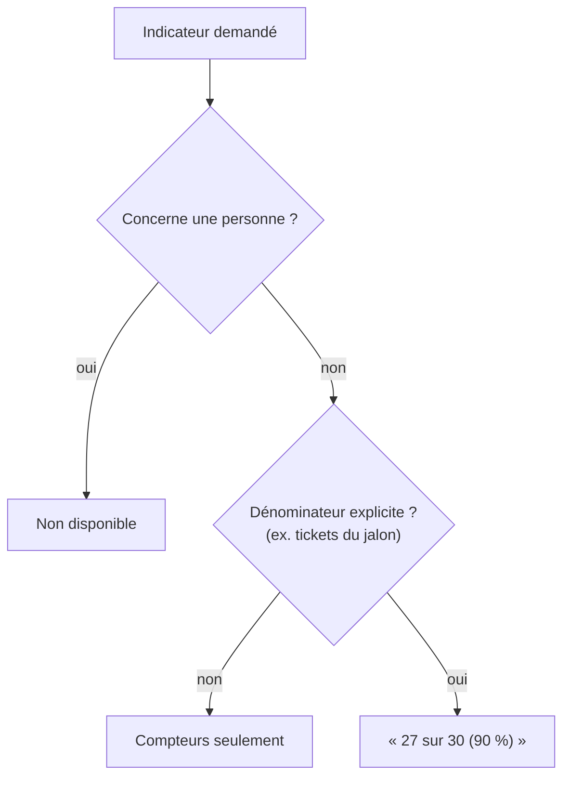

# Fiche capacité : `activite-projets`

| Élément | Valeur |
|---|---|
| Préfixe d'exigences | `PIN` |
| Spec de référence | [`/openspec/specs/activite-projets/spec.md`](/openspec/specs/activite-projets/spec.md) |
| Changements archivés | [`2026-11-17-mesurer-activite-projets`](/openspec/changes/archive/2026-11-17-mesurer-activite-projets/proposal.md) ; [`2026-11-26-alimenter-inventaire-et-completer-ihm`](/openspec/changes/archive/2026-11-26-alimenter-inventaire-et-completer-ihm/proposal.md) (PIN-06) |
| Statut de la capacité | livrée ; section « Activité » de la vue d'inventaire d'`argos-ui` ; aucun adaptateur de la synthèse vers la passerelle IA |
| Composants (arc42 §5) | `project-intel`, `scm-connector`, `ai-gateway`, `API & Security`, IHM `argos-ui` |

## Objectif

[EXISTANT — `mesurer-activite-projets`] Voir où en sont les projets à partir de faits vérifiables, sans pourcentage inventé et sans surveiller personne.

## Acteurs

| Acteur | Interaction | Statut |
|---|---|---|
| Utilisateur | consulte l'activité et la synthèse des projets de ses espaces par l'API REST (`GET /api/v1/projects/{id}/activite`, `/activite/synthese`) et dans la section « Activité » de la vue d'inventaire d'`argos-ui` (`ActiviteProjet.vue`) | [EXISTANT] — `ActiviteProjetsTest`, `ParcoursActiviteTest`, `argos-ui/tests/vues/inventaire.spec.ts` |
| Contributeur ou administrateur de l'espace du projet | lance la collecte immédiate de l'activité (`POST /api/v1/projects/{id}/activite/collecte`, bouton « Collecter maintenant ») | [PROPOSITION] — PIN-06 |
| GitHub / GitLab | fournissent tickets, demandes de fusion, jalons, pipelines et versions par leurs API REST, lues en lecture seule | [EXISTANT] — `RepositoryActivity` (`io.argos.scm`), forges simulées par un serveur HTTP local dans les tests |
| Passerelle IA | produirait la synthèse à partir des indicateurs affichés, par un adaptateur de `SyntheseIa` situé dans `project-intel` | [PROPOSITION] — aucun adaptateur livré ; capacité [`passerelle-ia`](passerelle-ia.md) |

## Périmètre et exclusions

Inclus :

- Compteurs par projet et par période : tickets ouverts et fermés, demandes de fusion ouvertes et fusionnées, pipelines réussis, échoués et autres, versions publiées.
- Jalons ouverts, ou fermés pendant la fenêtre de collecte, avec leur avancement « fermés sur total ».
- Synthèse marquée « produite par l'IA », fondée sur les seuls indicateurs affichés.
- GitHub et GitLab dès la première version (décision du 2026-11-16, Q-1).
- Collecte immédiate d'un projet à la demande, par l'API et l'IHM (PIN-06).
- Section « Activité » de la vue d'inventaire, web et desktop : compteurs sur 30 jours, jalons avec leur dénominateur, fraîcheur, collecte immédiate et synthèse marquée « produite par l'IA ».

Exclus :

- Toute mesure de productivité individuelle, tout classement de personnes.
- Les outils autres que GitHub et GitLab.
- Le choix de la période dans l'IHM : la section « Activité » affiche les 30 derniers jours ; l'API accepte de 1 à 397 jours.
- Les webhooks : la collecte est planifiée (*polling*) [PROPOSITION].

## Préconditions et déclencheurs

Projet relié à un dépôt GitHub (`owner/repo`) ou GitLab (chemin ou identifiant). Jeton facultatif par forge (`ARGOS_GITHUB_TOKEN`, `ARGOS_GITLAB_TOKEN`), en lecture seule : GitLab `read_api`, GitHub jeton à granularité fine en lecture seule [PROPOSITION]. La collecte est déclenchée par le planificateur (`argos.activite.cadence`, 1 h) pour chaque projet dont la collecte est échue (une fois par 24 h) [PROPOSITION]. Un contributeur ou un administrateur de l'espace du projet déclenche aussi la collecte immédiate d'un projet, quelle que soit son échéance (PIN-06 du changement [`alimenter-inventaire-et-completer-ihm`](/openspec/changes/archive/2026-11-26-alimenter-inventaire-et-completer-ihm/proposal.md), [PROPOSITION]).

## Entrées, sorties et validations

| Entrée / sortie | Contenu | Validation ou contrainte | Statut |
|---|---|---|---|
| Activité du dépôt | dates de création, de fermeture, de fusion et de publication ; issue des pipelines ; jalons (titre, état, échéance, tickets fermés et total) | lue dans des structures sans champ d'identité ; titres de jalons nettoyés des caractères de contrôle et tronqués à 200 caractères ; réponses de 5 Mio au plus, 10 pages de 100 éléments par liste et 50 jalons au plus (collecte marquée incomplète au-delà) | [EXISTANT] — `AgregationEtIdentiteTest`, `scm/RepositoryActivityTest#contratGitlab` |
| Compteurs | somme des compteurs quotidiens sur la période demandée | `jours` de 1 à 397, 30 par défaut ; sinon 400 `PERIODE_INVALIDE` | [EXISTANT] — `ActiviteProjetsTest.pin01S1ProjetReliéGithubIndicateursSur30Jours` |
| Avancement d'un jalon | « 27 sur 30 (90 %) » | dénominateur strictement positif ; pourcentage arrondi à l'entier inférieur [PROPOSITION] | [EXISTANT] — `AvancementTest` |
| Fraîcheur | état de la collecte, date de dernière mise à jour, prochaine collecte, complétude, premier jour couvert, motif | motif sans jeton | [EXISTANT] — `ActiviteProjetsTest.pin05S1QuotaEpuiseCollecteReporteeEtAgeAffiche` |
| Collecte immédiate | issue : `A_JOUR`, `REPORTEE_QUOTA`, `ECHEC` ou `SANS_DEPOT` | `POST /api/v1/projects/{id}/activite/collecte`, réponse 200 `{issue}` ; indicateurs existants conservés sauf `A_JOUR` | [PROPOSITION] — PIN-06 ; `CollecteImmediateTest` |
| Synthèse | état, texte, mention « produite par l'IA », période, indicateurs dont elle découle | texte brut de 2 000 caractères au plus ; refusée si elle cite un chiffre absent des indicateurs affichés (heuristique, voir Écarts) | [EXISTANT] — `ActiviteProjetsTest.pin04S1SyntheseMarqueeEtFondeeSurLesIndicateurs` |

## Règles métier

| Règle | Exigence(s) | Source | Statut |
|---|---|---|---|
| Indicateurs factuels par projet, avec leur période | PIN-01 | baseline v2.3 §2.4 | [EXISTANT] — `ActiviteProjetsTest`, `ParcoursActiviteTest` |
| Pourcentage seulement avec un dénominateur explicite ; aucun indicateur calculé par l'IA | PIN-02 | risque R-02 | [EXISTANT] — `AvancementTest`, `AgregationEtIdentiteTest.syntheseRefuseUnChiffreAbsentDesIndicateurs` |
| Aucune mesure individuelle : agrégation par jour avant stockage, aucune colonne ni aucun champ d'identité | PIN-03 | risque R-09 ; décision D1 | [EXISTANT] — `ActiviteProjetsTest.pin03S1AucunIndicateurParPersonne`, `AgregationEtIdentiteTest.pin03S1AucuneIdentiteDansLesStructuresDeLActivite` |
| Synthèse marquée « produite par l'IA », renvoyant aux indicateurs | PIN-04 | IAG-05 | [EXISTANT] — avec une synthèse simulée ; aucune implémentation réelle |
| Lecture seule (`GET` uniquement, aucune redirection suivie) ; quota épuisé : collecte reportée après la réinitialisation annoncée, âge des données affiché | PIN-05 | risque R-14 | [EXISTANT] — `ActiviteProjetsTest.pin05S1QuotaEpuiseCollecteReporteeEtAgeAffiche`, `contratGithubLectureSeuleSansRedirectionNiJeton` |
| Collecte immédiate de l'activité d'un projet par un contributeur ou un administrateur de son espace, par l'API et l'IHM, avec les règles de lecture seule et de quotas de la collecte planifiée ; lecteur : 403, non-membre : 404, refus journalisés | PIN-06 | AUD-QUA-17 ; PIN-05 | [PROPOSITION] — [`alimenter-inventaire-et-completer-ihm`](/openspec/changes/archive/2026-11-26-alimenter-inventaire-et-completer-ihm/proposal.md) ; `CollecteImmediateTest` |
| Historique conservé 13 mois puis supprimé chaque jour | — | décision du 2026-11-16 (Q-2) | [EXISTANT] — `ActiviteProjetsTest.purgeDeLHistoriqueAuDelaDeTreizeMois` |

Un quota épuisé est reconnu à une réponse 429, ou 403 avec `x-ratelimit-remaining: 0` ; la reprise vient de `Retry-After`, de `x-ratelimit-reset` (GitHub) ou de `RateLimit-Reset` (GitLab), bornée à 24 heures, 1 heure par défaut. Les projets suivants de la même forge sont reportés à la même date sans appel [PROPOSITION].

## Droits d'accès et restrictions

Activité et synthèse visibles des seuls membres de l'espace du projet, quel que soit leur rôle ; la collecte immédiate est réservée aux contributeurs et administrateurs de cet espace (`Access.contributor`), un lecteur recevant 403, refus journalisé (PIN-06). Un non-membre reçoit 404 sans révéler l'existence du projet et le refus est journalisé (`refus_acces`). Sous `argos_app`, la RLS des tables `activite_*` ne laisse lire que les projets des espaces du compte courant (ADR-0016) [EXISTANT — `ActiviteProjetsTest.cloisonnementSousArgosAppEtRefusJournalise`]. Les demandes de synthèse sont limitées à 10 par minute et par compte (`LimiteurDebit`) [PROPOSITION].

## Effets de bord observables

Compteurs quotidiens, jalons et état de collecte enregistrés (`activite_compteur`, `activite_jalon`, `activite_collecte`) ; aucune écriture dans les dépôts. Une collecte rejouée sur la même fenêtre produit le même résultat.

## Qualités mesurables

[QUESTION] Aucune cible chiffrée dans les sources ; la cible de consultation de arc42 §10 (Q-05) s'applique quand elle est pertinente.

## Diagrammes

### DF-PIN-1 — Affichage d'un avancement

- **Question** : quand un pourcentage d'avancement s'affiche-t-il ?
- **Type** : organigramme
- **Portée** : comportement implémenté (`Avancement`, `ActiviteResource`)
- **Exigences** : PIN-02, PIN-03

Un pourcentage n'apparaît qu'avec son dénominateur, et jamais pour une personne : l'API n'a ni paramètre ni opération par personne.

## Critères d'acceptation

Scénarios PIN-01-S1 à PIN-05-S1 du changement ; parcours de bout en bout `ParcoursActiviteTest`. Scénarios PIN-06-S1 à PIN-06-S3 du changement [`alimenter-inventaire-et-completer-ihm`](/openspec/changes/archive/2026-11-26-alimenter-inventaire-et-completer-ihm/specs/activite-projets/spec.md) [PROPOSITION].

## Interprétations introduites par un changement

- Aucune donnée d'identité conservée, même temporairement (décision D1) : les réponses des forges sont lues dans des structures qui ne déclarent aucun champ d'identité [PROPOSITION] : à faire valider.
- Les compteurs « ouverts » et « fermés » comptent les tickets créés et fermés pendant la période, non les tickets ouverts à une date [PROPOSITION].
- Un jalon GitHub compte les tickets et les pull requests qui lui sont rattachés, comme l'API GitHub ; un jalon GitLab compte les tickets de même titre (`issues_statistics`) [PROPOSITION].

## Écarts constatés

- PIN-04 : la synthèse n'est produite que si une implémentation de `SyntheseIa` existe ; aucun adaptateur vers la passerelle [`passerelle-ia`](passerelle-ia.md) n'est livré. Sans lui, l'état vaut `INDISPONIBLE` et les indicateurs restent affichés. L'adaptateur prévu se situe dans `project-intel` et appelle le seul contrat de la passerelle, comme `alerting.ResumeIaPasserelle` (décision D4) ; la passerelle sert un modèle local Ollama (MIT), sans API payante (décision Q-1 de `encadrer-appels-ia`) ; `project-intel` n'appelle aucun fournisseur directement.
- Le refus d'une synthèse porte sur les chiffres absents des indicateurs : c'est une heuristique. Un nombre écrit en lettres passe ; les chiffres des titres de jalons, texte externe, et les composantes des dates sont admis.
- La limite de débit des synthèses (10 demandes par minute et par compte) n'est couverte par aucun test : le profil de test la relève à 100 000.
- PIN-06-S2 n'est vérifié que pour un projet sans dépôt (`SANS_DEPOT`) ; l'issue `REPORTEE_QUOTA` de la collecte immédiate repose sur le traitement de la collecte planifiée, vérifié par `ActiviteProjetsTest.pin05S1QuotaEpuiseCollecteReporteeEtAgeAffiche`.
- Le rôle minimal de la collecte immédiate (contributeur) est la valeur proposée par la question Q-1 du changement `alimenter-inventaire-et-completer-ihm`, appliquée sans réponse du porteur du projet.
- La synthèse s'exécute sur un exécuteur commun à l'instance (1 fil, 2 au plus, file de 8) : avec un modèle local lent, la plupart des demandes simultanées valent `INDISPONIBLE`.

## Questions ouvertes

| ID | Question | Impact | Destinataire |
|---|---|---|---|
| Q-1 | Faut-il prendre en charge GitHub et GitLab dès la première version ? | répondue le 2026-11-16 : oui : GitHub et GitLab dès la première version, par les adapters `scm` existants [DÉCISION] | porteur du projet |
| Q-2 | Combien de temps conserver l'historique des indicateurs ? | répondue le 2026-11-16 : 13 mois, puis suppression [DÉCISION] | porteur du projet / DPO |

## Traçabilité

| Exigence | Scénarios | Conception / diagramme | Tâche | Test ou preuve |
|---|---|---|---|---|
| PIN-01 | PIN-01-S1 | Composants, D1 | 1.2 | `ActiviteProjetsTest.pin01S1ProjetReliéGithubIndicateursSur30Jours`, `contratGitlab`, `ParcoursActiviteTest` |
| PIN-02 | PIN-02-S1, PIN-02-S2 | Composants, D3, DF-PIN-1 | 2.1 | `AvancementTest`, `ActiviteProjetsTest.pin02S1EtS2AvancementAvecDenominateurSeulement` |
| PIN-03 | PIN-03-S1 | Persistance, D1 | 1.2 | `ActiviteProjetsTest.pin03S1AucunIndicateurParPersonne`, `AgregationEtIdentiteTest.pin03S1AucuneIdentiteDansLesStructuresDeLActivite` |
| PIN-04 | PIN-04-S1 | Composants, D4 | 2.2 | `ActiviteProjetsTest.pin04S1SyntheseMarqueeEtFondeeSurLesIndicateurs` (synthèse simulée) |
| PIN-05 | PIN-05-S1 | Gestion des erreurs, D2 | 1.1 | `ActiviteProjetsTest.pin05S1QuotaEpuiseCollecteReporteeEtAgeAffiche`, `contratGithubLectureSeuleSansRedirectionNiJeton` |
| PIN-06 | PIN-06-S1 à PIN-06-S3 | `alimenter-inventaire-et-completer-ihm` design.md D3 | 2.2 | `projectintel/CollecteImmediateTest` (`pin06S1CollecteDUnProjetDoteDUnDepot`, `pin06S2ProjetSansDepot`, `pin06S3LecteurOuNonMembre`), `argos-ui/tests/vues/inventaire.spec.ts` |
