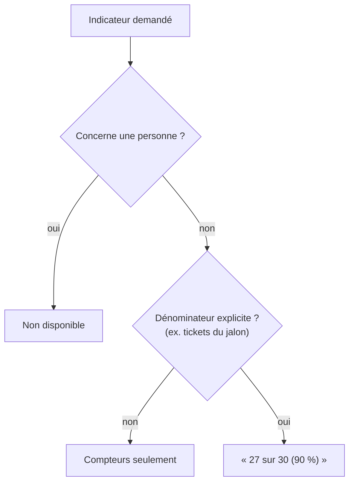

# Fiche capacité : `activite-projets`

| Élément | Valeur |
|---|---|
| Préfixe d'exigences | `PIN` |
| Spec de référence | `/openspec/specs/activite-projets/spec.md` — absente tant qu'aucun changement n'est archivé |
| Changements en cours | [`mesurer-activite-projets`](/openspec/changes/mesurer-activite-projets/proposal.md) (proposé) |
| Statut de la capacité | proposée |
| Composants (arc42 §5) | `project-intel`, `scm-connector`, `ai-gateway` |

## Objectif

[PROPOSITION — `mesurer-activite-projets`] Voir où en sont les projets à partir de faits vérifiables, sans pourcentage inventé et sans surveiller personne.

## Acteurs

| Acteur | Interaction | Statut |
|---|---|---|
| Utilisateur | consulte l'activité des projets de son espace | [PROPOSITION] — arc42 §6.2 |
| GitHub / GitLab | fournissent les données d'activité | [PROPOSITION] — `scm-connector` |

## Périmètre et exclusions

Inclus :

- Indicateurs par projet et par jalon ; synthèse.

Exclus :

- Toute mesure de productivité individuelle.
- Les outils autres que GitHub et GitLab.

## Préconditions et déclencheurs

Projet relié à un dépôt GitHub ou GitLab ; jeton en lecture seule fourni.

## Entrées, sorties et validations

| Entrée / sortie | Contenu | Validation ou contrainte | Statut |
|---|---|---|---|
| Activité du dépôt | tickets, demandes de fusion, jalons, pipelines, versions | agrégée sans identité (PIN-03) | [PROPOSITION] |
| Indicateur | compteur ou avancement avec dénominateur | dénominateur explicite (PIN-02) | [PROPOSITION] |

## Règles métier

| Règle | Exigence(s) | Source | Statut |
|---|---|---|---|
| Indicateurs factuels par projet | PIN-01 | baseline v2.3 §2.4  | [PROPOSITION] |
| Pourcentage avec dénominateur explicite | PIN-02 | risque R-02  | [PROPOSITION] |
| Aucune mesure individuelle | PIN-03 | risque R-09 | [PROPOSITION] |
| Synthèse IA marquée | PIN-04 | IAG-05  | [PROPOSITION] |
| Connexion en lecture seule et quotas | PIN-05 | risque R-14  | [PROPOSITION] |

## Droits d'accès et restrictions

Indicateurs visibles des membres de l'espace du projet.

## Effets de bord observables

Agrégats enregistrés ; aucune écriture dans les dépôts.

## Qualités mesurables

[QUESTION] Aucune cible chiffrée dans les sources ; voir les questions ouvertes.

## Diagrammes

### DF-PIN-1 — Affichage d'un avancement

- **Question** : quand un pourcentage d'avancement s'affiche-t-il ?
- **Type** : organigramme
- **Portée** : cible proposée
- **Exigences** : PIN-02, PIN-03

Un pourcentage n'apparaît qu'avec son dénominateur, et jamais pour une personne.

## Critères d'acceptation

Scénarios PIN-01-S1 à PIN-05-S1 du changement ; aucun scénario qualité transverse supplémentaire.

## Interprétations introduites par un changement

- Aucune donnée d'identité conservée, même temporairement (décision D1) : à faire valider.

## Écarts constatés

Aucun écart constaté.

## Questions ouvertes

| ID | Question | Impact | Destinataire |
|---|---|---|---|
| Q-1 | Faut-il prendre en charge GitHub et GitLab dès la première version ? | répondue le 2026-11-16 : oui : GitHub et GitLab dès la première version, par les adapters `scm` existants [DÉCISION] | porteur du projet |
| Q-2 | Combien de temps conserver l'historique des indicateurs ? | répondue le 2026-11-16 : 13 mois, puis suppression [DÉCISION] | porteur du projet / DPO |

## Traçabilité

| Exigence | Scénarios | Conception / diagramme | Tâche | Test ou preuve |
|---|---|---|---|---|
| PIN-01 | PIN-01-S1 | Composants | 1.2 | à écrire |
| PIN-02 | PIN-02-S1, PIN-02-S2 | Composants | 2.1 | à écrire |
| PIN-03 | PIN-03-S1 | Composants | 1.2 | à écrire |
| PIN-04 | PIN-04-S1 | Composants | 2.2 | à écrire |
| PIN-05 | PIN-05-S1 | Composants | 1.1 | à écrire |
