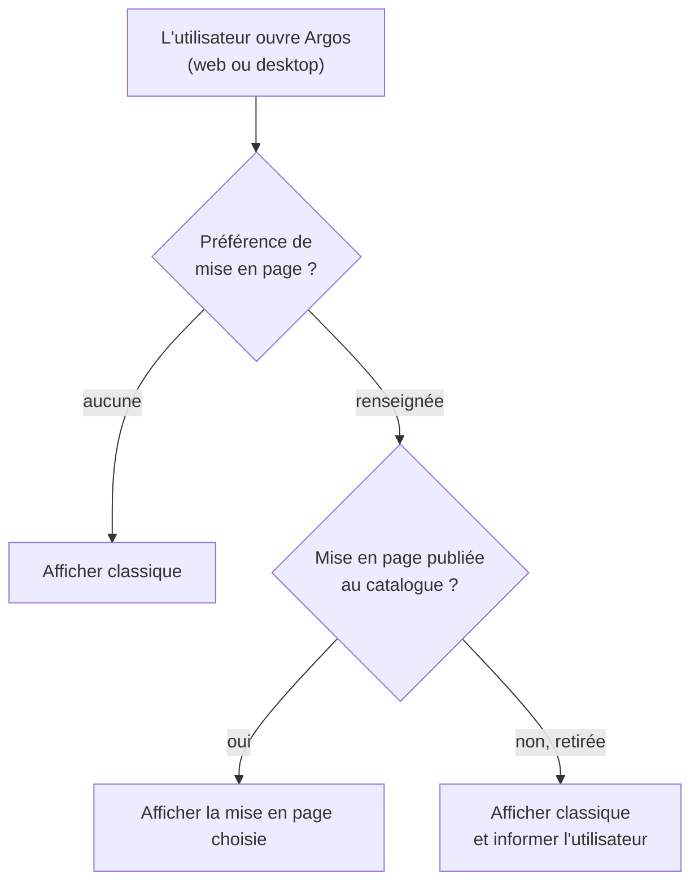

# Fiche capacité : `affichage-personnalise`

| Élément | Valeur |
|---|---|
| Préfixe d'exigences | `AFF` |
| Spec de référence | [`/openspec/specs/affichage-personnalise/spec.md`](/openspec/specs/affichage-personnalise/spec.md) |
| Changements archivés | [`2026-11-19-personnaliser-profils-et-affichage`](/openspec/changes/archive/2026-11-19-personnaliser-profils-et-affichage/proposal.md) |
| Statut de la capacité | livrée |
| Composants (arc42 §5) | `workspace`, `catalog`, `API & Security`, IHM `argos-ui` (couches contenu et mise en page) |

## Objectif

[EXIGENCE — ADR-0023 (Accepté)] Laisser chaque utilisateur choisir comment Argos s'affiche, pour une IHM « plus jolie et qui ne fasse pas penser au travail » (demande du porteur, 2026-11-15), sans jamais changer ce qui est affiché.

## Acteurs

| Acteur | Interaction | Statut |
|---|---|---|
| Utilisateur | choisit sa mise en page sur le web ou le desktop | [EXISTANT] — `#/affichage`, `PreferencesResourceTest`, E2E `e2e/tests/affichage.spec.ts` et `e2e/desktop/affichage.spec.ts` |
| Administrateur plateforme | publie ou retire une mise en page du catalogue | [EXISTANT] — par configuration (`argos.catalogue.mises-en-page.retirees`), `MiseEnPageRetireeTest` |

## Périmètre et exclusions

Inclus : catalogue des mises en page, choix par utilisateur, défaut, contenu identique, accessibilité. Exclus : réglages fins d'une mise en page (couleurs, densité), prévus plus tard.

Mises en page initiales [EXIGENCE — ADR-0023] :

| Identifiant | Esprit | Maquette |
|---|---|---|
| `classique` (défaut) | application de travail : menu, filtres, listes | page « Version classique » |
| `journal` | quotidien contemporain : une, rubriques, colonnes | page « Version journal » |
| `fantaisie` | magazine décalé et coloré | page « Version fantaisie » |
| `gazette` | presse imprimée du XIXᵉ siècle | page « Version gazette » |

Les maquettes se trouvent dans l'artefact « ARGOS desktop — maquettes des écrans ».

[EXISTANT — tâche 2.4] Les quatre mises en page reçoivent un même modèle de données typé, `VeilleAffichee` (`argos-ui/src/mises-en-page/modele.ts`) : rubriques des profils actifs et éléments avec titre, nature, gravité, résumé, projets concernés et niveau de correspondance, action, rubriques et mentions obligatoires (source et lien, date, niveau de confiance, mention « résumé produit par l'IA », mention de paternité et de licence de la source, mention de validation humaine, textes des garde-fous des profils actifs, origine : profils et abonnements personnels). Elles n'en retirent ni n'en ajoutent aucun fait et ne réordonnent pas les éléments ; le décor est ignoré des technologies d'assistance et l'humour reste dans la forme. Le composant affiché est choisi par `MiseEnPage.vue` d'après l'identifiant de la préférence, avec repli `classique` pour un identifiant inconnu de l'IHM.

[EXISTANT — tâche 2.4] L'écran « Ma veille » (`#/veille`) affiche la veille restituée par `GET /api/v1/me/veille` dans la mise en page de la préférence de l'utilisateur. La couche contenu transpose la réponse vers `VeilleAffichee` (`argos-ui/src/contenu/veille-affichee.ts`) : un élément reçu donne un élément affiché, dans l'ordre reçu ; types et gravités du serveur deviennent des natures et gravités du modèle (un type inconnu garde son libellé sous la nature `actualite`, une gravité hors échelle garde son libellé sous `non-classee`) ; les rubriques du sommaire sont celles des profils actifs d'après le catalogue, puis celles que portent les éléments. Le catalogue des profils et la liste des abonnements ne servent qu'à nommer ; leur échec, comme celui de la lecture de la préférence, n'empêche pas l'affichage (mise en page `classique` par défaut).

[DÉCISION — porteur du projet, 2026-11-18 ; tâche 2.4] Polices : celles des maquettes, toutes sous SIL Open Font License 1.1, embarquées par les paquets `@fontsource/*` (sous-ensemble latin) et servies par l'application ; aucun service de polices externe n'est appelé (CSP du desktop `font-src 'self'` inchangée). La licence SIL OFL 1.1 est acceptée pour les seules polices embarquées de `argos-ui` : licence libre et gratuite, usage commercial permis, sans effet sur la licence du code (ADR-0021 point 4). Licences enregistrées dans `argos-ui/NOTICE`, avis livrés dans `argos-ui/public/licences-polices.txt`.

## Préconditions et déclencheurs

Utilisateur authentifié ; mise en page publiée au catalogue.

## Entrées, sorties et validations

| Entrée / sortie | Contenu | Validation ou contrainte | Statut |
|---|---|---|---|
| Choix de mise en page | `PUT /api/v1/preferences/mise-en-page` `{"miseEnPage": "gazette"}` | doit être publié au catalogue, sinon refus 400 `MISE_EN_PAGE_INCONNUE` (AFF-01) | [EXISTANT] — `PreferencesResource`, `PreferencesResourceTest` |
| Préférence | `GET /api/v1/preferences` : mise en page appliquée, mise en page choisie, indicateur et message de retrait | enregistrée côté serveur, table `workspace_preference_utilisateur` (AFF-03) | [EXISTANT] — `PreferencesRepository`, migration `V7__preferences_utilisateur.sql`, clé : compte Argos |
| Catalogue | `GET /api/v1/catalogue/mises-en-page` : mises en page publiées, défaut signalé | une mise en page retirée (`argos.catalogue.mises-en-page.retirees`) n'est plus listée ni choisissable | [EXISTANT] — `CatalogueMisesEnPage`, `CatalogueResourceTest`, `MiseEnPageRetireeTest` |

## Règles métier

| Règle | Exigence(s) | Source | Statut |
|---|---|---|---|
| Le choix se fait parmi le catalogue | AFF-01 | ADR-0023 | [EXISTANT] — serveur ; tests AFF-01-S1, AFF-01-S2 |
| Contenu, droits et mentions identiques dans toute mise en page | AFF-02 | ADR-0023 ; dossier v2.4 §A.3 | [EXIGENCE] — implémentée : couches séparées (`argos-ui/tests/architecture.test.mjs`) ; mêmes faits, liens et mentions dans les quatre mises en page sur un même jeu (`argos-ui/tests/mises-en-page.test.mjs`, banc `e2e/accessibilite/`) ; veille réelle transposée rendue dans les quatre mises en page (`argos-ui/tests/veille-affichee.test.mjs`, `argos-ui/tests/mises-en-page.test.mjs`) ; E2E `e2e/tests/veille.spec.ts` « 2.4 (AFF-02-S1, AFF-02-S2) » sur la veille réelle (2026-11-17) |
| Préférence partagée web / desktop | AFF-03 | ADR-0023 ; ADR-0022 | [EXIGENCE] — implémentée : préférence serveur ; E2E web puis desktop (`e2e/desktop/affichage.spec.ts`, application Electron réelle) passe ; la connexion du desktop avec le navigateur réellement installé sur le poste reste à vérifier à la main (navigateur du système simulé dans l'E2E) |
| `classique` par défaut et en repli | AFF-04 | ADR-0023 | [EXISTANT] — serveur (`ResolutionPreferences`) et IHM (`resolution.ts`) ; tests AFF-04-S1, AFF-04-S2 |
| Accessibilité vérifiée avant publication | AFF-05 | ADR-0023 | [EXIGENCE] — partiellement implémentée : audit des quatre mises en page du 2026-11-17 ([rapport](../architecture/quality/audit-accessibilite-mises-en-page.md)) ; un couple de couleurs sous le seuil fait échouer les tests de l'IHM ; la publication au catalogue du serveur n'est pas bloquée par ce contrôle ([DÉCISION] du porteur du projet du 2026-11-19 : aucun contrôle côté serveur, voir « Qualités mesurables ») |

## Droits d'accès et restrictions

La mise en page ne change aucun droit : elle ne reçoit que des éléments déjà autorisés (voir DC-2 du changement).

## Effets de bord observables

Modification de la préférence de l'utilisateur ; aucune autre donnée.

## Qualités mesurables

[DÉCISION — 2026-11-16] Référentiel d'accessibilité : RGAA 4.1.2 (aligné sur WCAG 2.1 AA), vérifié sur les mêmes écrans de référence pour chaque mise en page (AFF-05).

[DÉCISION — porteur du projet, 2026-11-19 (F6)] AFF-05 : aucun contrôle d'accessibilité côté serveur. La conformité des mises en page est vérifiée par les tests de l'IHM (`argos-ui/tests/contrastes.test.mjs`, `e2e/accessibilite/mises-en-page.spec.ts`) et par l'audit d'accessibilité ; AFF-05 reste partiellement implémentée, le catalogue du serveur ne refusant pas lui-même une mise en page non conforme. Décision consignée dans la [spec de référence](/openspec/specs/affichage-personnalise/spec.md) (AFF-05).

[EXISTANT] Audit du 2026-11-17 ([rapport](../architecture/quality/audit-accessibilite-mises-en-page.md)) : contraste minimal du texte rendu 4,97:1 (`fantaisie`) à 6,67:1 (`gazette`), lecture à 320 px sans défilement horizontal, tabulation et focus, mouvement réduit, structure et décor contrôlés ; restitution par lecteur d'écran non vérifiée.

## Diagrammes

### DF-AFF-1 — Mise en page appliquée à l'ouverture

- **Question** : quelle mise en page s'affiche quand un utilisateur ouvre Argos ?
- **Type** : organigramme
- **Portée** : implémentation de `personnaliser-profils-et-affichage`
- **Exigences** : AFF-01, AFF-03, AFF-04

La préférence est lue sur le serveur : le portail web et le desktop suivent le même chemin et affichent donc la même mise en page.

## Critères d'acceptation

Scénarios AFF-01-S1 à AFF-05-S1 de la [spec de référence](/openspec/specs/affichage-personnalise/spec.md).

## Interprétations introduites par un changement

- Mise en page par défaut `classique` et repli en cas de retrait (AFF-04) : non précisé par la demande, à faire valider.
- Contrôle d'accessibilité avant publication (AFF-05) : ajouté par cohérence avec les mentions obligatoires, à faire valider.

## Écarts constatés

Aucun écart avec ADR-0022, ADR-0023 et le dossier v2.4 §A.3. Écart avec les maquettes : la mise en page `fantaisie` fonce le sarcelle et le rouge de la maquette, qui n'atteignent pas 4,5:1 sur les cartes roses (écart E2 du [rapport d'audit](../architecture/quality/audit-accessibilite-mises-en-page.md)) ; les polices des maquettes sont embarquées au lieu d'être chargées depuis Google Fonts.

## Questions ouvertes

| ID | Question | Impact | Destinataire |
|---|---|---|---|
| Q-4 | Référentiel d'accessibilité (RGAA, WCAG 2.1 AA) ? | répondue le 2026-11-16 : RGAA 4.1.2 (aligné sur WCAG 2.1 AA) [DÉCISION] | RSSI / référent accessibilité |

## Traçabilité

| Exigence | Scénarios | Conception / diagramme | Tâche | Test ou preuve |
|---|---|---|---|---|
| AFF-01 | AFF-01-S1, AFF-01-S2 | DC-1, DF-AFF-1 | 2.1, 2.2 | `argos-server/src/test/java/io/argos/api/preference/PreferencesResourceTest.java`, `OpenApiContractTest.java` — passent |
| AFF-02 | AFF-02-S1, AFF-02-S2 | DC-2 | 2.3, 2.4 | `argos-ui/tests/architecture.test.mjs`, `argos-ui/tests/mises-en-page.test.mjs` passent ; banc `e2e/accessibilite/mises-en-page.spec.ts` passe ; `argos-ui/tests/veille-affichee.test.mjs` passe ; E2E `e2e/tests/veille.spec.ts` « 2.4 » et « 3.9, AFF-02-S2 (PRF-02-S4) » passent (2026-11-17) |
| AFF-03 | AFF-03-S1 | DC-1, DF-AFF-1 | 2.5, 5.2 | `PreferencesResourceTest.java` ; E2E web `e2e/tests/affichage.spec.ts` ; E2E web puis desktop `e2e/desktop/affichage.spec.ts` (« fantaisie » choisie sur le web, appliquée par l'application Electron ; « gazette » choisie sur le web, « Ma veille » en gazette sur le desktop) — passent |
| AFF-04 | AFF-04-S1, AFF-04-S2 | DF-AFF-1 | 2.2 | `PreferencesResourceTest.java`, `MiseEnPageRetireeTest.java`, `argos-ui/tests/resolution.test.mjs` — passent |
| AFF-05 | AFF-05-S1 | — | 1.4, 2.6 | [rapport d'audit](../architecture/quality/audit-accessibilite-mises-en-page.md) ; `argos-ui/tests/contrastes.test.mjs`, `e2e/accessibilite/mises-en-page.spec.ts` passent |
