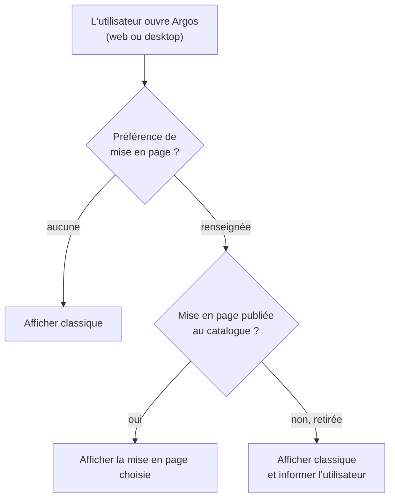

# Fiche capacité : `affichage-personnalise`

| Élément | Valeur |
|---|---|
| Préfixe d'exigences | `AFF` |
| Spec de référence | `/openspec/specs/affichage-personnalise/spec.md` — absente tant qu'aucun changement n'est archivé |
| Changements en cours | [`personnaliser-profils-et-affichage`](/openspec/changes/personnaliser-profils-et-affichage/proposal.md) (en cours d'implémentation) |
| Statut de la capacité | proposée ; catalogue, préférence serveur et couches de l'IHM implémentés |
| Composants (arc42 §5) | `workspace`, `catalog`, `API & Security`, IHM `argos-ui` (couches contenu et mise en page) |

## Objectif

[PROPOSITION — `personnaliser-profils-et-affichage`] Laisser chaque utilisateur choisir comment Argos s'affiche, pour une IHM « plus jolie et qui ne fasse pas penser au travail » (demande du porteur, 2026-11-15), sans jamais changer ce qui est affiché.

## Acteurs

| Acteur | Interaction | Statut |
|---|---|---|
| Utilisateur | choisit sa mise en page sur le web ou le desktop | [PROPOSITION] |
| Administrateur plateforme | publie ou retire une mise en page du catalogue | [PROPOSITION] |

## Périmètre et exclusions

Inclus : catalogue des mises en page, choix par utilisateur, défaut, contenu identique, accessibilité. Exclus : réglages fins d'une mise en page (couleurs, densité), prévus plus tard.

Mises en page initiales [PROPOSITION — ADR-0023] :

| Identifiant | Esprit | Maquette |
|---|---|---|
| `classique` (défaut) | application de travail : menu, filtres, listes | page « Version classique » |
| `journal` | quotidien contemporain : une, rubriques, colonnes | page « Version journal » |
| `fantaisie` | magazine décalé et coloré | page « Version fantaisie » |
| `gazette` | presse imprimée du XIXᵉ siècle | page « Version gazette » |

Les maquettes se trouvent dans l'artefact « ARGOS desktop — maquettes des écrans ».

## Préconditions et déclencheurs

Utilisateur authentifié ; mise en page publiée au catalogue.

## Entrées, sorties et validations

| Entrée / sortie | Contenu | Validation ou contrainte | Statut |
|---|---|---|---|
| Choix de mise en page | `PUT /api/v1/preferences/mise-en-page` `{"miseEnPage": "gazette"}` | doit être publié au catalogue, sinon refus 400 `MISE_EN_PAGE_INCONNUE` (AFF-01) | [EXISTANT] — `PreferencesResource`, `PreferencesResourceTest` |
| Préférence | `GET /api/v1/preferences` : mise en page appliquée, mise en page choisie, indicateur et message de retrait | enregistrée côté serveur, table `workspace_preference_utilisateur` (AFF-03) | [EXISTANT] — `PreferencesRepository`, migration `V20261116_1` |
| Catalogue | `GET /api/v1/catalogue/mises-en-page` : mises en page publiées, défaut signalé | une mise en page retirée (`argos.catalogue.mises-en-page.retirees`) n'est plus listée ni choisissable | [EXISTANT] — `CatalogueMisesEnPage`, `CatalogueResourceTest`, `MiseEnPageRetireeTest` |

## Règles métier

| Règle | Exigence(s) | Source | Statut |
|---|---|---|---|
| Le choix se fait parmi le catalogue | AFF-01 | ADR-0023 | [EXISTANT] — serveur ; tests AFF-01-S1, AFF-01-S2 |
| Contenu, droits et mentions identiques dans toute mise en page | AFF-02 | ADR-0023 ; dossier v2.4 §A.3 | [PROPOSITION] — couches contenu et mise en page séparées et vérifiées par `argos-ui/tests/architecture.test.mjs` ; E2E à écrire |
| Préférence partagée web / desktop | AFF-03 | ADR-0023 ; ADR-0022 | [PROPOSITION] — préférence serveur existante ; E2E desktop à écrire |
| `classique` par défaut et en repli | AFF-04 | ADR-0023 | [EXISTANT] — serveur (`ResolutionPreferences`) et IHM (`resolution.ts`) ; tests AFF-04-S1, AFF-04-S2 |
| Accessibilité vérifiée avant publication | AFF-05 | ADR-0023 | [PROPOSITION] |

## Droits d'accès et restrictions

La mise en page ne change aucun droit : elle ne reçoit que des éléments déjà autorisés (voir DC-2 du changement).

## Effets de bord observables

Modification de la préférence de l'utilisateur ; aucune autre donnée.

## Qualités mesurables

[DÉCISION — 2026-11-16] Référentiel d'accessibilité : RGAA 4.1.2 (aligné sur WCAG 2.1 AA), vérifié sur les mêmes écrans de référence pour chaque mise en page (AFF-05). Aucun audit n'est encore réalisé.

## Diagrammes

### DF-AFF-1 — Mise en page appliquée à l'ouverture

- **Question** : quelle mise en page s'affiche quand un utilisateur ouvre Argos ?
- **Type** : organigramme
- **Portée** : cible proposée
- **Exigences** : AFF-01, AFF-03, AFF-04

La préférence est lue sur le serveur : le portail web et le desktop suivent le même chemin et affichent donc la même mise en page.

## Critères d'acceptation

Scénarios AFF-01-S1 à AFF-05-S1 du changement.

## Interprétations introduites par un changement

- Mise en page par défaut `classique` et repli en cas de retrait (AFF-04) : non précisé par la demande, à faire valider.
- Contrôle d'accessibilité avant publication (AFF-05) : ajouté par cohérence avec les mentions obligatoires, à faire valider.

## Écarts constatés

Aucun écart constaté (comparaison avec ADR-0022, ADR-0023 et le dossier v2.4 §A.3).

## Questions ouvertes

| ID | Question | Impact | Destinataire |
|---|---|---|---|
| Q-4 | Référentiel d'accessibilité (RGAA, WCAG 2.1 AA) ? | répondue le 2026-11-16 : RGAA 4.1.2 (aligné sur WCAG 2.1 AA) [DÉCISION] | RSSI / référent accessibilité |

## Traçabilité

| Exigence | Scénarios | Conception / diagramme | Tâche | Test ou preuve |
|---|---|---|---|---|
| AFF-01 | AFF-01-S1, AFF-01-S2 | DC-1, DF-AFF-1 | 2.1, 2.2 | `argos-server/src/test/java/io/argos/api/preference/PreferencesResourceTest.java`, `OpenApiContractTest.java` — passent |
| AFF-02 | AFF-02-S1, AFF-02-S2 | DC-2 | 2.3, 2.4 | `argos-ui/tests/architecture.test.mjs` passe (2.3) ; E2E à écrire (2.4) |
| AFF-03 | AFF-03-S1 | DC-1, DF-AFF-1 | 2.5 | préférence serveur testée ; E2E web puis desktop à écrire |
| AFF-04 | AFF-04-S1, AFF-04-S2 | DF-AFF-1 | 2.2 | `PreferencesResourceTest.java`, `MiseEnPageRetireeTest.java`, `argos-ui/tests/resolution.test.mjs` — passent |
| AFF-05 | AFF-05-S1 | — | 1.4, 2.6 | à écrire |
