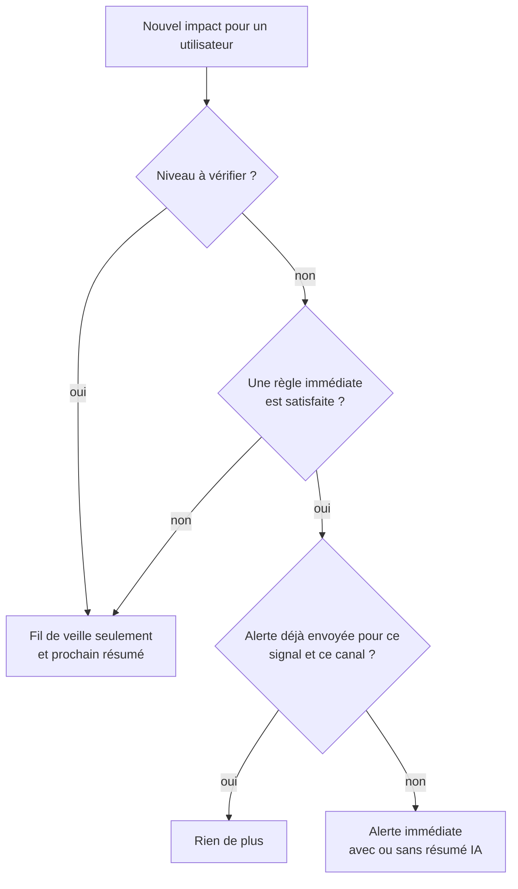

# Fiche capacité : `alertes-digests`

| Élément | Valeur |
|---|---|
| Préfixe d'exigences | `ALR` |
| Spec de référence | `/openspec/specs/alertes-digests/spec.md` — absente tant qu'aucun changement n'est archivé |
| Changements en cours | [`diffuser-alertes-et-digests`](/openspec/changes/diffuser-alertes-et-digests/proposal.md) (proposé) |
| Statut de la capacité | proposée |
| Composants (arc42 §5) | `alerting`, `workspace`, `impact-engine` |

## Objectif

[PROPOSITION — `diffuser-alertes-et-digests`] Prévenir chaque utilisateur des éléments qui le concernent, immédiatement quand c'est grave et établi, sinon dans un résumé, sans bruit inutile.

## Acteurs

| Acteur | Interaction | Statut |
|---|---|---|
| Utilisateur | reçoit alertes et résumés selon ses abonnements | [PROPOSITION] — ABO-01 à ABO-04 |
| Administrateur d'espace | définit les règles du socle d'équipe | [PROPOSITION] — ABO-03 |
| Serveur de messagerie | achemine les e-mails | [QUESTION] — Q-1 |

## Périmètre et exclusions

Inclus :

- Évaluation des règles, regroupement, envoi par e-mail, remise au client desktop (change `notifier-sur-le-poste`).

Exclus :

- Les canaux de messagerie d'équipe (Teams, Slack, Matrix) : question Q-2.
- Le statut d'action d'un impact (corrigé, risque accepté) : relève de `correlation-impact`.

## Préconditions et déclencheurs

Impacts calculés (`correlation-impact`) ; abonnements définis (`abonnements-veille`) ; utilisateur authentifié (`comptes-acces`).

## Entrées, sorties et validations

| Entrée / sortie | Contenu | Validation ou contrainte | Statut |
|---|---|---|---|
| Impact | signal, projet, niveau | niveau exact, probable ou à vérifier | [PROPOSITION] |
| Règle | type, gravité, projets, canal, fréquence | portée par un abonnement (ABO-02) | [PROPOSITION] |
| Alerte | titre, gravité, projets, sources, lien, résumé IA éventuel | données autorisées du destinataire seulement (ALR-06) | [PROPOSITION] |

## Règles métier

| Règle | Exigence(s) | Source | Statut |
|---|---|---|---|
| Alerte selon les règles de l'utilisateur | ALR-01 | ABO-02  | [PROPOSITION] |
| Pas d'alerte immédiate sur un impact à vérifier | ALR-02 | ADR-0013 (Proposé)  | [PROPOSITION] |
| Une alerte par signal, utilisateur et canal | ALR-03 | dossier v2.4 §8.4 (regroupement) | [PROPOSITION] |
| Résumés périodiques | ALR-04 | ABO-02 (fréquence)  | [PROPOSITION] |
| Diffusion sans IA bloquante | ALR-05 | baseline v2.3 §6  | [PROPOSITION] |
| Canaux de diffusion | ALR-06 | ADR-0022 (Proposé)  | [PROPOSITION] |

## Droits d'accès et restrictions

Une alerte ne cite que les projets que le destinataire est autorisé à voir (ACC-04).

## Effets de bord observables

Envoi de messages ; enregistrement des alertes et de leur état par canal.

## Qualités mesurables

[QUESTION] Aucune cible chiffrée dans les sources ; voir les questions ouvertes.

## Diagrammes

### DF-ALR-1 — Alerte immédiate ou résumé

- **Question** : un élément part-il en alerte immédiate ou dans le résumé ?
- **Type** : organigramme
- **Portée** : cible proposée
- **Exigences** : ALR-01, ALR-02, ALR-04

Seuls les impacts établis qui satisfont une règle immédiate déclenchent une alerte, une seule fois par canal.

## Critères d'acceptation

Scénarios ALR-01-S1 à ALR-06-S2 du changement ; QS-10 (résilience sans IA).

## Interprétations introduites par un changement

- Aucun résumé envoyé quand il est vide (ALR-04-S2) : à faire valider.

## Écarts constatés

Aucun écart constaté.

## Questions ouvertes

| ID | Question | Impact | Destinataire |
|---|---|---|---|
| Q-1 | Quel serveur d'envoi d'e-mails : relais du Synology ou service externe ? | oui pour ALR-06 | porteur du projet |
| Q-2 | Faut-il un canal de messagerie d'équipe (Teams, Slack, Matrix) ? | non | porteur du projet |
| Q-3 | À quelle heure et quel jour partent les résumés ? | non : paramétrable | Product Owner |
| Q-4 | La cible « alerte en moins d'une heure » est-elle validée ? | non : cible qualité | Product Owner |

## Traçabilité

| Exigence | Scénarios | Conception / diagramme | Tâche | Test ou preuve |
|---|---|---|---|---|
| ALR-01 | ALR-01-S1, ALR-01-S2 | DC-1 | 2.2 | à écrire |
| ALR-02 | ALR-02-S1 | DC-1 | 2.2 | à écrire |
| ALR-03 | ALR-03-S1 | DC-1 | 2.1, 2.3 | à écrire |
| ALR-04 | ALR-04-S1, ALR-04-S2 | DC-1 | 3.1 | à écrire |
| ALR-05 | ALR-05-S1 | DC-1 | 2.4 | à écrire |
| ALR-06 | ALR-06-S1, ALR-06-S2 | DC-1 | 1.1, 3.2, 3.3 | à écrire |
