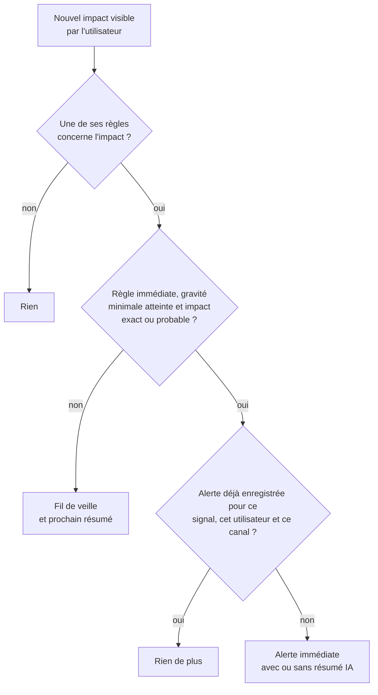

# Fiche capacité : `alertes-digests`

| Élément | Valeur |
|---|---|
| Préfixe d'exigences | `ALR` |
| Spec de référence | `/openspec/specs/alertes-digests/spec.md` — absente tant qu'aucun changement n'est archivé |
| Changements en cours | [`diffuser-alertes-et-digests`](/openspec/changes/diffuser-alertes-et-digests/proposal.md) (implémenté, non archivé) |
| Statut de la capacité | proposée ; implémentation et tests dans `argos-server`, changement non archivé |
| Composants (arc42 §5) | `alerting`, `workspace`, `impact-engine` |

## Objectif

[PROPOSITION — `diffuser-alertes-et-digests`] Prévenir chaque utilisateur des éléments qui le concernent, immédiatement quand c'est grave et établi, sinon dans un résumé, sans bruit inutile.

## Acteurs

| Acteur | Interaction | Statut |
|---|---|---|
| Utilisateur | reçoit alertes et résumés selon ses abonnements | [EXISTANT] — `MoteurAlertes`, `ResumesPeriodiques` |
| Administrateur d'espace | définit les règles du socle d'équipe (abonnements `TEAM`) | [EXISTANT] — ABO-03, ABO-06 |
| Serveur de messagerie | relais SMTP du Synology (DSM) qui achemine les e-mails | [DÉCISION] du 2026-11-16 (Q-1) ; [EXISTANT] — `CanalEmail` |
| Client desktop | lit les alertes `DESKTOP` et confirme leur remise | [EXISTANT] — contrat `/api/v1/alertes` ; client : changement `notifier-sur-le-poste` |

## Périmètre et exclusions

Inclus :

- évaluation des règles, regroupement, résumés quotidiens et hebdomadaires, envoi par e-mail avec nouvelles tentatives, mise à disposition des alertes au client desktop (contrat utilisé par `notifier-sur-le-poste`).

Exclus :

- les canaux de messagerie d'équipe (Teams, Slack, Matrix) : aucun pour l'instant [DÉCISION] du 2026-11-16 (Q-2) ;
- le statut d'action d'un impact (corrigé, risque accepté) : relève de `correlation-impact` ;
- la notification système du poste : relève de `notifications-poste`.

## Préconditions et déclencheurs

Impacts calculés (`correlation-impact`) : `impact-engine` publie l'événement `ImpactsRecorded` après chaque corrélation ; abonnements définis (`abonnements-veille`) ; comptes et appartenances (`comptes-acces`). Les résumés partent à heure fixe (tâches planifiées Quarkus Scheduler).

### Configuration d'exploitation

Configuration par variables d'environnement (aucun secret versionné) :

| Variable | Rôle | Défaut |
|---|---|---|
| `ARGOS_SMTP_HOST`, `ARGOS_SMTP_PORT` | relais SMTP du Synology | `localhost`, `587` |
| `ARGOS_SMTP_USER`, `ARGOS_SMTP_PASSWORD` | authentification au relais | aucune |
| `ARGOS_SMTP_STARTTLS` | `DISABLED`, `OPTIONAL` ou `REQUIRED` | `OPTIONAL` |
| `ARGOS_MAIL_FROM` | expéditeur | `argos@localhost` |
| `ARGOS_PUBLIC_URL` | adresse de l'IHM pour les liens | `http://localhost:5173` |
| `ARGOS_RESUME_QUOTIDIEN_CRON`, `ARGOS_RESUME_HEBDOMADAIRE_CRON`, `ARGOS_ALERTES_FUSEAU` | horaires des résumés | `0 0 8 * * ?`, `0 0 8 ? * MON`, `Europe/Paris` |

## Entrées, sorties et validations

| Entrée / sortie | Contenu | Validation ou contrainte | Statut |
|---|---|---|---|
| Impact | signal (titre, gravité, source), projet, espace, niveau, paquet | niveau `EXACT`, `PROBABLE` ou `A_VERIFIER` | [EXISTANT] — `ImpactsRecorded` |
| Règle | abonnement actif : canal, fréquence, critères `PROJECT`, `PACKAGE`, `SOURCE`, `TECHNOLOGY`, `SEVERITY` | canal `EMAIL` ou `DESKTOP` ; fréquence `IMMEDIATE`, `DAILY` ou `WEEKLY` ; gravité `LOW`, `MODERATE`, `MEDIUM`, `HIGH` ou `CRITICAL` | [EXISTANT] — `RegleAlerte` |
| Alerte | titre, gravité, projets autorisés du destinataire, sources, lien vers l'élément, résumé IA éventuel et son état | données autorisées du destinataire seulement (ALR-06) | [EXISTANT] — table `alerte` (V8) |
| Résumé | éléments non alertés de la période, avec projets, sources et liens | aucun résumé vide (ALR-04-S2) | [EXISTANT] — table `alerte`, éléments `resume_element` |
| Contrat desktop | `GET /api/v1/alertes?canal=&etat=`, `GET /api/v1/alertes/{id}`, `POST /api/v1/alertes/{id}/remise` | alertes de l'appelant seulement | [EXISTANT] — `AlertesResource` |

## Règles métier

| Règle | Exigence(s) | Source | Statut |
|---|---|---|---|
| Alerte immédiate quand une règle `IMMEDIATE` concerne l'impact et que la gravité minimale est atteinte | ALR-01 | ABO-02 | [EXISTANT] |
| Pas d'alerte immédiate sur un impact à vérifier ; l'élément reste dans le fil et entre dans le prochain résumé | ALR-02 | ADR-0013 (Proposé) | [EXISTANT] |
| Une alerte par signal, utilisateur et canal, qui cite tous les projets concernés ; un rejeu n'en crée pas d'autre | ALR-03 | dossier v2.4 §8.4 (regroupement) ; décision D2 | [EXISTANT] |
| Résumés quotidien (08:00) et hebdomadaire (lundi 08:00), Europe/Paris, paramétrables ; aucun résumé sans élément nouveau | ALR-04 | ABO-02 (fréquence) ; [DÉCISION] du 2026-11-16 (Q-3) | [EXISTANT] |
| Résumé IA demandé avec un délai borné ; alerte envoyée sans lui s'il est indisponible, refusé ou au-delà du plafond, avec mention dans le message | ALR-05 | baseline v2.3 §6 ; QS-10 | [EXISTANT] |
| Diffusion par e-mail (relais SMTP du Synology) et vers le client desktop ; nouvelles tentatives bornées puis état « en échec » | ALR-06 | ADR-0022 (Proposé) ; [DÉCISION] du 2026-11-16 (Q-1) | [EXISTANT] |

## Droits d'accès et restrictions

Une alerte ne cite que les projets que le destinataire est autorisé à voir (ACC-04) : les impacts sont relus sous son compte, rôle `argos_app` et RLS de `project_impact`. Les destinataires possibles sont les membres des espaces touchés ; une règle n'élargit aucun droit (ABO-05). Sous `argos_app`, un compte ne lit que ses alertes et ses éléments de résumé, et ne modifie que l'état et la date de remise de ses alertes `DESKTOP`. Une alerte d'un autre compte est introuvable via l'API et la tentative est journalisée (ACC-06).

## Effets de bord observables

- enregistrement des alertes et résumés, avec leur état d'envoi par canal (`EN_ATTENTE`, `ENVOYEE`, `EN_ECHEC`), le nombre de tentatives et l'échéance de la suivante ;
- envoi d'e-mails ;
- événement CDI `AlerteEmise` à chaque alerte ou résumé enregistré.

## Qualités mesurables

[QUESTION] La cible « alerte en moins d'une heure » (Q-4) n'est pas validée. Le parcours de test mesure le délai entre la collecte et l'envoi (moins d'une seconde avec les services de test) ; en exploitation, la diffusion des messages en attente a lieu toutes les minutes.

## Diagrammes

### DF-ALR-1 — Alerte immédiate ou résumé

- **Question** : un élément part-il en alerte immédiate ou dans le résumé ?
- **Type** : organigramme
- **Portée** : comportement implémenté
- **Exigences** : ALR-01, ALR-02, ALR-03, ALR-04

Seuls les impacts établis qui satisfont une règle immédiate déclenchent une alerte, une seule fois par canal. Un élément alerté immédiatement n'est pas repris dans un résumé.

## Critères d'acceptation

Scénarios ALR-01-S1 à ALR-06-S2 du changement ; QS-10 (résilience sans IA).

## Interprétations introduites par un changement

Interprétations du changement `diffuser-alertes-et-digests`, à faire valider [PROPOSITION] :

- gravité minimale portée par un critère d'abonnement `SEVERITY` ; une gravité absente ou non graduée (vecteur CVSS brut) n'atteint aucun seuil ;
- critères `PROJECT`, `PACKAGE`, `SOURCE`, `TECHNOLOGY` cumulatifs entre types et alternatifs dans un type ; les critères `VENDOR`, `THEME` et `DOMAIN` ne concernent aucun impact de sécurité ; les seuls éléments diffusés sont les impacts de sécurité ;
- un élément non alerté par une règle immédiate entre dans le résumé quotidien du canal de la règle ;
- un élément alerté sur un canal n'est repris dans aucun résumé du même utilisateur ;
- aucun résumé envoyé quand il est vide (ALR-04-S2) ;
- canaux `EMAIL` et `DESKTOP` seulement ; tout autre canal d'abonnement (`IN_APP`, par exemple) ne déclenche aucune diffusion ;
- le résumé IA porte sur le seul signal ; sans implémentation de `ResumeIa` (aucune n'est livrée), l'état est `INDISPONIBLE` ;
- le lien vers l'élément vise `<ARGOS_PUBLIC_URL>/signaux/<id>` ; la page correspondante de l'IHM reste à créer ;
- cinq tentatives au plus, délai initial d'une minute doublé à chaque échec, plafonné à 30 minutes ; une adresse e-mail absente est un échec définitif.

## Écarts constatés

- Le code de `argos-server` implémente les règles de cette fiche : module `io.argos.alerting` (`MoteurAlertes`, `RegleAlerte`, `ResumesPeriodiques`, `EnvoiAlertes`, `CanalEmail`, `ConsultationAlertes`), `io.argos.api.AlertesResource`, événement `io.argos.impact.ImpactsRecorded`, migration `V8__alertes_et_resumes.sql`.
- L'IHM ne présente pas encore les alertes ni la page d'un signal visée par le lien des messages.

## Questions ouvertes

| ID | Question | Impact | Destinataire |
|---|---|---|---|
| Q-1 | Quel serveur d'envoi d'e-mails : relais du Synology ou service externe ? | répondue le 2026-11-16 : relais SMTP du Synology (DSM), configuré par variables d'environnement ; aucun service externe payant [DÉCISION] | porteur du projet |
| Q-2 | Faut-il un canal de messagerie d'équipe (Teams, Slack, Matrix) ? | répondue le 2026-11-16 : non : aucun canal de messagerie d'équipe pour l'instant [DÉCISION] | porteur du projet |
| Q-3 | À quelle heure et quel jour partent les résumés ? | répondue le 2026-11-16 : résumé quotidien à 08:00 et hebdomadaire le lundi à 08:00 (Europe/Paris), paramétrables [DÉCISION] | Product Owner |
| Q-4 | La cible « alerte en moins d'une heure » est-elle validée ? | non : cible qualité | Product Owner |

## Traçabilité

| Exigence | Scénarios | Conception / diagramme | Tâche | Test ou preuve |
|---|---|---|---|---|
| ALR-01 | ALR-01-S1, ALR-01-S2 | DC-1 | 2.2 | `AlertesTest` (`alr01S1EtAlr06S1…`, `alr01S2…`), `RegleAlerteTest` |
| ALR-02 | ALR-02-S1 | DC-1 | 2.2 | `AlertesTest.alr02S1…` |
| ALR-03 | ALR-03-S1 | DC-1 | 2.1, 2.3 | `AlertesTest.alr03S1…`, `AlertesTest.cleDIdempotence…` |
| ALR-04 | ALR-04-S1, ALR-04-S2 | DC-1 | 3.1 | `AlertesTest.alr04S1…`, `alr04S2…`, `horairesDesResumes…` |
| ALR-05 | ALR-05-S1 | DC-1 | 2.4 | `AlertesTest.alr05S1…`, `qs10…` |
| ALR-06 | ALR-06-S1, ALR-06-S2 | DC-1 | 1.1, 3.2, 3.3 | `AlertesTest.alr01S1EtAlr06S1…`, `EchecSmtpTest`, `AlertesTest.contrat…`, `rls…`, `cloisonnement…` |

Tests : `argos-server/src/test/java/io/argos/alerting/`. Matrice détaillée : [`tasks.md`](/openspec/changes/diffuser-alertes-et-digests/tasks.md#matrice-de-traçabilité).
