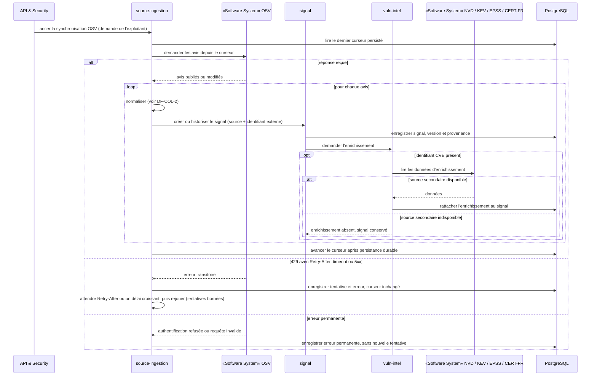
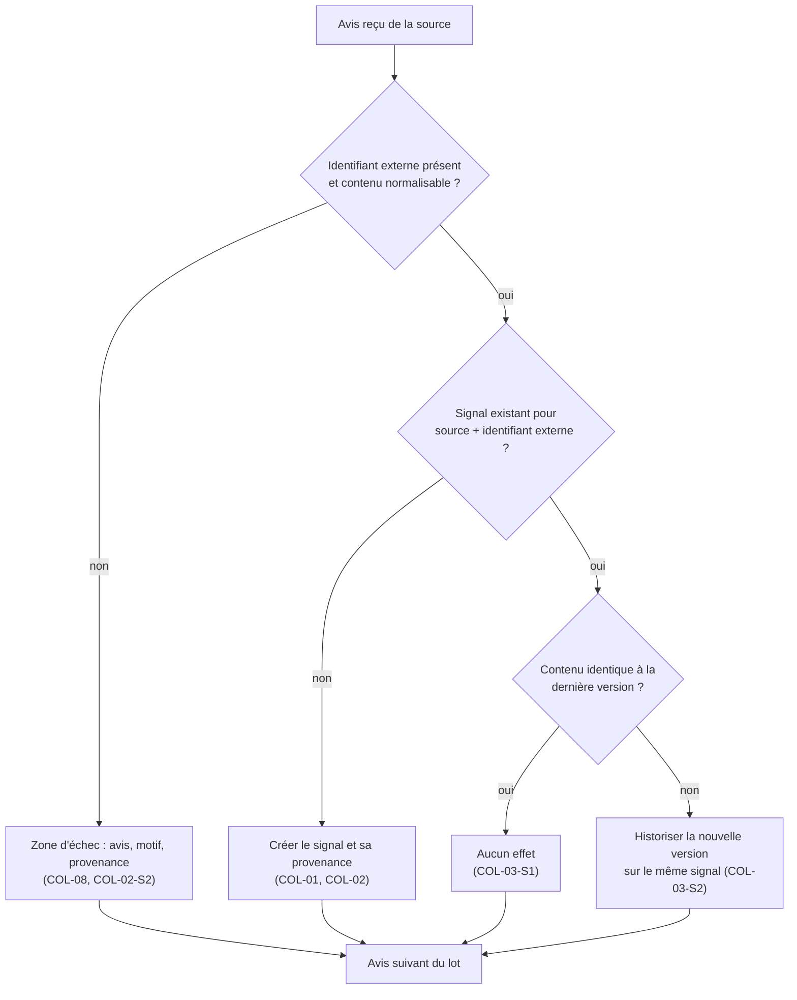
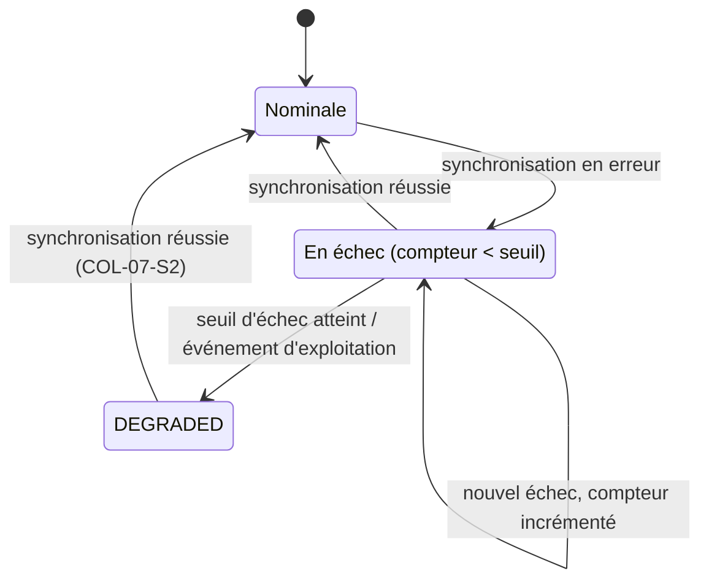

# Fiche capacité : `collecte-avis-securite`

| Élément | Valeur |
|---|---|
| Préfixe d'exigences | `COL` |
| Spec de référence | `/openspec/specs/collecte-avis-securite/spec.md` — absente : capacité non livrée |
| Changement en cours | [`formaliser-chaine-securite-poc`](/openspec/changes/formaliser-chaine-securite-poc/specs/collecte-avis-securite/spec.md) — proposé, non archivé ; [`automatiser-chaine-veille`](/openspec/changes/automatiser-chaine-veille/specs/collecte-avis-securite/spec.md) — proposé, non implémenté (COL-09, COL-10) |
| Statut de la capacité | **proposée**, implémentée dans `argos-server` (changement non archivé) : paquets `io.argos.ingestion`, `io.argos.signal`, `io.argos.vulnintel` |
| Composants (arc42 §5) | `source-ingestion`, `signal`, `vuln-intel`, `audit`, adaptateur PostgreSQL |

Tout le contenu de cette fiche porte le statut [PROPOSITION] (changement `formaliser-chaine-securite-poc`) sauf mention contraire.

## Objectif

Disposer, sans veille manuelle, des avis de vulnérabilité qui concernent les composants open source, sous une forme normalisée et traçable, afin que la corrélation (`correlation-impact`) puisse désigner les projets touchés. Source : arc42 §1.2 objectifs 1 et 2 ; ADR-0010.

## Acteurs

| Acteur | Interaction | Statut |
|---|---|---|
| OSV | publie les avis, source principale | [PROPOSITION] — ADR-0010 |
| NVD, CISA KEV, FIRST EPSS, CERT-FR | enrichissent les signaux | [PROPOSITION] — ADR-0010 |
| Responsable sécurité, utilisateur technique | consultent les signaux et leur provenance | [PROPOSITION] — arc42 §1.3 |
| Exploitant | surveille l'état des sources | [PROPOSITION] — arc42 §3.2, §6.3 |
| API d'exploitation (`API & Security`) | déclenche une synchronisation à la demande de l'exploitant | [EXISTANT] — `POST /api/v1/ops/sources/{id}/synchronizations` ; aucune planification automatique à ce jour |
| Planificateur du serveur (`quarkus-scheduler`) | déclenche la synchronisation de chaque source toutes les heures par défaut (COL-09) | [PROPOSITION] — changement `automatiser-chaine-veille` ; [DÉCISION] J1, porteur du projet, 2026-11-19 ; ADR-0031 (Accepté) |

## Périmètre et exclusions

- **Inclus** : collecte OSV, enrichissement, normalisation en signal, historisation des modifications, idempotence, reprise sur erreur, état dégradé, mise à l'écart des avis non conformes.
- **Exclu** : corrélation avec les projets (`correlation-impact`), alertes (lot 2), analyse IA, autres familles de signaux (releases, réglementation, RSS).

## Préconditions et déclencheurs

- La source OSV est configurée et joignable depuis l'environnement (proxy sortant selon politique SI : arc42 §7.3) [QUESTION].
- Déclencheur : synchronisation planifiée ou reprise après redémarrage (arc42 §6.3, §6.4). [DÉCISION — porteur du projet, 2026-11-19 ; J1, Q-COL-1] Les sources d'avis (OSV, CERT-FR et autres collecteurs existants) sont synchronisées toutes les heures par la planification existante (`quarkus-scheduler`, ADR-0031), avec le curseur delta existant ; fréquence configurable. Exigence COL-09 du changement [`automatiser-chaine-veille`](/openspec/changes/automatiser-chaine-veille/proposal.md) [PROPOSITION].

## Entrées, sorties et validations

| Entrée / sortie | Contenu | Validation ou contrainte | Statut |
|---|---|---|---|
| Entrée : avis OSV | identifiant, paquets (PURL), plages de versions, alias CVE, dates | identifiant externe obligatoire ; contenu traité comme donnée non fiable (arc42 §8.3) | [PROPOSITION] |
| Entrée : données d'enrichissement | score/fiche NVD, présence KEV, probabilité EPSS, avis CERT-FR | rattachées par identifiant (CVE) | [PROPOSITION] |
| Sortie : signal de sécurité | contenu normalisé, provenance, historique des versions | un signal logique par source + identifiant externe | [PROPOSITION] |
| Sortie : zone d'échec | avis rejeté, motif, provenance | aucune suppression silencieuse (arc42 §11.2) | [PROPOSITION] |
| Sortie : événement d'exploitation | passage en `DEGRADED` | daté, visible de l'exploitant | [PROPOSITION] |

## Règles métier

| Règle | Exigence(s) | Source | Statut |
|---|---|---|---|
| OSV est la source principale ; les autres enrichissent | COL-01, COL-04 | ADR-0010 | [PROPOSITION] |
| Un avis = un signal logique ; les modifications sont historisées | COL-03 | arc42 §6.1 ; baseline v2.3 §4 | [PROPOSITION] |
| Un signal conserve sa provenance complète | COL-02 | arc42 §4.2 P3 | [PROPOSITION] |
| Le curseur n'avance qu'après persistance durable | COL-05 | arc42 §6.3 | [PROPOSITION] |
| Retry borné, `Retry-After` respecté, erreurs permanentes distinguées | COL-06 | arc42 §6.3, §8.5 | [PROPOSITION] |
| Seuil d'échec → `DEGRADED` + événement d'exploitation | COL-07 | arc42 §6.3 | [PROPOSITION] |
| Avis non normalisable → zone d'échec, lot poursuivi | COL-08 | arc42 §8.3, §8.5, §11.2 | [PROPOSITION] |
| Synchronisation planifiée de chaque source, une heure par défaut, depuis le curseur persisté ; aucune seconde synchronisation d'une source déjà en cours ; index d'enrichissement rafraîchis à chaque cadence | COL-09 | décision J1 du porteur du projet, 2026-11-19 ; ADR-0031 | [PROPOSITION] — `automatiser-chaine-veille` |
| Avis connu inchangé si l'empreinte de son contenu normalisé est identique ; sinon nouvelle version | COL-10 | décision J2 du porteur du projet, 2026-11-19 | [PROPOSITION] — `automatiser-chaine-veille` |

## Droits d'accès et restrictions

Les signaux de sécurité sont globaux, non rattachés à un espace (ADR-0016, contexte). Leur consultation exige une identité authentifiée (ADR-0008, Proposé). L'état des sources est destiné au rôle `OPS` (arc42 §8.1) [PROPOSITION].

## Effets de bord observables

- création ou mise à jour de signaux et de leur historique ;
- avancement du curseur de la source ;
- enregistrements dans la zone d'échec ;
- changement d'état de la source et événement d'exploitation ;
- déclenchement de la corrélation pour les signaux créés ou modifiés (capacité `correlation-impact`).

## Qualités mesurables

| Qualité | Cible | Source | Statut |
|---|---|---|---|
| Perte d'avis lors d'une panne | 0 | arc42 §10.2 Q-03 ; QS-03 | [PROPOSITION] |
| Duplication logique après rejeu | 0 | arc42 §10.2 Q-03 ; QS-04 | [PROPOSITION] |
| Délai publication source → signal | « alerte sécurité < 1 h » | ADR-0010, traçabilité | [DÉCISION] Q-6 du changement — porteur du projet, 2026-11-18 : cible de qualité mesurée pendant le POC, sans être un critère d'acceptation |
| Fraîcheur des sources | métrique à exposer, seuil non défini | arc42 §8.6 | [QUESTION] |

## Diagrammes

### DF-COL-1 — Synchronisation d'une source de vulnérabilités

- **Question** : comment un avis OSV devient-il un signal enrichi, et que se passe-t-il quand une source répond en erreur ?
- **Type** : UML séquence
- **Portée** : implémenté dans `argos-server` (`io.argos.ingestion.SourceSynchronizer`, `SyncStore`, `RetryPolicy`, `io.argos.ingestion.osv`, `io.argos.vulnintel`) ; la planification automatique n'existe pas encore : une synchronisation se lance par `POST /api/v1/ops/sources/{id}/synchronizations` ; le déclenchement horaire planifié est la cible de COL-09 (changement `automatiser-chaine-veille`, [PROPOSITION])
- **Exigences** : COL-01, COL-03, COL-04, COL-05, COL-06

Le curseur n'avance qu'en fin de lot, après l'enregistrement durable des signaux (COL-05) : une panne entre deux avis fait rejouer le lot, et l'idempotence (COL-03) absorbe les avis déjà enregistrés. L'enrichissement est facultatif : son absence ne bloque pas le signal (COL-04-S3). La synchronisation se lance aujourd'hui à la demande de l'exploitant par l'API d'exploitation ; le changement `automatiser-chaine-veille` ajoute un déclenchement horaire par le planificateur, qui suit la même séquence et saute une source déjà en cours de synchronisation (COL-09) [PROPOSITION].

### DF-COL-2 — Traitement d'un avis reçu

- **Question** : quelle décision le système prend-il pour chaque avis reçu ?
- **Type** : organigramme (flowchart), pas un diagramme UML
- **Portée** : cible proposée
- **Exigences** : COL-02, COL-03, COL-08

Un avis rejeté n'interrompt pas le lot (COL-08-S1). [DÉCISION — porteur du projet, 2026-11-19 ; J2, Q-COL-2] « Contenu identique » signifie : même empreinte (hash) du contenu normalisé ; sinon l'avis est mis à jour (COL-10, changement `automatiser-chaine-veille`). Le code compare aujourd'hui l'empreinte du contenu brut [EXISTANT] ; la définition du contenu normalisé (champs du signal hors date de modification déclarée par la source et date de collecte) est la proposition P-2 du changement [PROPOSITION].

### DF-COL-3 — État de synchronisation d'une source

- **Question** : comment une source passe-t-elle en état dégradé et en sort-elle ?
- **Type** : UML états (stateDiagram-v2)
- **Portée** : cible proposée ; seul l'état `DEGRADED` est nommé par les sources (arc42 §6.3) — les noms `Nominale` et `En échec` sont proposés par ce changement
- **Exigences** : COL-06, COL-07

Seuils décidés le 2026-11-16 (Q-4) [DÉCISION] : 5 tentatives par synchronisation avec attente exponentielle ; `DEGRADED` après 3 synchronisations consécutives en échec. Ce sont les valeurs par défaut de `argos.ingestion.max-attempts` et `argos.ingestion.degraded-threshold`. Le retour de `DEGRADED` à `Nominale` sur succès est une interprétation de ce changement. Dans le code, `Nominale` vaut `NOMINAL` et `En échec` vaut `FAILING`.

## Critères d'acceptation

- Scénarios `COL-01-S1` à `COL-08-S1` de la spec.
- QS-03 (429/5xx sans perte) et QS-04 (rejeu sans duplication logique) du registre `/docs/architecture/quality/scenarios.md`.
- Baseline v2.3 §4 : « avis OSV collecté, normalisé, dédupliqué et historisé avec provenance ».

## Interprétations introduites par un changement

Interprétations validées par le porteur du projet le 2026-11-16 [DÉCISION].

Comportements absents des sources, ajoutés pour rendre les règles testables (changement `formaliser-chaine-securite-poc`) :

- COL-03-S3 : collectes concurrentes du même avis → un seul signal ;
- COL-06-S3 : une erreur permanente n'est pas retentée automatiquement ;
- COL-07-S2 : une synchronisation réussie fait quitter l'état `DEGRADED`.

## Écarts constatés

- Le code de `argos-server` implémente les règles de cette fiche (tests `argos-server/src/test/java/io/argos/chain/CollecteTest.java`, `EnrichmentTest.java`, `ResilienceTest.java`). Toute erreur inattendue pendant une synchronisation (et pas seulement une erreur de source) termine le traitement en échec permanent et fait changer l'état de la source ; un traitement `RUNNING` sans activité depuis `argos.ingestion.running-expiry` (30 minutes) est repris au lancement suivant.
- Le délai imposé par `Retry-After` est borné par le délai maximal des tentatives (`argos.ingestion.backoff-max`, 5 minutes).
- Un avis OSV retiré (champ `withdrawn`) reste historisé comme signal, mais ne déclare plus aucun paquet affecté : il ne produit aucun impact.
- Aucune planification automatique des synchronisations n'est installée à ce jour ; elle est spécifiée par COL-09 (décision J1 du 2026-11-19, changement `automatiser-chaine-veille`, volet A). La première synchronisation OSV sans curseur énumère tout l'index `modified_id.csv` des écosystèmes configurés, dans la requête d'exploitation, sans borne de volume.

## Questions ouvertes

| ID | Question | Impact | Destinataire |
|---|---|---|---|
| Q-COL-1 | Fréquence de synchronisation de chaque source ? | levée le 2026-11-19 : toutes les heures, par `quarkus-scheduler` (ADR-0031), avec le curseur delta existant, fréquence configurable [DÉCISION — porteur du projet, 2026-11-19 ; J1] ; voir COL-09 du changement [`automatiser-chaine-veille`](/openspec/changes/automatiser-chaine-veille/design.md) | sécurité / exploitation |
| Q-COL-2 | Qu'est-ce qu'un avis « modifié » : contenu différent ou date de modification de l'avis ? | levée le 2026-11-19 : inchangé si l'empreinte du contenu normalisé est identique, sinon mis à jour [DÉCISION — porteur du projet, 2026-11-19 ; J2] ; voir COL-10 du changement `automatiser-chaine-veille` | backend |
| Q-COL-3 | Quels écosystèmes (Maven, npm, PyPI…) le POC doit-il couvrir ? | périmètre COL-01 | Tech Lead |
| Q-4 (changement) | Nombre maximal de tentatives et seuil d'échec ? | répondue le 2026-11-16 : 5 tentatives par synchronisation, avec attente exponentielle ; `DEGRADED` après 3 synchronisations consécutives en échec [DÉCISION] | backend / exploitation |

## Traçabilité

Voir la matrice du changement : [`tasks.md`](/openspec/changes/formaliser-chaine-securite-poc/tasks.md#matrice-de-traçabilité). Les scénarios COL-01-S1 à COL-08-S1 sont vérifiés par `argos-server/src/test/java/io/argos/chain/CollecteTest.java`, `ResilienceTest.java`, `EnrichmentTest.java` et `DocumentParsingTest.java` (contrat sur une réponse OSV réelle enregistrée) ; les sources externes y sont simulées. COL-09 et COL-10 : matrice du changement [`automatiser-chaine-veille`](/openspec/changes/automatiser-chaine-veille/tasks.md#matrice-de-traçabilité) (tests à écrire, volet A).
