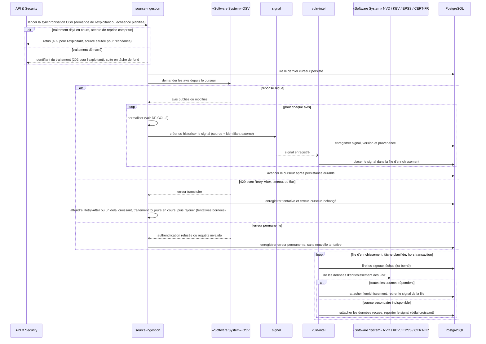
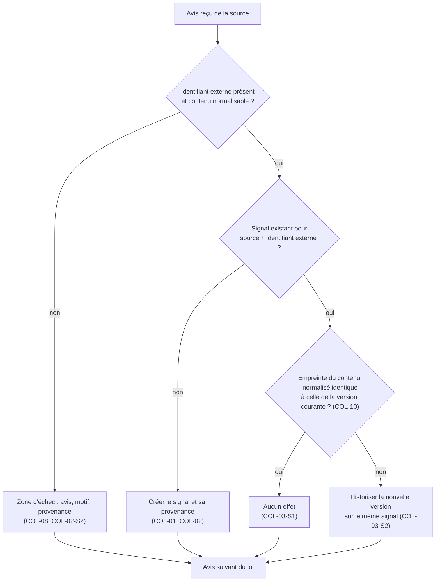
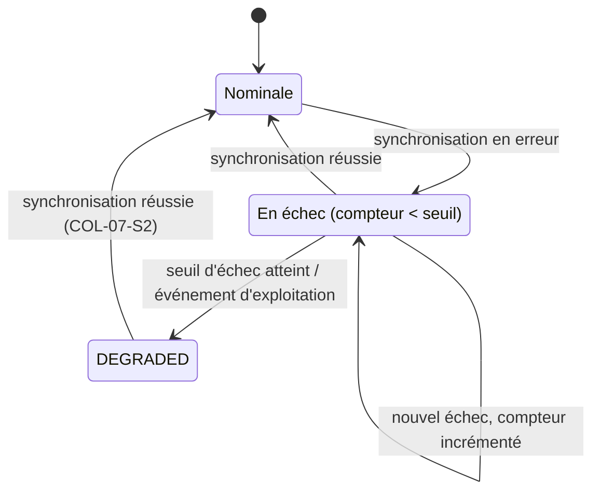

# Fiche capacité : `collecte-avis-securite`

| Élément | Valeur |
|---|---|
| Préfixe d'exigences | `COL` |
| Spec de référence | [`/openspec/specs/collecte-avis-securite/spec.md`](/openspec/specs/collecte-avis-securite/spec.md) |
| Changement en cours | [`formaliser-chaine-securite-poc`](/openspec/changes/archive/2026-11-20-formaliser-chaine-securite-poc/specs/collecte-avis-securite/spec.md) — proposé, non archivé ; [`automatiser-chaine-veille`](/openspec/changes/archive/2026-11-20-automatiser-chaine-veille/specs/collecte-avis-securite/spec.md) — proposé, non archivé ; COL-09 et COL-10 implémentés par le volet A (2026-11-19) ; [`2026-11-25-isoler-erreurs-aux-frontieres`](/openspec/changes/archive/2026-11-25-isoler-erreurs-aux-frontieres/proposal.md) (COL-11, archivé) ; [`rendre-ingestion-asynchrone`](/openspec/changes/rendre-ingestion-asynchrone/proposal.md) (COL-04 modifiée, COL-12) — proposé, implémenté |
| Statut de la capacité | **proposée**, implémentée dans `argos-server` (changement non archivé) : paquets `io.argos.ingestion`, `io.argos.signal`, `io.argos.vulnintel` |
| Composants (arc42 §5) | `source-ingestion`, `signal`, `vuln-intel`, `audit`, adaptateur PostgreSQL |

Tout le contenu de cette fiche porte le statut [PROPOSITION] (changement `formaliser-chaine-securite-poc`) sauf mention contraire.

## Objectif

Disposer, sans veille manuelle, des avis de vulnérabilité qui concernent les composants open source, sous une forme normalisée et traçable, afin que la corrélation (`correlation-impact`) puisse désigner les projets touchés. Source : arc42 §1.2 objectifs 1 et 2 ; ADR-0010.

## Acteurs

| Acteur | Interaction | Statut |
|---|---|---|
| OSV | publie les avis, source principale | [PROPOSITION] — ADR-0010 |
| NVD, CISA KEV, FIRST EPSS, CERT-FR | enrichissent les signaux | [PROPOSITION] — ADR-0010 |
| Responsable sécurité, utilisateur technique | consultent les signaux et leur provenance | [PROPOSITION] — arc42 §1.3 |
| Exploitant | surveille l'état des sources | [PROPOSITION] — arc42 §3.2, §6.3 |
| API d'exploitation (`API & Security`) | déclenche une synchronisation à la demande de l'exploitant | [EXISTANT] — `POST /api/v1/ops/sources/{id}/synchronizations` |
| Planificateur du serveur (`quarkus-scheduler`) | déclenche la synchronisation de chaque source toutes les heures par défaut (COL-09) | [EXISTANT] — tâche `signal-synchronisation-sources` (`io.argos.signal.SynchronisationPlanifiee`, 2026-11-19) ; [DÉCISION] J1, porteur du projet, 2026-11-19 ; ADR-0031 (Accepté) ; exigence [PROPOSITION] jusqu'à l'archivage de `automatiser-chaine-veille` |

## Périmètre et exclusions

- **Inclus** : collecte OSV, enrichissement, normalisation en signal, historisation des modifications, idempotence, reprise sur erreur, état dégradé, mise à l'écart des avis non conformes.
- **Exclu** : corrélation avec les projets (`correlation-impact`), alertes (lot 2), analyse IA, autres familles de signaux (releases, réglementation, RSS).

## Préconditions et déclencheurs

- La source OSV est configurée et joignable depuis l'environnement (proxy sortant selon politique SI : arc42 §7.3) [QUESTION].
- Déclencheur : synchronisation planifiée ou reprise après redémarrage (arc42 §6.3, §6.4). [DÉCISION — porteur du projet, 2026-11-19 ; J1, Q-COL-1] Les sources d'avis (OSV, CERT-FR et autres collecteurs existants) sont synchronisées toutes les heures par la planification existante (`quarkus-scheduler`, ADR-0031), avec le curseur delta existant ; fréquence configurable. Exigence COL-09 du changement [`automatiser-chaine-veille`](/openspec/changes/archive/2026-11-20-automatiser-chaine-veille/proposal.md) [PROPOSITION] ; implémentée [EXISTANT] par la tâche `signal-synchronisation-sources`, cadence `argos.ingestion.planification.cadence` (`1h` par défaut, variable `ARGOS_INGESTION_PLANIFICATION_CADENCE`, `off` la désactive), désactivée dans le profil de test et dans la pile E2E. Le CERT-FR, source d'enrichissement sans curseur, est rafraîchi à chaque échéance (index invalidé puis relu à la consultation suivante, COL-09-S5).

## Entrées, sorties et validations

| Entrée / sortie | Contenu | Validation ou contrainte | Statut |
|---|---|---|---|
| Entrée : avis OSV | identifiant, paquets (PURL), plages de versions, alias CVE, dates | identifiant externe obligatoire ; contenu traité comme donnée non fiable (arc42 §8.3) | [PROPOSITION] |
| Entrée : données d'enrichissement | score/fiche NVD, présence KEV, probabilité EPSS, avis CERT-FR | rattachées par identifiant (CVE) | [PROPOSITION] |
| Sortie : signal de sécurité | contenu normalisé, provenance, historique des versions | un signal logique par source + identifiant externe | [PROPOSITION] |
| Sortie : zone d'échec | avis rejeté, motif, provenance | aucune suppression silencieuse (arc42 §11.2) | [PROPOSITION] |
| Sortie : événement d'exploitation | passage en `DEGRADED` | daté, visible de l'exploitant | [PROPOSITION] |

## Règles métier

| Règle | Exigence(s) | Source | Statut |
|---|---|---|---|
| OSV est la source principale ; les autres enrichissent | COL-01, COL-04 | ADR-0010 | [PROPOSITION] |
| Un avis = un signal logique ; les modifications sont historisées | COL-03 | arc42 §6.1 ; baseline v2.3 §4 | [PROPOSITION] |
| Un signal conserve sa provenance complète | COL-02 | arc42 §4.2 P3 | [PROPOSITION] |
| Le curseur n'avance qu'après persistance durable | COL-05 | arc42 §6.3 | [PROPOSITION] |
| Retry borné, `Retry-After` respecté, erreurs permanentes distinguées | COL-06 | arc42 §6.3, §8.5 | [PROPOSITION] |
| Seuil d'échec → `DEGRADED` + événement d'exploitation | COL-07 | arc42 §6.3 | [PROPOSITION] |
| Avis non normalisable → zone d'échec, lot poursuivi | COL-08 | arc42 §8.3, §8.5, §11.2 | [PROPOSITION] |
| Synchronisation planifiée de chaque source, une heure par défaut, depuis le curseur persisté ; aucune seconde synchronisation d'une source déjà en cours ; index d'enrichissement rafraîchis à chaque cadence | COL-09 | décision J1 du porteur du projet, 2026-11-19 ; ADR-0031 | [PROPOSITION] — `automatiser-chaine-veille` ; implémentée et vérifiée le 2026-11-19 (`SynchronisationPlanifieeTest`) |
| Avis connu inchangé si l'empreinte de son contenu normalisé est identique ; sinon nouvelle version | COL-10 | décision J2 du porteur du projet, 2026-11-19 | [PROPOSITION] — `automatiser-chaine-veille` ; implémentée et vérifiée le 2026-11-19 (`EmpreinteNormaliseeTest`, `CollecteTest`) |
| L'enrichissement suit l'enregistrement du signal sans le retarder : le signal attend dans une file persistante, traitée par lots hors transaction ; une source indisponible est retentée avec un délai croissant, et un signal à CVE resté sans enrichissement est replacé en file | COL-04 | AUD-PER-02 ; ADR-0039 (Proposé) | [PROPOSITION] — `rendre-ingestion-asynchrone` ; vérifiée par `EnrichmentTest` |
| Le lancement par l'exploitant répond 202 avec l'identifiant du traitement, poursuivi en tâche de fond ; un traitement en cours, attente de reprise comprise, refuse un second lancement (409 `SYNCHRONISATION_EN_COURS`) | COL-12 | AUD-PER-01, AUD-PER-27 ; décision du porteur du projet, 2026-11-26 | [PROPOSITION] — `rendre-ingestion-asynchrone` ; vérifiée par `LancementSynchronisationTest` |
| Une erreur imprévue, y compris due à un avis mal formé (PURL mal encodé), termine la synchronisation de sa source en `FAILED` (motif `PERMANENT`, compté pour `DEGRADED`), jamais `RUNNING` ; les autres sources du passage sont synchronisées, puis le passage relance l'erreur et se termine en échec visible. Un PURL mal encodé est illisible : l'avis est indexé par écosystème et nom | COL-11 | AUD-QUA-20 ; arc42 §8.5 (frontières d'erreur) ; décision « isoler puis relancer » du porteur du projet, 2026-11-24 | [PROPOSITION] — `isoler-erreurs-aux-frontieres` ; vérifiée par `FrontieresCollecteTest`, `ResilienceTest` |

## Droits d'accès et restrictions

Les signaux de sécurité sont globaux, non rattachés à un espace (ADR-0016, contexte). Leur consultation exige une identité authentifiée (ADR-0008, Proposé). L'état des sources est destiné au rôle `OPS` (arc42 §8.1) [PROPOSITION].

## Effets de bord observables

- création ou mise à jour de signaux et de leur historique ;
- avancement du curseur de la source ;
- enregistrements dans la zone d'échec ;
- changement d'état de la source et événement d'exploitation ;
- déclenchement de la corrélation pour les signaux créés ou modifiés (capacité `correlation-impact`).

## Qualités mesurables

| Qualité | Cible | Source | Statut |
|---|---|---|---|
| Perte d'avis lors d'une panne | 0 | arc42 §10.2 Q-03 ; QS-03 | [PROPOSITION] |
| Duplication logique après rejeu | 0 | arc42 §10.2 Q-03 ; QS-04 | [PROPOSITION] |
| Délai publication source → signal | « alerte sécurité < 1 h » | ADR-0010, traçabilité | [DÉCISION] Q-6 du changement — porteur du projet, 2026-11-18 : cible de qualité mesurée pendant le POC, sans être un critère d'acceptation |
| Fraîcheur des sources | métrique à exposer, seuil non défini | arc42 §8.6 | [QUESTION] |

## Diagrammes

### DF-COL-1 — Synchronisation d'une source de vulnérabilités

- **Question** : comment un avis OSV devient-il un signal enrichi, et que se passe-t-il quand une source répond en erreur ?
- **Type** : UML séquence
- **Portée** : implémenté dans `argos-server` (`io.argos.ingestion.SourceSynchronizer`, `SyncStore`, `RetryPolicy`, `io.argos.ingestion.osv`, `io.argos.vulnintel`) ; une synchronisation se lance par `POST /api/v1/ops/sources/{id}/synchronizations` (202, poursuivie en tâche de fond, COL-12) ou par la tâche planifiée horaire `signal-synchronisation-sources` (`io.argos.signal.SynchronisationPlanifiee`, COL-09, changement `automatiser-chaine-veille`), qui suit la même séquence (DC-3 du changement)
- **Exigences** : COL-01, COL-03, COL-04, COL-05, COL-06, COL-12

Le curseur n'avance qu'en fin de lot, après l'enregistrement durable des signaux (COL-05) : une panne entre deux avis fait rejouer le lot, et l'idempotence (COL-03) absorbe les avis déjà enregistrés. L'enrichissement est facultatif et différé : la synchronisation n'attend aucune source secondaire (COL-04-S4), et un enrichissement manquant est repris par la file (COL-04-S3). La synchronisation se lance à la demande de l'exploitant par l'API d'exploitation, ou toutes les heures par le planificateur (COL-09, changement `automatiser-chaine-veille`) : la tâche planifiée suit la même séquence, saute une source déjà en cours de synchronisation (index unique `sync_run_one_running`) et retente une source `DEGRADED` [EXISTANT, 2026-11-19].

### DF-COL-2 — Traitement d'un avis reçu

- **Question** : quelle décision le système prend-il pour chaque avis reçu ?
- **Type** : organigramme (flowchart), pas un diagramme UML
- **Portée** : cible proposée
- **Exigences** : COL-02, COL-03, COL-08

Un avis rejeté n'interrompt pas le lot (COL-08-S1). [DÉCISION — porteur du projet, 2026-11-19 ; J2, Q-COL-2] « Contenu identique » signifie : même empreinte (hash) du contenu normalisé ; sinon l'avis est mis à jour (COL-10, changement `automatiser-chaine-veille`). Depuis le volet A (2026-11-19), le code compare l'empreinte du contenu normalisé [EXISTANT] : `io.argos.ingestion.EmpreinteNormalisee`, SHA-256 du JSON canonique (clés triées, sans espaces) de l'identifiant externe, du titre, du résumé, de la gravité, des alias triés, des paquets affectés triés avec leurs plages et versions, de la date de publication et de la date de retrait ; la date de modification déclarée par la source et la date de collecte en sont exclues (proposition P-2 du changement [PROPOSITION]). L'empreinte du contenu brut reste enregistrée pour l'audit. Un signal antérieur à la migration V18 reçoit son empreinte normalisée au premier passage, sans nouvelle version (COL-10-S4).

### DF-COL-3 — État de synchronisation d'une source

- **Question** : comment une source passe-t-elle en état dégradé et en sort-elle ?
- **Type** : UML états (stateDiagram-v2)
- **Portée** : cible proposée ; seul l'état `DEGRADED` est nommé par les sources (arc42 §6.3) — les noms `Nominale` et `En échec` sont proposés par ce changement
- **Exigences** : COL-06, COL-07

Seuils décidés le 2026-11-16 (Q-4) [DÉCISION] : 5 tentatives par synchronisation avec attente exponentielle ; `DEGRADED` après 3 synchronisations consécutives en échec. Ce sont les valeurs par défaut de `argos.ingestion.max-attempts` et `argos.ingestion.degraded-threshold`. Le retour de `DEGRADED` à `Nominale` sur succès est une interprétation de ce changement. Dans le code, `Nominale` vaut `NOMINAL` et `En échec` vaut `FAILING`.

## Critères d'acceptation

- Scénarios `COL-01-S1` à `COL-08-S1` de la spec.
- QS-03 (429/5xx sans perte) et QS-04 (rejeu sans duplication logique) du registre `/docs/architecture/quality/scenarios.md`.
- Baseline v2.3 §4 : « avis OSV collecté, normalisé, dédupliqué et historisé avec provenance ».

## Interprétations introduites par un changement

Interprétations validées par le porteur du projet le 2026-11-16 [DÉCISION].

Comportements absents des sources, ajoutés pour rendre les règles testables (changement `formaliser-chaine-securite-poc`) :

- COL-03-S3 : collectes concurrentes du même avis → un seul signal ;
- COL-06-S3 : une erreur permanente n'est pas retentée automatiquement ;
- COL-07-S2 : une synchronisation réussie fait quitter l'état `DEGRADED`.

## Écarts constatés

- Le code de `argos-server` implémente les règles de cette fiche (tests `argos-server/src/test/java/io/argos/chain/CollecteTest.java`, `EnrichmentTest.java`, `ResilienceTest.java`). Une panne d'accès aux données pendant une synchronisation (et pas seulement une erreur de source) termine le traitement en échec permanent et fait changer l'état de la source ; une erreur imprévue (défaut du programme) interrompt le traitement sans le clore. Un traitement `RUNNING` sans activité depuis `argos.ingestion.running-expiry` (30 minutes) est repris au lancement suivant.
- Le délai imposé par `Retry-After` est borné par le délai maximal des tentatives (`argos.ingestion.backoff-max`, 5 minutes).
- Un avis OSV retiré (champ `withdrawn`) reste historisé comme signal, mais ne déclare plus aucun paquet affecté : il ne produit aucun impact.
- La synchronisation planifiée horaire est installée par le volet A du changement `automatiser-chaine-veille` (COL-09, 2026-11-19). La première synchronisation OSV sans curseur énumère tout l'index `modified_id.csv` des écosystèmes configurés, sans borne de volume ; lancée par le planificateur, elle s'exécute en tâche de fond et ne bloque plus une requête d'exploitation.
- Un avis dont le contenu revient exactement à celui d'une version antérieure (même empreinte normalisée qu'une version déjà historisée, mais différente de la version courante) est mis à jour, comme l'exige J2 : le signal reprend ce contenu, sa version courante redevient cette version antérieure, sans nouvelle version, et l'événement de modification déclenche la recorrélation. L'invariant INV-A1 (deux versions d'un signal n'ont jamais la même empreinte normalisée) reste ainsi respecté [DÉCISION] du porteur du projet, 2026-11-19 (J2), appliquée par la vérification d'intégration (PA-2 révisée).

## Questions ouvertes

| ID | Question | Impact | Destinataire |
|---|---|---|---|
| Q-COL-1 | Fréquence de synchronisation de chaque source ? | levée le 2026-11-19 : toutes les heures, par `quarkus-scheduler` (ADR-0031), avec le curseur delta existant, fréquence configurable [DÉCISION — porteur du projet, 2026-11-19 ; J1] ; voir COL-09 du changement [`automatiser-chaine-veille`](/openspec/changes/archive/2026-11-20-automatiser-chaine-veille/design.md) | sécurité / exploitation |
| Q-COL-2 | Qu'est-ce qu'un avis « modifié » : contenu différent ou date de modification de l'avis ? | levée le 2026-11-19 : inchangé si l'empreinte du contenu normalisé est identique, sinon mis à jour [DÉCISION — porteur du projet, 2026-11-19 ; J2] ; voir COL-10 du changement `automatiser-chaine-veille` | backend |
| Q-COL-3 | Quels écosystèmes (Maven, npm, PyPI…) le POC doit-il couvrir ? | périmètre COL-01 | Tech Lead |
| Q-4 (changement) | Nombre maximal de tentatives et seuil d'échec ? | répondue le 2026-11-16 : 5 tentatives par synchronisation, avec attente exponentielle ; `DEGRADED` après 3 synchronisations consécutives en échec [DÉCISION] | backend / exploitation |

## Traçabilité

Voir la matrice du changement : [`tasks.md`](/openspec/changes/archive/2026-11-20-formaliser-chaine-securite-poc/tasks.md#matrice-de-traçabilité). Les scénarios COL-01-S1 à COL-08-S1 sont vérifiés par `argos-server/src/test/java/io/argos/chain/CollecteTest.java`, `ResilienceTest.java`, `EnrichmentTest.java` et `DocumentParsingTest.java` (contrat sur une réponse OSV réelle enregistrée) ; les sources externes y sont simulées. COL-09 et COL-10 : matrice du changement [`automatiser-chaine-veille`](/openspec/changes/archive/2026-11-20-automatiser-chaine-veille/tasks.md#matrice-de-traçabilité) ; vérifiés le 2026-11-19 par `argos-server/src/test/java/io/argos/chain/SynchronisationPlanifieeTest.java` (COL-09-S1 à S5), `argos-server/src/test/java/io/argos/ingestion/EmpreinteNormaliseeTest.java` et `CollecteTest.java` (COL-10-S1 à S4), et `MigrationV18Test.java` (migration V18). COL-04 (modifiée) et COL-12 : matrice du changement [`rendre-ingestion-asynchrone`](/openspec/changes/rendre-ingestion-asynchrone/tasks.md#matrice-de-traçabilité) ; vérifiées par `EnrichmentTest.java` (COL-04-S1 à S4) et `LancementSynchronisationTest.java` (COL-12-S1 à S3). COL-11 : matrice du changement [`isoler-erreurs-aux-frontieres`](/openspec/changes/archive/2026-11-25-isoler-erreurs-aux-frontieres/tasks.md#matrice-de-traçabilité) ; vérifiée par `argos-server/src/test/java/io/argos/chain/FrontieresCollecteTest.java` (COL-11-S1 à S3) et `ResilienceTest.java` (erreur imprévue relancée après l'échec du traitement).
