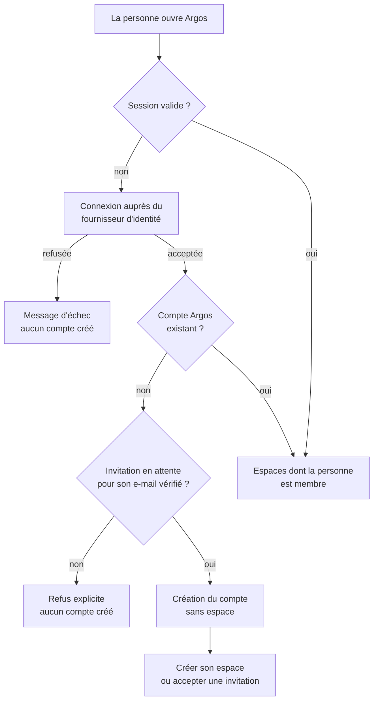

# Fiche capacité : `comptes-acces`

| Élément | Valeur |
|---|---|
| Préfixe d'exigences | `ACC` |
| Spec de référence | `/openspec/specs/comptes-acces/spec.md` — absente tant qu'aucun changement n'est archivé |
| Changements en cours | [`gerer-comptes-et-acces`](/openspec/changes/gerer-comptes-et-acces/proposal.md) (implémenté, non archivé) |
| Statut de la capacité | proposée ; implémentation et tests dans `argos-server`, changement non archivé |
| Composants (arc42 §5) | `API & Security`, `workspace`, `audit` |

## Objectif

[PROPOSITION — `gerer-comptes-et-acces`] Permettre à toute personne invitée de se connecter à Argos, de créer son espace et d'y inviter d'autres utilisateurs, chacun ne voyant que ce que ses rôles autorisent.

## Acteurs

| Acteur | Interaction | Statut |
|---|---|---|
| Utilisateur | se connecte, crée son espace, rejoint un espace sur invitation | [PROPOSITION] — ADR-0025 (Accepté) |
| Administrateur d'espace | invite, attribue et révoque les rôles de son espace | [PROPOSITION] — ADR-0016 (Proposé) |
| Administrateur plateforme | gère les catalogues et l'exploitation, sans accès implicite aux données des espaces | [PROPOSITION] — arc42 §8.1 |
| Fournisseur d'identité OIDC (Keycloak) | authentifie les utilisateurs | [DÉCISION] Q-1 — ADR-0008, ADR-0027 (Proposés), ADR-0026 (Accepté) |

## Périmètre et exclusions

Inclus :

- Connexion, création de compte, espaces, rôles, invitations, révocation.
- Contrôle d'accès de l'API REST ; le serveur MCP réutilise ces règles (change `exposer-serveur-mcp`).

Exclus :

- L'écran de connexion et de déconnexion de l'IHM et du client desktop (Authorization Code + PKCE) : à réaliser dans `argos-ui` et `argos-desktop`.
- Le déploiement de Keycloak sur le Synology.
- La facturation et les offres payantes : aucune décision (ADR-0021).
- La suppression de compte et l'export des données (RGPD) : changement dédié à créer.

## Préconditions et déclencheurs

Royaume Keycloak `argos` configuré, inscription libre désactivée ; `ARGOS_OIDC_URL` renseignée (ADR-0026, ADR-0027). Premier administrateur plateforme désigné par `ARGOS_ADMIN_EMAIL`.

## Entrées, sorties et validations

| Entrée / sortie | Contenu | Validation ou contrainte | Statut |
|---|---|---|---|
| Jeton OIDC | identité de l'utilisateur (sujet, nom, e-mail vérifié) | signature, émetteur, audience `argos-server`, expiration (ACC-01) | [EXISTANT] — `AuthentificationTest` |
| Invitation | espace, e-mail du destinataire, rôle, expiration (14 jours par défaut) | émise par un administrateur d'espace ; acceptée par le titulaire de l'e-mail vérifié (ACC-05) | [EXISTANT] — `InvitationsTest` |
| Entrée du journal des refus | compte, méthode et chemin, motif, horodatage | aucune donnée de la ressource (ACC-06) | [EXISTANT] — `JournalRefusTest` |

API : `/api/v1/moi`, `/api/v1/espaces`, `/api/v1/espaces/{espaceId}/membres`, `/api/v1/espaces/{espaceId}/invitations`, `/api/v1/invitations` ; contrat publié sur `/q/openapi` (`ContratOpenApiTest`).

## Règles métier

| Règle | Exigence(s) | Source | Statut |
|---|---|---|---|
| Authentification obligatoire | ACC-01 | ADR-0008, ADR-0027 (Proposés) | [PROPOSITION] — implémentée |
| Création du compte à la première connexion | ACC-02 | ADR-0025 (Accepté) | [PROPOSITION] — implémentée |
| Inscription sur invitation : compte créé seulement pour un e-mail vérifié destinataire d'une invitation en attente, ou pour l'administrateur plateforme initial | ACC-02 | Q-2 (2026-11-16) | [DÉCISION] — implémentée |
| Profil de veille `developpeur` activé à la création du compte | ACC-02, PRF-01 | Q-3 (2026-11-16) | [DÉCISION] — événement `CompteCree` émis ; activation par `profils-veille` |
| Espaces et rôles ; un espace garde au moins un administrateur | ACC-03 | ADR-0016 (Proposé) | [PROPOSITION] — implémentée |
| Cloisonnement par espace, dans le service et par la RLS | ACC-04 | ADR-0016 (Proposé) | [PROPOSITION] — implémentée |
| Accès refusé à un autre espace : « introuvable » (404) | ACC-04 | Q-4 (2026-11-16) | [DÉCISION] — implémentée |
| Invitations et révocation, effective dès la requête suivante | ACC-05 | ADR-0016 (Proposé) | [PROPOSITION] — implémentée |
| Journal des refus d'accès | ACC-06 | ADR-0016 (Proposé) | [PROPOSITION] — implémentée |

## Droits d'accès et restrictions

Trois rôles d'espace : lecteur, contributeur, administrateur d'espace. L'administrateur plateforme est un attribut du compte, sans accès implicite aux espaces. Les préférences (abonnements, profils, mise en page) ne donnent aucun droit (ABO-05, PRF-05). Réponses : non authentifié 401, non-membre ou ressource inexistante 404, rôle insuffisant 403, inscription sans invitation 403.

## Effets de bord observables

Création de comptes, d'espaces, d'appartenances, d'invitations et d'entrées de journal des refus (table `refus_acces`).

## Qualités mesurables

[QUESTION] Aucune cible chiffrée dans les sources ; voir les questions ouvertes.

## Diagrammes

### DF-ACC-1 — Première visite d'un utilisateur

- **Question** : que se passe-t-il lors de la première connexion d'une personne ?
- **Type** : organigramme
- **Portée** : cible proposée
- **Exigences** : ACC-01, ACC-02, ACC-03

Une première connexion crée un compte sans aucun accès : la personne crée son propre espace ou rejoint celui qui l'a invitée. Sans invitation, la personne authentifiée reçoit un refus explicite et aucun compte n'est créé.

## Critères d'acceptation

Scénarios ACC-01-S1 à ACC-06-S1 du changement, couverts par les tests de `argos-server/src/test/java/io/argos/api/comptes/`.

## Interprétations introduites par un changement

- Aucun espace accessible par défaut (ACC-02) : déduit d'ADR-0025, à faire valider.
- Révocation effective dès la requête suivante (ACC-05) : l'appartenance est relue à chaque requête, sans cache.
- Inscription sur invitation (Q-2) : appliquée dans Keycloak (inscription libre désactivée) et dans Argos (invitation en attente exigée à la création du compte).
- Une invitation est rapprochée de l'e-mail vérifié du jeton ; un e-mail non vérifié ne permet ni l'inscription ni l'acceptation.

## Écarts constatés

- ACC-04-S2 cite les impacts : la table des impacts appartient au changement `formaliser-chaine-securite-poc`. La RLS est vérifiée sur les tables d'espace de cette capacité (`espace`, `appartenance`, `invitation`) ; les tables des autres capacités suivent la convention d'arc42 §8.1.
- La tâche 3.3 du changement cite QS-02, qui porte sur la confidentialité des appels LLM et non sur le cloisonnement ; aucun scénario du registre qualité ne couvre l'accès inter-espaces.

## Questions ouvertes

| ID | Question | Impact | Destinataire |
|---|---|---|---|
| Q-1 | Quel fournisseur d'identité : SSO Server de DSM, Keycloak ou Authentik ? | répondue le 2026-11-16 : Keycloak (gratuit, Apache-2.0, Dev Services Quarkus) [DÉCISION] ; ADR-0027 | porteur du projet |
| Q-2 | L'inscription est-elle ouverte à tous ou sur invitation au démarrage ? | répondue le 2026-11-16 : sur invitation [DÉCISION] | porteur du projet |
| Q-3 | Quel profil de veille est activé à la création d'un compte (PRF-01 impose au moins un profil) ? | répondue le 2026-11-16 : profil `developpeur` [DÉCISION] | Product Owner |
| Q-4 | Un accès refusé à une ressource d'un autre espace répond-il « interdit » ou « introuvable » ? | répondue le 2026-11-16 : « introuvable » (HTTP 404), qui ne révèle pas l'existence de la ressource [DÉCISION] | architecte / sécurité |

## Traçabilité

| Exigence | Scénarios | Conception / diagramme | Tâche | Test ou preuve |
|---|---|---|---|---|
| ACC-01 | ACC-01-S1, ACC-01-S2 | DC-1 | 1.1, 2.1 | `AuthentificationTest` |
| ACC-02 | ACC-02-S1, ACC-02-S2 | DC-1 | 1.1, 1.2, 2.2 | `PremiereConnexionTest` |
| ACC-03 | ACC-03-S1, ACC-03-S2 | DC-1 | 3.1, 3.2 | `EspacesEtRolesTest`, `ContratOpenApiTest` |
| ACC-04 | ACC-04-S1, ACC-04-S2 | DC-1, DC-2 | 3.3 | `CloisonnementTest` |
| ACC-05 | ACC-05-S1, ACC-05-S2 | DC-1 | 3.1, 3.2 | `InvitationsTest`, `ContratOpenApiTest` |
| ACC-06 | ACC-06-S1 | DC-2 | 3.4 | `JournalRefusTest` |

Tests dans [`argos-server/src/test/java/io/argos/api/comptes/`](/argos-server/src/test/java/io/argos/api/comptes/) ; parcours de bout en bout : `ParcoursComptesEtAccesTest`.
