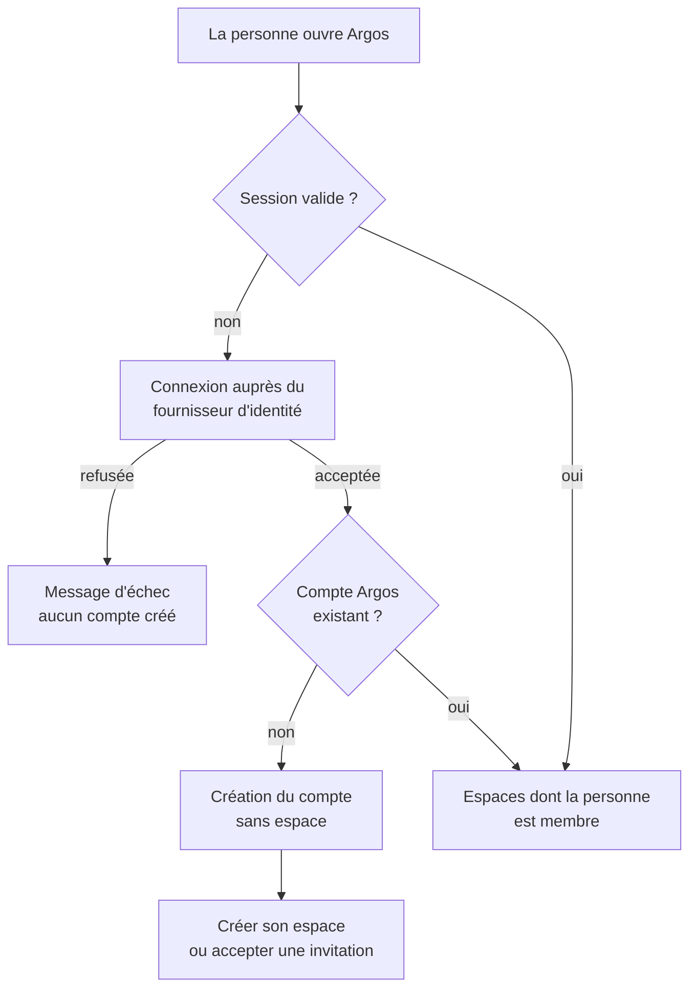

# Fiche capacité : `comptes-acces`

| Élément | Valeur |
|---|---|
| Préfixe d'exigences | `ACC` |
| Spec de référence | `/openspec/specs/comptes-acces/spec.md` — absente tant qu'aucun changement n'est archivé |
| Changements en cours | [`gerer-comptes-et-acces`](/openspec/changes/gerer-comptes-et-acces/proposal.md) (proposé) |
| Statut de la capacité | proposée |
| Composants (arc42 §5) | `API & Security`, `workspace`, `audit` |

## Objectif

[PROPOSITION — `gerer-comptes-et-acces`] Permettre à toute personne de se connecter à Argos, de créer son espace et d'y inviter d'autres utilisateurs, chacun ne voyant que ce que ses rôles autorisent.

## Acteurs

| Acteur | Interaction | Statut |
|---|---|---|
| Utilisateur | se connecte, crée son espace, rejoint un espace sur invitation | [PROPOSITION] — ADR-0025 (Accepté) |
| Administrateur d'espace | invite, attribue et révoque les rôles de son espace | [PROPOSITION] — ADR-0016 (Proposé) |
| Administrateur plateforme | gère les catalogues et l'exploitation, sans accès implicite aux données des espaces | [PROPOSITION] — arc42 §8.1 |
| Fournisseur d'identité OIDC | authentifie les utilisateurs | [PROPOSITION] — ADR-0008 (Proposé), ADR-0026 (Accepté) |

## Périmètre et exclusions

Inclus :

- Connexion, déconnexion, création de compte, espaces, rôles, invitations, révocation.
- Contrôle d'accès de l'API REST ; le serveur MCP réutilise ces règles (change `exposer-serveur-mcp`).

Exclus :

- Le choix du fournisseur d'identité (question Q-1).
- La facturation et les offres payantes : aucune décision (ADR-0021).
- La suppression de compte et l'export des données (RGPD) : changement dédié à créer.

## Préconditions et déclencheurs

Fournisseur d'identité OIDC configuré (ADR-0026).

## Entrées, sorties et validations

| Entrée / sortie | Contenu | Validation ou contrainte | Statut |
|---|---|---|---|
| Jeton OIDC | identité de l'utilisateur | signature, émetteur, audience, expiration (ACC-01) | [PROPOSITION] |
| Invitation | espace, destinataire, rôle | émise par un administrateur d'espace (ACC-05) | [PROPOSITION] |

## Règles métier

| Règle | Exigence(s) | Source | Statut |
|---|---|---|---|
| Authentification obligatoire | ACC-01 | ADR-0008 (Proposé)  | [PROPOSITION] |
| Création du compte à la première connexion | ACC-02 | ADR-0025 (Accepté)  | [PROPOSITION] |
| Espaces et rôles | ACC-03 | ADR-0016 (Proposé)  | [PROPOSITION] |
| Cloisonnement par espace | ACC-04 | ADR-0016 (Proposé)  | [PROPOSITION] |
| Invitations et révocation | ACC-05 | ADR-0016 (Proposé) | [PROPOSITION] |
| Journal des refus d'accès | ACC-06 | ADR-0016 (Proposé)  | [PROPOSITION] |

## Droits d'accès et restrictions

Quatre rôles : lecteur, contributeur, administrateur d'espace, administrateur plateforme. Les préférences (abonnements, profils, mise en page) ne donnent aucun droit (ABO-05, PRF-05).

## Effets de bord observables

Création de comptes, d'espaces, d'appartenances et d'entrées de journal des refus.

## Qualités mesurables

[QUESTION] Aucune cible chiffrée dans les sources ; voir les questions ouvertes.

## Diagrammes

### DF-ACC-1 — Première visite d'un utilisateur

- **Question** : que se passe-t-il lors de la première connexion d'une personne ?
- **Type** : organigramme
- **Portée** : cible proposée
- **Exigences** : ACC-01, ACC-02, ACC-03

Une première connexion crée un compte sans aucun accès : la personne crée son propre espace ou rejoint celui qui l'a invitée.

## Critères d'acceptation

Scénarios ACC-01-S1 à ACC-06-S1 du changement ; QS-02 (sécurité) pour le cloisonnement.

## Interprétations introduites par un changement

- Aucun espace accessible par défaut (ACC-02) : déduit d'ADR-0025, à faire valider.
- Révocation effective dès la requête suivante (ACC-05) : à faire valider.

## Écarts constatés

- ADR-0008 vise l'IdP d'une entreprise ; ADR-0025 et ADR-0026 imposent un IdP auto-hébergé : ADR-0008 est à compléter ou remplacer (tâche 4.2).

## Questions ouvertes

| ID | Question | Impact | Destinataire |
|---|---|---|---|
| Q-1 | Quel fournisseur d'identité : SSO Server de DSM, Keycloak ou Authentik ? | oui pour l'implémentation | porteur du projet |
| Q-2 | L'inscription est-elle ouverte à tous ou sur invitation au démarrage ? | oui pour ACC-02 | porteur du projet |
| Q-3 | Quel profil de veille est activé à la création d'un compte (PRF-01 impose au moins un profil) ? | oui pour ACC-02 | Product Owner |
| Q-4 | Un accès refusé à une ressource d'un autre espace répond-il « interdit » ou « introuvable » ? | non : choix de conception | architecte / sécurité |

## Traçabilité

| Exigence | Scénarios | Conception / diagramme | Tâche | Test ou preuve |
|---|---|---|---|---|
| ACC-01 | ACC-01-S1, ACC-01-S2 | DC-1 | 1.1, 2.1 | à écrire |
| ACC-02 | ACC-02-S1, ACC-02-S2 | DC-1 | 1.1, 1.2, 2.2 | à écrire |
| ACC-03 | ACC-03-S1, ACC-03-S2 | DC-1 | 3.1, 3.2 | à écrire |
| ACC-04 | ACC-04-S1, ACC-04-S2 | DC-1, DC-2 | 3.3 | à écrire |
| ACC-05 | ACC-05-S1, ACC-05-S2 | DC-1 | 3.1, 3.2 | à écrire |
| ACC-06 | ACC-06-S1 | DC-2 | 3.4 | à écrire |
