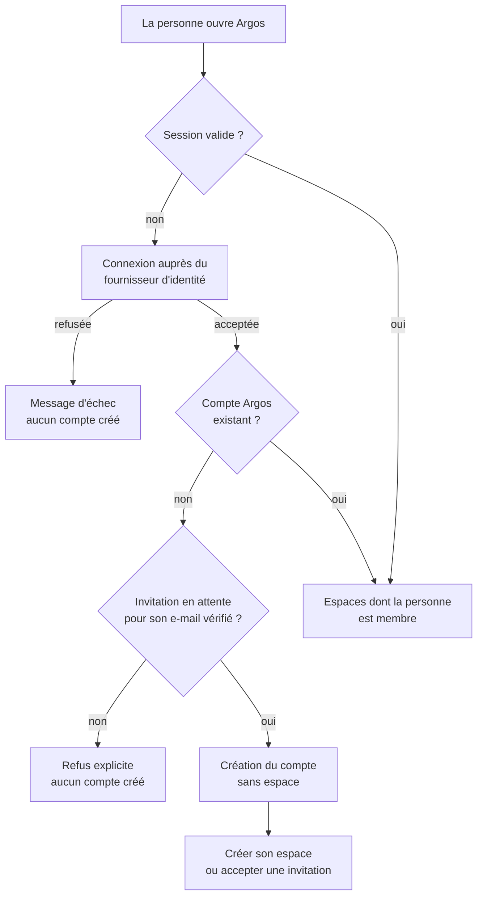
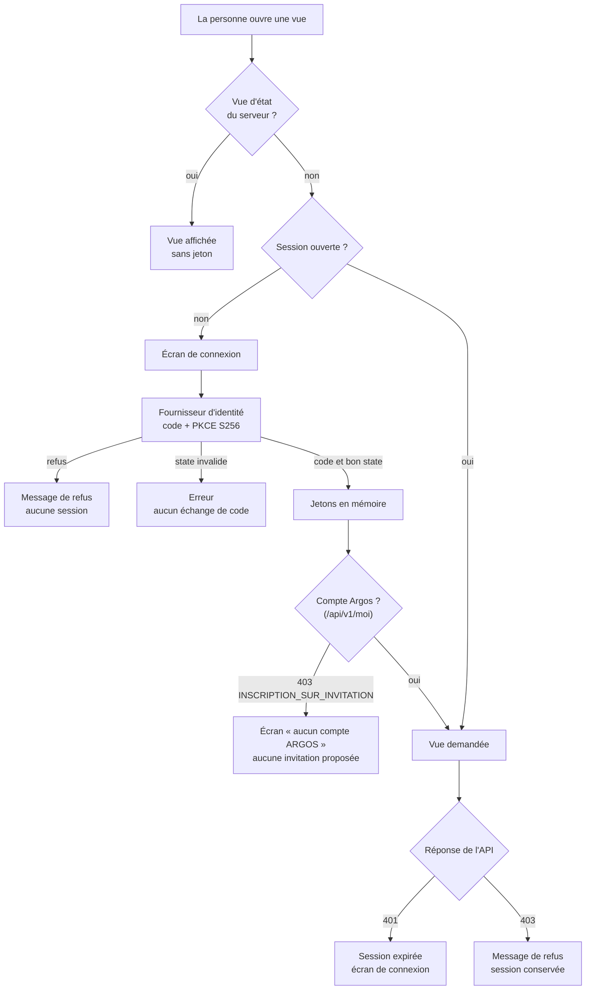

# Fiche capacité : `comptes-acces`

| Élément | Valeur |
|---|---|
| Préfixe d'exigences | `ACC` |
| Spec de référence | [`/openspec/specs/comptes-acces/spec.md`](/openspec/specs/comptes-acces/spec.md) |
| Changements archivés | [`2026-11-17-gerer-comptes-et-acces`](/openspec/changes/archive/2026-11-17-gerer-comptes-et-acces/proposal.md) (ACC-01 à ACC-06) ; [`2026-11-18-connecter-ihm-oidc`](/openspec/changes/archive/2026-11-18-connecter-ihm-oidc/proposal.md) (ACC-07 à ACC-10) |
| Statut de la capacité | livrée |
| Composants (arc42 §5) | `API & Security`, `workspace`, `audit` ; `Vue.js 3 SPA` et `Client desktop Electron` (ACC-07 à ACC-10) |

## Objectif

[PROPOSITION — `gerer-comptes-et-acces`] Permettre à toute personne invitée de se connecter à Argos, de créer son espace et d'y inviter d'autres utilisateurs, chacun ne voyant que ce que ses rôles autorisent.

## Acteurs

| Acteur | Interaction | Statut |
|---|---|---|
| Utilisateur | se connecte, crée son espace, rejoint un espace sur invitation | [PROPOSITION] — ADR-0025 (Accepté) |
| Administrateur d'espace | invite, attribue et révoque les rôles de son espace | [PROPOSITION] — ADR-0016 (Proposé) |
| Administrateur plateforme | gère les catalogues et l'exploitation, sans accès implicite aux données des espaces | [PROPOSITION] — arc42 §8.1 |
| Fournisseur d'identité OIDC (Keycloak) | authentifie les utilisateurs | [DÉCISION] Q-1 — ADR-0008 (Proposé), ADR-0026, ADR-0027 (Acceptés) |

## Périmètre et exclusions

Inclus :

- Connexion, création de compte, espaces, rôles, invitations, révocation.
- Contrôle d'accès de l'API REST ; le serveur MCP réutilise ces règles (change `exposer-serveur-mcp`).
- [PROPOSITION] — implémentée : connexion, renouvellement et déconnexion dans `argos-ui` et `argos-desktop` (Authorization Code + PKCE S256), garde des vues, écrans de connexion, de session expirée et de refus (ACC-07 à ACC-10).

Exclus :

- La persistance de la session entre deux lancements du client desktop (ADR-0033, Accepté ; question Q-5).
- Le déploiement de Keycloak sur le Synology.
- La facturation et les offres payantes : aucune décision (ADR-0021).
- La suppression de compte et l'export des données (RGPD) : changement dédié à créer.

## Préconditions et déclencheurs

Royaume Keycloak `argos` configuré, inscription libre désactivée ; `ARGOS_OIDC_URL` renseignée (ADR-0026, ADR-0027). Premier administrateur plateforme désigné par `ARGOS_ADMIN_EMAIL`.

[EXISTANT] Côté clients : émetteur et client de l'IHM fixés au build (`VITE_ARGOS_OIDC_ISSUER`, `VITE_ARGOS_OIDC_CLIENT_ID`, défauts `http://localhost:8180/realms/argos` et `argos-ui`) ; émetteur du desktop lu au lancement (`ARGOS_OIDC_URL`, même défaut). Client `argos-ui` du royaume : redirections `http://localhost:5173/*` et `http://127.0.0.1/argos/retour` (port libre), origines web `http://localhost:5173` et `app://argos`, PKCE S256 obligatoire.

## Entrées, sorties et validations

| Entrée / sortie | Contenu | Validation ou contrainte | Statut |
|---|---|---|---|
| Jeton OIDC | identité de l'utilisateur (sujet, nom, e-mail vérifié) | signature, émetteur, audience `argos-server`, expiration (ACC-01) | [EXISTANT] — `AuthentificationTest` |
| Invitation | espace, e-mail du destinataire, rôle, expiration (14 jours par défaut) | émise par un administrateur d'espace ; acceptée par le titulaire de l'e-mail vérifié (ACC-05) | [EXISTANT] — `InvitationsTest` |
| Entrée du journal des refus | compte, méthode et chemin, motif, horodatage | aucune donnée de la ressource (ACC-06) | [EXISTANT] — `JournalRefusTest` |
| Retour du fournisseur dans l'IHM | `code`, `state` (ou `error`) | state égal à celui de la demande ; `iss`, s'il est présent, égal à l'émetteur (RFC 9207) ; adresse nettoyée ; message de refus choisi dans une liste fixe (ACC-07) | [EXISTANT] — `argos-ui/tests/oidc.test.mjs`, `session.test.mjs` ; E2E `e2e/tests/connexion.spec.ts` |
| Jetons de l'IHM | jeton d'accès, de renouvellement, d'identité | en mémoire seulement ; renouvelés avant expiration (ACC-08) | [EXISTANT] — `argos-ui/tests/session.test.mjs`, `securite-session.test.mjs` ; E2E `e2e/tests/connexion.spec.ts` |
| Appel de l'API par l'IHM | `Authorization: Bearer` | sur tout `/api/v1` sauf `/api/v1/system/info` (ACC-09) | [EXISTANT] — `argos-ui/tests/autorisation.test.mjs` ; `ClientIhmOidcTest` ; E2E `e2e/tests/connexion.spec.ts` |

API : `/api/v1/moi`, `/api/v1/espaces`, `/api/v1/espaces/{espaceId}/membres`, `/api/v1/espaces/{espaceId}/invitations`, `/api/v1/invitations` ; contrat publié sur `/q/openapi` (`ContratOpenApiTest`).

## Règles métier

| Règle | Exigence(s) | Source | Statut |
|---|---|---|---|
| Authentification obligatoire | ACC-01 | ADR-0008 (Proposé), ADR-0027 (Accepté) | [PROPOSITION] — implémentée |
| Création du compte à la première connexion | ACC-02 | ADR-0025 (Accepté) | [PROPOSITION] — implémentée |
| Inscription sur invitation : compte créé seulement pour un e-mail vérifié destinataire d'une invitation en attente, ou pour l'administrateur plateforme initial | ACC-02 | Q-2 (2026-11-16) | [DÉCISION] — implémentée |
| Profil de veille `developpeur` activé à la création du compte | ACC-02, PRF-01 | Q-3 (2026-11-16) | [DÉCISION] — implémentée : l'événement `CompteCree` active le profil dans les préférences du compte (`io.argos.api.preference.ActivationProfilParDefaut`) |
| Espaces et rôles ; un espace garde au moins un administrateur, y compris en cas de changements concurrents (verrou de la ligne de l'espace) | ACC-03 | ADR-0016 (Proposé) | [PROPOSITION] — implémentée |
| Cloisonnement par espace, dans le service et par la RLS | ACC-04 | ADR-0016 (Proposé) | [PROPOSITION] — implémentée |
| Accès refusé à un autre espace : « introuvable » (404) | ACC-04 | Q-4 (2026-11-16) | [DÉCISION] — implémentée |
| Invitations et révocation, effective dès la requête suivante | ACC-05 | ADR-0016 (Proposé) | [PROPOSITION] — implémentée |
| Journal des refus d'accès, unique pour toute l'API (espaces, impacts, inventaires, abonnements, exploitation) | ACC-06, COR-08 | ADR-0016 (Proposé) | [PROPOSITION] — implémentée |
| Toute vue de l'IHM sauf l'état du serveur exige une session obtenue par code d'autorisation + PKCE S256, state vérifié | ACC-07 | ADR-0027, ADR-0033 (Acceptés) | [PROPOSITION] — implémentée |
| Jetons en mémoire seulement, renouvelés avant expiration, oubliés à la déconnexion ; « session expirée » si le renouvellement échoue | ACC-08 | ADR-0033 (Accepté) ; demande du lot 7 | [PROPOSITION] — implémentée |
| 401 → reconnexion ; 403 `INSCRIPTION_SUR_INVITATION` → écran « aucun compte ARGOS » sans invitation proposée ; autre 403 → message de refus | ACC-09 | ACC-01, ACC-02 ; Q-2 | [PROPOSITION] — implémentée |
| Desktop : autorisation dans le navigateur du système, retour sur `127.0.0.1` à port éphémère, CSP limitée au serveur et au fournisseur | ACC-10 | ADR-0022 point 6 (Proposé), ADR-0033 (Accepté) ; RFC 8252 | [PROPOSITION] — implémentée |

## Droits d'accès et restrictions

Trois rôles d'espace : lecteur, contributeur, administrateur d'espace. L'administrateur plateforme est un attribut du compte, sans accès implicite aux espaces. Les préférences (abonnements, profils, mise en page) ne donnent aucun droit (ABO-05, PRF-05). Réponses : non authentifié 401, non-membre ou ressource inexistante 404, rôle insuffisant 403, inscription sans invitation 403.

## Effets de bord observables

Création de comptes, d'espaces, d'appartenances, d'invitations et d'entrées de journal des refus (table `refus_acces`). La création d'un compte enregistre aussi le profil `developpeur` dans ses préférences (table `workspace_preference_utilisateur`, capacité `profils-veille`).

## Qualités mesurables

[QUESTION] Aucune cible chiffrée dans les sources ; voir les questions ouvertes.

## Diagrammes

### DF-ACC-1 — Première visite d'un utilisateur

- **Question** : que se passe-t-il lors de la première connexion d'une personne ?
- **Type** : organigramme
- **Portée** : cible proposée
- **Exigences** : ACC-01, ACC-02, ACC-03

Une première connexion crée un compte sans aucun accès : la personne crée son propre espace ou rejoint celui qui l'a invitée. Sans invitation, la personne authentifiée reçoit un refus explicite et aucun compte n'est créé.

### DF-ACC-2 — Ouverture d'une vue de l'IHM

- **Question** : que voit une personne qui ouvre une vue de l'IHM, selon sa session et la réponse de l'API ?
- **Type** : organigramme
- **Portée** : implémentation de `connecter-ihm-oidc`
- **Exigences** : ACC-07, ACC-08, ACC-09

L'IHM ne décide d'aucun droit : elle présente la décision du serveur. L'état du serveur reste accessible sans session ; toute autre vue passe par l'écran de connexion, et un compte non créé faute d'invitation mène à un écran de refus dédié.

## Critères d'acceptation

Scénarios ACC-01-S1 à ACC-06-S1 du changement, couverts par les tests de `argos-server/src/test/java/io/argos/api/comptes/`.

Scénarios ACC-07-S1 à ACC-10-S4 : tests `node:test` d'`argos-ui/tests/` et d'`argos-desktop/test/`, parcours réel du client `argos-ui` contre le Keycloak des Dev Services (`ClientIhmOidcTest`) ; parcours de bout en bout du portail web (`e2e/tests/connexion.spec.ts`) et du client desktop Electron (`e2e/desktop/connexion.spec.ts`, ACC-10-S1, S2 et S4, navigateur du système simulé par une page Chromium).

## Interprétations introduites par un changement

- Aucun espace accessible par défaut (ACC-02) : déduit d'ADR-0025, à faire valider.
- Révocation effective dès la requête suivante (ACC-05) : l'appartenance est relue à chaque requête, sans cache.
- Inscription sur invitation (Q-2) : appliquée dans Keycloak (inscription libre désactivée) et dans Argos (invitation en attente exigée à la création du compte).
- Une invitation est rapprochée de l'e-mail vérifié du jeton ; un e-mail non vérifié ne permet ni l'inscription ni l'acceptation.

## Écarts constatés

- ACC-04-S2 : la RLS est vérifiée sous le rôle non super-utilisateur `argos_app` sur les tables de cette capacité (`CloisonnementTest`, `DefenseEnProfondeurTest`), sur les impacts (`argos-server/src/test/java/io/argos/chain/CorrelationTest.java`, `rlsGardeFouEnBase` et `rlsAppliqueeSurLeCheminApplicatif`) et sur l'ensemble du schéma (`CouvertureRlsTest`) : toute table accessible à `argos_app` est soumise à la RLS, sauf cinq données de référence globales sans espace ni compte (`signal`, `cycle_vie_produit`, `cycle_vie`, `texte_officiel`, `opportunite`) ; sans contexte, aucune table soumise à la RLS ne renvoie de ligne ; `argos_app` n'est ni super-utilisateur, ni `BYPASSRLS`, ni propriétaire d'un objet ; le rôle et l'espace courant transmis à la base sont locaux à la transaction. Le serveur MCP applique le même cloisonnement (`argos-server/src/test/java/io/argos/mcp/CloisonnementMcpTest.java`).
- L'espace courant est transmis par le chemin de la requête (`/api/v1/espaces/{id}/…`) ; `ContexteBase` le pose dans `argos.espace_courant`, avec le rôle `argos_app`, par `SET LOCAL` au début de chaque transaction.
- Sans espace courant, la RLS expose encore au compte courant ses propres appartenances et les espaces dont il est membre ou créateur, ainsi que les invitations adressées à son e-mail vérifié : c'est ce qui permet de lister « mes espaces » et « mes invitations ». Les autres lignes d'un espace exigent l'espace courant.
- Moindre privilège : `argos_app` ne lit que son compte et les comptes qui partagent un espace avec lui (ou l'auteur d'une invitation qui le concerne), n'a aucun droit sur le journal des refus, et ne peut modifier que les colonnes que l'application modifie (`invitation.etat`, `invitation.destinataire_id`, `appartenance.role`, `espace.nom`). Le destinataire d'une invitation ne peut que la faire passer à l'état accepté, à son nom, et n'entre dans l'espace qu'avec le rôle de l'invitation.
- Une invitation déjà acceptée ou révoquée répond 409 (`INVITATION_INACTIVE`) ; une invitation inconnue ou adressée à une autre personne répond 404 sans être journalisée comme refus d'accès à un espace.
- ACC-02-S2 (« message explicite ») : le refus de Keycloak est vérifié côté serveur ; l'écran de connexion d'argos-ui affiche un message fixe pour un refus du fournisseur [EXISTANT] — ACC-07-S4, vérifié par `argos-ui/tests/session.test.mjs`, sans test de bout en bout.
- ACC-10-S1 et ACC-10-S2 : le parcours de bout en bout du client desktop simule le navigateur du système par une page Chromium. L'ouverture du navigateur réellement installé par `shell.openExternal` et le retour de la fenêtre ARGOS au premier plan restent à constater manuellement, selon la procédure du [`tasks.md` archivé](/openspec/changes/archive/2026-11-18-connecter-ihm-oidc/tasks.md) ; cette vérification manuelle n'est pas consignée [QUESTION].
- ADR-0022 point 6 prévoit de conserver les jetons du desktop par `safeStorage` ; `connecter-ihm-oidc` les garde en mémoire seulement (ADR-0033, Accepté). ADR-0022 n'est pas modifié.
- Parcours réel d'invitation : Argos n'envoie aucun e-mail et ne crée aucun compte Keycloak ; tant que l'inscription libre est désactivée dans Keycloak, l'administrateur Keycloak crée le compte de la personne invitée (e-mail vérifié) avant sa première connexion.
- La tâche 3.3 du changement cite QS-02, qui porte sur la confidentialité des appels LLM et non sur le cloisonnement ; QS-02 est exécuté au niveau des tests de la passerelle IA (`argos-server/src/test/java/io/argos/aigateway/PasserelleIaTest.java#iag02S1DonneeConfidentielleRefuseeSansEnvoiEtJournalisee`, `argos-server/src/test/java/io/argos/chain/ParcoursIaTest.java#iag02S1DonneeConfidentielleRefuseeEtJournalisee` : refus, aucun envoi au fournisseur simulé, refus journalisé dans `ia_appel` avec son espace, 0 violation). Aucun scénario du registre qualité ne couvre l'accès inter-espaces.

## Questions ouvertes

| ID | Question | Impact | Destinataire |
|---|---|---|---|
| Q-1 | Quel fournisseur d'identité : SSO Server de DSM, Keycloak ou Authentik ? | répondue le 2026-11-16 : Keycloak (gratuit, Apache-2.0, Dev Services Quarkus) [DÉCISION] ; ADR-0027 | porteur du projet |
| Q-2 | L'inscription est-elle ouverte à tous ou sur invitation au démarrage ? | répondue le 2026-11-16 : sur invitation [DÉCISION] | porteur du projet |
| Q-3 | Quel profil de veille est activé à la création d'un compte (PRF-01 impose au moins un profil) ? | répondue le 2026-11-16 : profil `developpeur` [DÉCISION] | Product Owner |
| Q-4 | Un accès refusé à une ressource d'un autre espace répond-il « interdit » ou « introuvable » ? | répondue le 2026-11-16 : « introuvable » (HTTP 404), qui ne révèle pas l'existence de la ressource [DÉCISION] | architecte / sécurité |
| Q-5 | Le client desktop doit-il conserver la session entre deux lancements (jeton de renouvellement chiffré par `safeStorage`) ? | ouverte : mémoire seule en [PROPOSITION] (ADR-0033) ; Q-1 de `connecter-ihm-oidc` | porteur du projet / sécurité |
| Q-6 | Quelles redirections et origines du client `argos-ui` déclarer dans le royaume de production ? | ouverte : dépend du déploiement de Keycloak (ADR-0026, ADR-0027) ; Q-2 de `connecter-ihm-oidc` | porteur du projet |

## Traçabilité

| Exigence | Scénarios | Conception / diagramme | Tâche | Test ou preuve |
|---|---|---|---|---|
| ACC-01 | ACC-01-S1, ACC-01-S2 | DC-1 | 1.1, 2.1 | `AuthentificationTest` |
| ACC-02 | ACC-02-S1, ACC-02-S2 | DC-1 | 1.1, 1.2, 2.2 | `PremiereConnexionTest` |
| ACC-03 | ACC-03-S1, ACC-03-S2 | DC-1 | 3.1, 3.2 | `EspacesEtRolesTest`, `ContratOpenApiTest` |
| ACC-04 | ACC-04-S1, ACC-04-S2 | DC-1, DC-2 | 3.3 | `CloisonnementTest`, `CouvertureRlsTest` |
| ACC-05 | ACC-05-S1, ACC-05-S2 | DC-1 | 3.1, 3.2 | `InvitationsTest`, `ContratOpenApiTest` |
| ACC-06 | ACC-06-S1 | DC-2 | 3.4 | `JournalRefusTest` |
| ACC-07 | ACC-07-S1 à ACC-07-S5 | `connecter-ihm-oidc` DC-1, DC-2, DC-4 ; DF-ACC-2 | 2.1 à 2.4 | `argos-ui/tests/oidc.test.mjs`, `session.test.mjs`, `autorisation.test.mjs`, `garde.test.mjs` ; `ClientIhmOidcTest` ; E2E `e2e/tests/connexion.spec.ts` |
| ACC-08 | ACC-08-S1 à ACC-08-S4 | `connecter-ihm-oidc` DC-4 | 2.1, 2.2, 2.4 | `argos-ui/tests/session.test.mjs`, `securite-session.test.mjs` ; E2E `e2e/tests/connexion.spec.ts` (ACC-08-S1, S3, S4) |
| ACC-09 | ACC-09-S1 à ACC-09-S5 | `connecter-ihm-oidc` DC-2 ; DF-ACC-2 | 2.3, 2.4 | `argos-ui/tests/autorisation.test.mjs` ; `ClientIhmOidcTest` ; E2E `e2e/tests/connexion.spec.ts` (ACC-09-S1, S2, S4) |
| ACC-10 | ACC-10-S1 à ACC-10-S4 | `connecter-ihm-oidc` DC-1, DC-3 | 3.1 à 3.3 | `argos-desktop/test/connexion.test.js`, `canaux.test.js`, `preload.test.js`, `ui-protocol.test.js` ; `ClientIhmOidcTest` ; E2E Electron `e2e/desktop/connexion.spec.ts` (ACC-10-S1, S2, S4) |

Tests dans [`argos-server/src/test/java/io/argos/api/comptes/`](/argos-server/src/test/java/io/argos/api/comptes/) ; parcours de bout en bout : `ParcoursComptesEtAccesTest`. Les numéros de tâche des lignes ACC-07 à ACC-10 renvoient au [`tasks.md` de `connecter-ihm-oidc`](/openspec/changes/archive/2026-11-18-connecter-ihm-oidc/tasks.md#matrice-de-traçabilité).
