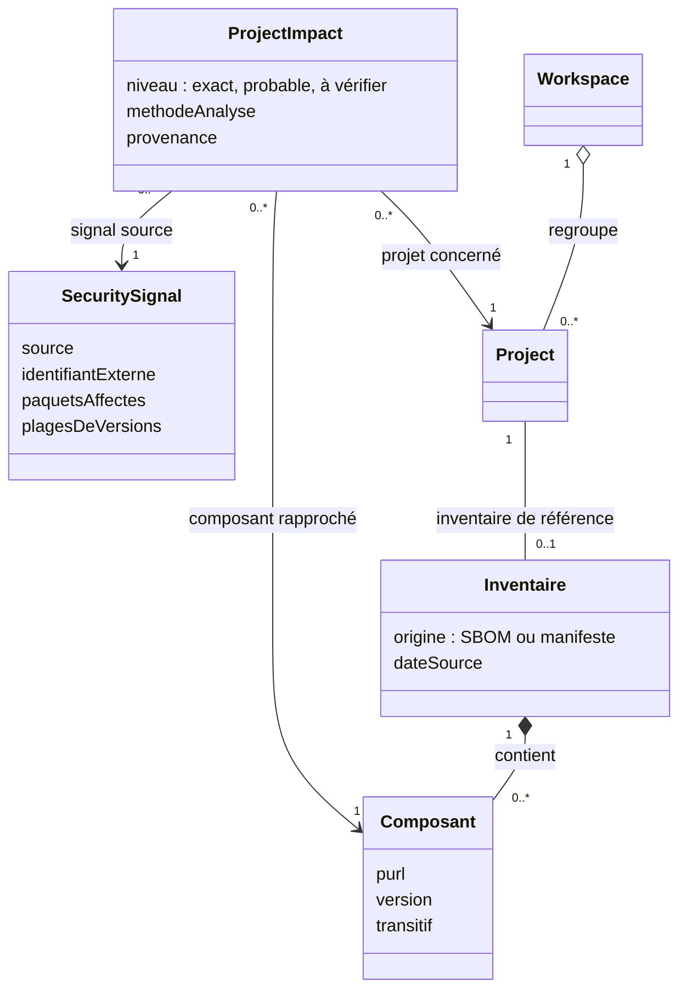
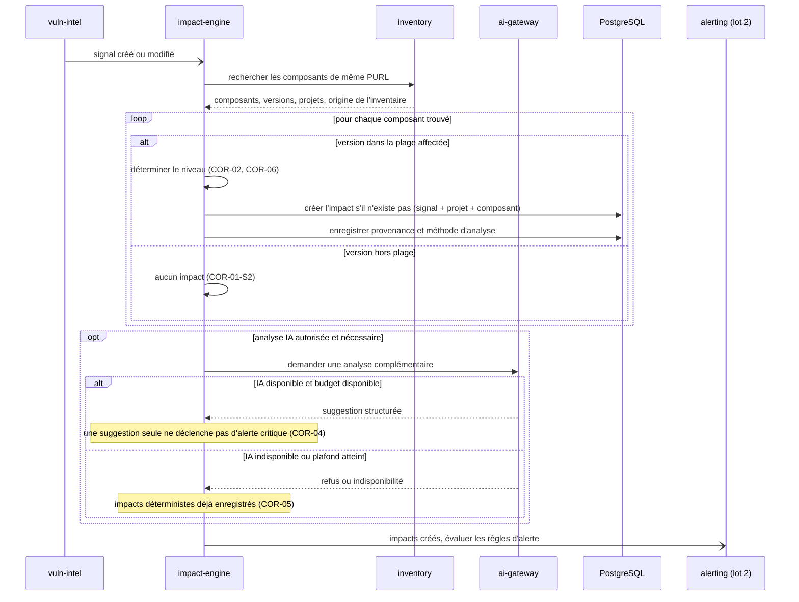
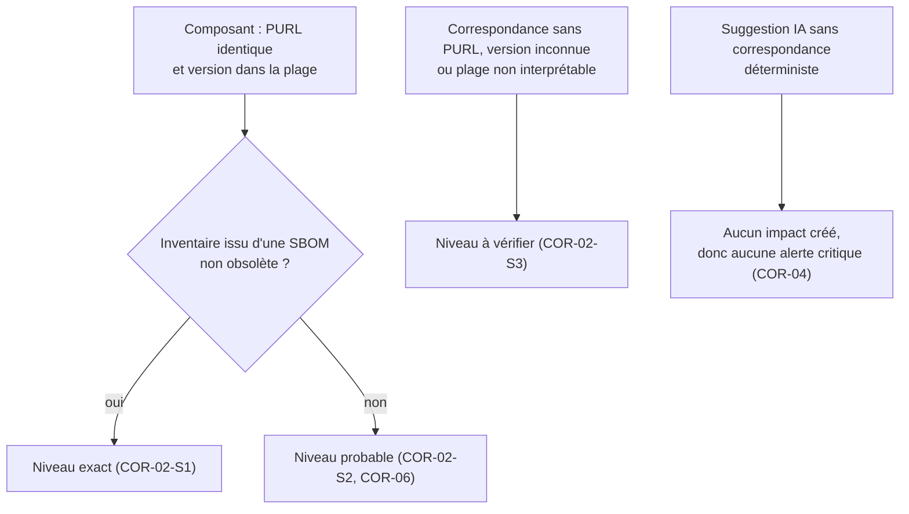

# Fiche capacité : `correlation-impact`

| Élément | Valeur |
|---|---|
| Préfixe d'exigences | `COR` |
| Spec de référence | `/openspec/specs/correlation-impact/spec.md` — absente : capacité non livrée |
| Changement en cours | [`formaliser-chaine-securite-poc`](/openspec/changes/formaliser-chaine-securite-poc/specs/correlation-impact/spec.md) — proposé, non archivé |
| Statut de la capacité | **proposée**, implémentée dans `argos-server` (changement non archivé) : paquet `io.argos.impact` |
| Composants (arc42 §5) | `impact-engine`, `inventory`, `vuln-intel`, `workspace`, `ai-gateway` (facultatif), `audit` |

Tout le contenu de cette fiche porte le statut [PROPOSITION] (changement `formaliser-chaine-securite-poc`) sauf mention contraire.

## Objectif

Désigner automatiquement, et seulement eux, les projets concernés par un signal de sécurité, avec un niveau de confiance et une provenance qui permettent de vérifier chaque impact. Source : ADR-0013 ; baseline v2.3 §4 ; arc42 §1.2 objectif 2.

## Acteurs

| Acteur | Interaction | Statut |
|---|---|---|
| Utilisateur technique, Tech Lead | consultent les impacts de leurs projets | [PROPOSITION] — arc42 §1.3 |
| Responsable sécurité | évalue les impacts | [PROPOSITION] — arc42 §1.3 |
| Fournisseur d'IA (via `ai-gateway`) | peut suggérer, jamais décider seul | [PROPOSITION] — ADR-0004, ADR-0013 |

## Périmètre et exclusions

- **Inclus** : rapprochement PURL + plage de versions, niveau d'impact, provenance, garde-fou IA, fonctionnement sans IA, idempotence, cloisonnement de la consultation.
- **Exclu** : émission et routage des alertes (lot 2, `alerting`), corrélation de signaux non techniques (réglementation, releases), cycle de vie de traitement d'un impact (probable, confirmé, résolu : glossaire, termes ambigus).

## Préconditions et déclencheurs

- Un signal de sécurité est créé ou modifié (`collecte-avis-securite`) ; ou un inventaire change (déclenchement à confirmer, Q-INV-2).
- Les projets disposent d'un inventaire (`inventaire-sbom`).

## Entrées, sorties et validations

| Entrée / sortie | Contenu | Validation ou contrainte | Statut |
|---|---|---|---|
| Entrée : signal de sécurité | paquets (PURL), plages de versions affectées, provenance | normalisé (COL-01) | [PROPOSITION] |
| Entrée : inventaire du projet | PURL, version, direct/transitif, origine, date | INV-01 à INV-04 | [PROPOSITION] |
| Sortie : impact projet | signal, projet, composant, niveau, méthode, inventaire et date, provenance | unique par signal + projet + composant (COR-07) | [PROPOSITION] |
| Sortie : refus journalisé | utilisateur, ressource, date | ADR-0016 | [PROPOSITION] |

## Règles métier

| Règle | Exigence(s) | Source | Statut |
|---|---|---|---|
| Impact si PURL identique et version dans la plage ; aucun sinon | COR-01 | ADR-0013 | [PROPOSITION] |
| Un niveau parmi `exact`, `probable`, `à vérifier` : `exact` = PURL déclaré et version dans la plage sur SBOM non obsolète ; `probable` = même correspondance sur inventaire de repli ou SBOM obsolète ; `à vérifier` = correspondance sans PURL, version inconnue ou plage non interprétable | COR-02 | ADR-0013 ; décision du 2026-11-16 (Q-2) | [PROPOSITION] |
| Provenance complète, aucun impact orphelin | COR-03 | arc42 §10.2 Q-01 | [PROPOSITION] |
| L'IA ne déclenche jamais seule une alerte critique | COR-04 | ADR-0013 | [PROPOSITION] |
| Corrélation déterministe sans IA (panne ou plafond) | COR-05 | baseline v2.3 §6 critère 6 ; QS-10 | [PROPOSITION] |
| Inventaire de repli ou SBOM obsolète → niveau autre que `exact` | COR-06 | ADR-0011 | [PROPOSITION] |
| Rejeu sans doublon d'impact | COR-07 | arc42 §6.1 | [PROPOSITION] |
| Consultation limitée au périmètre autorisé, refus journalisé | COR-08 | ADR-0016 | [PROPOSITION] |

## Droits d'accès et restrictions

Les signaux sont globaux mais les impacts appartiennent à l'espace du projet (ADR-0016). Un utilisateur ne voit que les impacts des projets de ses espaces ; un accès direct hors périmètre est refusé et journalisé (COR-08). Les abonnements de veille n'élargissent pas ce périmètre (ABO-05).

## Effets de bord observables

- création d'impacts avec provenance ;
- évaluation des règles d'alerte pour les impacts créés (arc42 §6.1) — comportement de l'alerte hors lot ;
- journalisation des refus d'accès.

## Qualités mesurables

| Qualité | Cible | Source | Statut |
|---|---|---|---|
| Impacts sans provenance | 0 (100 % traçables) | arc42 §10.2 Q-01 ; QS-01 | [PROPOSITION] |
| Précision de la corrélation | mesurée sur jeu de référence (vrais/faux positifs, faux négatifs) | baseline v2.3 §6 critère 3 ; ADR-0013 | [PROPOSITION] ; seuil « pertinence ≥ 80 % » cité par ADR-0013 non validé [QUESTION] |
| Alertes bloquées par l'indisponibilité de l'IA | 0 | baseline v2.3 §6 critère 6 | [PROPOSITION] |
| Données CONFIDENTIAL / RESTRICTED envoyées à l'IA | 0 | baseline v2.3 §6 critère 7 ; QS-02 | [PROPOSITION] — portée par la future capacité AI Gateway |

## Diagrammes

### DF-COR-1 — Modèle conceptuel de la corrélation

- **Question** : quels concepts la corrélation relie-t-elle, et avec quelles cardinalités ?
- **Type** : UML classes (modèle conceptuel, pas un schéma de base)
- **Portée** : cible proposée
- **Exigences** : COR-01, COR-02, COR-03, COR-07

Un impact est identifié par le triplet signal + projet + composant (COR-07). `SecuritySignal`, `ProjectImpact`, `Project` et `Workspace` sont des termes d'arc42 (§4.2, §12) ; `Inventaire` et `Composant` sont introduits par ce changement. Le rattachement d'un projet à un seul espace est déduit du glossaire (« Workspace ») [PROPOSITION].

### DF-COR-2 — Corrélation d'un signal, avec et sans IA

- **Question** : comment un signal produit-il des impacts, et que devient la chaîne quand l'IA est indisponible ?
- **Type** : UML séquence
- **Portée** : cible proposée ; reprend arc42 §6.1 avec les composants de §5
- **Exigences** : COR-01, COR-03, COR-04, COR-05, COR-07

L'analyse IA intervient après l'enregistrement des impacts déterministes : son échec ne peut donc pas les bloquer (COR-05). Les conditions d'« analyse IA autorisée et nécessaire » (arc42 §6.1) ne sont pas définies [QUESTION Q-COR-1].

### DF-COR-3 — Détermination du niveau d'un impact

- **Question** : quel niveau porte un impact selon la qualité de l'inventaire ?
- **Type** : organigramme (flowchart)
- **Portée** : cible proposée ; règles décidées le 2026-11-16 (Q-2, Q-3) et implémentées par `io.argos.impact.MatchRules`
- **Exigences** : COR-02, COR-06

Une SBOM est obsolète 30 jours après sa date de génération (Q-3). Le niveau le plus fort l'emporte quand plusieurs entrées de l'avis visent le même paquet.

## Critères d'acceptation

- Scénarios `COR-01-S1` à `COR-08-S2` de la spec.
- Baseline v2.3 §6 critères 1 (avis critique de test traité sans intervention manuelle, jusqu'à l'alerte : lot 2), 3, 6 et 7.
- QS-01 (impact traçable) et QS-10 (Claude indisponible).

## Interprétations introduites par un changement

Interprétations validées par le porteur du projet le 2026-11-16 [DÉCISION].

- COR-01-S3 : un impact sur dépendance transitive indique son caractère transitif ;
- COR-02-S1 : correspondance PURL + version sur SBOM non obsolète ⇒ niveau `exact` (interprétation de ADR-0013) ;
- COR-08-S2 : le refus ne révèle pas le contenu de l'impact.

## Écarts constatés

- arc42 §6.1 nomme `Impact Correlation`, `Technology Intelligence` et `Workspace & Project Core` ; ces participants correspondent à `impact-engine`, `signal`/`vuln-intel` et `workspace`/`inventory` de §5. DF-COR-2 utilise les noms de §5.
- Le code de `argos-server` implémente les règles de cette fiche (`io.argos.impact`). La consultation des impacts s'exécute sous le rôle applicatif `argos_app` avec le compte de l'appelant : la RLS de `project_impact` (fonction `argos_espace_lisible`, migration V2) masque les impacts des espaces dont il n'est pas membre, même si le filtre explicite de la couche API était erroné (`CorrelationTest#rlsAppliqueeSurLeCheminApplicatif`). La corrélation écrit sous l'utilisateur de connexion, propriétaire des tables.
- Les refus sont journalisés dans le journal unique des refus d'accès (`refus_acces`, module `audit`) : compte, méthode et chemin, motif `NON_MEMBRE` (réponse 404) ou `ROLE_INSUFFISANT` (réponse 403).
- Un avis retiré par sa source (OSV `withdrawn`) ne produit aucun impact et retire ceux qu'il portait.
- Les niveaux sont calculés à la corrélation et enregistrés ; le vieillissement d'une SBOM au-delà de 30 jours ne les fait pas recalculer sans nouvelle corrélation (aucune planification, tâche 6.3).
- Le glossaire distingue « impact probable, confirmé et résolu », alors qu'ADR-0013 définit les niveaux `exact`, `probable`, `à vérifier` : deux notions (confiance et cycle de traitement) à séparer [QUESTION Q-COR-2].

## Questions ouvertes

| ID | Question | Impact | Destinataire |
|---|---|---|---|
| Q-2 (changement) | Règles des niveaux `probable` et `à vérifier` ? | répondue le 2026-11-16 : `exact` : PURL et version dans la plage affectée, SBOM non obsolète ; `probable` : même correspondance, mais inventaire de repli ou SBOM obsolète ; `à vérifier` : correspondance sans PURL (nom ou CPE seul), version inconnue ou plage non interprétable [DÉCISION] | architecte / sécurité |
| Q-COR-1 | Quand une analyse IA est-elle « autorisée et nécessaire » ? | DF-COR-2, AI Gateway | architecte / sécurité |
| Q-COR-2 | Quel cycle de vie de traitement pour un impact (confirmé, résolu…) ? | futur stateDiagram `ProjectImpact` | Product Owner |
| Q-COR-3 | Comment traiter une plage de versions non interprétable pour un écosystème ? | COR-01 | backend |

## Traçabilité

Voir la matrice du changement : [`tasks.md`](/openspec/changes/formaliser-chaine-securite-poc/tasks.md#matrice-de-traçabilité). Les scénarios COR-01-S1 à COR-08-S2 sont vérifiés par `argos-server/src/test/java/io/argos/chain/MatchRulesTest.java` et `CorrelationTest.java` (RLS vérifiée sur le chemin applicatif, sous le rôle non super-utilisateur `argos_app`). Le jeu de référence annoté et la mesure de précision et de rappel restent à produire (tâche 4.7).
