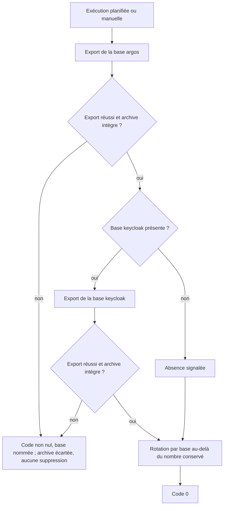
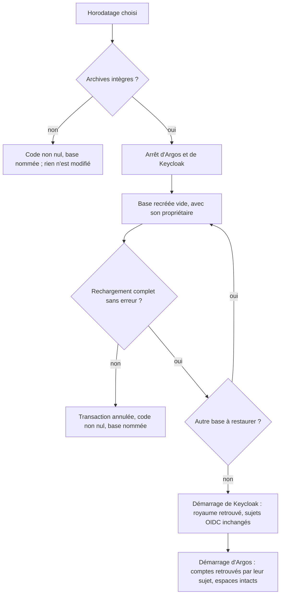
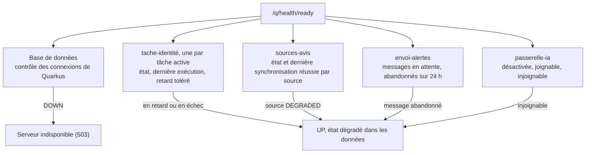

# Fiche capacité : `exploitation-plateforme`

<!-- Statuts : [EXIGENCE] [EXISTANT] [DÉCISION] [PROPOSITION] [QUESTION] (légende : /docs/specifications/README.md#statuts-des-informations). -->

| Élément | Valeur |
|---|---|
| Préfixe d'exigences | `EXP` |
| Spec de référence | [`/openspec/specs/exploitation-plateforme/spec.md`](/openspec/specs/exploitation-plateforme/spec.md) (EXP-01 à EXP-06, EXP-13 à EXP-15) |
| Changements en cours | [`2026-11-24-fiabiliser-sauvegarde-et-roles-base`](/openspec/changes/archive/2026-11-24-fiabiliser-sauvegarde-et-roles-base/proposal.md) (EXP-01 à EXP-06, archivé) ; [`completer-configuration-conteneurs`](/openspec/changes/completer-configuration-conteneurs/proposal.md) (EXP-07 à EXP-12, implémenté, non archivé) ; [`2026-11-25-instrumenter-observabilite`](/openspec/changes/archive/2026-11-25-instrumenter-observabilite/proposal.md) (EXP-13 à EXP-15, archivé) ; [`durcir-conteneurs-de-service`](/openspec/changes/durcir-conteneurs-de-service/proposal.md) (EXP-16, implémenté, non archivé) |
| Statut de la capacité | livrée pour EXP-01 à EXP-06 (scripts de sauvegarde et de restauration, comptes de base distincts) et EXP-13 à EXP-15 (journaux, métriques et santé du serveur) ; EXP-07 à EXP-12 et EXP-16 implémentées, non archivées ; suite proposée |
| Composants (arc42 §5) | PostgreSQL ; Keycloak auto-hébergé ; Quarkus Backend (comptes de connexion, configuration, image ; journaux, métriques et santé : module technique `observabilite` et contrôles des modules) ; Ollama ; outillage d'exploitation (`scripts/`, `deploiement/`) |

## Objectif

Argos s'exploite sur le Synology du porteur, seule cible réelle ([ADR-0026](../architecture/adr/0026-hebergement-synology.md)), sans perte ni exposition de ses données : une sauvegarde qui signale ses échecs et emporte toutes les bases, une restauration rejouable qui rend à chaque utilisateur son compte et ses espaces, des comptes de base cloisonnés et aucun secret par défaut. [PROPOSITION — `fiabiliser-sauvegarde-et-roles-base`]

L'assemblage Docker Compose transmet au serveur tout ce qu'il lit, refuse une configuration incomplète du fournisseur d'identité local, expose l'état de santé de chaque service, tient dans la mémoire du NAS et durcit le conteneur applicatif. [PROPOSITION — `completer-configuration-conteneurs`]

L'exploitant voit et mesure le serveur sans lire de texte libre : journaux structurés et corrélés, métriques techniques et métier réservées, état de santé par tâche planifiée et par dépendance facultative, sans qu'une dépendance dégradée rende le serveur indisponible. [PROPOSITION — `instrumenter-observabilite`]

## Acteurs

| Acteur | Interaction | Statut |
|---|---|---|
| Exploitant (porteur sur le NAS) | planifie la sauvegarde (tâche DSM), restaure, migre une installation existante, renseigne les mots de passe | [PROPOSITION — `fiabiliser-sauvegarde-et-roles-base`] |
| Utilisateur d'Argos | retrouve son compte et ses espaces après une restauration | [PROPOSITION — `fiabiliser-sauvegarde-et-roles-base`] |
| Moteur de conteneurs (Container Manager, Docker) | exécute les contrôles de santé, fait tourner les journaux, redémarre un service arrêté | [PROPOSITION — `completer-configuration-conteneurs`] |
| Exploitant (lecture de l'état du serveur) | lit les journaux JSON (`docker compose logs`), les métriques `/q/metrics` (compte administrateur plateforme) et l'état de santé `/q/health/ready` | [PROPOSITION — `instrumenter-observabilite`] |
| Keycloak (profil `idp-local`) | fournisseur d'identité dont la base est sauvegardée et restaurée avec celle d'Argos ([ADR-0027](../architecture/adr/0027-keycloak-idp-auto-heberge.md)) | [DÉCISION] |

## Périmètre et exclusions

- Inclus : sauvegarde et restauration des bases `argos` et `keycloak`, comptes PostgreSQL, mots de passe obligatoires. [PROPOSITION — `fiabiliser-sauvegarde-et-roles-base`]
- Inclus : parité des variables de configuration, garde du profil `idp-local`, contrôles de santé, journaux bornés, arrêt sur saturation mémoire, compression, dimensionnement du NAS, durcissement du conteneur `argos`. [PROPOSITION — `completer-configuration-conteneurs`]
- Inclus : journaux JSON corrélés en production, métriques Micrometer au format Prometheus, contrôles de disponibilité par tâche planifiée, sources d'avis, envoi des alertes et passerelle IA. [PROPOSITION — `instrumenter-observabilite`]
- Inclus : durcissement des conteneurs `postgres`, `keycloak` et `ollama` (lecture seule, aucune capacité, aucune élévation de privilèges). [PROPOSITION — `durcir-conteneurs-de-service`]
- Exclus : chiffrement des sauvegardes (Q-2), copie hors site (Hyper Backup, réglage de DSM), valeurs RPO/RTO (arc42 §7.6) ; exécution d'Ollama sous un utilisateur non `root` (`durcir-conteneurs-de-service`, proposal.md) ; traçage distribué (OpenTelemetry) et pile de collecte ou de tableaux de bord (Q-3 d'`instrumenter-observabilite`).

## Préconditions et déclencheurs

- Sauvegarde : tâche planifiée de DSM (utilisateur `root`) ou commande manuelle, conteneur `postgres` démarré.
- Restauration : décision de l'exploitant, archives choisies par leur horodatage, sauvegarde préalable de l'état courant.
- Comptes de base : créés au premier démarrage d'un volume PostgreSQL neuf ; une installation antérieure se migre par sauvegarde et restauration ([guide](/docs/deploiement/synology-et-pc.md#passer-aux-comptes-de-base-distincts)).

## Entrées, sorties et validations

| Entrée / sortie | Contenu | Validation ou contrainte | Statut |
|---|---|---|---|
| Archive de sauvegarde | `<base>-AAAAMMJJ-HHMMSS.sql.gz`, une par base, même horodatage | intégrité gzip et fin d'export vérifiées avant conservation ; 0600 ; dossier 0700 | [PROPOSITION — `fiabiliser-sauvegarde-et-roles-base`] |
| Code de sortie | sauvegarde et restauration | 0 en succès, non nul sinon, base nommée sur la sortie d'erreur | [PROPOSITION — `fiabiliser-sauvegarde-et-roles-base`] |
| Journal du serveur (production) | une ligne JSON par événement : horodatage, niveau, source, message, MDC (`correlation`, `tache`), exception détaillée (type, message, pile, causes) | aucun jeton (tout jeton JWT cité est masqué), mot de passe ni adresse e-mail ; texte en développement et en test | [PROPOSITION — `instrumenter-observabilite`] |
| En-tête de réponse `X-Request-Id` | identifiant de corrélation de la requête, créé par le serveur | une valeur reçue de l'appelant n'est jamais reprise | [DÉCISION — porteur du projet, 2026-11-24 (Q-4 d'`instrumenter-observabilite`)] |
| `/q/metrics` | format texte Prometheus : métriques `argos_` (tâches, sources, alertes, IA), HTTP, JVM, pool de connexions | administrateur plateforme seulement ; étiquettes bornées, sans compte, espace, projet ni avis | [DÉCISION — porteur du projet, 2026-11-24 (Q-1 d'`instrumenter-observabilite`)] |
| `/q/health/ready` | contrôles nommés : base de données, `tache-<identité>` par tâche active, `sources-avis`, `envoi-alertes`, `passerelle-ia` | public, sans donnée d'espace ; seule la base rend `DOWN` | [PROPOSITION — `instrumenter-observabilite`] |
| Mots de passe de base (`.env`) | administration, propriétaire et connexion d'Argos, Keycloak | obligatoires : Compose refuse de démarrer sans eux | [PROPOSITION — `fiabiliser-sauvegarde-et-roles-base`] |
| Modèle de configuration (`.env.example`) | toute variable lue par le serveur en production ou interpolée par `compose.yaml` | écart signalé par [`scripts/verifier-configuration.mjs`](/scripts/verifier-configuration.mjs), exécuté par l'intégration continue | [PROPOSITION — `completer-configuration-conteneurs`] |
| Variables du profil `idp-local` | `ARGOS_ADMIN_EMAIL`, `ARGOS_ADMIN_MOT_DE_PASSE_INITIAL`, `ARGOS_KEYCLOAK_ADMIN_MOT_DE_PASSE` | obligatoires avec le profil : Keycloak s'arrête en nommant la variable, sans importer le royaume | [PROPOSITION — `completer-configuration-conteneurs`] |
| État de santé des conteneurs | `starting`, `healthy`, `unhealthy` | `argos` : `/q/health/ready` ; `ollama` : réponse de son API ; `postgres` et `keycloak` : contrôles existants | [PROPOSITION — `completer-configuration-conteneurs`] |

## Règles métier

| Règle | Exigence(s) | Source | Statut |
|---|---|---|---|
| Un échec de sauvegarde se voit (code non nul, base nommée), ne laisse aucune archive invalide et ne supprime aucune sauvegarde ; la rotation suit une sauvegarde complète | EXP-01 | AUD-QUA-02 ; ADR-0026 point 6 | [PROPOSITION — `fiabiliser-sauvegarde-et-roles-base`] |
| Chaque exécution sauvegarde la base d'Argos et, si elle existe, celle de Keycloak, chacune restaurable seule | EXP-02 | AUD-DEP-24 | [PROPOSITION — `fiabiliser-sauvegarde-et-roles-base`] |
| Les sauvegardes ne sont lisibles que par le compte qui les produit | EXP-03 | AUD-SEC-07 | [PROPOSITION — `fiabiliser-sauvegarde-et-roles-base`] |
| La restauration remplace les deux bases d'une même sauvegarde, s'arrête à la première erreur et précède le premier démarrage de Keycloak | EXP-04 | AUD-DEP-03, AUD-DEP-24 ; R-10, QS-14 | [PROPOSITION — `fiabiliser-sauvegarde-et-roles-base`] |
| Keycloak a son compte, propriétaire de sa seule base ; Argos migre sous le propriétaire et se connecte avec un rôle ni superutilisateur, ni propriétaire, ni BYPASSRLS | EXP-05 | AUD-SEC-30 ; [ADR-0035](../architecture/adr/0035-comptes-et-isolation-des-bases.md) (Proposé) | [DÉCISION — porteur du projet, 2026-11-24 (Q-1)] |
| Aucun mot de passe de base par défaut | EXP-06 | AUD-SEC-06 | [PROPOSITION — `fiabiliser-sauvegarde-et-roles-base`] |
| Toute variable lue en production atteint le conteneur et figure dans `.env.example` ; un contrôle automatisé échoue sur tout écart | EXP-07 | AUD-DEP-01, AUD-DEP-27 | [PROPOSITION — `completer-configuration-conteneurs`] |
| Avec le profil `idp-local`, le déploiement refuse de démarrer sans ses trois variables obligatoires, avant tout import du royaume ; sans le profil, elles ne sont pas exigées | EXP-08 | AUD-DEP-27 ; ADR-0027 | [PROPOSITION — `completer-configuration-conteneurs`] |
| Chaque service déclare un contrôle de santé reflétant sa disponibilité et borne ses journaux (trois fichiers de 10 Mio) | EXP-09 | AUD-DEP-08 | [PROPOSITION — `completer-configuration-conteneurs`] |
| Le serveur s'arrête sur `OutOfMemoryError` (tas à 60 % du plafond) et compresse les réponses textuelles si le client l'annonce | EXP-10 | AUD-PER-12 | [PROPOSITION — `completer-configuration-conteneurs`] |
| Le dimensionnement documenté laisse au moins 3 Go à DSM avec `ia` et `idp-local` ; la somme des pools reste sous `max_connections` | EXP-11 | AUD-PER-28, AUD-PER-12 ; ADR-0026 | [PROPOSITION — `completer-configuration-conteneurs`] |
| Le conteneur `argos` ne peut modifier ni son code ni son système de fichiers racine hors de `/tmp`, sans capacité système ni élévation de privilèges | EXP-12 | AUD-SEC-25 | [PROPOSITION — `completer-configuration-conteneurs`] |
| En production, chaque événement de journal est une ligne JSON corrélée à sa requête ou à son exécution planifiée, avec la cause et la pile d'une erreur, sans secret ni jeton | EXP-13 | AUD-DEP-07 ; arc42 §8.6 ; [ADR-0036](../architecture/adr/0036-pile-observabilite-serveur.md) (Accepté) | [PROPOSITION — `instrumenter-observabilite`] |
| Métriques techniques et métier sur `/q/metrics`, refusées à un anonyme, sans donnée personnelle dans les étiquettes | EXP-14 | AUD-DEP-07 ; ADR-0036 (Accepté) | [PROPOSITION — `instrumenter-observabilite`] |
| Un contrôle de disponibilité par tâche planifiée active et par dépendance facultative ; une dépendance dégradée ou une tâche en retard laisse le serveur disponible | EXP-15 | AUD-DEP-07 ; ADR-0031 (Accepté) | [PROPOSITION — `instrumenter-observabilite`] |
| Les conteneurs `postgres`, `keycloak` et `ollama` ont une racine en lecture seule hors de leurs volumes et emplacements en mémoire déclarés, sans capacité système ni élévation de privilèges, et gardent service, données et sauvegarde | EXP-16 | Q-7 ; AUD-SEC-25 | [PROPOSITION — `durcir-conteneurs-de-service`] |
| Chaque jour, la purge de conservation supprime, table par table, les lignes de journal, d'échec ou d'historique plus anciennes que la durée réglée (`argos.conservation.<règle>`) : refus d'accès, appels MCP et IA (180 jours), compteurs de quotas IA (90 jours), synchronisations terminées (90 jours), avis mis à l'écart et événements d'exploitation (180 jours), échecs d'import (180 jours), actualités (un an), opportunités échues (180 jours après l'échéance). Une synchronisation en cours ou à reprendre n'est jamais supprimée ; l'échec d'une table n'empêche pas les autres | EXP-17 | AUD-SEC-03, AUD-PER-18 ; ADR-0041 (Proposé) | [PROPOSITION — `retenir-importer-et-paginer`] |

## Droits d'accès et restrictions

- Comptes PostgreSQL [DÉCISION — porteur du projet, 2026-11-24] : superutilisateur d'administration (initialisation, sauvegarde, restauration) ; propriétaire de la base `argos` (migrations) ; rôle de connexion d'Argos, membre d'`argos_app` (transactions d'un utilisateur, RLS) et d'`argos_technique` (traitements de plateforme, hors contexte utilisateur) ; rôle `keycloak`, propriétaire de sa seule base. `CONNECT` retiré à `PUBLIC` sur les deux bases. Détail : [ADR-0035](../architecture/adr/0035-comptes-et-isolation-des-bases.md).
- Sauvegardes : lisibles par le seul compte qui exécute le script (`root` sur le NAS).
- Conteneur `argos` : utilisateur d'UID 1001, code de l'application propriété de root, système de fichiers racine en lecture seule (`/tmp` en mémoire seul inscriptible), `cap_drop: [ALL]`, `no-new-privileges`. [PROPOSITION — `completer-configuration-conteneurs`]
- `/q/metrics` : politique HTTP `admin-plateforme` (jeton OIDC d'un compte `admin_plateforme`) ; un anonyme reçoit 401, un autre compte 403 [DÉCISION — porteur du projet, 2026-11-24 (Q-1 d'`instrumenter-observabilite`)]. `/q/health` reste public.

## Effets de bord observables

- Une restauration arrête Argos et Keycloak et les laisse arrêtés ; elle détruit le contenu courant des bases restaurées.
- Une installation dont le `.env` n'a pas les quatre mots de passe ne démarre plus (rupture d'exploitation annoncée dans le guide).
- Avec le profil `idp-local`, un `.env` sans les trois variables de ce profil laisse Keycloak arrêté et relancé en boucle, avec un message nommant chaque variable manquante (rupture d'exploitation annoncée dans le guide). [PROPOSITION — `completer-configuration-conteneurs`]
- Une saturation du tas arrête le serveur, que la politique `restart: unless-stopped` relance. [PROPOSITION — `completer-configuration-conteneurs`]
- Les journaux de production sont au format JSON : `docker compose logs` affiche une ligne JSON par événement ([guide](/docs/deploiement/synology-et-pc.md#lire-les-journaux-et-les-métriques)). [PROPOSITION — `instrumenter-observabilite`]

## Qualités mesurables

- QS-14 ([`scenarios.md`](../architecture/quality/scenarios.md)) : reprise après sinistre par restauration ; durée non mesurée, RPO/RTO à valider (arc42 §7.6).
- Mémoire et connexions (EXP-11) : plafonds par défaut de 4,75 Gio au total avec `ia` et `idp-local` (`postgres` 512 Mio, `keycloak` 768 Mio, `argos` 1 Gio, `ollama` 2,5 Gio), soit 3,25 Gio laissés à DSM sur 8 Gio ; pools d'Argos et de Keycloak à 10 chacun sous `max_connections` = 40. Relevé `docker stats` sur le PC le 2026-11-24, pile au repos : 80 Mio, 614 Mio, 316 Mio et 10 Mio (modèle non chargé) ; **non mesuré** sur le NAS. [PROPOSITION — `completer-configuration-conteneurs`]
- Compression (EXP-10) : bundle principal de l'IHM transféré en 68 292 octets au lieu de 201 740 (relevé du 2026-11-24). [PROPOSITION — `completer-configuration-conteneurs`]

## Diagrammes

### DF-EXP-1 — Une sauvegarde

- **Question** : quand une sauvegarde est-elle conservée, et que devient la rotation en cas d'échec ?
- **Type** : organigramme
- **Portée** : cible proposée, implémentée par `scripts/sauvegarder-base.sh` (changement non archivé)
- **Exigences** : EXP-01, EXP-02, EXP-03

Une archive n'est gardée qu'après la vérification de son intégrité ; la rotation n'a lieu qu'une fois toutes les bases présentes sauvegardées : une suite d'échecs ne réduit jamais le nombre de bonnes sauvegardes. Les archives sont créées en 0600 dans un dossier en 0700.

### DF-EXP-2 — Une restauration

- **Question** : dans quel ordre restaurer pour qu'un utilisateur retrouve son compte et ses espaces ?
- **Type** : organigramme
- **Portée** : cible proposée, implémentée par `scripts/restaurer-base.sh` (changement non archivé)
- **Exigences** : EXP-04

Keycloak n'importe son royaume que s'il est absent : restaurer sa base avant son premier démarrage conserve les sujets OIDC auxquels Argos rattache ses comptes. Rejouée, la procédure aboutit au même contenu.

### DF-EXP-3 — Composition du contrôle de disponibilité

- **Question** : quels contrôles composent `/q/health/ready` et lesquels peuvent rendre le serveur indisponible ?
- **Type** : organigramme
- **Portée** : cible proposée, implémentée par `observabilite/SanteTaches`, `ingestion/SanteSources`, `alerting/SanteEnvoiAlertes` et `aigateway/SantePasserelleIa` (changement non archivé)
- **Exigences** : EXP-15

Une tâche est en retard quand sa dernière exécution terminée (ou le démarrage du serveur) date de plus de deux intervalles de son déclencheur (`argos.observabilite.taches.facteur-retard`, décision Q-2 du 2026-11-24). Une tâche désactivée (`off`) n'a pas de contrôle ; la passerelle IA désactivée est signalée `desactivee`. Seule la base de données renvoie `DOWN` : un conteneur redémarré parce qu'une source externe est en panne n'apporterait rien.

## Critères d'acceptation

Scénarios EXP-01-S1 à EXP-06-S2 et EXP-13-S1 à EXP-15-S4 de la [spec de référence](/openspec/specs/exploitation-plateforme/spec.md), EXP-07-S1 à EXP-12-S3 du [delta de `completer-configuration-conteneurs`](/openspec/changes/completer-configuration-conteneurs/specs/exploitation-plateforme/spec.md), EXP-16-S1 à EXP-16-S6 du [delta de `durcir-conteneurs-de-service`](/openspec/changes/durcir-conteneurs-de-service/specs/exploitation-plateforme/spec.md) ; scénario qualité QS-14.

## Interprétations introduites par un changement

- Les traitements de plateforme d'Argos (sans contexte utilisateur) passent par le rôle `argos_technique`, dont la politique RLS ne s'applique que hors de tout contexte utilisateur : l'exigence EXP-05-S3 (abandon du rôle restreint sans effet) est tenue sans retirer à ces traitements leur portée. [PROPOSITION — `fiabiliser-sauvegarde-et-roles-base` ; ADR-0035, Proposé]
- La garde du profil `idp-local` (EXP-08) est faite par la commande d'entrée du conteneur `keycloak`, pas par l'interpolation de Compose : Compose interpole aussi les services des profils inactifs et refuserait alors de démarrer sans le profil (constaté avec Docker Compose 5.7.0). [PROPOSITION — `completer-configuration-conteneurs`]
- Le jeton JWT cité par l'extension OIDC de Quarkus dans son avertissement d'échec de vérification est masqué par le filtre de journal `masquage-jetons`, posé sur la console : EXP-13-S4 couvre aussi les messages des extensions. [PROPOSITION — `instrumenter-observabilite`]
- La migration d'une installation existante passe par une sauvegarde et une restauration sur un volume neuf : le compte initial d'un volume est le superutilisateur créé avec lui, que PostgreSQL ne permet pas de rétrograder. [PROPOSITION — `fiabiliser-sauvegarde-et-roles-base`]
- Les versions d'un avis, les alertes et les historiques métier (transitions d'impact, historiques des standards et des fiches) ne sont pas purgés par durée : COL-03-S2 exige la version précédente d'un avis, la ligne d'une alerte immédiate porte son idempotence, un historique métier disparaît avec son entité. [PROPOSITION — [`retenir-importer-et-paginer`](/openspec/changes/retenir-importer-et-paginer/design.md)]

## Écarts constatés

- ADR-0026 (point 6, Proposé) prévoit une restauration testée : la preuve est l'exercice de restauration consigné dans les tâches du changement et dans [`recette-poste.md`](/docs/deploiement/recette-poste.md) (R-6) ; sa périodicité reste ouverte (Q-4).
- Keycloak 26.7.4 se déclare prêt (`/health/ready`) une dizaine de secondes avant la fin de l'import du royaume au premier démarrage, avec l'image officielle comme avec l'image optimisée (relevé du 2026-11-24, `durcir-conteneurs-de-service`) : un démarrage d'Argos dans cet intervalle trouve un royaume absent. Aucun traitement dans ce changement.

## Questions ouvertes

| ID | Question | Impact | Destinataire |
|---|---|---|---|
| Q-2 | Les sauvegardes sont-elles chiffrées par le script (outil et gestion de la clé à choisir) ou par Hyper Backup ? | confidentialité des archives hors du NAS | porteur du projet |
| Q-3 | Quelle taille minimale d'archive tient lieu de contrôle de vraisemblance, en plus du contrôle d'intégrité ? | détection d'une base vidée par erreur | exploitant |
| Q-4 | À quelle fréquence l'exercice de restauration est-il rejoué (R-10) ? | confiance dans la reprise | porteur du projet |
| Q-3 (`instrumenter-observabilite`) | Une pile de collecte (Prometheus, Grafana, ou la supervision de DSM) est-elle prévue sur le NAS, et dans quel changement ? | lecture des métriques dans le temps | porteur du projet |
| Q-5 | Profil NAS par défaut : plafond d'Ollama réduit à 2,5 Gio (valeur appliquée, l'IA restant désactivée par défaut), ou IA désactivée sur le NAS ? (Q-1 de `completer-configuration-conteneurs`) ; répondue le 2026-11-24 : plafond de 2,5 Gio, IA désactivée par défaut [DÉCISION] | marge laissée à DSM | porteur du projet |
| Q-6 | Les valeurs appliquées (pools à 10, `max_connections` 40, `shared_buffers` 128 Mo, `work_mem` 4 Mo, tas à 60 %) tiennent-elles la charge mesurée sur le NAS ? (Q-2 du changement) | attente de connexion, mémoire | exploitant |
| Q-7 | Le durcissement (lecture seule, `cap_drop`, `no-new-privileges`) s'étend-il à `keycloak`, `postgres` et `ollama` ? (Q-3 du changement) ; répondue le 2026-11-24 : traité par un changement dédié, hors de `completer-configuration-conteneurs` [DÉCISION] ; changement `durcir-conteneurs-de-service` (EXP-16) | surface d'attaque | porteur du projet |
| Q-8 | Keycloak est-il construit en image optimisée (`kc.sh build`, `--optimized`) pour accélérer son démarrage sur le NAS ? (Q-4 du changement) ; répondue le 2026-11-24 : image optimisée construite localement, nécessaire à la lecture seule (Q-1 de `durcir-conteneurs-de-service`) [DÉCISION] | durée de démarrage | porteur du projet |
| Q-9 (`retenir-importer-et-paginer`) | Les durées de conservation par défaut (180 jours pour les journaux, 90 pour les compteurs et synchronisations, un an pour les actualités) conviennent-elles ? | volume sur le NAS, enquête a posteriori | porteur du projet |

Questions tranchées d'`instrumenter-observabilite` (porteur du projet, 2026-11-24) : Q-1 `/q/metrics` réservé à l'administrateur plateforme sur le port publié ; Q-2 retard d'une tâche au-delà de deux intervalles de son déclencheur ; Q-4 identifiant de corrélation toujours créé par le serveur.

## Traçabilité

| Exigence | Scénarios | Conception / diagramme | Tâche | Test ou preuve |
|---|---|---|---|---|
| EXP-01 | S1 à S3 | design.md D1, DC-1 ; DF-EXP-1 | 1.1, 1.4 | [`essai-sauvegarde-restauration.sh`](/scripts/essai-sauvegarde-restauration.sh) |
| EXP-02 | S1, S2 | design.md D2, DC-1 ; DF-EXP-1 | 1.3, 1.4 | idem |
| EXP-03 | S1, S2 | design.md « Sécurité et isolation » | 1.2, 1.4 | idem (système de fichiers Linux, en root) |
| EXP-04 | S1 à S3 | design.md D3, DC-2 ; DF-EXP-2 | 2.1, 2.2, 5.1 | idem ; exercice de restauration (tâche 5.1) |
| EXP-05 | S1 à S5 | design.md D4 ; ADR-0035 | 3.1 à 3.4, 3.6 | `RolesBaseTest` ; `CouvertureRlsTest` |
| EXP-06 | S1, S2 | design.md D5 | 3.5 | `docker compose config` sans puis avec `.env` |
| EXP-07 | S1 à S3 | design.md D1 (`completer-configuration-conteneurs`) | 1.1, 1.2 | [`verifier-configuration.test.mjs`](/scripts/verifier-configuration.test.mjs) ; variables relevées dans le conteneur |
| EXP-08 | S1, S2 | design.md D2 | 1.3 | démarrage de `keycloak` sans mot de passe provisoire ; `docker compose config` sans profil |
| EXP-09 | S1 à S3 | design.md D3, DC-1 | 2.1 | `docker inspect` : `healthy`, `unhealthy` base arrêtée, `LogConfig` |
| EXP-10 | S1 à S3 | design.md D4 | 2.2 | `CompressionReponsesTest` ; arrêt et redémarrages sous un tas réduit |
| EXP-11 | S1, S2 | design.md D5, DC-1 | 2.3 | `docker compose config` (plafonds) ; `SHOW max_connections` ; `docker stats` |
| EXP-12 | S1 à S3 | design.md D6 | 3.1 | écritures dans le conteneur ; `docker inspect` (`ReadonlyRootfs`, `CapDrop`, `SecurityOpt`) |
| EXP-13 | S1 à S4 | `instrumenter-observabilite` design.md D1, D2, DC-1 | 1.1 à 1.4 | `observabilite/JournauxJsonTest`, `FiltreJetonsTest`, `CorrelationTest` |
| EXP-14 | S1 à S3 | `instrumenter-observabilite` design.md D3, D4 | 2.1, 2.2, 2.4 | `observabilite/MetriquesEtSanteTest` (`exp14*`) |
| EXP-15 | S1 à S4 | `instrumenter-observabilite` design.md D5, DC-2 ; DF-EXP-3 | 2.3, 2.4 | `observabilite/MetriquesEtSanteTest` (`exp15*`), `BaseInjoignableTest`, `EvaluationTacheTest` |
| EXP-16 | S1 à S6 | `durcir-conteneurs-de-service` design.md D1 à D4, DC-1, DC-2 | 2.1 à 2.5, 3.1 à 3.3, 5.2 | [`verifier-configuration.test.mjs`](/scripts/verifier-configuration.test.mjs) ; `docker inspect` et écritures sur pile isolée ; `essai-sauvegarde-restauration.sh` |
| EXP-17 | S1 à S5 | `retenir-importer-et-paginer` design.md D1 à D5, DC-1, DC-2 | 2.1 à 2.7, 4.2 | `conservation/ConservationTest`, `conservation/PurgesConservationTest`, `architecture/ConservationCompleteTest` |
