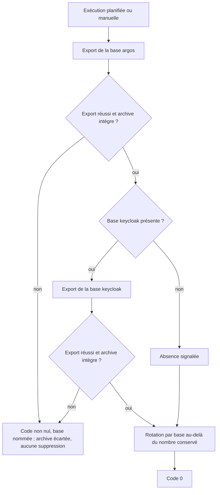
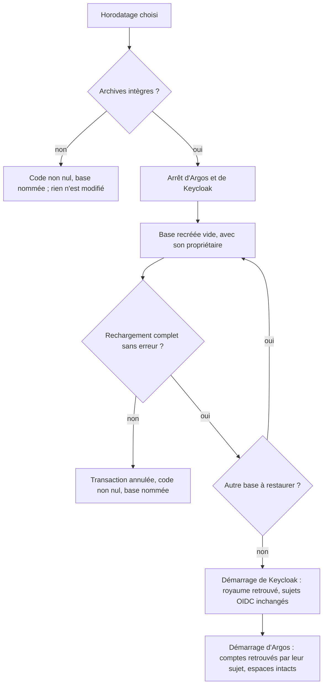

# Fiche capacité : `exploitation-plateforme`

<!-- Statuts : [EXIGENCE] [EXISTANT] [DÉCISION] [PROPOSITION] [QUESTION] (légende : /docs/specifications/README.md#statuts-des-informations). -->

| Élément | Valeur |
|---|---|
| Préfixe d'exigences | `EXP` |
| Spec de référence | `/openspec/specs/exploitation-plateforme/spec.md` — absente tant qu'aucun changement n'est archivé |
| Changements en cours | [`fiabiliser-sauvegarde-et-roles-base`](/openspec/changes/fiabiliser-sauvegarde-et-roles-base/proposal.md) (EXP-01 à EXP-06, implémenté, non archivé) ; `completer-configuration-conteneurs` et `instrumenter-observabilite` (proposés) |
| Statut de la capacité | proposée |
| Composants (arc42 §5) | PostgreSQL ; Keycloak auto-hébergé ; Quarkus Backend (comptes de connexion) ; outillage d'exploitation (`scripts/`, `deploiement/`) |

## Objectif

Argos s'exploite sur le Synology du porteur, seule cible réelle ([ADR-0026](../architecture/adr/0026-hebergement-synology.md)), sans perte ni exposition de ses données : une sauvegarde qui signale ses échecs et emporte toutes les bases, une restauration rejouable qui rend à chaque utilisateur son compte et ses espaces, des comptes de base cloisonnés et aucun secret par défaut. [PROPOSITION — `fiabiliser-sauvegarde-et-roles-base`]

## Acteurs

| Acteur | Interaction | Statut |
|---|---|---|
| Exploitant (porteur sur le NAS) | planifie la sauvegarde (tâche DSM), restaure, migre une installation existante, renseigne les mots de passe | [PROPOSITION — `fiabiliser-sauvegarde-et-roles-base`] |
| Utilisateur d'Argos | retrouve son compte et ses espaces après une restauration | [PROPOSITION — `fiabiliser-sauvegarde-et-roles-base`] |
| Keycloak (profil `idp-local`) | fournisseur d'identité dont la base est sauvegardée et restaurée avec celle d'Argos ([ADR-0027](../architecture/adr/0027-keycloak-idp-auto-heberge.md)) | [DÉCISION] |

## Périmètre et exclusions

- Inclus : sauvegarde et restauration des bases `argos` et `keycloak`, comptes PostgreSQL, mots de passe obligatoires. [PROPOSITION — `fiabiliser-sauvegarde-et-roles-base`]
- Exclus de ce changement : chiffrement des sauvegardes (Q-2), copie hors site (Hyper Backup, réglage de DSM), valeurs RPO/RTO (arc42 §7.6) ; configuration et durcissement des conteneurs (`completer-configuration-conteneurs`) ; journaux et métriques (`instrumenter-observabilite`).

## Préconditions et déclencheurs

- Sauvegarde : tâche planifiée de DSM (utilisateur `root`) ou commande manuelle, conteneur `postgres` démarré.
- Restauration : décision de l'exploitant, archives choisies par leur horodatage, sauvegarde préalable de l'état courant.
- Comptes de base : créés au premier démarrage d'un volume PostgreSQL neuf ; une installation antérieure se migre par sauvegarde et restauration ([guide](/docs/deploiement/synology-et-pc.md#passer-aux-comptes-de-base-distincts)).

## Entrées, sorties et validations

| Entrée / sortie | Contenu | Validation ou contrainte | Statut |
|---|---|---|---|
| Archive de sauvegarde | `<base>-AAAAMMJJ-HHMMSS.sql.gz`, une par base, même horodatage | intégrité gzip et fin d'export vérifiées avant conservation ; 0600 ; dossier 0700 | [PROPOSITION — `fiabiliser-sauvegarde-et-roles-base`] |
| Code de sortie | sauvegarde et restauration | 0 en succès, non nul sinon, base nommée sur la sortie d'erreur | [PROPOSITION — `fiabiliser-sauvegarde-et-roles-base`] |
| Mots de passe de base (`.env`) | administration, propriétaire et connexion d'Argos, Keycloak | obligatoires : Compose refuse de démarrer sans eux | [PROPOSITION — `fiabiliser-sauvegarde-et-roles-base`] |

## Règles métier

| Règle | Exigence(s) | Source | Statut |
|---|---|---|---|
| Un échec de sauvegarde se voit (code non nul, base nommée), ne laisse aucune archive invalide et ne supprime aucune sauvegarde ; la rotation suit une sauvegarde complète | EXP-01 | AUD-QUA-02 ; ADR-0026 point 6 | [PROPOSITION — `fiabiliser-sauvegarde-et-roles-base`] |
| Chaque exécution sauvegarde la base d'Argos et, si elle existe, celle de Keycloak, chacune restaurable seule | EXP-02 | AUD-DEP-24 | [PROPOSITION — `fiabiliser-sauvegarde-et-roles-base`] |
| Les sauvegardes ne sont lisibles que par le compte qui les produit | EXP-03 | AUD-SEC-07 | [PROPOSITION — `fiabiliser-sauvegarde-et-roles-base`] |
| La restauration remplace les deux bases d'une même sauvegarde, s'arrête à la première erreur et précède le premier démarrage de Keycloak | EXP-04 | AUD-DEP-03, AUD-DEP-24 ; R-10, QS-14 | [PROPOSITION — `fiabiliser-sauvegarde-et-roles-base`] |
| Keycloak a son compte, propriétaire de sa seule base ; Argos migre sous le propriétaire et se connecte avec un rôle ni superutilisateur, ni propriétaire, ni BYPASSRLS | EXP-05 | AUD-SEC-30 ; [ADR-0035](../architecture/adr/0035-comptes-et-isolation-des-bases.md) (Proposé) | [DÉCISION — porteur du projet, 2026-11-24 (Q-1)] |
| Aucun mot de passe de base par défaut | EXP-06 | AUD-SEC-06 | [PROPOSITION — `fiabiliser-sauvegarde-et-roles-base`] |

## Droits d'accès et restrictions

- Comptes PostgreSQL [DÉCISION — porteur du projet, 2026-11-24] : superutilisateur d'administration (initialisation, sauvegarde, restauration) ; propriétaire de la base `argos` (migrations) ; rôle de connexion d'Argos, membre d'`argos_app` (transactions d'un utilisateur, RLS) et d'`argos_technique` (traitements de plateforme, hors contexte utilisateur) ; rôle `keycloak`, propriétaire de sa seule base. `CONNECT` retiré à `PUBLIC` sur les deux bases. Détail : [ADR-0035](../architecture/adr/0035-comptes-et-isolation-des-bases.md).
- Sauvegardes : lisibles par le seul compte qui exécute le script (`root` sur le NAS).

## Effets de bord observables

- Une restauration arrête Argos et Keycloak et les laisse arrêtés ; elle détruit le contenu courant des bases restaurées.
- Une installation dont le `.env` n'a pas les quatre mots de passe ne démarre plus (rupture d'exploitation annoncée dans le guide).

## Qualités mesurables

- QS-14 ([`scenarios.md`](../architecture/quality/scenarios.md)) : reprise après sinistre par restauration ; durée non mesurée, RPO/RTO à valider (arc42 §7.6).

## Diagrammes

### DF-EXP-1 — Une sauvegarde

- **Question** : quand une sauvegarde est-elle conservée, et que devient la rotation en cas d'échec ?
- **Type** : organigramme
- **Portée** : cible proposée, implémentée par `scripts/sauvegarder-base.sh` (changement non archivé)
- **Exigences** : EXP-01, EXP-02, EXP-03

Une archive n'est gardée qu'après la vérification de son intégrité ; la rotation n'a lieu qu'une fois toutes les bases présentes sauvegardées : une suite d'échecs ne réduit jamais le nombre de bonnes sauvegardes. Les archives sont créées en 0600 dans un dossier en 0700.

### DF-EXP-2 — Une restauration

- **Question** : dans quel ordre restaurer pour qu'un utilisateur retrouve son compte et ses espaces ?
- **Type** : organigramme
- **Portée** : cible proposée, implémentée par `scripts/restaurer-base.sh` (changement non archivé)
- **Exigences** : EXP-04

Keycloak n'importe son royaume que s'il est absent : restaurer sa base avant son premier démarrage conserve les sujets OIDC auxquels Argos rattache ses comptes. Rejouée, la procédure aboutit au même contenu.

## Critères d'acceptation

Scénarios EXP-01-S1 à EXP-06-S2 du [delta de spécification](/openspec/changes/fiabiliser-sauvegarde-et-roles-base/specs/exploitation-plateforme/spec.md) ; scénario qualité QS-14.

## Interprétations introduites par un changement

- Les traitements de plateforme d'Argos (sans contexte utilisateur) passent par le rôle `argos_technique`, dont la politique RLS ne s'applique que hors de tout contexte utilisateur : l'exigence EXP-05-S3 (abandon du rôle restreint sans effet) est tenue sans retirer à ces traitements leur portée. [PROPOSITION — `fiabiliser-sauvegarde-et-roles-base` ; ADR-0035, Proposé]
- La migration d'une installation existante passe par une sauvegarde et une restauration sur un volume neuf : le compte initial d'un volume est le superutilisateur créé avec lui, que PostgreSQL ne permet pas de rétrograder. [PROPOSITION — `fiabiliser-sauvegarde-et-roles-base`]

## Écarts constatés

- ADR-0026 (point 6, Proposé) prévoit une restauration testée : la preuve est l'exercice de restauration consigné dans les tâches du changement et dans [`recette-poste.md`](/docs/deploiement/recette-poste.md) (R-6) ; sa périodicité reste ouverte (Q-4).

## Questions ouvertes

| ID | Question | Impact | Destinataire |
|---|---|---|---|
| Q-2 | Les sauvegardes sont-elles chiffrées par le script (outil et gestion de la clé à choisir) ou par Hyper Backup ? | confidentialité des archives hors du NAS | porteur du projet |
| Q-3 | Quelle taille minimale d'archive tient lieu de contrôle de vraisemblance, en plus du contrôle d'intégrité ? | détection d'une base vidée par erreur | exploitant |
| Q-4 | À quelle fréquence l'exercice de restauration est-il rejoué (R-10) ? | confiance dans la reprise | porteur du projet |

## Traçabilité

| Exigence | Scénarios | Conception / diagramme | Tâche | Test ou preuve |
|---|---|---|---|---|
| EXP-01 | S1 à S3 | design.md D1, DC-1 ; DF-EXP-1 | 1.1, 1.4 | [`essai-sauvegarde-restauration.sh`](/scripts/essai-sauvegarde-restauration.sh) |
| EXP-02 | S1, S2 | design.md D2, DC-1 ; DF-EXP-1 | 1.3, 1.4 | idem |
| EXP-03 | S1, S2 | design.md « Sécurité et isolation » | 1.2, 1.4 | idem (système de fichiers Linux, en root) |
| EXP-04 | S1 à S3 | design.md D3, DC-2 ; DF-EXP-2 | 2.1, 2.2, 5.1 | idem ; exercice de restauration (tâche 5.1) |
| EXP-05 | S1 à S5 | design.md D4 ; ADR-0035 | 3.1 à 3.4, 3.6 | `RolesBaseTest` ; `CouvertureRlsTest` |
| EXP-06 | S1, S2 | design.md D5 | 3.5 | `docker compose config` sans puis avec `.env` |
