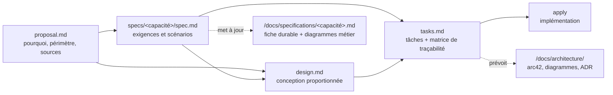

# Guide : schéma OpenSpec `detailed-uml`

Le schéma `detailed-uml` est le workflow OpenSpec du projet. Il dérive du schéma officiel `spec-driven` d'OpenSpec 1.14.3 et produit des spécifications en français, aux exigences identifiées, aux scénarios testables, accompagnées de diagrammes Mermaid et d'une traçabilité jusqu'aux preuves.

| Élément | Emplacement |
|---|---|
| Définition du schéma | `/openspec/schemas/detailed-uml/schema.yaml` |
| Modèles des artefacts | `/openspec/schemas/detailed-uml/templates/` |
| Copie de référence du schéma officiel | `/openspec/schemas/detailed-uml/upstream/spec-driven-1.14.3/` |
| Sélection du schéma, contexte et règles | `/openspec/config.yaml` |
| Modèle de fiche capacité | [`_modele-fiche-capacite.md`](_modele-fiche-capacite.md) |
| Contrôle documentaire | `/scripts/verifier-docs.mjs` |

## Workflow



Organigramme des dépendances déclarées dans `schema.yaml` (`requires`). Différence avec `spec-driven` : `design` dépend aussi de `specs`, pour que la conception cite les identifiants d'exigences ; `design.md` est toujours produit (les tâches en dépendent) et peut se réduire à « Non applicable » justifié pour un changement documentaire.

## Produire une spécification

Depuis la racine du dépôt :

```bash
openspec new change <change-id> --description "<résumé>"
```

```bash
openspec status --change <change-id>
```

```bash
openspec instructions proposal --change <change-id>
```

Puis, artefact par artefact, `openspec instructions specs|design|tasks --change <change-id>`. Les commandes des assistants (`/opsx:propose`, `/opsx:continue`, `/opsx:ff`) appellent ces mêmes instructions et utilisent automatiquement le schéma du changement.

Contrôles avant revue :

```bash
openspec validate <change-id> --strict
```

```bash
node scripts/verifier-docs.mjs
```

L'archivage (`openspec archive <change-id>`) n'est lancé que sur décision explicite, après réalisation des tâches et bascule des statuts dans les fiches.

## Contraintes de format vérifiées sur OpenSpec 1.14.3

Comportements constatés dans une copie isolée du dépôt (validation stricte puis archivage) :

| Constat | Conséquence dans le schéma |
|---|---|
| Une section `##` autre que `Purpose` et les sections de delta est ignorée par l'archivage (avertissement, échec en `--strict`) | le contexte fonctionnel et les diagrammes vont dans la fiche durable |
| `## Why` et `## What Changes` sont exigés dans `proposal.md` ; `## Why — Pourquoi` est accepté | en-têtes bilingues dans le modèle |
| Une exigence sans `MUST` ni `SHALL` déclenche un avertissement (échec en `--strict`) | « DOIT (MUST) », « NE DOIT PAS (MUST NOT) » |
| `**GIVEN**` et `**AND**` sont acceptés dans les scénarios | scénarios GIVEN / WHEN / THEN / AND |
| Le contenu d'un scénario (y compris un bloc Mermaid) est recopié tel quel dans la spec principale | possible, mais réservé aux cas où le diagramme est propre au scénario |
| `Purpose` est recopié dans une nouvelle spec principale | `Purpose` porte le lien vers la fiche durable |
| Un lien relatif ne survit pas : le delta (`openspec/changes/<id>/specs/<cap>/`) et la spec principale (`openspec/specs/<cap>/`) n'ont pas la même profondeur | liens écrits depuis la racine du dépôt (`/docs/...`), interprétés par GitHub et par le script de contrôle |
| Une section ajoutée à la main après `## Requirements` dans une spec principale est conservée lors d'un archivage MODIFIED | possible pour des références durables, à éditer directement dans la spec principale |
| Après archivage, le dossier du changement part sous `openspec/changes/archive/<date>-<id>/` : les liens des fiches vers le changement cassent | étape « repointer les liens » dans `## Workflow follow-up` ; `node scripts/verifier-docs.mjs` les signale |
| Le format RENAMED `- FROM:` / `- TO:` avec en-têtes entre accents graves fonctionne | repris dans le modèle |

`openspec new change` affiche « with schema 'spec-driven' » mais écrit `schema: detailed-uml` dans `.openspec.yaml` lorsque `config.yaml` sélectionne `detailed-uml` ; `openspec status` confirme le schéma réellement utilisé.

## Identifiants et traçabilité

- Exigence : `<PRÉFIXE>-<NN>` dans l'en-tête `### Requirement:` ; scénario : `<PRÉFIXE>-<NN>-S<n>`.
- Les préfixes sont enregistrés dans le [registre des capacités](README.md#registre-des-capacités-et-des-préfixes) ; un préfixe ou un identifiant retiré n'est jamais réutilisé.
- Diagrammes : `DF-<PRÉFIXE>-<n>` (métier, fiches), `DC-<n>` (conception, `design.md` du changement), `D-<nn>` (architecture, arc42).
- Chaîne de traçabilité : exigence → scénario → section de conception ou diagramme → tâche → test ou preuve, tenue dans la matrice de `tasks.md` puis reportée dans la fiche à l'archivage.

## Maintenir le schéma

1. Modifier `schema.yaml` ou un modèle, en gardant alignées l'instruction et la structure du modèle (aucune consigne de concision contraire aux sections attendues).
2. Valider :

   ```bash
   openspec schema validate detailed-uml
   ```

3. Vérifier les instructions réellement transmises sur un changement existant :

   ```bash
   openspec instructions specs --change <change-id>
   ```

4. Rejouer le parcours de création, validation stricte et archivage dans une copie temporaire du dossier `openspec/` (jamais sur un changement réel), puis contrôler la spec principale produite.

`openspec schema validate` ne détecte pas un champ mal orthographié (il est ignoré) : relire tout champ ajouté dans `schema.yaml` (référence : [schema.yaml](https://openspec.dev/docs/schemas/schema-yaml)).

## Comparer avec une nouvelle version du schéma officiel

Un fork ne reçoit pas les évolutions de `spec-driven` : `openspec update` ne touche pas `openspec/schemas/`. Procédure lors d'une montée de version d'OpenSpec :

1. Dans une copie temporaire du dépôt, créer une copie du nouveau schéma officiel :

   ```bash
   openspec schema fork spec-driven spec-driven-upstream
   ```

2. Comparer l'ancienne référence et la nouvelle pour isoler les évolutions officielles :

   ```bash
   git diff --no-index openspec/schemas/detailed-uml/upstream/spec-driven-1.14.3 openspec/schemas/spec-driven-upstream
   ```

3. Comparer la référence et la personnalisation pour rappeler les écarts propres au projet :

   ```bash
   git diff --no-index openspec/schemas/detailed-uml/upstream/spec-driven-1.14.3 openspec/schemas/detailed-uml --stat
   ```

4. Reporter dans `detailed-uml` les évolutions officielles utiles (nouveaux champs, nouvelles règles de validation, formats), remplacer le dossier `upstream/` par la nouvelle version, puis valider et rejouer le parcours de l'étape 4 de la section précédente.

## Limites

- Une validation OpenSpec réussie prouve la structure, pas la complétude des règles métier : la revue sémantique reste humaine.
- Le script de contrôle vérifie la présence et le type déclaré des blocs Mermaid, pas leur rendu ; le rendu se vérifie avec un moteur Mermaid (voir le script, option `--rendu`).
- Les fiches ne sont pas mises à jour par OpenSpec : leur cohérence repose sur les tâches et sur la revue.
