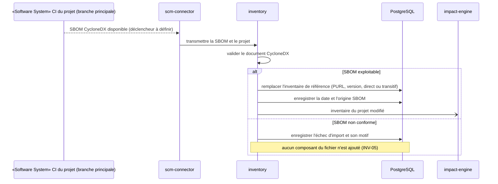
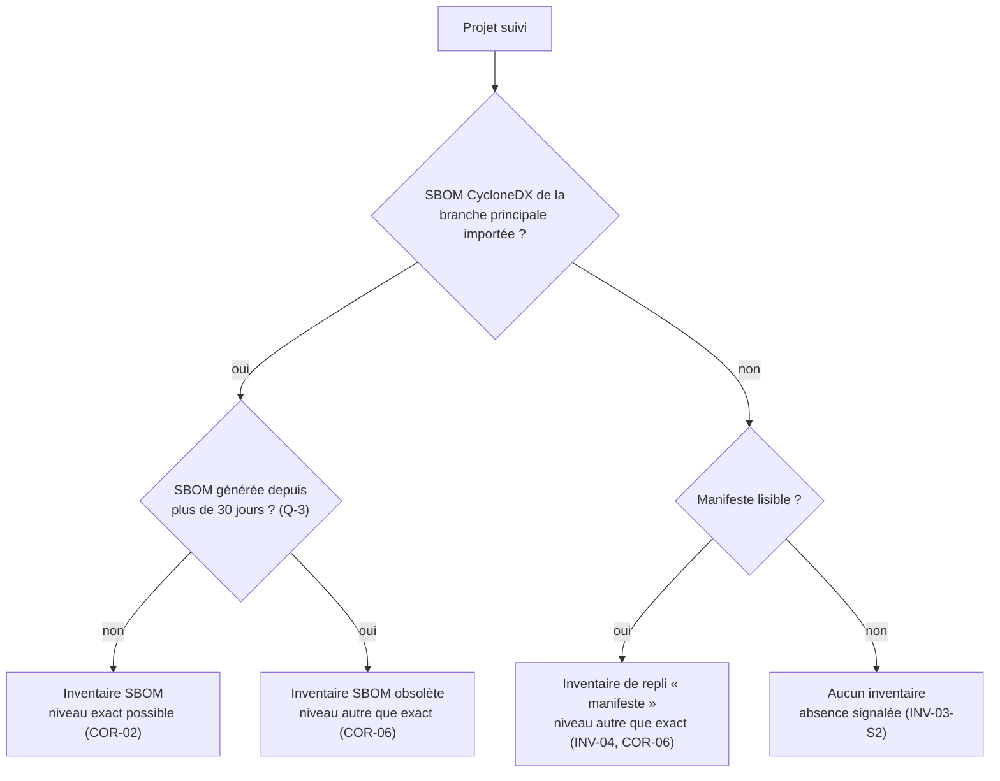

# Fiche capacité : `inventaire-sbom`

| Élément | Valeur |
|---|---|
| Préfixe d'exigences | `INV` |
| Spec de référence | `/openspec/specs/inventaire-sbom/spec.md` — absente : capacité non livrée |
| Changement en cours | [`formaliser-chaine-securite-poc`](/openspec/changes/formaliser-chaine-securite-poc/specs/inventaire-sbom/spec.md) — proposé, non archivé |
| Statut de la capacité | **proposée**, implémentée dans `argos-server` (changement non archivé) : paquets `io.argos.scm`, `io.argos.inventory` |
| Composants (arc42 §5) | `inventory`, `scm-connector`, adaptateur PostgreSQL |

Tout le contenu de cette fiche porte le statut [PROPOSITION] (changement `formaliser-chaine-securite-poc`) sauf mention contraire.

## Objectif

Répondre de façon fiable à la question « quels composants, et dans quelles versions, chaque projet embarque-t-il ? », dépendances transitives comprises, pour permettre la corrélation déterministe. Source : ADR-0011 (contexte).

## Acteurs

| Acteur | Interaction | Statut |
|---|---|---|
| CI de la branche principale des projets suivis | produit la SBOM CycloneDX | [PROPOSITION] — ADR-0011 |
| GitLab / GitHub (via `scm-connector`) | donne accès aux SBOM et manifestes | [PROPOSITION] — arc42 §5.3 ; baseline v2.3 §2.4 |
| Utilisateur technique, Tech Lead | consultent l'inventaire et sa fraîcheur | [PROPOSITION] — arc42 §1.3 |

## Périmètre et exclusions

- **Inclus** : import de la SBOM de la branche principale, PURL et versions, dépendances transitives, âge de l'inventaire, repli sur les manifestes, rejet d'une SBOM non conforme.
- **Exclu** : génération de la SBOM (responsabilité de la CI des projets), Dependency-Track (ADR-0012, optionnel), analyse de licences, autres branches que la branche principale.

## Préconditions et déclencheurs

- Le projet est suivi et rattaché à au moins un dépôt (glossaire « Repository »). La relation projet ↔ dépôts n'est pas tranchée [QUESTION — glossaire, termes ambigus].
- Déclencheur de l'import : non documenté (webhook de pipeline, interrogation périodique ou import manuel) [QUESTION Q-INV-1].

## Entrées, sorties et validations

| Entrée / sortie | Contenu | Validation ou contrainte | Statut |
|---|---|---|---|
| Entrée : SBOM CycloneDX | composants, PURL, versions, graphe de dépendances, date | document CycloneDX JSON exploitable, schéma 1.5 ou 1.6 (décision du 2026-11-16, Q-7) | [PROPOSITION] |
| Entrée : manifeste de dépendances | dépendances déclarées | utilisé seulement sans SBOM | [PROPOSITION] |
| Sortie : inventaire du projet | composants, PURL, version, direct/transitif, origine (SBOM ou manifeste), date de la source | un inventaire de référence par projet | [PROPOSITION] |
| Sortie : échec d'import | motif | consultable | [PROPOSITION] |
| Entrée : SBOM récupérée sur la forge | octets et format reconnu à l'en-tête : CycloneDX JSON, CycloneDX XML, SPDX JSON (dont l'export du graphe de dépendances GitHub), SPDX étiquette-valeur, inconnu | seule une SBOM CycloneDX JSON (ou de format inconnu, alors soumise au contrôle CycloneDX) est importée ; un autre format reconnu est refusé avec un motif qui le nomme, l'inventaire en place est conservé | [EXISTANT] — `io.argos.scm.SbomDocument`, `InventoryService.refresh` ; [PROPOSITION] pour le refus nommé des formats SPDX et CycloneDX XML |

## Règles métier

| Règle | Exigence(s) | Source | Statut |
|---|---|---|---|
| La SBOM de la branche principale fait référence | INV-01 | ADR-0011 | [PROPOSITION] |
| Les dépendances transitives sont incluses et distinguées | INV-02 | ADR-0011 ; baseline v2.3 §4, §6 | [PROPOSITION] |
| L'âge de la SBOM et l'absence de SBOM sont visibles | INV-03 | ADR-0011 | [PROPOSITION] |
| Sans SBOM, repli sur les manifestes, origine affichée | INV-04 | ADR-0011 | [PROPOSITION] |
| SBOM non conforme refusée, motif visible | INV-05 | arc42 §8.3, §11.2 | [PROPOSITION] |

## Droits d'accès et restrictions

L'inventaire appartient au projet et suit le cloisonnement par espace (ADR-0016, Proposé) : seuls les utilisateurs autorisés sur le projet le consultent. Les exigences de cloisonnement des impacts sont portées par COR-08 ; le cloisonnement de l'inventaire lui-même relève de la capacité de contrôle d'accès (lot ultérieur) [QUESTION].

## Effets de bord observables

- remplacement de l'inventaire de référence à chaque nouvelle SBOM ;
- nouvelle corrélation des signaux existants pour le projet après changement d'inventaire — attendu par la chaîne baseline v2.3 §3, déclenchement non spécifié [QUESTION Q-INV-2] ;
- enregistrement des échecs d'import.

## Qualités mesurables

| Qualité | Cible | Source | Statut |
|---|---|---|---|
| Couverture SBOM des projets pilotes | 2 projets pilotes avec SBOM fraîche, transitives incluses | baseline v2.3 §6 critère 2 | [PROPOSITION] |
| Réponse « projets touchés » | < 5 min | ADR-0011, traçabilité | [QUESTION] — cible non validée |
| Seuil d'obsolescence d'une SBOM | 30 jours après la date de génération | ADR-0011 ; décision du 2026-11-16 (Q-3) | [DÉCISION] |

## Diagrammes

### DF-INV-1 — Import d'une SBOM

- **Question** : comment l'inventaire de référence d'un projet est-il remplacé par une nouvelle SBOM, et que se passe-t-il si elle est invalide ?
- **Type** : UML séquence
- **Portée** : cible proposée ; déclencheur non documenté (Q-INV-1)
- **Exigences** : INV-01, INV-02, INV-05

L'envoi vers `impact-engine` est asynchrone et matérialise l'effet de bord « nouvelle corrélation » dont le déclenchement reste à spécifier (Q-INV-2). Le devenir de l'inventaire précédent après un import refusé n'est pas documenté (Q-INV-3).

### DF-INV-2 — Origine de l'inventaire d'un projet

- **Question** : d'où provient l'inventaire utilisé pour un projet, et avec quelle conséquence sur la confiance ?
- **Type** : organigramme (flowchart)
- **Portée** : cible proposée
- **Exigences** : INV-01, INV-03, INV-04, COR-06

Le diagramme relie l'origine de l'inventaire au niveau d'impact défini par `correlation-impact`. Le comportement d'un projet sans aucun inventaire vis-à-vis de la corrélation (aucun impact calculable) est une conséquence logique, non une règle écrite dans les sources.

## Critères d'acceptation

- Scénarios `INV-01-S1` à `INV-05-S1` de la spec.
- Baseline v2.3 §4 : « SBOM CycloneDX de deux projets, PURL et versions transitives consultables ».

## Interprétations introduites par un changement

Interprétations validées par le porteur du projet le 2026-11-16 [DÉCISION].

- INV-01-S2 : un composant absent de la nouvelle SBOM disparaît de l'inventaire de référence (remplacement complet) ;
- INV-02 : la distinction direct/transitif est affichée — la source exige la couverture des transitives, pas l'affichage de la distinction.

[DÉCISION — porteur du projet, 2026-11-18] Tâche 3.2 : le test de contrat GitLab/GitHub enregistré se fait sur une capture d'un dépôt pilote réel, notamment de l'artefact SBOM GitLab. Les réponses enregistrées sur des dépôts publics de `api.github.com` et `gitlab.com` restent une preuve partielle ; la tâche reste ouverte jusqu'à cette capture.

Interprétation introduite par l'implémentation, à valider [PROPOSITION] :

- INV-03 : une SBOM sans date de génération est traitée comme obsolète, faute de pouvoir établir sa fraîcheur ; la corrélation lui attribue au mieux le niveau `probable`. La décision Q-3 ne fixe que le seuil de 30 jours après la date de génération.
- INV-04 : le repli sur les manifestes ne s'applique qu'à une SBOM absente d'un dépôt accessible ; un dépôt introuvable, un jeton refusé ou un quota épuisé fait échouer le rafraîchissement sans repli, l'inventaire en place étant conservé.
- INV-01, INV-05 : une SBOM SPDX ou CycloneDX XML trouvée sur la forge est reconnue et refusée avec le motif « SBOM <format> non acceptée : CycloneDX JSON 1.5 ou 1.6 attendu » ; elle n'est ni convertie ni importée, conformément à la décision Q-7. L'import de SPDX demanderait de modifier INV-01.

## Écarts constatés

- Le code de `argos-server` implémente les règles de cette fiche (`io.argos.inventory`, `io.argos.scm` ; tests `argos-server/src/test/java/io/argos/chain/InventoryTest.java` et `DocumentParsingTest.java`). La consultation de l'inventaire s'exécute sous le rôle applicatif `argos_app` : la RLS des tables `project`, `inventory`, `component` et `inventory_import_failure` limite la lecture aux membres de l'espace du projet.
- L'indicateur `obsolete` de la consultation ne vaut vrai que pour une SBOM ; un inventaire de repli (manifestes) n'est pas une SBOM, mais la corrélation ne lui accorde jamais le niveau `exact`.
- Les niveaux des impacts sont calculés à la corrélation et enregistrés : une SBOM qui dépasse ensuite les 30 jours ne fait pas recalculer les impacts existants tant qu'aucun nouveau signal ni inventaire ne déclenche de corrélation (aucune tâche planifiée ne le fait, ADR-0031 accepté).
- `scm-connector` (`io.argos.scm.RepositoryFiles`) récupère la SBOM et les manifestes en lecture seule : GitLab, SBOM = artefact du job désigné sur la branche principale, fichiers par l'API des fichiers bruts, jeton `PRIVATE-TOKEN` ; GitHub, SBOM et fichiers par l'API des contenus en média brut, jeton `Bearer`. Les jetons sont lus dans la configuration (`argos.scm.gitlab.token`, `argos.scm.github.token`, variables d'environnement) ; le délai `argos.sources.http-timeout` borne l'établissement de la connexion et l'attente des en-têtes de réponse, la lecture du corps étant bornée en taille et non en durée. Une réponse 404 sur un fichier d'un dépôt existant signifie « absent » et ouvre le repli sur les manifestes ; un dépôt introuvable (`DepotIntrouvable` : corps `404 Project Not Found` de GitLab ; pour GitHub, dont le 404 est identique pour un fichier et un dépôt absents, un `GET /repos/:owner/:repo` répondant 404), un jeton refusé (401) ou un accès interdit (403 hors quota, `AccesRefuse`), un quota épuisé (`QuotaEpuise` : 429, ou 403 avec `x-ratelimit-remaining: 0`, `Retry-After` ou un message mentionnant une limite de débit, comme la limite secondaire GitHub signalée sans `Retry-After`), un autre statut, une redirection (jamais suivie) ou une réponse au-delà de `argos.inventory.max-document-bytes` font échouer le rafraîchissement (`ERROR`) sans repli ni modification de l'inventaire. Les segments `.` et `..` sont retirés des chemins, un dépôt GitHub hors de la forme `owner/repo` est refusé, le jeton n'apparaît dans aucun message. Les points d'accès utilisés ne sont pas paginés. Au cours d'un même rafraîchissement (`RepositoryFiles.Lecture`), le dépôt GitHub n'est vérifié qu'une fois, quel que soit le nombre de fichiers absents.
- Le contrat de ces appels est vérifié sans accès à Internet, sur un serveur HTTP local qui rejoue des réponses de `api.github.com` et `gitlab.com` enregistrées le 2026-11-18 sur des dépôts publics, en-têtes compris (`argos-server/src/test/resources/fixtures/scm/enregistrees/`, `chain/ScmContratEnregistreTest`) : SBOM CycloneDX 1.6 trouvée et importée, SBOM absente avec repli sur `package.json`, dépôt introuvable, jeton refusé, artefact interdit. Les limites de débit et l'artefact SBOM GitLab servi en 200 sont composés d'après la documentation des forges (`fixtures/NOTICE`) ; `chain/ScmContractTest` complète ces cas sur des réponses composées (formats SPDX et CycloneDX XML, redirection, taille, chemins hostiles). Aucune réponse n'est enregistrée sur un dépôt pilote.
- Les artefacts de job GitLab ne sont pas lisibles anonymement sur les projets publics essayés (403 enregistré) ; la récupération d'un artefact réel n'est vérifiée qu'avec une réponse composée.
- `InventoryService.refresh` n'a aucun déclencheur en production : ni tâche planifiée, ni point d'entrée REST (Q-INV-1).
- Une forge qui sert durablement une SBOM SPDX ou CycloneDX XML fait refuser chaque rafraîchissement (`REJECTED`) sans repli sur les manifestes : un inventaire existant reste en l'état et n'est plus mis à jour tant que la SBOM n'est ni retirée ni remplacée par une SBOM CycloneDX JSON, comme pour une SBOM CycloneDX invalide.

## Questions ouvertes

| ID | Question | Impact | Destinataire |
|---|---|---|---|
| Q-INV-1 | Qu'est-ce qui déclenche l'import d'une SBOM ? | conception `scm-connector` | Tech Lead |
| Q-INV-2 | Un changement d'inventaire relance-t-il la corrélation des signaux existants ? | COR-01 | architecte |
| Q-INV-3 | Après un import refusé, l'inventaire précédent reste-t-il la référence ? | INV-05 | Tech Lead |
| Q-INV-4 | Quels formats de manifeste le repli doit-il lire ? | INV-04 | Tech Lead |
| Q-3 (changement) | Âge à partir duquel une SBOM est obsolète ? | répondue le 2026-11-16 : obsolète 30 jours après sa date de génération [DÉCISION] | sécurité / Tech Lead |
| Q-7 (changement) | Versions du schéma CycloneDX acceptées ? | répondue le 2026-11-16 : CycloneDX 1.5 et 1.6, format JSON [DÉCISION] | Tech Lead |

## Traçabilité

Voir la matrice du changement : [`tasks.md`](/openspec/changes/formaliser-chaine-securite-poc/tasks.md#matrice-de-traçabilité). Les scénarios INV-01-S1 à INV-05-S1 sont vérifiés par `argos-server/src/test/java/io/argos/chain/InventoryTest.java` et `DocumentParsingTest.java`. La récupération GitLab et GitHub est vérifiée par `argos-server/src/test/java/io/argos/chain/ScmContratEnregistreTest.java` (réponses enregistrées) et `ScmContractTest.java` (réponses composées), forges simulées par un serveur HTTP local (tâche 3.2).
