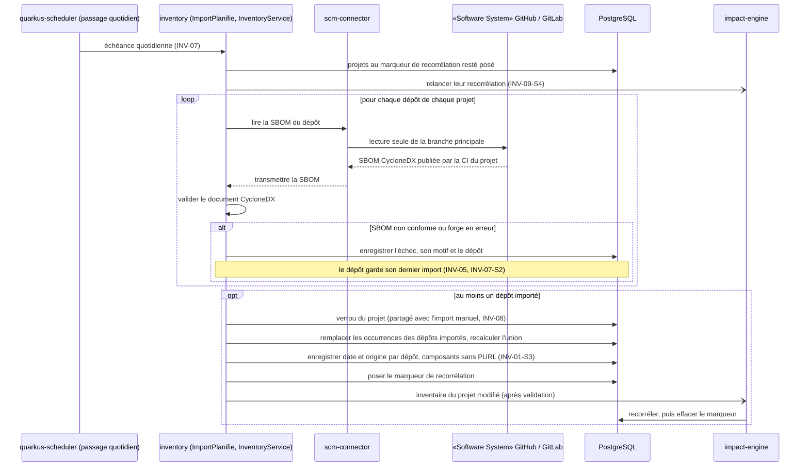
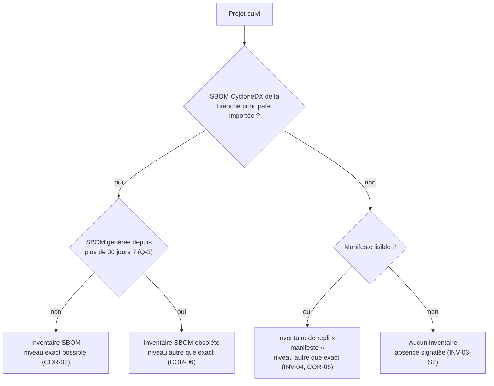
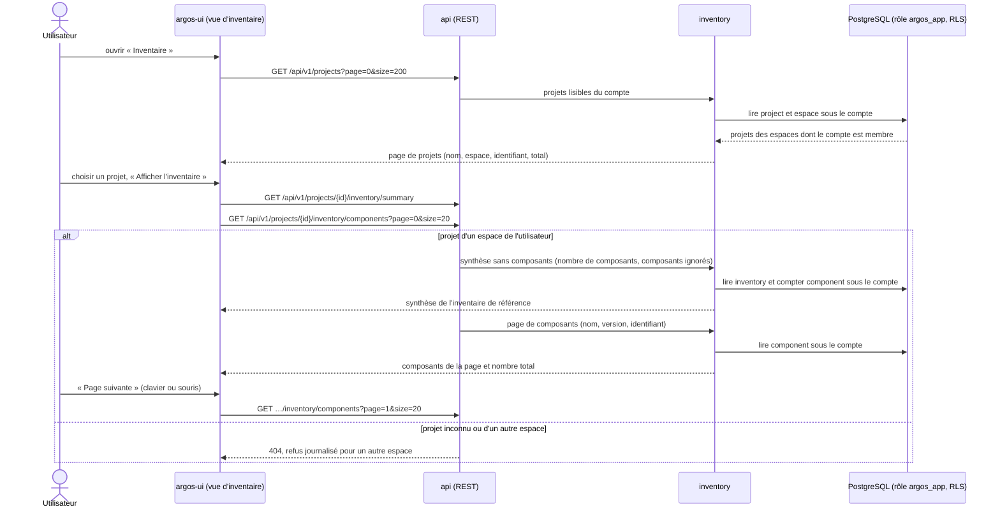
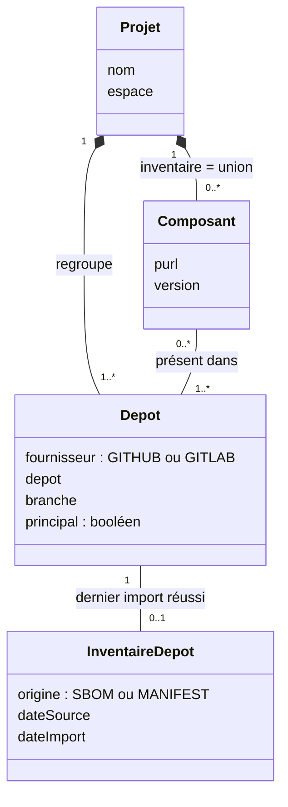

# Fiche capacité : `inventaire-sbom`

| Élément | Valeur |
|---|---|
| Préfixe d'exigences | `INV` |
| Spec de référence | [`/openspec/specs/inventaire-sbom/spec.md`](/openspec/specs/inventaire-sbom/spec.md) |
| Changement en cours | [`formaliser-chaine-securite-poc`](/openspec/changes/archive/2026-11-20-formaliser-chaine-securite-poc/specs/inventaire-sbom/spec.md) — proposé, non archivé ; [`automatiser-chaine-veille`](/openspec/changes/archive/2026-11-20-automatiser-chaine-veille/specs/inventaire-sbom/spec.md) — proposé, non archivé ; INV-07 à INV-10 implémentées (volet B) et intégrées le 2026-11-19 ; [`2026-11-25-isoler-erreurs-aux-frontieres`](/openspec/changes/archive/2026-11-25-isoler-erreurs-aux-frontieres/proposal.md) (INV-11, archivé) ; [`2026-11-26-alimenter-inventaire-et-completer-ihm`](/openspec/changes/archive/2026-11-26-alimenter-inventaire-et-completer-ihm/proposal.md) (INV-12, INV-13, archivé) |
| Statut de la capacité | **proposée**, implémentée dans `argos-server` (changement non archivé) : paquets `io.argos.scm`, `io.argos.inventory` |
| Composants (arc42 §5) | `inventory`, `scm-connector`, adaptateur PostgreSQL |

Tout le contenu de cette fiche porte le statut [PROPOSITION] (changement `formaliser-chaine-securite-poc`) sauf mention contraire.

## Objectif

Répondre de façon fiable à la question « quels composants, et dans quelles versions, chaque projet embarque-t-il ? », dépendances transitives comprises, pour permettre la corrélation déterministe. Source : ADR-0011 (contexte).

## Acteurs

| Acteur | Interaction | Statut |
|---|---|---|
| CI de la branche principale des projets suivis | produit la SBOM CycloneDX | [PROPOSITION] — ADR-0011 |
| GitLab / GitHub (via `scm-connector`) | donne accès aux SBOM et manifestes | [PROPOSITION] — arc42 §5.3 ; baseline v2.3 §2.4 |
| Utilisateur technique, Tech Lead | consultent l'inventaire et sa fraîcheur | [PROPOSITION] — arc42 §1.3 |
| Administrateur d'espace | crée les projets de son espace, leur rattache et en détache des dépôts | [PROPOSITION] — INV-12 ; décision du porteur du projet, 2026-11-26 |
| Contributeur d'espace (ou administrateur) | importe une SBOM ou des manifestes, relance l'import depuis les dépôts du projet | [PROPOSITION] — INV-13 ; décision du porteur du projet, 2026-11-26 |

## Périmètre et exclusions

- **Inclus** : import de la SBOM de la branche principale, PURL et versions, dépendances transitives, âge de l'inventaire, repli sur les manifestes, rejet d'une SBOM non conforme.
- **Exclu** : génération de la SBOM (responsabilité de la CI des projets), Dependency-Track (ADR-0012, optionnel), analyse de licences, autres branches que la branche principale.

## Préconditions et déclencheurs

- Le projet est suivi et rattaché à au moins un dépôt (glossaire « Repository »). [DÉCISION — porteur du projet, 2026-11-19 ; J6] Un projet peut regrouper plusieurs dépôts ; son inventaire est l'union des inventaires de ses dépôts (INV-10 du changement [`automatiser-chaine-veille`](/openspec/changes/archive/2026-11-20-automatiser-chaine-veille/proposal.md), [PROPOSITION]). Le code rattache à un projet zéro, un ou plusieurs dépôts, dont au plus un principal (table `project_repository`, migration V19 ; `io.argos.inventory.ProjectDirectory`) ; les projets antérieurs reçoivent leur dépôt principal à la migration [EXISTANT — volet B, 2026-11-19]. L'administrateur de l'espace crée un projet, lui rattache un dépôt et en détache un par l'API REST et par la vue d'inventaire d'`argos-ui` ; le premier dépôt rattaché devient le dépôt principal (INV-12 du changement [`alimenter-inventaire-et-completer-ihm`](/openspec/changes/archive/2026-11-26-alimenter-inventaire-et-completer-ihm/proposal.md), [PROPOSITION]). Un projet n'est ni renommé ni supprimé.
- Déclencheur de l'import : [DÉCISION — porteur du projet, 2026-11-19 ; J3, Q-INV-1] interrogation périodique, quotidienne et configurable, des dépôts GitHub/GitLab configurés, en réutilisant la récupération existante de `scm-connector` ; import manuel par un contributeur ou un administrateur de l'espace, par l'API REST et la vue d'inventaire (envoi d'une SBOM, de manifestes, ou relance de l'import depuis les dépôts du projet ; INV-13, [PROPOSITION]) ; aucun point d'entrée entrant (pas de webhook). Exigences INV-07 et INV-08 [PROPOSITION]. Le passage quotidien est la tâche `inventory-import-quotidien` (`io.argos.inventory.ImportPlanifie`, `cron` `argos.inventory.import.cron`, 03:00 par défaut, fuseau `argos.alerting.fuseau`, `SKIP`), désactivée dans le profil de test et dans la pile E2E (`ARGOS_INVENTORY_IMPORT_CRON=off`) [EXISTANT — volet B].

## Entrées, sorties et validations

| Entrée / sortie | Contenu | Validation ou contrainte | Statut |
|---|---|---|---|
| Entrée : SBOM CycloneDX | composants, PURL, versions, graphe de dépendances, date | document CycloneDX JSON exploitable, schéma 1.5 ou 1.6 (décision du 2026-11-16, Q-7) | [PROPOSITION] |
| Entrée : manifeste de dépendances | dépendances déclarées | utilisé seulement sans SBOM | [PROPOSITION] |
| Sortie : inventaire du projet | composants, PURL, version, direct/transitif, origine (SBOM ou manifeste), date de la source | un inventaire de référence par projet | [PROPOSITION] |
| Sortie : échec d'import | motif | consultable | [PROPOSITION] |
| Sortie : composants signalés à l'import | nombre total des composants écartés faute de PURL ; nom, groupe, version et motif (`SANS_PURL` : aucun PURL déclaré ; `PURL_INVALIDE` : PURL illisible) des 100 premiers | restitués avec l'inventaire (`ignoredCount`, `ignoredComponents` de `GET /api/v1/projects/{projectId}/inventory`) et affichés dans la vue d'inventaire d'`argos-ui`, web et desktop (section « Composants ignorés ») ; remplacés à chaque import | [DÉCISION] porteur du projet, 2026-11-18 (D6) et 2026-11-19 (E4) |
| Sortie : projets visibles | identifiant, espace (identifiant et nom) et nom de chaque projet des espaces de l'utilisateur, par nom de projet, nom d'espace puis identifiant ; nombre total | `GET /api/v1/projects`, liste paginée (`page` à partir de 0, `size` de 1 à 200, défaut 50, ramenés aux bornes) ; liste de choix « Projet » de la vue d'inventaire d'`argos-ui` | [DÉCISION] porteur du projet, 2026-11-19 (F1) ; modalités [PROPOSITION] |
| Sortie : composants inventoriés paginés | nom (clé du paquet sans `pkg:<type>/`), version, PURL, dépendance directe, transitive ou inconnue, par nom, version puis identifiant ; nombre total | `GET /api/v1/projects/{projectId}/inventory/components`, mêmes bornes ; section « Composants inventoriés » de la vue d'inventaire, pages de 20 | [DÉCISION] porteur du projet, 2026-11-19 (F5) ; modalités [PROPOSITION] |
| Sortie : dépôts du projet | pour chaque dépôt, le principal d'abord : forge, identifiant, branche, principal, origine, date de la source et date du dernier import réussi, dernier échec postérieur à ce dernier import (motif sans jeton, date) | `repositories` de `GET /api/v1/projects/{projectId}/inventory/summary` ; tableau « Dépôts du projet » de la vue d'inventaire d'`argos-ui` ; liste vide pour un projet sans dépôt | [PROPOSITION] — INV-10-S1, volet B de `automatiser-chaine-veille` |
| Sortie : dépôts d'un composant | dépôts du projet qui contiennent le composant (identifiant, forge, identifiant du dépôt) | `repositories` de chaque composant de `GET /api/v1/projects/{projectId}/inventory/components` ; colonne « Dépôts » de la vue d'inventaire pour un projet à plusieurs dépôts | [PROPOSITION] — INV-10-S1, volet B |
| Entrée : SBOM récupérée sur la forge | octets et format reconnu à l'en-tête : CycloneDX JSON, CycloneDX XML, SPDX JSON (dont l'export du graphe de dépendances GitHub), SPDX étiquette-valeur, inconnu | seule une SBOM CycloneDX JSON (ou de format inconnu, alors soumise au contrôle CycloneDX) est importée ; un autre format reconnu est refusé avec un motif qui le nomme, l'inventaire en place est conservé | [EXISTANT] — `io.argos.scm.SbomDocument`, `InventoryService.refresh` ; [PROPOSITION] pour le refus nommé des formats SPDX et CycloneDX XML |
| Entrée : création d'un projet | espace, nom, premier dépôt facultatif | `POST /api/v1/projects` ; nom de 1 à 200 caractères sans virgule ; espace obligatoire ; 201 `{id, espaceId, nom}` ; deux appels créent deux projets | [PROPOSITION] — INV-12 |
| Entrée : dépôt rattaché | forge (`GITHUB` ou `GITLAB`), identifiant, branche (`main` par défaut), chemin de la SBOM, job CI GitLab, manifestes (20 au plus) | `POST /api/v1/projects/{projectId}/repositories` ; textes de 200 caractères au plus, sans virgule ; 201 `{id, principal}` ; même forge et même identifiant déjà rattachés au projet : 409 `DEPOT_DEJA_RATTACHE` | [PROPOSITION] — INV-12 |
| Entrée : détachement d'un dépôt | identifiant du dépôt | `DELETE /api/v1/projects/{projectId}/repositories/{repositoryId}` ; 204, ou 404 pour un dépôt inconnu ; l'inventaire du projet est reconstitué sans les occurrences du dépôt (INV-10-S3) | [PROPOSITION] — INV-12 |
| Entrée : SBOM importée manuellement | document CycloneDX JSON brut | `POST /api/v1/projects/{projectId}/inventory/sbom` ; mêmes contrôles que l'import planifié ; document au-delà de `argos.inventory.max-document-bytes` (20 Mio) refusé `REJECTED` ; corps HTTP admis jusqu'à 24 Mio (`quarkus.http.limits.max-body-size`), 413 au-delà ; réponse 200 `ImportResult` (`status`, `origin`, `components`, `ignored`, `reason`) | [PROPOSITION] — INV-13 |
| Entrée : manifestes importés manuellement | `{manifestes: [{chemin, contenu}]}` | `POST /api/v1/projects/{projectId}/inventory/manifests` ; 1 à 20 manifestes portant un chemin, sinon 400 `DONNEE_INVALIDE` ; issue `IMPORTED` (origine `MANIFEST`) ou `NONE` sans manifeste lisible | [PROPOSITION] — INV-13 |
| Entrée : relance de l'import | — | `POST /api/v1/projects/{projectId}/inventory/refresh` ; issue de chaque dépôt, le principal d'abord ; projet sans dépôt : 409 `PROJET_SANS_DEPOT`, rien n'est modifié | [PROPOSITION] — INV-13 |

## Règles métier

| Règle | Exigence(s) | Source | Statut |
|---|---|---|---|
| La SBOM de la branche principale fait référence | INV-01 | ADR-0011 | [PROPOSITION] |
| L'inventaire reste fondé sur le PURL : un composant de SBOM sans PURL exploitable n'y entre pas et il est signalé à l'utilisateur avec l'import (nom, groupe, version, motif « sans PURL ») | INV-01 (INV-01-S3) | décision du porteur du projet, 2026-11-18 (D6) | [DÉCISION] |
| Les composants ignorés faute de PURL sont affichés dans la vue d'inventaire d'`argos-ui` (web et desktop) : nom, groupe, version et motif, liste bornée comme l'API (100 entrées, champs de 200 caractères), nombre total, état vide | INV-01 (INV-01-S3) | décision du porteur du projet, 2026-11-19 (E4) | [DÉCISION] |
| Les dépendances transitives sont incluses et distinguées | INV-02 | ADR-0011 ; baseline v2.3 §4, §6 | [PROPOSITION] |
| L'âge de la SBOM et l'absence de SBOM sont visibles | INV-03 | ADR-0011 | [PROPOSITION] |
| Sans SBOM, repli sur les manifestes, origine affichée | INV-04 | ADR-0011 | [PROPOSITION] |
| SBOM non conforme refusée, motif visible | INV-05 | arc42 §8.3, §11.2 | [PROPOSITION] |
| La vue d'inventaire propose le choix du projet parmi les projets des espaces de l'utilisateur, lus sous la RLS de `project` ; les liens depuis les alertes restent | INV-06 (INV-06-S1) | décision du porteur du projet, 2026-11-19 (F1) | [DÉCISION] |
| Les composants inventoriés d'un projet (nom, version, PURL, direct ou transitif) sont listés par pages côté serveur et consultables dans la vue | INV-06 (INV-06-S2) | décision du porteur du projet, 2026-11-19 (F5) | [DÉCISION] |
| Pages de taille bornée (1 à 200, défaut 50, valeurs hors bornes ramenées), tri stable (composants : nom, version, identifiant ; projets : nom, espace, identifiant) ; projet inconnu ou d'un autre espace : 404, refus journalisé | INV-06 (INV-06-S2, INV-06-S3) | arc42 §8.10 ; design.md D7 | [PROPOSITION] |
| Un paramètre de pagination non entier est refusé par 400 `DONNEE_INVALIDE`, sur toutes les listes paginées de l'API REST | INV-06 (INV-06-S2) | décision du porteur du projet, 2026-11-19 (G4) | [DÉCISION] |
| La synthèse de l'inventaire d'un projet (nombres, dates, origine, composants ignorés) est fournie sans la liste des composants ; la vue ne charge que la synthèse et la page de composants affichée | INV-06 (INV-06-S4) | décision du porteur du projet, 2026-11-19 (G5) | [DÉCISION] |
| Import quotidien, configurable, de l'inventaire de chaque dépôt configuré, par interrogation en lecture seule de la forge ; aucun webhook | INV-07 | décision J3 du porteur du projet, 2026-11-19 ; ADR-0031 | [PROPOSITION] — `automatiser-chaine-veille`, implémentée (volet B) |
| L'import manuel reste possible à côté de l'import planifié ; les imports d'un même projet sont sérialisés | INV-08 | décision J3 du porteur du projet, 2026-11-19 | [PROPOSITION] — `automatiser-chaine-veille`, implémentée (volet B) ; point d'entrée : INV-13 |
| L'administrateur d'un espace crée un projet dans cet espace, lui rattache un dépôt GitHub ou GitLab et en détache un, par l'API et l'IHM ; tout autre rôle reçoit 403 (`ROLE_INSUFFISANT`), un non-membre 404 (`NON_MEMBRE`), refus journalisés ; une saisie invalide reçoit 400 `DONNEE_INVALIDE` avec l'attribut en cause, sans rien enregistrer | INV-12 | AUD-QUA-01 ; ADR-0016 (Accepté) ; décision du porteur du projet, 2026-11-26 | [PROPOSITION] — [`alimenter-inventaire-et-completer-ihm`](/openspec/changes/archive/2026-11-26-alimenter-inventaire-et-completer-ihm/proposal.md) ; vérifiée par `AdministrationProjetsTest` |
| Un contributeur ou un administrateur de l'espace d'un projet importe une SBOM CycloneDX JSON, importe des manifestes ou relance l'import depuis les dépôts, par l'API et l'IHM, avec les règles de l'import planifié (INV-01, INV-05, INV-08, INV-09) ; un lecteur reçoit 403, refus journalisé | INV-13 | AUD-QUA-01 ; INV-08 ; décision du porteur du projet, 2026-11-26 | [PROPOSITION] — [`alimenter-inventaire-et-completer-ihm`](/openspec/changes/archive/2026-11-26-alimenter-inventaire-et-completer-ihm/proposal.md) ; vérifiée par `ImportManuelTest` |
| Chaque import réussi recorrèle les avis connus pour le projet ; les impacts devenus sans objet sont résolus (COR-11) | INV-09 | décision J4 du porteur du projet, 2026-11-19 | [PROPOSITION] — `automatiser-chaine-veille` ; recorrélation implémentée (volet B) ; l'impact sans objet est résolu par le système (COR-11, volet C), intégré le 2026-11-19 |
| Un projet regroupe un ou plusieurs dépôts ; son inventaire est l'union des inventaires de ses dépôts | INV-10 | décision J6 du porteur du projet, 2026-11-19 | [PROPOSITION] — `automatiser-chaine-veille`, implémentée (volet B) |
| Un composant présent dans plusieurs dépôts est une seule ligne de l'inventaire ; son niveau d'impact se fonde sur sa meilleure occurrence (SBOM non obsolète, puis SBOM obsolète, puis manifestes) ; il est direct dès qu'un dépôt l'utilise directement | INV-10, COR-02, COR-06 | proposition P-7 du changement ; volet B | [PROPOSITION] |
| Un dépôt refusé, en erreur, sans nouvelle SBOM ou dont la forge a épuisé son quota garde son dernier import réussi ; l'échec est enregistré avec le dépôt, sans jeton | INV-07-S2, INV-10-S2 | design.md du changement (« Gestion des erreurs ») ; volet B | [PROPOSITION] |
| Dans l'import planifié, une SBOM fautive ou une erreur imprévue n'arrête que son projet : il garde son inventaire en place, est compté en échec au bilan et l'erreur est journalisée avec sa cause ; les projets suivants sont importés, puis le passage relance l'erreur imprévue. Un composant au PURL mal encodé est écarté et signalé comme tout PURL illisible | INV-11 | AUD-QUA-20 ; arc42 §8.5 ; décisions Q-2 et « isoler puis relancer » du porteur du projet, 2026-11-24 | [PROPOSITION] — `isoler-erreurs-aux-frontieres` ; vérifiée par `ImportPlanifieTest` |
| L'import manuel d'un projet remplace l'inventaire de son dépôt principal, ou, sans dépôt principal, l'inventaire « sans dépôt » du projet | INV-08 | proposition P-B1 (volet B, 2026-11-19) | [PROPOSITION] |
| Un dépôt lu depuis sa forge dont le document (SBOM ou manifestes) a l'empreinte SHA-256 de son dernier import réussi est conservé (`KEPT`, « document inchangé depuis le dernier import ») sans écriture ni recorrélation ; un import manuel est toujours appliqué. Les composants sont écrits par lot, un composant inchangé n'est pas réécrit | INV-14 | AUD-PER-19, AUD-PER-20 | [PROPOSITION — `retenir-importer-et-paginer`] |

## Droits d'accès et restrictions

L'inventaire appartient au projet et suit le cloisonnement par espace (ADR-0016, Proposé) : seuls les utilisateurs autorisés sur le projet le consultent. La liste des projets visibles n'applique aucun filtre d'espace dans sa requête : la RLS de `project` sous le rôle `argos_app` la limite aux espaces dont l'utilisateur est membre (INV-06-S1). Les exigences de cloisonnement des impacts sont portées par COR-08. Le cloisonnement de l'inventaire est appliqué et testé sur les points d'accès de consultation : `GET /api/v1/projects/{projectId}/inventory`, `GET /api/v1/projects/{projectId}/inventory/summary` et `GET /api/v1/projects/{projectId}/inventory/components` répondent 404 à un projet inconnu ou d'un espace dont l'appelant n'est pas membre, le second refus étant journalisé (motif `NON_MEMBRE`), et la RLS de `project`, `inventory` et `component` sous `argos_app` sert de garde-fou (INV-06-S3, `ConsultationInventaireTest`). Les dépôts d'un projet, leur dernier import et les occurrences des composants (`project_repository`, `repository_inventory`, `component_occurrence`, migration V19) suivent la même règle : lecture seule sous `argos_app`, réservée aux membres de l'espace du projet (`argos_projet_lisible`), vérifiée par `ProjetMultiDepotsTest` et `CouvertureRlsTest`. L'import planifié s'exécute sous l'utilisateur de connexion, comme la collecte et la corrélation (traitement technique). Les écritures demandées par l'API (création de projet, rattachement et détachement de dépôt, imports manuels) passent par les mêmes traitements du module `inventory` (`ProjectDirectory`, `InventoryService`), après le contrôle de rôle d'`api` (`Access.administrator` pour les projets et les dépôts, `Access.contributor` pour les imports) : un refus n'écrit rien, et l'écriture n'est pas doublée par une politique RLS d'écriture pour `argos_app` (décision D2 du changement `alimenter-inventaire-et-completer-ihm`, application d'ADR-0016 et d'ADR-0035). Les rôles fins au sein d'un espace (ADR-0016, Proposé) relèvent de la capacité de contrôle d'accès.

## Effets de bord observables

- remplacement de l'inventaire de référence à chaque nouvelle SBOM, et du signalement des composants écartés faute de PURL ;
- nouvelle corrélation des signaux existants pour le projet après changement d'inventaire — attendu par la chaîne baseline v2.3 §3 ; [DÉCISION — porteur du projet, 2026-11-19 ; J4, Q-INV-2] à chaque import d'inventaire d'un projet, les avis connus sont recorrélés pour ce projet (INV-09, [PROPOSITION]) ; le code le fait sur l'événement `InventoryReplaced` [EXISTANT — `io.argos.impact.CorrelationEngine#onInventoryReplaced`] ; depuis le volet B, la recorrélation parcourt aussi les signaux qui portent déjà un impact sur le projet, et le marqueur `inventory.recorrelation_pending`, posé par l'import, n'est effacé qu'après une recorrélation réussie ; un marqueur resté posé est repris au passage planifié suivant (INV-09-S4, P-10) ;
- enregistrement des échecs d'import, rattachés au dépôt concerné, y compris les erreurs de forge (INV-07-S2).

## Qualités mesurables

| Qualité | Cible | Source | Statut |
|---|---|---|---|
| Couverture SBOM des projets pilotes | 2 projets pilotes avec SBOM fraîche, transitives incluses | baseline v2.3 §6 critère 2 | [PROPOSITION] |
| Réponse « projets touchés » | < 5 min | ADR-0011, traçabilité | [QUESTION] — cible non validée |
| Seuil d'obsolescence d'une SBOM | 30 jours après la date de génération | ADR-0011 ; décision du 2026-11-16 (Q-3) | [DÉCISION] |

## Diagrammes

### DF-INV-1 — Import d'une SBOM

- **Question** : comment l'inventaire de référence d'un projet est-il remplacé par une nouvelle SBOM, et que se passe-t-il si elle est invalide ?
- **Type** : UML séquence
- **Portée** : implémentée (volet B du changement `automatiser-chaine-veille`, 2026-11-19) ; déclencheur : passage quotidien planifié ou import manuel (décision J3 du 2026-11-19, INV-07, INV-08 [PROPOSITION])
- **Exigences** : INV-01, INV-02, INV-05, INV-07, INV-08, INV-09

L'envoi vers `impact-engine` est un événement CDI observé après la validation de la transaction d'import et matérialise l'effet de bord « nouvelle corrélation » : à chaque import réussi, les avis connus sont recorrélés pour le projet (décision J4 du 2026-11-19, INV-09 [PROPOSITION]). Aucun flux n'entre depuis la forge ou la CI : ARGOS interroge la forge (J3). Un import refusé conserve le dernier import réussi du dépôt (INV-07-S2, INV-10-S2) ; la question Q-INV-3 reste ouverte sur sa portée hors de ces scénarios. L'import manuel par l'API (INV-13) et son contrôle de rôle suivent la séquence d'[arc42 §6.8](../architecture/arc42/06-vue-execution.md#68-scénario-nominal--import-manuel-dune-sbom-par-lapi).

### DF-INV-2 — Origine de l'inventaire d'un projet

- **Question** : d'où provient l'inventaire utilisé pour un projet, et avec quelle conséquence sur la confiance ?
- **Type** : organigramme (flowchart)
- **Portée** : cible proposée
- **Exigences** : INV-01, INV-03, INV-04, COR-06

Le diagramme relie l'origine de l'inventaire au niveau d'impact défini par `correlation-impact`. Le comportement d'un projet sans aucun inventaire vis-à-vis de la corrélation (aucun impact calculable) est une conséquence logique, non une règle écrite dans les sources.

### DF-INV-3 — Consultation de l'inventaire d'un projet choisi

- **Question** : comment un utilisateur choisit-il un projet et parcourt-il ses composants inventoriés, sans voir ceux d'un autre espace ?
- **Type** : UML séquence
- **Portée** : implémentée (décisions F1, F5 et G5 du 2026-11-19 ; modalités [PROPOSITION], design.md D7)
- **Exigences** : INV-06, INV-03

La synthèse (origine, âge, obsolescence, nombre de composants) et les composants ignorés sont lus sur `/inventory/summary`, sans la liste des composants (INV-01-S3, INV-03, INV-06-S4 ; décision G5) ; la page de composants est un appel distinct. La réponse de `/inventory`, composants compris, est inchangée et n'est plus lue par la vue.

### DF-INV-4 — Projet à plusieurs dépôts

- **Question** : comment un projet regroupe-t-il ses dépôts, et comment son inventaire se déduit-il des leurs ?
- **Type** : UML classes (modèle conceptuel)
- **Portée** : implémentée (changement `automatiser-chaine-veille`, décision J6 du 2026-11-19, volet B : tables `project_repository`, `repository_inventory`, `component_occurrence` de la migration V19)
- **Exigences** : INV-10, INV-07, INV-03

L'inventaire du projet est l'union des inventaires de ses dépôts (J6) : un composant présent dans deux dépôts n'y figure qu'une fois, avec ses dépôts ; chaque dépôt garde son origine, sa date et son dernier import réussi, si bien qu'un refus sur un dépôt ne retire rien des autres (INV-10-S2). Le passage quotidien importe chaque dépôt (INV-07). La règle de niveau d'un composant présent dans plusieurs dépôts (meilleure preuve parmi ses occurrences) est la proposition P-7 du changement [PROPOSITION]. La présence d'un composant dans un dépôt est une occurrence ; un composant sans occurrence est retiré de l'inventaire du projet, y compris quand le dépôt qui le contenait est détaché (INV-10-S3). Une occurrence sans dépôt provient d'un import manuel d'un projet sans dépôt principal (P-B1) [PROPOSITION].

## Critères d'acceptation

- Scénarios `INV-01-S1` à `INV-05-S1` de la spec, et `INV-06-S1` à `INV-06-S4` (consultation par projet, [PROPOSITION] issue des décisions F1, F5 et G5 du 2026-11-19).
- Scénarios `INV-12-S1` à `INV-12-S6` (administration des projets et des dépôts) et `INV-13-S1` à `INV-13-S6` (import manuel) du changement [`alimenter-inventaire-et-completer-ihm`](/openspec/changes/archive/2026-11-26-alimenter-inventaire-et-completer-ihm/specs/inventaire-sbom/spec.md) [PROPOSITION].
- Baseline v2.3 §4 : « SBOM CycloneDX de deux projets, PURL et versions transitives consultables ».

## Interprétations introduites par un changement

Interprétations validées par le porteur du projet le 2026-11-16 [DÉCISION].

- INV-01-S2 : un composant absent de la nouvelle SBOM disparaît de l'inventaire de référence (remplacement complet) ;
- INV-02 : la distinction direct/transitif est affichée — la source exige la couverture des transitives, pas l'affichage de la distinction.

[DÉCISION — porteur du projet, 2026-11-18] Tâche 3.2 : le test de contrat GitLab/GitHub enregistré se fait sur une capture d'un dépôt pilote réel, notamment de l'artefact SBOM GitLab. Les réponses enregistrées sur des dépôts publics de `api.github.com` et `gitlab.com` restent une preuve partielle ; la tâche reste ouverte jusqu'à cette capture.

Interprétation introduite par l'implémentation, à valider [PROPOSITION] :

- INV-03 : une SBOM sans date de génération est traitée comme obsolète, faute de pouvoir établir sa fraîcheur ; la corrélation lui attribue au mieux le niveau `probable`. La décision Q-3 ne fixe que le seuil de 30 jours après la date de génération.
- INV-04 : le repli sur les manifestes ne s'applique qu'à une SBOM absente d'un dépôt accessible ; un dépôt introuvable, un jeton refusé ou un quota épuisé fait échouer le rafraîchissement sans repli, l'inventaire en place étant conservé.
- INV-01-S3 : la description des composants signalés est bornée à 100 entrées par import et chaque champ à 200 caractères ; au-delà, seul le nombre total est conservé. Un PURL présent mais illisible porte le motif `PURL_INVALIDE`, distinct de `SANS_PURL`.
- INV-01, INV-05 : une SBOM SPDX ou CycloneDX XML trouvée sur la forge est reconnue et refusée avec le motif « SBOM <format> non acceptée : CycloneDX JSON 1.5 ou 1.6 attendu » ; elle n'est ni convertie ni importée, conformément à la décision Q-7. L'import de SPDX demanderait de modifier INV-01.

Interprétations introduites par le volet B du changement `automatiser-chaine-veille` (2026-11-19), à valider [PROPOSITION] :

- P-B1 — INV-08 : l'import manuel (`POST /api/v1/projects/{projectId}/inventory/sbom` et `…/manifests`, INV-13, par `InventoryService.importSbom` et `importManifests`) remplace l'inventaire du dépôt principal du projet ; un projet sans dépôt principal reçoit un inventaire « sans dépôt » (occurrences sans dépôt), que le premier import d'un dépôt de ce projet remplace. Une API d'import manuel par dépôt n'est pas ouverte.
- INV-10-S1 : dans la synthèse, l'origine, la date de la source et la date d'import restent celles du dépôt principal (ou, sans dépôt principal importé, du dernier dépôt importé), pour la compatibilité des clients existants ; le nombre de composants ignorés est la somme des dépôts et leur description réunit au plus 100 entrées, celles du dépôt de référence d'abord.
- INV-07-S2 : le dernier échec d'un dépôt n'est restitué que s'il est postérieur à son dernier import réussi ; les erreurs de forge (dépôt introuvable, jeton refusé, quota épuisé, autre statut) sont enregistrées comme les refus, et apparaissent donc aussi dans `GET …/inventory/failures`.
- INV-07 (quota) : un quota épuisé sur une forge pendant un passage arrête l'interrogation de cette forge jusqu'au passage suivant (issue `DEFERRED` pour ses autres dépôts) ; les autres forges continuent (design.md, « Gestion des erreurs »).
- INV-08-S2 : les imports d'un même projet sont sérialisés par le verrou consultatif transactionnel `inventory:<projet>`, pris à l'écriture ; la lecture des forges se fait hors verrou et hors transaction. L'inventaire final est celui de l'écriture validée en dernier.
- INV-10-S1 (IHM) : la colonne « Dépôts » des composants n'est affichée que pour un projet à plusieurs dépôts ; le tableau « Dépôts du projet » l'est dès qu'un dépôt est rattaché.
- P-12 : l'heure par défaut du passage quotidien est 03:00 (`0 0 3 * * ?`), au fuseau commun `argos.alerting.fuseau`.

## Écarts constatés

- Le code de `argos-server` implémente les règles de cette fiche (`io.argos.inventory`, `io.argos.scm` ; tests `argos-server/src/test/java/io/argos/chain/InventoryTest.java` et `DocumentParsingTest.java`). La consultation de l'inventaire s'exécute sous le rôle applicatif `argos_app` : la RLS des tables `project`, `inventory`, `component`, `inventory_import_failure`, `project_repository`, `repository_inventory` et `component_occurrence` limite la lecture aux membres de l'espace du projet.
- L'indicateur `obsolete` de la consultation ne vaut vrai que pour une SBOM ; un inventaire de repli (manifestes) n'est pas une SBOM, mais la corrélation ne lui accorde jamais le niveau `exact`.
- Les niveaux des impacts sont calculés à la corrélation et enregistrés : une SBOM qui dépasse ensuite les 30 jours ne fait pas recalculer les impacts existants tant qu'aucun nouveau signal ni inventaire ne déclenche de corrélation (aucune tâche planifiée ne le fait à ce jour ; le passage quotidien d'INV-07 et la recorrélation d'INV-09, changement `automatiser-chaine-veille`, recalculent les niveaux à chaque import réussi, pas lorsqu'une SBOM inchangée est conservée).
- `scm-connector` (`io.argos.scm.RepositoryFiles`) récupère la SBOM et les manifestes en lecture seule : GitLab, SBOM = artefact du job désigné sur la branche principale, fichiers par l'API des fichiers bruts, jeton `PRIVATE-TOKEN` ; GitHub, SBOM et fichiers par l'API des contenus en média brut, jeton `Bearer`. Les jetons sont lus dans la configuration (`argos.scm.gitlab.token`, `argos.scm.github.token`, variables d'environnement) ; le délai `argos.sources.http-timeout` borne l'établissement de la connexion et l'attente des en-têtes de réponse, la lecture du corps étant bornée en taille et non en durée. Une réponse 404 sur un fichier d'un dépôt existant signifie « absent » et ouvre le repli sur les manifestes ; un dépôt introuvable (`DepotIntrouvable` : corps `404 Project Not Found` de GitLab ; pour GitHub, dont le 404 est identique pour un fichier et un dépôt absents, un `GET /repos/:owner/:repo` répondant 404), un jeton refusé (401) ou un accès interdit (403 hors quota, `AccesRefuse`), un quota épuisé (`QuotaEpuise` : 429, ou 403 avec `x-ratelimit-remaining: 0`, `Retry-After` ou un message mentionnant une limite de débit, comme la limite secondaire GitHub signalée sans `Retry-After`), un autre statut, une redirection (jamais suivie) ou une réponse au-delà de `argos.inventory.max-document-bytes` font échouer le rafraîchissement (`ERROR`) sans repli ni modification de l'inventaire. Les segments `.` et `..` sont retirés des chemins, un dépôt GitHub hors de la forme `owner/repo` est refusé, le jeton n'apparaît dans aucun message. Les points d'accès utilisés ne sont pas paginés. Au cours d'un même rafraîchissement (`RepositoryFiles.Lecture`), le dépôt GitHub n'est vérifié qu'une fois, quel que soit le nombre de fichiers absents.
- Le contrat de ces appels est vérifié sans accès à Internet, sur un serveur HTTP local qui rejoue des réponses de `api.github.com` et `gitlab.com` enregistrées le 2026-11-18 sur des dépôts publics, en-têtes compris (`argos-server/src/test/resources/fixtures/scm/enregistrees/`, `chain/ScmContratEnregistreTest`) : SBOM CycloneDX 1.6 trouvée et importée, SBOM absente avec repli sur `package.json`, dépôt introuvable, jeton refusé, artefact interdit. Les limites de débit et l'artefact SBOM GitLab servi en 200 sont composés d'après la documentation des forges (`fixtures/NOTICE`) ; `chain/ScmContractTest` complète ces cas sur des réponses composées (formats SPDX et CycloneDX XML, redirection, taille, chemins hostiles). Aucune réponse n'est enregistrée sur un dépôt pilote.
- Les artefacts de job GitLab ne sont pas lisibles anonymement sur les projets publics essayés (403 enregistré) ; la récupération d'un artefact réel n'est vérifiée qu'avec une réponse composée.
- Écart E-2 du [jeu de référence](../architecture/quality/mesure-correlation-jeu-reference.md) (composant décrit sans PURL) : signalé à l'import et affiché dans l'IHM.
- [DÉCISION — porteur du projet, 2026-11-19 ; E4] Composants ignorés faute de PURL : ils sont affichés dans la vue d'inventaire d'`argos-ui` (web et desktop), à partir du champ déjà exposé par `GET /api/v1/projects/{id}/inventory`.
- Les composants signalés à l'import sont restitués par l'API d'inventaire et affichés par la vue d'inventaire d'`argos-ui`, web et desktop (`argos-ui/src/views/InventaireView.vue`, adresses `/inventaire` et `/inventaire/{id}`, entrée « Inventaire » de la navigation) : l'IHM lit la synthèse `GET /api/v1/projects/{projectId}/inventory/summary` par `appelerApi` (`argos-ui/src/api/inventaire.ts`, décision G5), affiche la synthèse de l'inventaire de référence (origine, date et âge de la source, obsolescence, date d'import, nombre de composants inventoriés), puis la section « Composants ignorés » : nombre total, tableau à en-têtes de colonne (nom, groupe, version, motif) borné comme l'API, ou l'état vide (« Aucun composant ignoré au dernier import. ») ; un projet sans inventaire est nommé comme tel. Les valeurs issues de la SBOM sont rendues comme texte. Le détail d'une alerte mène à la vue d'inventaire de chaque projet cité. Le projet se choisit dans la liste des projets visibles ou se désigne par son identifiant (décision F1 ci-dessous). Les outils MCP ne restituent pas le signalement ; le résultat d'un import manuel (`InventoryService.ImportResult`, réponse des routes d'INV-13) en donne le nombre (`ignored`). Ils sont conservés dans les colonnes `ignored_count` et `ignored_components` de `inventory` (migration V17), sous la RLS de la table.
- [DÉCISION — porteur du projet, 2026-11-19 ; F1] Vue d'inventaire : nouveau point d'accès `GET /api/v1/projects` listant les projets visibles par l'utilisateur (sous RLS, adossé à `InventoryQueries.visibleProjects` ou équivalent existant), et liste de choix du projet dans la vue Inventaire d'`argos-ui` ; les liens depuis les alertes restent.
- [DÉCISION — porteur du projet, 2026-11-19 ; F5] Vue d'inventaire : liste paginée côté serveur des composants inventoriés d'un projet (nom, version, PURL, direct ou transitif), consultable dans la vue.
- Les décisions F1 et F5 sont implémentées (exigence INV-06 [PROPOSITION], tâche 3.8, design.md D7) : `io.argos.api.ProjectResource` (`GET /api/v1/projects`) et `InventoryResource#components` (`GET /api/v1/projects/{projectId}/inventory/components`), adossés à `InventoryQueries.projects` et `InventoryQueries.components`, exécutés sous `argos_app` avec le compte de l'appelant ; `GET /api/v1/projects/{projectId}/inventory` est inchangé. La vue d'inventaire d'`argos-ui` (web et desktop) propose la liste de choix « Projet » (libellé « nom du projet — nom de l'espace », 200 premiers projets ; au-delà, un message renvoie à la désignation par identifiant, conservée sous « Ou identifiant du projet ») et la section « Composants inventoriés » : tableau à en-têtes (nom, version, PURL, dépendance), pages de 20, navigation « Page précédente » / « Page suivante » au clavier, position « Page n sur m », annonce dans la région live, focus sur le tableau après un changement de page, état vide (« Aucun composant inventorié. ») et erreurs avec nouvelle tentative. L'ordre des versions est l'ordre alphabétique de la base, et non l'ordre des versions de l'écosystème [PROPOSITION].
- [DÉCISION — porteur du projet, 2026-11-19 ; G4] Toutes les listes paginées de l'API REST refusent un paramètre de pagination non entier par 400 `DONNEE_INVALIDE` (helper `io.argos.api.ParametresPagination`), contrat OpenAPI à jour.
- [DÉCISION — porteur du projet, 2026-11-19 ; G5] L'API fournit la synthèse d'inventaire d'un projet sans la liste des composants (nombres, date, source, composants ignorés faute de PURL) ; la vue Inventaire ne charge plus l'inventaire complet, seulement la synthèse et la page de composants affichée ; la dette consignée dans D7 est levée.
- [DÉCISION — porteur du projet, 2026-11-19 ; G6] Une seule requête de liste des projets visibles : les outils MCP passent par la requête paginée `InventoryQueries.projects` (ou son équivalent unifié) ; `visibleProjects` disparaît si plus rien ne l'utilise ; comportement des outils MCP inchangé pour l'appelant (cloisonnement, contenu), tests MCP verts.
- Les décisions G4, G5 et G6 sont implémentées (tâche 3.9, design.md D7, révision G) : `GET /api/v1/projects/{projectId}/inventory/summary` (`InventoryResource#summary`, `InventoryQueries.summary`) renvoie `{projectId, status, summary}`, `summary` portant les champs de l'inventaire de référence avec `componentCount` à la place de `components`, mêmes règles d'accès que `/inventory` (404 journalisé hors des espaces de l'appelant, RLS sous `argos_app`) ; `GET /api/v1/projects/{projectId}/inventory` est inchangé pour ses clients. La vue d'inventaire d'`argos-ui` (web et desktop) lit la synthèse et la page de composants affichée, jamais l'inventaire complet. Les paramètres `page`, `size`, `taille` et `limite` des listes paginées de l'API passent par `ParametresPagination` ; les bornes propres à chaque liste sont conservées. Les outils MCP `get_project_context` et `upcoming_releases` lisent les projets par `InventoryQueries.projects`, page après page (`io.argos.mcp.ProjetsVisibles`) ; `InventoryQueries.projects` est la seule requête de liste des projets visibles. Le résumé des projets de `get_project_context` lit la synthèse de l'inventaire et non ses composants.
- ADR-0032 décrit les migrations V1 à V16 à sa date d'acceptation ; la migration V17 figure dans la liste à jour des migrations d'[arc42 §8.7](../architecture/arc42/08-concepts-transverses.md#87-persistance), qui fait foi pour les migrations suivantes. [DÉCISION — porteur du projet, 2026-11-19 ; F4] ADR-0032 n'est pas modifié ; l'écart est levé.
- La tâche planifiée `inventory-import-quotidien` (`ImportPlanifie`) appelle `InventoryService.importerProjet` pour chaque projet ayant au moins un dépôt (décision J3, INV-07) ; la relance manuelle (`POST …/inventory/refresh`, INV-13) appelle le même traitement pour un projet.
- Import manuel (décision J3, INV-13) : `io.argos.api.InventoryResource` (`importerSbom`, `importerManifestes`, `relancer`) et `ProjectResource` (`creer`, `rattacher`, `detacher`, saisies validées par `SaisieProjet`) appellent les traitements du module `inventory` après le contrôle de rôle ; la vue d'inventaire d'`argos-ui` (web et desktop) propose la création d'un projet (`CreationProjet.vue`), le rattachement et le détachement d'un dépôt, l'envoi d'une SBOM ou de manifestes et la relance (`AlimentationInventaire.vue`), par `argos-ui/src/api/projets.ts`. Aucun outil MCP n'importe un inventaire (ADR-0014, lecture seule). [PROPOSITION]
- Le détachement d'un dépôt n'est proposé par la vue d'inventaire qu'une fois un inventaire disponible : le tableau « Dépôts du projet » est alimenté par la synthèse, qui ne liste les dépôts que si son statut vaut `AVAILABLE`. Un dépôt rattaché à un projet encore sans inventaire ne se détache que par l'API.
- L'écriture déclenchée par l'API repose sur le contrôle de rôle du service et non sur la RLS (décision D2 du changement `alimenter-inventaire-et-completer-ihm`) : défense en profondeur moindre que pour les consultations, assumée comme pour les traitements de plateforme (ADR-0035, conséquences négatives).
- Le refus d'un rattachement en double porte sur la forge et l'identifiant du dépôt (`DepotDejaRattache`), quelle que soit la branche ; la conception du changement citait aussi la branche.
- Une forge qui sert durablement une SBOM SPDX ou CycloneDX XML fait refuser chaque rafraîchissement (`REJECTED`) sans repli sur les manifestes : un inventaire existant reste en l'état et n'est plus mis à jour tant que la SBOM n'est ni retirée ni remplacée par une SBOM CycloneDX JSON, comme pour une SBOM CycloneDX invalide.

## Questions ouvertes

| ID | Question | Impact | Destinataire |
|---|---|---|---|
| Q-INV-1 | Qu'est-ce qui déclenche l'import d'une SBOM ? | levée le 2026-11-19 : interrogation périodique (quotidienne, configurable) des dépôts GitHub/GitLab configurés, par la récupération existante de `scm-connector` ; import manuel existant conservé ; aucun webhook [DÉCISION — porteur du projet, 2026-11-19 ; J3] ; voir INV-07 et INV-08 du changement [`automatiser-chaine-veille`](/openspec/changes/archive/2026-11-20-automatiser-chaine-veille/design.md) | Tech Lead |
| Q-INV-2 | Un changement d'inventaire relance-t-il la corrélation des signaux existants ? | levée le 2026-11-19 : oui, à chaque import d'inventaire d'un projet, pour ce projet ; impacts sans objet traités selon l'état de traitement (J5) [DÉCISION — porteur du projet, 2026-11-19 ; J4] ; voir INV-09 et COR-11 du changement `automatiser-chaine-veille` | architecte |
| Q-INV-3 | Après un import refusé, l'inventaire précédent reste-t-il la référence ? | INV-05 | Tech Lead |
| Q-INV-4 | Quels formats de manifeste le repli doit-il lire ? | INV-04 | Tech Lead |
| Q-3 (changement) | Âge à partir duquel une SBOM est obsolète ? | répondue le 2026-11-16 : obsolète 30 jours après sa date de génération [DÉCISION] | sécurité / Tech Lead |
| Q-7 (changement) | Versions du schéma CycloneDX acceptées ? | répondue le 2026-11-16 : CycloneDX 1.5 et 1.6, format JSON [DÉCISION] | Tech Lead |

## Traçabilité

Voir la matrice du changement : [`tasks.md`](/openspec/changes/archive/2026-11-20-formaliser-chaine-securite-poc/tasks.md#matrice-de-traçabilité). Les scénarios INV-01-S1 à INV-05-S1 sont vérifiés par `argos-server/src/test/java/io/argos/chain/InventoryTest.java` et `DocumentParsingTest.java` ; INV-01-S3 l'est aussi par `JeuReferenceCorrelationTest` (composant sans PURL du projet `outil-sans-purl`) et, pour l'affichage dans la vue d'inventaire d'`argos-ui`, par `argos-ui/tests/composants-ignores.test.mjs` (conversion, rendu, règles de l'écran), `argos-ui/tests/inventaire-projet.test.mjs` (synthèse, chargement, erreur et nouvelle tentative, annulation) et les parcours E2E `e2e/tests/inventaire.spec.ts` (portail web) et `e2e/desktop/inventaire.spec.ts` (client desktop). Les scénarios INV-06-S1 à INV-06-S4 sont vérifiés par `argos-server/src/test/java/io/argos/chain/ConsultationInventaireTest.java` (cloisonnement entre espaces, RLS sous `argos_app`, bornes de pagination, paramètres non entiers, tri stable, projet inconnu ou d'un autre espace, synthèse sans composants égale à l'inventaire complet, contrat OpenAPI), `argos-server/src/test/java/io/argos/api/ParametresPaginationTest.java` (paramètres non entiers des autres listes paginées de l'API, décision G4), `argos-server/src/test/java/io/argos/mcp/CloisonnementMcpTest.java` (projets des outils MCP lus page après page, décision G6), `argos-ui/tests/inventaire-listes.test.mjs` (chemins, liste de choix, pages, chargements, rendu du tableau et de la pagination, accessibilité de l'écran), `argos-ui/tests/inventaire-projet.test.mjs` et `argos-ui/tests/composants-ignores.test.mjs` (synthèse lue sur `/inventory/summary`) et les mêmes parcours E2E (choix du projet dans la liste, seconde page atteinte au clavier, synthèse lue sans appel de l'inventaire complet). La récupération GitLab et GitHub est vérifiée par `argos-server/src/test/java/io/argos/chain/ScmContratEnregistreTest.java` (réponses enregistrées) et `ScmContractTest.java` (réponses composées), forges simulées par un serveur HTTP local (tâche 3.2). INV-07 à INV-10 : matrice du changement [`automatiser-chaine-veille`](/openspec/changes/archive/2026-11-20-automatiser-chaine-veille/tasks.md#matrice-de-traçabilité) ; vérifiés le 2026-11-19 (volet B) par `argos-server/src/test/java/io/argos/chain/ImportPlanifieTest.java` (INV-07-S1 à S4, INV-08-S1, S2 : forges simulées par les réponses enregistrées, imports concurrents sous le verrou du projet, aucune route entrante), `RecorrelationImportTest.java` (INV-09-S1 à S4), `ProjetMultiDepotsTest.java` (INV-10-S1 à S3, meilleure occurrence P-7, cloisonnement et RLS des nouvelles tables), `MigrationDepotsTest.java` (INV-10-S4, reprise des données de V19), `ConsultationInventaireTest.java` (contrat OpenAPI des dépôts) et `argos-ui/tests/inventaire-depots.test.mjs` (affichage des dépôts). INV-11 : matrice du changement [`isoler-erreurs-aux-frontieres`](/openspec/changes/archive/2026-11-25-isoler-erreurs-aux-frontieres/tasks.md#matrice-de-traçabilité) ; vérifiée par `ImportPlanifieTest.java` (`inv11S1SbomPortantUnPurlMalEncode`, `inv11S2ErreurImprevuePendantLImportDUnProjet`). INV-12 et INV-13 : matrice du changement [`alimenter-inventaire-et-completer-ihm`](/openspec/changes/archive/2026-11-26-alimenter-inventaire-et-completer-ihm/tasks.md#matrice-de-traçabilité) ; vérifiées par `argos-server/src/test/java/io/argos/api/inventaire/AdministrationProjetsTest.java` (`inv12S1CreationDUnProjetAvecSonPremierDepot` à `inv12S6SaisieInvalide`, `creationSansDepot`), `ImportManuelTest.java` (`inv13S1ImportDUneSbomConforme` à `inv13S6Lecteur`) et, pour l'IHM, `argos-ui/tests/vues/inventaire.spec.ts` (Vitest) ; chaque appel du client (méthode et chemin) est vérifié contre l'instantané `argos-ui/src/api/openapi.json` par `argos-ui/tests/contrat-api.test.mjs`, l'instantané contre le schéma servi par `ContratClientIhmTest`.

INV-14 ([PROPOSITION] `retenir-importer-et-paginer`, design.md D8, D9, DC-3, tâches 5.1 à 5.3) est vérifiée par `chain/ImportPlanifieTest` (`inv14*`) et `inventory/EcritureComposantsTest`.
