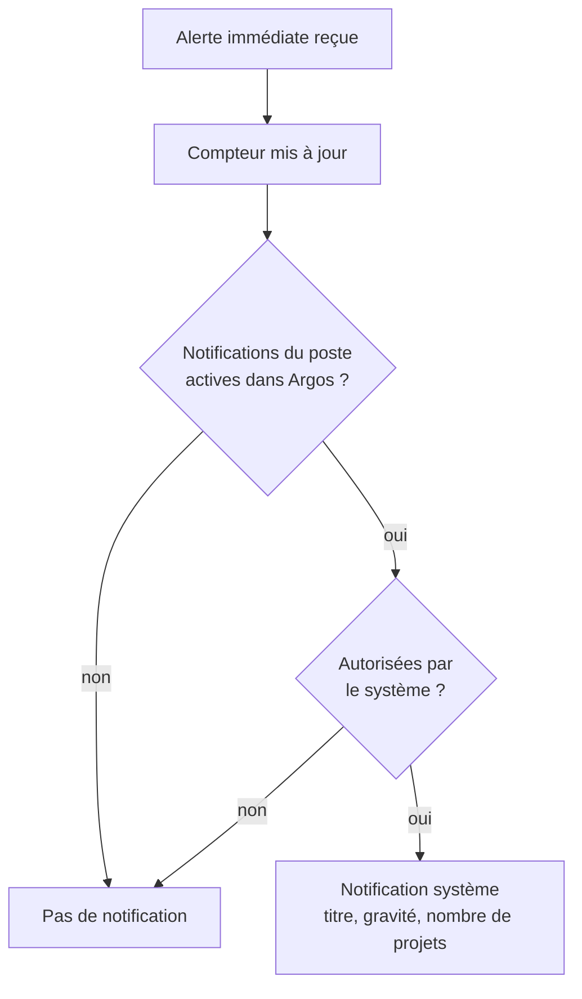

# Fiche capacité : `notifications-poste`

| Élément | Valeur |
|---|---|
| Préfixe d'exigences | `NOT` |
| Spec de référence | `/openspec/specs/notifications-poste/spec.md` — absente tant qu'aucun changement n'est archivé |
| Changements en cours | [`notifier-sur-le-poste`](/openspec/changes/notifier-sur-le-poste/proposal.md) (proposé) |
| Statut de la capacité | proposée |
| Composants (arc42 §5) | `argos-desktop`, IHM `argos-ui` (couche contenu), `alerting` |

## Objectif

[PROPOSITION — `notifier-sur-le-poste`] Faire apparaître sur le poste les alertes immédiates de l'utilisateur, même fenêtre masquée, et y accéder en un clic.

## Acteurs

| Acteur | Interaction | Statut |
|---|---|---|
| Utilisateur du client desktop | reçoit et ouvre les notifications | [PROPOSITION] — ADR-0022 (Proposé) |

## Périmètre et exclusions

Inclus :

- Client desktop Electron et sa connexion au serveur pour les alertes.

Exclus :

- Les notifications quand l'application est entièrement fermée (question Q-1).
- Les notifications mobiles.

## Préconditions et déclencheurs

Client desktop ouvert et connecté ; utilisateur authentifié ; alertes immédiates émises par `alertes-digests`.

## Entrées, sorties et validations

| Entrée / sortie | Contenu | Validation ou contrainte | Statut |
|---|---|---|---|
| Alerte du flux | identifiant, titre, gravité, nombre de projets | données autorisées seulement | [PROPOSITION] |
| Notification | titre, gravité, nombre de projets | contenu minimal (NOT-05) | [PROPOSITION] |

## Règles métier

| Règle | Exigence(s) | Source | Statut |
|---|---|---|---|
| Notification d'une alerte immédiate | NOT-01 | ADR-0022 (Proposé)  | [PROPOSITION] |
| Ouverture de l'élément au clic | NOT-02 | ADR-0022 (Proposé) | [PROPOSITION] |
| Compteur dans la zone de notification | NOT-03 | ADR-0022 (Proposé) | [PROPOSITION] |
| Préférence de notification du poste | NOT-04 | ABO-02 (canal)  | [PROPOSITION] |
| Contenu minimal affiché | NOT-05 | interprétation de ce change (écran verrouillé)  | [PROPOSITION] |
| Reprise après une coupure | NOT-06 | ADR-0022 (Proposé)  | [PROPOSITION] |

## Droits d'accès et restrictions

Le client ne reçoit que les alertes de l'utilisateur connecté.

## Effets de bord observables

Notifications système ; mise à jour du compteur ; préférence enregistrée côté serveur.

## Qualités mesurables

[QUESTION] Aucune cible chiffrée dans les sources ; voir les questions ouvertes.

## Diagrammes

### DF-NOT-1 — Affichage d'une alerte sur le poste

- **Question** : quand une alerte s'affiche-t-elle en notification système ?
- **Type** : organigramme
- **Portée** : cible proposée
- **Exigences** : NOT-01, NOT-03, NOT-04

Le compteur est toujours à jour ; la notification dépend de la préférence de l'utilisateur et des réglages du système.

## Critères d'acceptation

Scénarios NOT-01-S1 à NOT-06-S1 du changement ; aucun scénario qualité transverse supplémentaire.

## Interprétations introduites par un changement

- Contenu minimal pour l'écran verrouillé (NOT-05) : ajouté par ce change, à faire valider.

## Écarts constatés

- Le compteur de la zone de notification n'existe pas dans `argos-desktop/src/main.js` : seule une infobulle fixe « ARGOS » est définie.

## Questions ouvertes

| ID | Question | Impact | Destinataire |
|---|---|---|---|
| Q-1 | Faut-il recevoir les notifications quand l'application est entièrement fermée (service en arrière-plan) ? | non | porteur du projet |
| Q-2 | L'application doit-elle démarrer avec la session de l'utilisateur ? | non | porteur du projet |

## Traçabilité

| Exigence | Scénarios | Conception / diagramme | Tâche | Test ou preuve |
|---|---|---|---|---|
| NOT-01 | NOT-01-S1, NOT-01-S2 | DC-1 | 1.1, 1.2 | à écrire |
| NOT-02 | NOT-02-S1 | DC-1 | 1.2 | à écrire |
| NOT-03 | NOT-03-S1 | DC-1 | 1.2 | à écrire |
| NOT-04 | NOT-04-S1 | DC-1 | 1.4 | à écrire |
| NOT-05 | NOT-05-S1 | DC-1 | 1.3 | à écrire |
| NOT-06 | NOT-06-S1 | DC-1 | 1.1 | à écrire |
