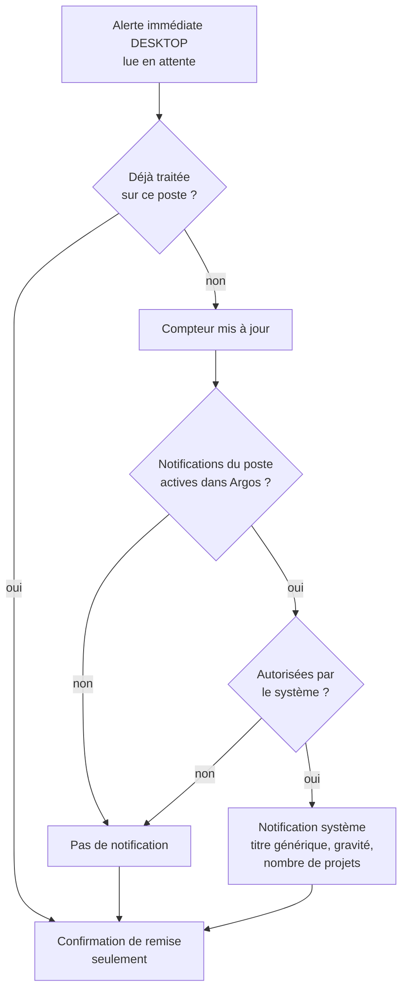

# Fiche capacité : `notifications-poste`

| Élément | Valeur |
|---|---|
| Préfixe d'exigences | `NOT` |
| Spec de référence | [`/openspec/specs/notifications-poste/spec.md`](/openspec/specs/notifications-poste/spec.md) |
| Changements archivés | [`2026-11-20-notifier-sur-le-poste`](/openspec/changes/archive/2026-11-20-notifier-sur-le-poste/proposal.md) (NOT-01 à NOT-06) |
| Statut de la capacité | livrée, implémentée dans `argos-desktop` et `argos-ui` ; tests unitaires et d'intégration simulée (chaîne pont → canaux → poste avec doublures Electron, boucle de lecture sur horloge simulée) ; parcours E2E de l'application Electron réelle connectée à la pile locale (`e2e/desktop/notifications.spec.ts`), clic sur la notification, refus du système et coupure du serveur simulés ; bulle et refus réels par Windows à vérifier à la main (tâche 1.2 non cochée) |
| Composants (arc42 §5) | `argos-desktop`, IHM `argos-ui` (couche contenu), `alerting` |

## Objectif

[PROPOSITION — `notifier-sur-le-poste`] Faire apparaître sur le poste les alertes immédiates de l'utilisateur, même fenêtre masquée, et y accéder en un clic.

## Acteurs

| Acteur | Interaction | Statut |
|---|---|---|
| Utilisateur du client desktop | reçoit et ouvre les notifications, règle le poste | [EXISTANT] — `argos-desktop/src/poste.js`, `argos-ui/src/views/ReglagesPosteView.vue` |
| Serveur ARGOS (`alerting`) | met à disposition les alertes `DESKTOP` et enregistre leur remise | [EXISTANT] — `AlertesResource` (`alertes-digests`) |

## Périmètre et exclusions

Inclus :

- client desktop Electron : notifications système, compteur et menu de la zone de notification, réglages du poste ;
- couche contenu de `argos-ui` : lecture des alertes `DESKTOP` en attente, confirmation de remise, reprise après coupure, vue des alertes.

Exclus :

- les notifications quand l'application est entièrement quittée : aucun service en arrière-plan ; fenêtre fermée, l'application continue de tourner dans la zone de notification [DÉCISION] du 2026-11-16 (Q-1) ;
- les notifications mobiles ;
- les notifications dans le navigateur : le canal `DESKTOP` est lu par le client desktop seulement.

## Préconditions et déclencheurs

Client desktop lancé (fenêtre visible ou masquée) ; utilisateur authentifié auprès du serveur ; alertes du canal `DESKTOP` enregistrées par `alertes-digests` (abonnement `DESKTOP`). La couche contenu lit les alertes en attente au démarrage puis toutes les 30 s.

## Entrées, sorties et validations

| Entrée / sortie | Contenu | Validation ou contrainte | Statut |
|---|---|---|---|
| Alertes en attente | `GET /api/v1/alertes?canal=DESKTOP&etat=EN_ATTENTE&limite=200` | alertes de l'appelant seulement (RLS, `alertes-digests`) | [EXISTANT] — `fetchAlertesPosteEnAttente` |
| Confirmation de remise | `POST /api/v1/alertes/{id}/remise` | l'alerte passe `ENVOYEE` ; une alerte non confirmée revient à la lecture suivante | [EXISTANT] — `confirmerRemise` |
| Pont vers le poste | identifiant (UUID), gravité, nombre de projets | tout autre champ (titre, noms, liens) est ignoré ; alerte invalide rejetée | [EXISTANT] — `preload.js`, `canaux.js`, `notifications.js` |
| Notification | titre fixe « Nouvelle alerte ARGOS » ; « Gravité critique · 3 projets » | contenu minimal (NOT-05) : ni le titre du signal, qui nomme souvent le composant, ni un nom de projet | [EXISTANT] — `texteNotification`, `alertePoste` |
| Compteur | nombre d'alertes ouvertes, de 0 à 9 999 | infobulle « ARGOS — 3 alertes ouvertes » et ligne du menu de la zone de notification | [EXISTANT] — `poste.js` |
| Réglages du poste | `notificationsPoste` (défaut : vrai), `demarrageSession` (défaut : faux) | booléens seulement ; fichier `reglages-poste.json` dans le dossier de données de l'application | [EXISTANT] — `preferences.js` |

## Règles métier

| Règle | Exigence(s) | Source | Statut |
|---|---|---|---|
| Chaque alerte immédiate `DESKTOP` en attente donne une notification système, fenêtre visible ou masquée, puis sa remise est confirmée | NOT-01 | ADR-0022 (Proposé) ; ALR-06 | [EXISTANT] |
| Notification refusée ou indisponible : l'alerte est quand même comptée et visible dans l'application | NOT-01 | NOT-01-S2 | [EXISTANT] |
| Le clic sur une notification remet la fenêtre au premier plan sur la vue de l'alerte (`#/alertes/{id}`) | NOT-02 | ADR-0022 (Proposé) | [EXISTANT] |
| Le compteur indique les alertes ouvertes : reçues sur le poste et pas encore consultées dans l'application | NOT-03 | ADR-0022 (Proposé) | [EXISTANT] |
| « Notifications du poste » coupées : aucune notification système, compteur et vue inchangés ; aucun autre canal modifié | NOT-04 | ABO-02 (canal) | [EXISTANT] |
| Une notification n'affiche qu'un titre générique, la gravité et le nombre de projets ; aucun nom de projet ni de composant | NOT-05 | interprétation de ce change (écran verrouillé) ; ACC-04 | [EXISTANT] |
| Perte de connexion signalée (« Hors ligne ») ; au retour, les alertes immédiates émises pendant la coupure sont notifiées et leur nombre affiché, sans perte ; aucun doublon, y compris après un rechargement de la fenêtre (seul un arrêt de l'application entre la notification et l'enregistrement de son identifiant peut en produire un) | NOT-06 | ADR-0022 (Proposé) ; arc42 §8.5 | [EXISTANT] |
| Démarrage avec la session : option désactivée par défaut, activable dans les réglages du poste ou le menu de la zone de notification ; lancée ainsi, l'application démarre masquée ; sous Linux, l'option est indisponible et toute demande de l'activer est ignorée | — | [DÉCISION] du 2026-11-16 (Q-2) | [EXISTANT] |

## Droits d'accès et restrictions

Le client ne lit que les alertes de l'utilisateur connecté : le serveur filtre sur le compte et la RLS de `alerte` sert de garde-fou (`alertes-digests`). Le processus principal d'Electron n'appelle pas l'API et ne reçoit de l'IHM que l'identifiant, la gravité et le nombre de projets d'une alerte ; seuls les messages de la fenêtre principale sont acceptés. Le pont `window.argosDesktop` reste limité aux notifications, au compteur et aux réglages du poste (`contextIsolation`, `sandbox`, sans `nodeIntegration`, CSP du protocole `app://argos`, ADR-0022). La mémoire locale de l'IHM ne contient que des identifiants d'alertes (alertes ouvertes et alertes déjà traitées, 500 au plus chacune), jamais leur contenu.

## Effets de bord observables

- notifications système ;
- infobulle et menu de la zone de notification ; badge de l'application sous macOS et Linux (Unity) ;
- alertes `DESKTOP` passées `ENVOYEE` côté serveur ;
- fichier `reglages-poste.json` ; entrée de démarrage automatique de la session (Windows, macOS) quand l'option est active ;
- bandeau « Hors ligne » puis « Connexion rétablie : n alertes émises pendant la coupure » dans l'IHM.

## Qualités mesurables

[QUESTION] Aucune cible chiffrée dans les sources. Délai visé entre l'enregistrement d'une alerte et sa notification : 30 s, connexion établie ; la fenêtre masquée garde ses minuteries (`backgroundThrottling` désactivé), mais le délai n'est pas mesuré de bout en bout. Après un échec, nouvelle tentative au bout de 5 s, attente doublée à chaque échec, plafonnée à 5 minutes.

## Diagrammes

### DF-NOT-1 — Affichage d'une alerte sur le poste

- **Question** : quand une alerte s'affiche-t-elle en notification système ?
- **Type** : organigramme
- **Portée** : comportement implémenté
- **Exigences** : NOT-01, NOT-03, NOT-04

Le compteur est toujours à jour ; la notification dépend du réglage du poste et des réglages du système. Une alerte dont la confirmation a échoué revient à la lecture suivante sans nouvelle notification.

## Critères d'acceptation

Scénarios NOT-01-S1 à NOT-06-S1 du changement ; aucun scénario qualité transverse supplémentaire.

## Interprétations introduites par un changement

Interprétations du changement `notifier-sur-le-poste`, à faire valider [PROPOSITION] :

- contenu minimal pour l'écran verrouillé (NOT-05) : le « titre » de NOT-05-S1 est celui de la notification, fixe (« Nouvelle alerte ARGOS ») ; le titre public du signal, qui nomme souvent le composant touché, n'est affiché que dans l'application ;
- lecture périodique (30 s) du contrat existant `GET /api/v1/alertes` puis confirmation de remise, à la place d'un flux Server-Sent Events : l'état `EN_ATTENTE` tient lieu de curseur de reprise, sans modification du serveur ;
- « alerte ouverte » : alerte immédiate reçue sur le poste et pas encore consultée dans l'application ; les identifiants sont gardés dans la mémoire locale de l'IHM, comme ceux des alertes déjà traitées ;
- « alertes émises pendant la coupure » : alertes immédiates lues à la première lecture réussie qui suit un échec, une fois la session déjà connectée ; la première connexion n'en annonce aucune ;
- un résumé `DESKTOP` (quotidien, hebdomadaire) est remis et visible dans la vue des alertes, sans notification ni compteur ;
- le réglage « notifications du poste » est propre au poste et reste sur lui ; il ne touche à aucun abonnement ni canal côté serveur ;
- démarrage avec la session proposé sous Windows et macOS seulement (API d'Electron), désactivé sous Linux ;
- un refus d'authentification (401, 403) est présenté comme « connexion requise », distinct d'une coupure.

[DÉCISION — porteur du projet, 2026-11-18] La coupure réseau dans la session du desktop, serveur en marche, prouve NOT-06-S1 (tâche 1.1) : le scénario porte sur un serveur injoignable depuis le client.

## Écarts constatés

- Le parcours E2E (tâche 3.2) observe les objets `Notification` et `Tray` réels du processus principal, mais pas l'affichage de la bulle par Windows : le clic sur la bulle est simulé par l'événement `click` de la notification créée ; le refus des notifications dans les réglages de Windows est simulé par l'événement `failed` que Windows fait émettre (sous Windows, `Notification.isSupported` ne reflète pas ce refus) ; la coupure du serveur est simulée dans la session du desktop, le serveur restant en marche (preuve acceptée par la [DÉCISION] du 2026-11-18). Procédures manuelles : [`tasks.md`](/openspec/changes/archive/2026-11-20-notifier-sur-le-poste/tasks.md#preuves-e2e-du-client-desktop).
- La page d'un signal visée par le lien des e-mails (`/signaux/<id>`) reste à créer ; la vue `#/alertes/{id}` du client desktop affiche l'alerte, ses projets et ses sources.

## Questions ouvertes

| ID | Question | Impact | Destinataire |
|---|---|---|---|
| Q-1 | Faut-il recevoir les notifications quand l'application est entièrement fermée (service en arrière-plan) ? | répondue le 2026-11-16 : non : les notifications arrivent tant que l'application tourne, fenêtre fermée dans la zone de notification ; aucun service en arrière-plan [DÉCISION] | porteur du projet |
| Q-2 | L'application doit-elle démarrer avec la session de l'utilisateur ? | répondue le 2026-11-16 : oui, en option désactivée par défaut et activable par l'utilisateur [DÉCISION] | porteur du projet |

## Traçabilité

| Exigence | Scénarios | Conception / diagramme | Tâche | Test ou preuve |
|---|---|---|---|---|
| NOT-01 | NOT-01-S1, NOT-01-S2 | DC-1 | 1.1, 1.2 | `argos-desktop/test/poste.test.js` (`NOT-01-S1…`, `NOT-01-S2…`), `argos-desktop/test/chaine-poste.test.js` (`NOT-01-S1…`, `NOT-01-S2…`), `argos-desktop/test/preload.test.js` (`NOT-01-S1 / NOT-05…`), `argos-ui/tests/alertes-poste.test.mjs` (`NOT-01…`, `NOT-01-S2…`) ; E2E Electron `e2e/desktop/notifications.spec.ts` (`NOT-01-S1…`, `NOT-01-S2 (partie application)…`) |
| NOT-02 | NOT-02-S1 | DC-1 | 1.2 | `argos-desktop/test/poste.test.js` (`NOT-02-S1…`), `argos-desktop/test/chaine-poste.test.js` (`NOT-02-S1…`), `argos-desktop/test/canaux.test.js` (`NOT-02-S1…`), `argos-desktop/test/preload.test.js` (`NOT-02-S1…`) ; E2E Electron `e2e/desktop/notifications.spec.ts` (`…clic`) |
| NOT-03 | NOT-03-S1 | DC-1 | 1.2 | `argos-desktop/test/poste.test.js` (`NOT-03-S1…`), `argos-desktop/test/chaine-poste.test.js` (`NOT-03-S1…`), `argos-desktop/test/preload.test.js` (`NOT-03-S1…`), `argos-desktop/test/notifications.test.js` (`NOT-03…`), `argos-ui/tests/alertes-poste.test.mjs` (`NOT-03-S1…`, `NOT-03…`) ; E2E Electron `e2e/desktop/notifications.spec.ts` (`…NOT-03-S1…`) |
| NOT-04 | NOT-04-S1 | DC-1 | 1.4 | `argos-desktop/test/poste.test.js` (`NOT-04-S1…`), `argos-desktop/test/preferences.test.js` (`NOT-04…`) ; e-mail : `AlertesTest` (`alertes-digests`), canal indépendant ; E2E Electron `e2e/desktop/notifications.spec.ts` (`NOT-04-S1 (partie poste)…`) |
| NOT-05 | NOT-05-S1 | DC-1 | 1.3 | `argos-desktop/test/notifications.test.js` (`NOT-05-S1…`), `argos-ui/tests/alertes-poste.test.mjs` (`NOT-05-S1…`) ; E2E Electron `e2e/desktop/notifications.spec.ts` |
| NOT-06 | NOT-06-S1 | DC-1 | 1.1 | `argos-ui/tests/alertes-poste.test.mjs` (`NOT-06-S1…`, `NOT-06…`), `argos-ui/tests/reprise-poste.test.mjs` (`NOT-06-S1…`, `NOT-06…`) ; E2E Electron `e2e/desktop/notifications.spec.ts` (`NOT-06-S1…`) |

Matrice détaillée : [`tasks.md`](/openspec/changes/archive/2026-11-20-notifier-sur-le-poste/tasks.md#matrice-de-traçabilité).
