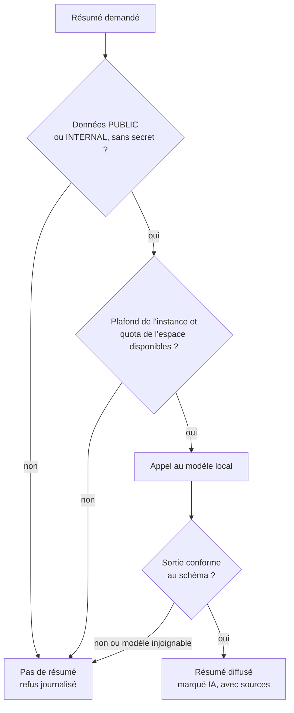

# Fiche capacité : `passerelle-ia`

| Élément | Valeur |
|---|---|
| Préfixe d'exigences | `IAG` |
| Spec de référence | `/openspec/specs/passerelle-ia/spec.md` — absente tant qu'aucun changement n'est archivé |
| Changements en cours | [`encadrer-appels-ia`](/openspec/changes/encadrer-appels-ia/proposal.md) (implémenté, non archivé) |
| Statut de la capacité | implémentée, non archivée |
| Composants (arc42 §5) | `ai-gateway` (`io.argos.aigateway`), `audit` (`JournalAppelsIa`), modules appelants `alerting`, `signal.web`, `impact` |

## Objectif

[PROPOSITION — `encadrer-appels-ia`] Utiliser l'IA là où elle apporte de la valeur, sans fuite de données, sans dérive de charge et sans jamais lui laisser une décision. [EXISTANT] Le fournisseur est un modèle local servi par Ollama (licence MIT), coût nul ; le remplacement d'ADR-0004 (Claude) par ce fournisseur est proposé par [ADR-0029](../architecture/adr/0029-passerelle-ia-ollama-local.md) (Proposé).

## Acteurs

| Acteur | Interaction | Statut |
|---|---|---|
| Module `alerting` | demande le résumé d'un avis public pour une alerte (`ResumeIaPasserelle`, tâche `resume-alerte`) | [EXISTANT] — `ParcoursIaTest` |
| Module `signal.web` | demande le résumé d'une actualité web à la demande de l'utilisateur (tâche `resume-actualite`) | [EXISTANT] — `ParcoursIaTest` |
| Module `impact` | demande des suggestions de projets après la corrélation (tâche `analyse-correlation`), désactivé par défaut | [EXISTANT] — `ParcoursIaTest` |
| Module `regintel` | fiche réglementaire (tâche `fiche-reglementaire`) : prompt publié, appelant à brancher | [PROPOSITION] — `suivre-veille-reglementaire` |
| Exploitant (porteur du projet) | fixe le plafond, les quotas et le modèle par tâche ; active Ollama (profil `ia`) | [DÉCISION] — Q-1 à Q-3, répondues le 2026-11-16 |
| Fournisseur de modèles (Ollama local) | exécute les requêtes sur le NAS | [PROPOSITION] — ADR-0029 (Proposé) |

## Périmètre et exclusions

Inclus :

- [EXISTANT] Passerelle, registre de prompts versionnés, classes de données, filtrage des secrets et des données personnelles, plafond et quotas journaliers, validation des sorties, journal des appels, mention IA.

Exclus :

- Les embeddings et la recherche sémantique (ADR-0015 : différés).
- Un fournisseur distant ou payant.

## Préconditions et déclencheurs

[EXISTANT] Aucune clé d'API. L'IA est active par défaut (`argos.ia.active`) et appelle `argos.ia.ollama.url` (variable `ARGOS_OLLAMA_URL`, défaut `http://localhost:11434` ; `http://ollama:11434` dans `compose.yaml`). Sans Ollama joignable, chaque demande est refusée comme indisponible et Argos fonctionne en mode déterministe. Déclencheurs : création d'une alerte immédiate, `POST /api/v1/veille-web/actualites/{id}/resume-ia`, corrélation d'un signal (si `argos.ia.analyse-correlation.active=true`).

## Entrées, sorties et validations

| Entrée / sortie | Contenu | Validation ou contrainte | Statut |
|---|---|---|---|
| Demande (`DemandeIa`) | tâche (prompt du registre), espace imputé, entrées nommées et classées, sources | classes PUBLIC ou INTERNAL seulement (IAG-02) ; secrets refusés, données personnelles masquées ; chaque entrée bornée à 8 000 caractères | [EXISTANT] |
| Message au modèle | consignes système du prompt versionné ; entrées entre balises `<donnees>` dans le message utilisateur, chevrons neutralisés | le contenu externe ne peut ni fermer sa balise ni rejoindre les consignes (R-11) | [EXISTANT] |
| Réponse (`ReponseIa`) | issue, champs validés, mention « produit par l'IA », sources, modèle, version du prompt | objet JSON conforme au schéma de la tâche, champs hors schéma ignorés (IAG-04) | [EXISTANT] |
| Résumé d'actualité (API) | `etat`, `methode` (`IA_V1` ou `EXTRAIT_V1`), `texte`, `mention`, `sources` | sans résultat IA : extrait déterministe, sans mention | [EXISTANT] |
| Contenu d'alerte (API, e-mail, IHM) | `resumeIa`, `etatResumeIa`, `mentionResumeIa` et les sources des éléments | mention présente dès qu'un résumé l'est (IAG-05) | [EXISTANT] |

## Règles métier

| Règle | Exigence(s) | Source | Statut |
|---|---|---|---|
| Appel tracé par la passerelle : modèle, version du prompt, jetons, coût (0 €), empreinte SHA-256 des entrées, issue ; aucune copie des données | IAG-01 | ADR-0004 (Proposé) ; décision D2 | [EXISTANT] — `PasserelleIaTest` |
| Seules PUBLIC et INTERNAL sortent ; jamais de secrets, de jetons ni de données personnelles | IAG-02 | Q-4, répondue le 2026-11-16 | [EXISTANT] — `PasserelleIaTest`, `FiltreDonneesTest` |
| Plafond de 1 000 appels par jour pour l'instance et de 100 par jour et par espace, paramétrables ; au-delà, aucun appel et traitement poursuivi sans IA | IAG-03 | Q-1, Q-2, répondues le 2026-11-16 | [EXISTANT] — `PasserelleIaTest`, `ParcoursIaTest` |
| Modèle `qwen2.5:1.5b` par défaut, remplaçable par tâche (`argos.ia.modeles.<tâche>`) | IAG-01 | Q-3, répondue le 2026-11-16 | [EXISTANT] — `PasserelleIaTest` |
| Sortie validée par schéma, rejetée et journalisée sinon | IAG-04 | ADR-0004 (Proposé) ; QS-15 | [EXISTANT] — `PasserelleIaTest` |
| Mention « produit par l'IA » et sources avec tout contenu produit | IAG-05 | ADR-0004 (Proposé) ; AFF-02 | [EXISTANT] — `ParcoursIaTest`, `argos-ui/tests/resume-ia.test.mjs` |
| Prompt modifié sans nouvelle version : démarrage refusé | IAG-01 | décision locale | [EXISTANT] — `RegistrePrompts` |

## Droits d'accès et restrictions

[EXISTANT] Seuls les modules d'Argos appellent la passerelle, par son contrat (`PasserelleIa`, `DemandeIa`, `ReponseIa`) ; l'adaptateur Ollama et les quotas restent internes (règle ArchUnit `seuleLaPasserelleConnaitLeFournisseur`). Le résumé d'une actualité n'est produit que pour une actualité visible de l'appelant sous le rôle `argos_app` (404 et refus journalisé sinon) et partage la limite de débit de la veille web. Les tables `ia_appel`, `ia_quota_jour` et `ia_prompt` ne sont accessibles qu'à l'utilisateur de connexion : `argos_app` n'y a aucun droit (vérifié par `PasserelleIaTest`).

## Effets de bord observables

[EXISTANT] Appels HTTP au serveur Ollama configuré (aucune redirection suivie, aucun mandataire, réponse bornée à 1 Mio et au délai `argos.ia.delai`) ; lignes du journal `ia_appel` ; compteurs journaliers `ia_quota_jour` ; empreintes des prompts dans `ia_prompt`.

## Qualités mesurables

- [EXISTANT] QS-08 : plafond et quotas vérifiés par compteurs atomiques (`PasserelleIaTest`, `ParcoursIaTest`).
- [EXISTANT] QS-09 : aucune entrée CONFIDENTIAL, RESTRICTED ou contenant un secret ne parvient au fournisseur simulé.
- [EXISTANT] QS-15 : sorties non JSON, hors schéma, vides, trop longues ou de date non ISO rejetées.
- [QUESTION] Latence et mémoire de `qwen2.5:1.5b` sur le DS1522+ : non mesurées (ADR-0029, méthode de validation).

## Diagrammes

### DF-IAG-1 — Un résumé est-il produit ?

- **Question** : dans quels cas un élément reçoit-il un résumé produit par l'IA ?
- **Type** : organigramme
- **Portée** : comportement implémenté
- **Exigences** : IAG-02, IAG-03, IAG-04

À chaque refus, l'élément est diffusé sans résumé : l'IA n'est jamais bloquante.

## Critères d'acceptation

Scénarios IAG-01-S1 à IAG-05-S1 du changement ; QS-08, QS-09, QS-15. Preuves : matrice de [`tasks.md`](/openspec/changes/encadrer-appels-ia/tasks.md#matrice-de-traçabilité).

## Interprétations introduites par un changement

- [PROPOSITION] Refus au-delà du plafond plutôt que bascule vers un autre modèle (décision D1).
- [PROPOSITION] Le résumé d'une alerte est imputé au premier espace concerné dont le quota n'est pas épuisé ; une actualité personnelle n'est imputée qu'au plafond de l'instance.
- [PROPOSITION] Les secrets font refuser toute la demande ; les données personnelles (adresses électroniques, numéros de téléphone, IBAN) sont masquées, leur nombre seul étant tracé.
- [PROPOSITION] L'analyse complémentaire de la corrélation, qui transmet des noms de projets (INTERNAL), est désactivée par défaut ; elle ne mêle jamais deux espaces dans un appel.
- [PROPOSITION] Aucun nouvel essai automatique après une panne du modèle : l'élément reste sans résumé.

## Écarts constatés

- Le mode dégradé, la mention et les sources sont vérifiés par l'API REST et des tests unitaires de l'IHM ; aucun test de navigateur ni de modèle réel n'est exécuté.
- Aucun outil MCP ne restitue de contenu produit par l'IA : la mention via MCP (IAG-05-S1) est sans objet tant qu'aucun outil n'en renvoie.
