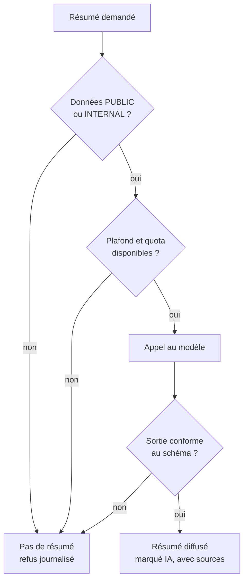

# Fiche capacité : `passerelle-ia`

| Élément | Valeur |
|---|---|
| Préfixe d'exigences | `IAG` |
| Spec de référence | `/openspec/specs/passerelle-ia/spec.md` — absente tant qu'aucun changement n'est archivé |
| Changements en cours | [`encadrer-appels-ia`](/openspec/changes/encadrer-appels-ia/proposal.md) (proposé) |
| Statut de la capacité | proposée |
| Composants (arc42 §5) | `ai-gateway`, `audit`, modules appelants |

## Objectif

[PROPOSITION — `encadrer-appels-ia`] Utiliser l'IA là où elle apporte de la valeur, sans fuite de données, sans dérive de coût et sans jamais lui laisser une décision.

## Acteurs

| Acteur | Interaction | Statut |
|---|---|---|
| Modules métier (`reg-intel`, `impact-engine`, `alerting`) | demandent résumés et fiches | [PROPOSITION] — arc42 §5.5 règle 3 |
| Porteur du projet | fixe le plafond et suit les coûts | [PROPOSITION] — ADR-0025 (Accepté) |
| Fournisseur de modèles (Anthropic) | exécute les requêtes | [PROPOSITION] — ADR-0004 (Proposé) |

## Périmètre et exclusions

Inclus :

- Passerelle, registre de prompts versionnés, comptage des coûts, validation des sorties.

Exclus :

- Les embeddings et la recherche sémantique (ADR-0015 : différés).
- Le choix définitif des modèles par tâche (question Q-3).

## Préconditions et déclencheurs

Clé d'API configurée ; plafond et quotas fixés (Q-1, Q-2).

## Entrées, sorties et validations

| Entrée / sortie | Contenu | Validation ou contrainte | Statut |
|---|---|---|---|
| Demande | tâche, entrées classées, schéma, espace | classes PUBLIC ou INTERNAL seulement (IAG-02) | [PROPOSITION] |
| Résultat | sortie validée, mention IA, sources | conforme au schéma (IAG-04) | [PROPOSITION] |

## Règles métier

| Règle | Exigence(s) | Source | Statut |
|---|---|---|---|
| Appel tracé par la passerelle | IAG-01 | ADR-0004 (Proposé)  | [PROPOSITION] |
| Classes de données autorisées | IAG-02 | arc42 §10.2 Q-02  | [PROPOSITION] |
| Plafond et quotas | IAG-03 | arc42 §10.2 Q-06  | [PROPOSITION] |
| Sortie validée par schéma | IAG-04 | ADR-0004 (Proposé)  | [PROPOSITION] |
| Mention du contenu produit par l'IA | IAG-05 | ADR-0004 (Proposé)  | [PROPOSITION] |

## Droits d'accès et restrictions

Seuls les modules d'Argos appellent la passerelle ; aucun utilisateur ne l'appelle directement.

## Effets de bord observables

Appels au fournisseur ; journal des appels et refus ; compteurs de coût.

## Qualités mesurables

[QUESTION] Aucune cible chiffrée dans les sources ; voir les questions ouvertes.

## Diagrammes

### DF-IAG-1 — Un résumé est-il produit ?

- **Question** : dans quels cas un élément reçoit-il un résumé produit par l'IA ?
- **Type** : organigramme
- **Portée** : cible proposée
- **Exigences** : IAG-02, IAG-03, IAG-04

À chaque refus, l'élément est diffusé sans résumé : l'IA n'est jamais bloquante.

## Critères d'acceptation

Scénarios IAG-01-S1 à IAG-05-S1 du changement ; QS-08, QS-09, QS-15.

## Interprétations introduites par un changement

- Refus au-delà du plafond plutôt que bascule vers un modèle moins cher (décision D1) : à faire valider.

## Écarts constatés

- Les classes de données transmissibles à Claude restent une question ouverte de `/docs/architecture/README.md` (question 2).

## Questions ouvertes

| ID | Question | Impact | Destinataire |
|---|---|---|---|
| Q-1 | Quel plafond mensuel de dépense API ? | oui pour IAG-03 | porteur du projet |
| Q-2 | Quel quota par espace pour un produit ouvert ? | oui pour IAG-03 | porteur du projet |
| Q-3 | Quels modèles par tâche (classement, résumé, analyse) ? | non : configuration | porteur du projet |
| Q-4 | Quelles classes de données peuvent sortir (question 2 de `/docs/architecture/README.md`) ? | oui pour IAG-02 | porteur du projet / DPO |

## Traçabilité

| Exigence | Scénarios | Conception / diagramme | Tâche | Test ou preuve |
|---|---|---|---|---|
| IAG-01 | IAG-01-S1 | DC-1 | 2.1 | à écrire |
| IAG-02 | IAG-02-S1, IAG-02-S2 | DC-1 | 1.1, 2.2 | à écrire |
| IAG-03 | IAG-03-S1 | DC-1 | 1.1, 2.3 | à écrire |
| IAG-04 | IAG-04-S1 | DC-1 | 2.4 | à écrire |
| IAG-05 | IAG-05-S1 | DC-1 | 2.5 | à écrire |
