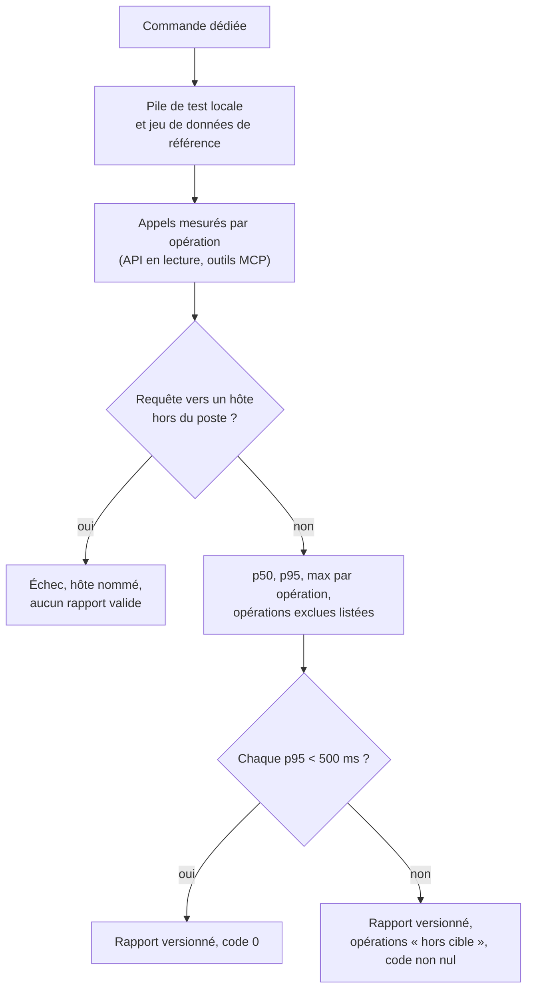

# Fiche capacité : `performance-api-mcp`

| Élément | Valeur |
|---|---|
| Préfixe d'exigences | `PERF` |
| Spec de référence | `/openspec/specs/performance-api-mcp/spec.md` — absente tant qu'aucun changement n'est archivé |
| Changements en cours | [`automatiser-chaine-veille`](/openspec/changes/automatiser-chaine-veille/specs/performance-api-mcp/spec.md) — proposé ; campagne implémentée et exécutée par le volet C (branche `lot18/impacts-performance`, 2026-11-19), non intégrée |
| Statut de la capacité | proposée |
| Composants (arc42 §5) | `API & Security`, serveur MCP (`mcp`), `e2e/` (campagne de mesure) |

Tout le contenu de cette fiche porte le statut [PROPOSITION] (changement `automatiser-chaine-veille`) sauf mention contraire.

## Objectif

Vérifier, par une mesure automatisée et gratuite, que les consultations de l'API REST et les outils du serveur MCP respectent la cible de latence d'arc42, et en garder une preuve datée et versionnée. Source : décision J8 du porteur du projet (2026-11-19) ; arc42 §8 (cibles initiales) ; arc42 §10.2 Q-05.

## Acteurs

| Acteur | Interaction | Statut |
|---|---|---|
| Développeur, exploitant | lance la campagne par une commande dédiée et lit le rapport | [PROPOSITION] — J8 |
| Pile de test locale (PostgreSQL de `compose.yaml`, serveur sur le port 8090, Keycloak des Dev Services) | reçoit les requêtes mesurées | [EXISTANT] — `e2e/README.md` |
| Client MCP de test | appelle les huit outils en lecture seule | [EXISTANT] — `e2e/support/mcp.ts` |

## Périmètre et exclusions

- **Inclus** : opérations de consultation de l'API REST (projets, inventaire, impacts, veille, recherche, abonnements, alertes) et outils MCP en lecture seule ; calcul de p50, p95 et maximum par opération ; rapport JSON et Markdown versionnés ; verdict par rapport à 500 ms.
- **Exclu** : opérations qui appellent une source externe ou un modèle d'IA (synchronisations, collectes, résumés IA), listées comme exclues dans le rapport ; environnement de production (Synology) ; outils sous licence non permissive (k6, AGPL) ou payants (J8, ADR-0021).

## Préconditions et déclencheurs

- Docker, JDK et Node.js disponibles, comme pour `npm --prefix e2e test` ; aucun accès Internet nécessaire.
- Déclencheur : la commande dédiée `npm --prefix e2e run test:performance` (proposition P-9), jamais le build ni les tests par défaut (PERF-02-S2).
- La pile E2E du poste n'est pas déjà utilisée par un autre lancement (verrou du dépôt).

## Entrées, sorties et validations

| Entrée / sortie | Contenu | Validation ou contrainte | Statut |
|---|---|---|---|
| Entrée : jeu de données de référence | espaces, projets, inventaires, signaux, impacts, éléments de veille | volume non fixé [QUESTION Q-PERF-1] ; valeur retenue écrite dans le rapport | [PROPOSITION] |
| Entrée : paramètres de campagne | nombre d'appels par opération, concurrence, échauffement | concurrence non fixée [QUESTION Q-PERF-2] ; valeurs écrites dans le rapport | [PROPOSITION] |
| Sortie : rapport JSON | date, révision Git, environnement, volume, concurrence, mesures par opération, opérations exclues, verdict | `e2e/resultats/performance/` | [PROPOSITION] |
| Sortie : rapport Markdown | mêmes informations, lisibles | `docs/architecture/quality/mesure-performance-api-mcp.md` | [PROPOSITION] |
| Sortie : code de sortie | 0 si tous les p95 < 500 ms, non nul sinon ou en cas de requête hors du poste | PERF-01-S2, PERF-02-S3 | [PROPOSITION] |

## Règles métier

| Règle | Exigence(s) | Source | Statut |
|---|---|---|---|
| p95 < 500 ms par opération de consultation API ou outil MCP, hors appels externes et IA, sur la pile de test locale | PERF-01 | décision J8 du porteur du projet, 2026-11-19 ; arc42 §8 ; arc42 §10.2 Q-05 | [DÉCISION] pour la vérification de la cible ; cible arc42 « initiale » [PROPOSITION] |
| Commande dédiée, hors build par défaut ; outils gratuits sous licence permissive ; aucune requête hors du poste ; rapport versionné | PERF-02 | décision J8 du porteur du projet, 2026-11-19 ; ADR-0021 | [DÉCISION] |
| Outil retenu : script Node sans dépendance (`fetch`, `node:perf_hooks`) ; autocannon (MIT) ou Gatling (Apache-2.0) restent des alternatives permises | PERF-02 | proposition P-9 du changement | [PROPOSITION] |

## Droits d'accès et restrictions

La campagne s'authentifie avec les comptes du royaume de test du dépôt (`argos-server/src/test/resources/keycloak/argos-realm.json`), jamais avec un secret réel ; elle mesure les opérations sous les mêmes contrôles (RBAC, RLS) que l'IHM.

## Effets de bord observables

- écriture des rapports JSON et Markdown ;
- démarrage puis arrêt de la pile de test locale lancée par la campagne, et d'elle seule.

## Qualités mesurables

| Qualité | Cible | Source | Statut |
|---|---|---|---|
| Latence API et MCP, p95, hors appels externes et IA | < 500 ms | arc42 §8 ; arc42 §10.2 Q-05 ; QS-06 | [PROPOSITION] — cible initiale ; mesure de la recherche seule : p95 = 250 ms le 2026-11-16 (QS-13, [rapport](../architecture/quality/mesure-qs13-recherche.md)) [EXISTANT] ; campagne du 2026-11-19 : 15 opérations sur 16 dans la cible, `GET /api/v1/me/veille` hors cible (p95 = 618 ms), code de sortie 1 ([rapport](../architecture/quality/mesure-performance-api-mcp.md)) [EXISTANT] |

## Diagrammes

### DF-PERF-1 — Une campagne de mesure

- **Question** : comment une campagne aboutit-elle à un verdict et à un rapport, sans quitter le poste ?
- **Type** : organigramme (flowchart)
- **Portée** : cible proposée
- **Exigences** : PERF-01, PERF-02

La campagne ne mesure que des opérations sans appel externe ni IA : les autres sont listées avec le motif de leur exclusion (PERF-01-S3). Le rapport conserve les paramètres de la campagne (volume, concurrence), faute de valeurs fixées par les sources (Q-PERF-1, Q-PERF-2).

## Critères d'acceptation

- Scénarios `PERF-01-S1` à `PERF-02-S3` de la spec.
- QS-06 (« API p95 < 500 ms ») du registre `/docs/architecture/quality/scenarios.md`.

## Interprétations introduites par un changement

Propositions du changement `automatiser-chaine-veille`, à valider [PROPOSITION] :

- P-9 : script Node sans dépendance, commande `npm --prefix e2e run test:performance`, rapports dans `e2e/resultats/performance/` et `docs/architecture/quality/` ;
- une opération mesurée au-dessus de la cible rend la campagne en échec (code de sortie non nul), sans bloquer le build par défaut.

## Écarts constatés

- Campagne implémentée (branche du volet C, 2026-11-19) : `e2e/performance/mesurer-p95.mjs` (exécution), `e2e/performance/mesure.mjs` (garde réseau, centiles, verdict, rapports), `e2e/performance/donnees-performance.sql` (jeu de données paramétré), commande `npm --prefix e2e run test:performance` ; tests `node --test "e2e/performance/*.test.mjs"` (Node 24 n'accepte pas un dossier comme argument de `node --test`) [EXISTANT sur la branche].
- Première exécution, 2026-11-19 (révision `fbb04c9`, code du volet C ; script de campagne non encore validé dans Git au moment de la mesure) : `GET /api/v1/me/veille` dépasse la cible (p50 = 511 ms, p95 = 618 ms) ; les quinze autres opérations sont sous 230 ms. L'écart est consigné, sans correction dans ce volet : l'optimisation de « Ma veille » relève d'un changement ultérieur [PROPOSITION P-18].
- Valeurs retenues en attendant Q-PERF-1 et Q-PERF-2 (P-9) : 20 projets × 100 composants, 1 000 avis, 20 000 impacts dans un espace ; 200 appels par opération après 20 d'échauffement ; 4 clients simultanés ; surchargeables par `ARGOS_PERF_PROJETS`, `ARGOS_PERF_COMPOSANTS`, `ARGOS_PERF_SIGNAUX`, `ARGOS_PERF_APPELS`, `ARGOS_PERF_ECHAUFFEMENT`, `ARGOS_PERF_CONCURRENCE`.
- `explain_change` (synthèse par l'IA) est exclu : sept outils MCP sur huit sont mesurés. La limite de débit MCP (60 requêtes par minute en développement) est relevée pour la campagne par `ARGOS_MCP_DEBIT_REQUETES_PAR_MINUTE`, comme dans le profil de test.

## Questions ouvertes

| ID | Question | Impact | Destinataire |
|---|---|---|---|
| Q-PERF-1 | Quel volume de données de référence pour la campagne ? | représentativité de PERF-01 | porteur du projet |
| Q-PERF-2 | Quelle concurrence (clients simultanés) pour mesurer le p95 ? | représentativité de PERF-01 | porteur du projet |

## Traçabilité

| Exigence | Scénarios | Conception / diagramme | Tâche | Test ou preuve |
|---|---|---|---|---|
| PERF-01 | PERF-01-S1, PERF-01-S2, PERF-01-S3 | design.md D8, DC-8 ; DF-PERF-1 | 3.6, 3.7 | [rapport du 2026-11-19](../architecture/quality/mesure-performance-api-mcp.md) (S2 constaté : une opération hors cible, code 1 ; S1 non atteint) ; `e2e/performance/mesure.test.mjs` (S2, S3) |
| PERF-02 | PERF-02-S1, PERF-02-S2, PERF-02-S3 | design.md D8, DC-8 ; DF-PERF-1 | 3.6, 3.7 | `e2e/performance/mesure.test.mjs` (S1 à S3) ; rapports JSON (`e2e/resultats/performance/rapport-2026-11-19.json`) et Markdown du 2026-11-19 |

Matrice détaillée : [`tasks.md` du changement](/openspec/changes/automatiser-chaine-veille/tasks.md#matrice-de-traçabilité).
