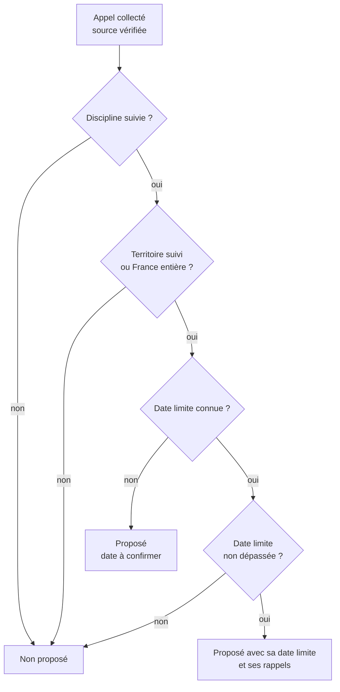

# Fiche capacité : `profil-artiste`

| Élément | Valeur |
|---|---|
| Préfixe d'exigences | `ART` |
| Spec de référence | [`/openspec/specs/profil-artiste/spec.md`](/openspec/specs/profil-artiste/spec.md) |
| Changements archivés | [`2026-11-17-ajouter-profil-artiste`](/openspec/changes/archive/2026-11-17-ajouter-profil-artiste/proposal.md) ; [`2026-11-26-alimenter-inventaire-et-completer-ihm`](/openspec/changes/archive/2026-11-26-alimenter-inventaire-et-completer-ihm/proposal.md) (ART-07) ; [`2026-11-27-retenir-importer-et-paginer`](/openspec/changes/archive/2026-11-27-retenir-importer-et-paginer/proposal.md) (ART-08) |
| Statut de la capacité | livrée ; vue du profil artiste dans `argos-ui` (ART-07, [PROPOSITION]) |
| Composants (arc42 §5) | `catalog` (pack), `workspace` (suivis sous RLS), `signal` (registre des sources et opportunités), `impact-engine` (stratégie), `source-ingestion`, `alerting`, `API & Security`, IHM `argos-ui` |

## Objectif

[PROPOSITION — `ajouter-profil-artiste`] Montrer qu'Argos sert d'autres publics que les équipes techniques, en offrant aux artistes une veille des opportunités adaptées à leur discipline et à leur territoire.

## Acteurs

| Acteur | Interaction | Statut |
|---|---|---|
| Artiste | active le profil, choisit ses disciplines, ses territoires et ses jours de rappel ; consulte dans l'IHM ses suivis, les opportunités rapprochées, leur résumé et les rubriques de sa veille | [EXISTANT] — ART-02 ; [PROPOSITION] — ART-07 pour l'IHM |
| Administrateur plateforme | déclare les sources du pack, enregistre leurs conditions d'usage, lance une collecte | [EXISTANT] — ART-05 |
| data.culture.gouv.fr | publie des jeux de données sous Licence Ouverte Etalab, lus par l'API Opendatasoft « explore v2.1 » | [DÉCISION] — Q-1 |
| Organismes publics et sociétés de gestion | publient appels, aides et informations par des flux RSS/Atom publics | [DÉCISION] — Q-1 |

## Périmètre et exclusions

Inclus :

- le pack `artiste` du catalogue (cinq rubriques, listes de disciplines et de territoires, trois garde-fous) ;
- les suivis de l'utilisateur, la stratégie discipline + territoire + date limite, les rappels J-30, J-7 et J-1 paramétrables ;
- le registre des sources du pack et la collecte des seules sources vérifiées ;
- le gabarit de résumé sans avis d'éligibilité ;
- la vue du profil artiste dans `argos-ui`, web et desktop : choix des disciplines et des territoires suivis, opportunités rapprochées, résumé d'une opportunité à une adresse stable, sources vérifiées, rubriques de la veille (ART-07).

Exclus :

- les profils `comedien` et `politique` : changements dédiés ;
- la candidature en ligne aux appels ;
- l'administration des sources du pack dans l'IHM (déclaration, conditions d'usage, collecte) : routes REST réservées à l'administrateur plateforme ;
- le réglage des jours de rappel dans l'IHM : il passe par `PUT /api/v1/profils/artiste/suivis` ;
- toute source hors data.culture.gouv.fr et flux RSS/Atom publics tant que ses conditions d'usage ne sont pas vérifiées (Q-1) ;
- un périmètre géographique hors de France (Q-2).

## Préconditions et déclencheurs

- Profil `artiste` publié au catalogue (`argos.catalogue.profils.manifestes`) et actif dans les préférences de l'utilisateur ; sinon les suivis et la restitution répondent `409 PROFIL_INACTIF`.
- Au moins une discipline et un territoire suivis ; sinon la restitution répond `suivisRequis: true` avec une liste vide.
- Collecte quotidienne (`argos.profil-artiste.collecte.cron`, 05:00) ou à la demande de l'administrateur plateforme ; rappels quotidiens (`argos.profil-artiste.rappels.cron`, 07:00), fuseau `argos.alerting.fuseau`.

## Entrées, sorties et validations

| Entrée / sortie | Contenu | Validation ou contrainte | Statut |
|---|---|---|---|
| Suivis de l'utilisateur | disciplines, territoires, jours de rappel facultatifs | identifiants des listes du pack, au moins une valeur, 50 au plus ; valeur hors liste refusée `400` avec la liste disponible ; jours : 1 à 10 valeurs entre 0 et 365 | [EXISTANT] — ART-02, Q-4 |
| Déclaration d'une source | type `DATA_CULTURE` ou `FLUX`, adresse, libellé, rubrique, disciplines et territoires par défaut | adresse http(s) sans identifiants ; `DATA_CULTURE` limité aux hôtes de `argos.profil-artiste.data-culture.hotes` (data.culture.gouv.fr) ; rubrique et valeurs des listes du pack ; état initial `CONDITIONS_A_VERIFIER` | [EXISTANT] — ART-05 |
| Conditions d'usage | licence, texte des conditions, lien facultatif | licence et texte obligatoires ; vérificateur et date enregistrés | [EXISTANT] — ART-05 |
| Opportunité collectée | rubrique, titre, organisme, critères, lien officiel, disciplines, territoires, date limite | texte brut (balises retirées, longueurs bornées) ; lien http(s) seulement ; valeurs ramenées aux listes du pack, à défaut celles déclarées pour la source ; date absente ou illisible : « date à confirmer » | [EXISTANT] — ART-03 |
| Opportunité restituée | champs ci-dessus, explication de la décision, résumé | ordre : date limite la plus proche, « date à confirmer » en dernier | [EXISTANT] — ART-03, ART-06 |

API REST `/api/v1/profils/artiste/` : `listes` (GET), `suivis` (GET, PUT), `opportunites` (GET), `opportunites/{id}/resume` (GET) ; pour l'administrateur plateforme : `sources` (GET, POST), `sources/{id}/conditions-usage` (PUT), `collectes` (POST, limité à 10 par minute et par compte). Rubriques de la veille : `GET /api/v1/preferences/rubriques` (union des rubriques des profils actifs). IHM : vue `ProfilArtisteView` aux adresses `/#/profils/artiste` et `/#/profils/artiste/opportunites/{id}` (opportunité mise en avant avec son résumé, cible des liens des rappels, ALR-09), module `argos-ui/src/api/artiste.ts`.

## Règles métier

| Règle | Exigence(s) | Source | Statut |
|---|---|---|---|
| Pack `artiste` au catalogue, rubriques appels à projets et résidences, aides à la création, droits et rémunérations, statut social et fiscal, événements | ART-01 | ADR-0024 (Accepté) | [EXISTANT] |
| Disciplines (arts visuels, musique, spectacle vivant, littérature, cinéma et audiovisuel, design et métiers d'art) et territoires (France entière, 13 régions métropolitaines, 5 régions d'outre-mer) choisis dans les listes du pack | ART-02 | Q-2, Q-3 | [EXISTANT] |
| Restitution si une discipline et un territoire de l'appel sont suivis (un appel `france` vaut pour tout territoire) et si la date limite n'est pas dépassée ; le jour même reste ouvert ; sans date connue, restitution « date à confirmer » | ART-03 | ADR-0024 ; ADR-0013 | [EXISTANT] |
| Rappel aux jours de rappel du compte (J-30, J-7, J-1 par défaut), avec la date limite, le lien officiel et la mention « aucun avis d'éligibilité » ; aucun rappel pour une date à confirmer | ART-04 | ALR-04 ; Q-4 | [EXISTANT] |
| Aucune requête vers une source dont les conditions d'usage ne sont pas enregistrées ; état « conditions d'usage à vérifier » | ART-05 | ADR-0024 point 8 ; ADR-0025 | [EXISTANT] |
| Résumé composé sans IA : critères tels qu'énoncés, date limite, lien vers le texte officiel, mention fixe ; aucun champ ni aucune formule sur l'éligibilité | ART-06 | ADR-0024 point 7 | [EXISTANT] |
| Vue de l'IHM, web et desktop : choix des disciplines et territoires suivis, opportunités rapprochées, résumé d'une opportunité (marqué « produit par l'IA » lorsqu'il l'est), sources vérifiées et rubriques de la veille, à une adresse stable par opportunité ; sans suivi, message « suivis requis » sans liste | ART-07 | AUD-ARC-15 ; ART-02, ART-03, ART-05 ; AUD-ARC-22 | [PROPOSITION] — [`alimenter-inventaire-et-completer-ihm`](/openspec/changes/archive/2026-11-26-alimenter-inventaire-et-completer-ihm/proposal.md) ; vérifiée par `argos-ui/tests/vues/profil-artiste.spec.ts` |
| Une opportunité sans date limite (élément de flux) n'est restituée que tant que sa première collecte date de moins de `argos.profil-artiste.opportunites.age-max` (90 jours par défaut) ; la liste des opportunités est paginée (PERF-03) | ART-08 | AUD-PER-18 | [PROPOSITION — `2026-11-27-retenir-importer-et-paginer`] |

## Droits d'accès et restrictions

- Aucun droit nouveau (PRF-05) : activer le profil ou choisir des suivis ne donne accès à aucune donnée d'espace.
- Suivis et jours de rappel visibles du seul compte : tables `suivi_profil` et `suivi_rappels` (migration `V15`) sous RLS, lues et écrites sous `argos_app` avec le compte courant (ADR-0016).
- Sources et opportunités : données publiques de la plateforme, sans espace ; registre des sources réservé à l'administrateur plateforme (`403` sinon, refus journalisé dans `refus_acces`).
- Activer le profil n'a aucun effet sur les autres utilisateurs (PRF-04) ; désactiver le profil arrête la restitution et les rappels.

## Effets de bord observables

- Lignes `opportunite` dédupliquées par source et empreinte de l'identifiant ; une nouvelle collecte met à jour l'existante.
- État de chaque source (`CONDITIONS_A_VERIFIER`, `ACTIVE`, `EN_ERREUR` avec le motif générique du dernier échec, date de dernière collecte).
- Messages `RAPPEL` dans la table `alerte`, canal `EMAIL` si le compte a une adresse, sinon `DESKTOP`, consultables par `/api/v1/alertes` ; clé d'idempotence (opportunité, date limite, jour de rappel).

## Sécurité

- Récupération par le collecteur de la veille web (`RecuperateurWeb`) : réseaux privés refusés, redirections vérifiées, durée et taille bornées (SSRF) ; aucune adresse lue dans un contenu n'est récupérée.
- Contenu externe traité comme non fiable : JSON analysé sans doublon de clé, texte brut sans balises ni scripts, longueurs bornées, nombre d'éléments par collecte borné (`argos.profil-artiste.elements-max`) ; liens `javascript:` ou `data:` écartés (XSS).
- Requêtes SQL paramétrées ; aucun contenu externe envoyé à un modèle d'IA (le résumé est un gabarit).
- Vue de l'IHM : titres, critères et organismes, issus des sources, sont rendus comme texte ; seuls les liens `http(s)` sont rendus cliquables (`urlSure`).

## Qualités mesurables

[QUESTION] Aucune cible chiffrée dans les sources.

## Diagrammes

### DF-ART-1 — Un appel est-il proposé à l'artiste ?

- **Question** : à quelles conditions un appel est-il présenté comme une opportunité ?
- **Type** : organigramme
- **Portée** : implémenté (`StrategieDisciplineTerritoire`)
- **Exigences** : ART-03, ART-05

Trois critères structurés suffisent à décider, sans IA ; le résumé ne juge jamais l'éligibilité.

## Critères d'acceptation

Scénarios ART-01-S1 à ART-06-S1 du changement ; ART-07-S1 à ART-07-S3 du changement [`alimenter-inventaire-et-completer-ihm`](/openspec/changes/archive/2026-11-26-alimenter-inventaire-et-completer-ihm/specs/profil-artiste/spec.md) [PROPOSITION] ; aucun scénario qualité transverse supplémentaire.

## Interprétations introduites par un changement

- [PROPOSITION] Un appel à date limite passée n'est pas présenté comme opportunité (ART-03-S2) ; le jour de la date limite reste ouvert.
- [PROPOSITION] Un appel sans date limite lisible est restitué « date à confirmer » et ne produit aucun rappel.
- [PROPOSITION] Un appel dont le territoire est « France entière » correspond à tout territoire suivi.
- [PROPOSITION] Les jours de rappel sont réglables par chaque utilisateur dans ses suivis (Q-4 « paramétrables »).
- [PROPOSITION] Rubriques du pack reprises de l'exemple de la fiche `profils-veille`.
- [PROPOSITION] Noms des champs d'un jeu de données data.culture.gouv.fr fixés par configuration (`argos.profil-artiste.data-culture.champ.*`) : chaque jeu a les siens.

## Écarts constatés

- Aucun jeu de données data.culture.gouv.fr n'est encore déclaré en exploitation : la correspondance des champs est à confirmer pour chaque jeu retenu par l'administrateur plateforme.
- La tâche 5.2 du changement archivé est vérifiée par un parcours de bout en bout au niveau de l'API (`ParcoursArtisteTest`) ; la vue `ProfilArtisteView` l'est par des tests de composants (Vitest), sans parcours E2E.
- ART-07 (sources vérifiées) : la section « Sources vérifiées » n'apparaît qu'à l'administrateur plateforme, car `GET /api/v1/profils/artiste/sources` lui est réservé (`403` sinon) ; les autres utilisateurs ne voient pas les sources vérifiées.
- ART-07-S3 (mention de l'IA) : le résumé d'une opportunité est un gabarit composé sans IA (ART-06) ; la vue sait afficher la mention « produit par l'IA », mais le serveur n'en produit jamais, si bien qu'elle n'apparaît pas.
- Un flux RSS/Atom ne porte pas de date limite structurée : ses éléments sont restitués « date à confirmer », sans rappel.
- Un rappel n'est calculé que pour le jour exact (aujourd'hui + N), comme les rappels du radar : un jour sans exécution n'est pas rattrapé.
- Un `PUT /suivis` sans `rappelsJours` conserve les jours déjà enregistrés ; aucun appel ne rétablit les jours par défaut, qu'il faut renvoyer explicitement (`[30, 7, 1]`).
- La restriction d'hôte des sources `DATA_CULTURE` porte sur l'adresse initiale : une redirection vers un autre hôte public reste acceptée, sous le garde SSRF de la veille web.
- ART-01-S1 est prouvé par `GET /api/v1/preferences/rubriques`, lu par la vue du profil artiste (section « Rubriques de ma veille ») mais pas par `/api/v1/me/watch` ; les opportunités paraissent sous `/api/v1/profils/artiste/opportunites`, pas dans la veille principale.

## Questions ouvertes

| ID | Question | Impact | Destinataire |
|---|---|---|---|
| Q-1 | Quelles sources prioritaires (ministère de la Culture, centres nationaux, régions, sociétés de gestion) et leurs conditions d'usage ? | répondue le 2026-11-16 : data.culture.gouv.fr (Licence Ouverte Etalab) et flux RSS publics déclarés comme sources de la veille web ; toute autre source après vérification de ses conditions d'usage [DÉCISION] | porteur du projet |
| Q-2 | Quel périmètre géographique au démarrage (France, Europe) ? | répondue le 2026-11-16 : France [DÉCISION] | porteur du projet |
| Q-3 | Quelle liste de disciplines ? | répondue le 2026-11-16 : arts visuels, musique, spectacle vivant, littérature, cinéma et audiovisuel, design et métiers d'art [DÉCISION] | porteur du projet |
| Q-4 | À quelles échéances rappeler une date limite de candidature ? | répondue le 2026-11-16 : J-30, J-7 et J-1, paramétrables [DÉCISION] | Product Owner |

## Traçabilité

| Exigence | Scénarios | Conception / diagramme | Tâche | Test ou preuve |
|---|---|---|---|---|
| ART-01 | ART-01-S1 | Composants | 2.1 | `ManifesteArtisteTest`, `ProfilArtisteTest.art01S1ActivationAjouteLesCinqRubriquesArtiste` |
| ART-02 | ART-02-S1, ART-02-S2 | Composants | 1.1, 2.2 | `ProfilArtisteTest.art02S1ChoixEnregistres`, `art02S2DisciplineHorsListeRefusee`, `lesSuivisSontCloisonnesParCompteSousArgosApp` |
| ART-03 | ART-03-S1, ART-03-S2 | DC-1, DF-ART-1 | 2.3 | `StrategieDisciplineTerritoireTest`, `ProfilArtisteTest.art03RapprochementParDisciplineTerritoireEtDateLimite` |
| ART-04 | ART-04-S1 | DC-1 | 2.4 | `RappelsOpportunitesTest.art04S1RappelALEcheanceAvecDateLimiteEtLienOfficiel`, `lesJoursDeRappelSontParametrables` |
| ART-05 | ART-05-S1 | Composants | 1.1, 3.1 | `ProfilArtisteTest.art05S1SourceNonVerifieeNonCollectee`, `lesAdressesDesSourcesSontControlees` |
| ART-06 | ART-06-S1 | Composants | 3.2 | `ProfilArtisteTest.art06S1ResumeSansAvisDEligibilite`, `StrategieDisciplineTerritoireTest.art06LeGabaritDeResumeNeSePrononcePasSurLEligibilite` |
| ART-07 | ART-07-S1 à ART-07-S3 | `alimenter-inventaire-et-completer-ihm` design.md D6 | 3.1 | `argos-ui/tests/vues/profil-artiste.spec.ts` (suivis, « suivis requis », opportunité de l'adresse, résumé sans mention de l'IA, sources réservées à l'administrateur plateforme) |
| ART-08 | S1, S2 | `2026-11-27-retenir-importer-et-paginer` design.md D5 | 4.1, 4.3 | `chain/ProfilArtisteTest` (`art08*`, `art03*`) |
