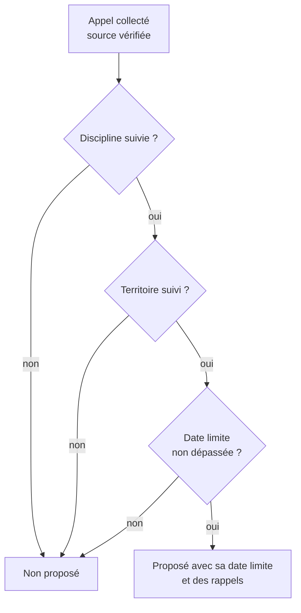

# Fiche capacité : `profil-artiste`

| Élément | Valeur |
|---|---|
| Préfixe d'exigences | `ART` |
| Spec de référence | `/openspec/specs/profil-artiste/spec.md` — absente tant qu'aucun changement n'est archivé |
| Changements en cours | [`ajouter-profil-artiste`](/openspec/changes/ajouter-profil-artiste/proposal.md) (proposé) |
| Statut de la capacité | proposée |
| Composants (arc42 §5) | `catalog` (pack), `impact-engine` (stratégie), `source-ingestion`, `alerting` |

## Objectif

[PROPOSITION — `ajouter-profil-artiste`] Montrer qu'Argos sert d'autres publics que les équipes techniques, en offrant aux artistes une veille des opportunités adaptées à leur discipline et à leur territoire.

## Acteurs

| Acteur | Interaction | Statut |
|---|---|---|
| Artiste | active le profil, choisit ses disciplines et territoires | [PROPOSITION] — ADR-0024 (Proposé) |
| Administrateur plateforme | publie le pack et valide ses sources | [PROPOSITION] — PRF-04 |
| Organismes publics et sociétés de gestion | publient appels, aides et informations | [QUESTION] — Q-1 |

## Périmètre et exclusions

Inclus :

- Le pack, sa stratégie de rapprochement et ses garde-fous.

Exclus :

- Les profils `comedien` et `politique` : changes dédiés.
- La candidature en ligne aux appels.

## Préconditions et déclencheurs

Profil `artiste` publié et actif ; au moins une discipline et un territoire suivis.

## Entrées, sorties et validations

| Entrée / sortie | Contenu | Validation ou contrainte | Statut |
|---|---|---|---|
| Appel ou aide | discipline, territoire, date limite, lien officiel | source vérifiée (ART-05) | [PROPOSITION] |
| Suivis de l'utilisateur | disciplines, territoires | listes du pack (ART-02) | [PROPOSITION] |

## Règles métier

| Règle | Exigence(s) | Source | Statut |
|---|---|---|---|
| Pack artiste au catalogue | ART-01 | ADR-0024 (Proposé)  | [PROPOSITION] |
| Disciplines et territoires suivis | ART-02 | ADR-0024 (Proposé)  | [PROPOSITION] |
| Rapprochement par discipline, territoire et date limite | ART-03 | ADR-0024 (Proposé)  | [PROPOSITION] |
| Rappel avant date limite | ART-04 | ALR-04  | [PROPOSITION] |
| Sources vérifiées | ART-05 | ADR-0024 (Proposé) point 8  | [PROPOSITION] |
| Aucun avis d'éligibilité | ART-06 | ADR-0024 (Proposé) point 7 | [PROPOSITION] |

## Droits d'accès et restrictions

Aucun droit nouveau (PRF-05) ; disciplines et territoires suivis visibles de l'utilisateur seul.

## Effets de bord observables

Éléments restitués, rappels envoyés.

## Qualités mesurables

[QUESTION] Aucune cible chiffrée dans les sources ; voir les questions ouvertes.

## Diagrammes

### DF-ART-1 — Un appel est-il proposé à l'artiste ?

- **Question** : à quelles conditions un appel est-il présenté comme une opportunité ?
- **Type** : organigramme
- **Portée** : cible proposée
- **Exigences** : ART-03, ART-05

Trois critères structurés suffisent à décider, sans IA ; le résumé éventuel ne juge jamais l'éligibilité.

## Critères d'acceptation

Scénarios ART-01-S1 à ART-06-S1 du changement ; aucun scénario qualité transverse supplémentaire.

## Interprétations introduites par un changement

- Un appel à date limite passée n'est pas présenté comme opportunité (ART-03-S2) : à faire valider.
- Rubriques du pack reprises de l'exemple de la fiche `profils-veille` : à faire valider.

## Écarts constatés

- Aucune source « artiste » n'est encore identifiée ni vérifiée : les rubriques sont posées, leurs sources restent une question (Q-1).

## Questions ouvertes

| ID | Question | Impact | Destinataire |
|---|---|---|---|
| Q-1 | Quelles sources prioritaires (ministère de la Culture, centres nationaux, régions, sociétés de gestion) et leurs conditions d'usage ? | oui pour ART-05 | porteur du projet |
| Q-2 | Quel périmètre géographique au démarrage (France, Europe) ? | oui pour ART-02 | porteur du projet |
| Q-3 | Quelle liste de disciplines ? | oui pour ART-02 | porteur du projet |
| Q-4 | À quelles échéances rappeler une date limite de candidature ? | non : paramétrable | Product Owner |

## Traçabilité

| Exigence | Scénarios | Conception / diagramme | Tâche | Test ou preuve |
|---|---|---|---|---|
| ART-01 | ART-01-S1 | Composants | 2.1 | à écrire |
| ART-02 | ART-02-S1, ART-02-S2 | Composants | 1.1, 2.2 | à écrire |
| ART-03 | ART-03-S1, ART-03-S2 | DC-1 | 2.3 | à écrire |
| ART-04 | ART-04-S1 | DC-1 | 2.4 | à écrire |
| ART-05 | ART-05-S1 | Composants | 1.1, 3.1 | à écrire |
| ART-06 | ART-06-S1 | Composants | 3.2 | à écrire |
