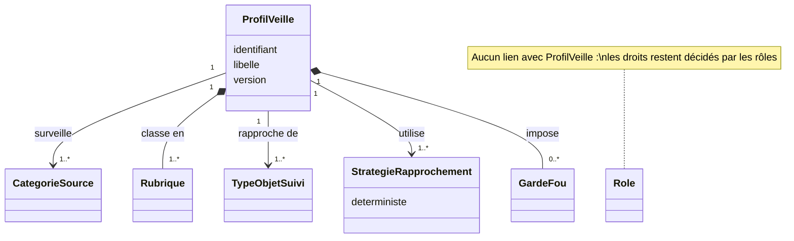
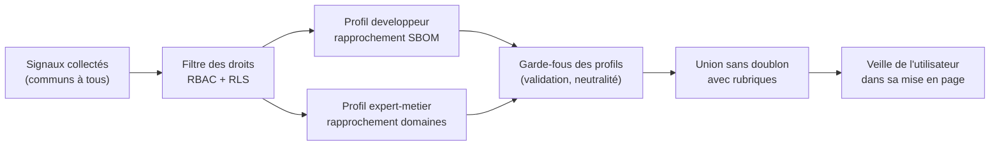

# Fiche capacité : `profils-veille`

| Élément | Valeur |
|---|---|
| Préfixe d'exigences | `PRF` |
| Spec de référence | `/openspec/specs/profils-veille/spec.md` — absente tant qu'aucun changement n'est archivé |
| Changements en cours | [`personnaliser-profils-et-affichage`](/openspec/changes/personnaliser-profils-et-affichage/proposal.md) (proposé) |
| Statut de la capacité | proposée |
| Composants (arc42 §5) | `catalog`, `workspace`, `impact-engine`, `signal`, `API & Security`, `mcp-server` |

## Objectif

[PROPOSITION — `personnaliser-profils-et-affichage`] Permettre à chaque utilisateur de choisir un ou plusieurs **profils de veille**. Un profil décide de ce qu'Argos surveille pour lui et de la façon dont une information est jugée le concerner. Les deux premiers profils sont ceux du dossier v2.4 ; d'autres publics pourront être servis plus tard (demande du porteur, 2026-11-15).

Un profil n'est pas un rôle : il ne donne aucun droit (ADR-0016, PRF-05).

## Acteurs

| Acteur | Interaction | Statut |
|---|---|---|
| Utilisateur | active un ou plusieurs profils | [PROPOSITION] |
| Administrateur d'espace | propose des profils par défaut à son équipe | [PROPOSITION] |
| Administrateur plateforme | publie un profil au catalogue | [PROPOSITION] |
| Expert métier | valide les éléments soumis à garde-fou | [PROPOSITION] — ADR-0018 |
| DPO | revoit tout profil concernant des personnes | [PROPOSITION] — ADR-0024 |

## Périmètre et exclusions

Inclus : catalogue, profils actifs, union des veilles, deux profils initiaux, ajout d'un profil, garde-fous. Exclus : la réalisation des profils futurs, chacun relevant de son propre changement.

### Profils initiaux

| Profil | Sources | Objets suivis | Rapprochement | Garde-fous | Statut |
|---|---|---|---|---|---|
| `developpeur` | OSV, NVD, KEV, EPSS, CERT-FR, éditeurs, endoflife.date | projets, composants (SBOM, PURL) | PURL + plage de versions, déterministe | IA sans décision d'impact | [PROPOSITION] — ADR-0010 à ADR-0013 |
| `expert-metier` | Légifrance, net-entreprises, BOSS, DGCL, DGAFP, caisses de retraite | domaines métier, modules produits | nature, NOR, codes modifiés, dictionnaire métier | validation par l'expert avant diffusion ; aucun avis juridique | [PROPOSITION] — ADR-0018 |

### Exemples de profils futurs (non engagés)

| Profil | Sources possibles | Objets suivis | Rapprochement pressenti | Garde-fous pressentis |
|---|---|---|---|---|
| `artiste` | appels à projets et résidences, aides publiques à la création, sociétés de gestion des droits, régime social des artistes-auteurs | discipline, territoire, échéances | discipline + territoire + date limite de candidature | sources officielles ou des organismes eux-mêmes |
| `comedien` | annonces de casting, convention collective et règles de l'intermittence, festivals, offres de formation | spécialités, région, agenda | spécialité + région + date | sources publiques ; aucune donnée personnelle de tiers |
| `politique` | agenda et textes des assemblées, Journal officiel, rapports publics, consultations | thèmes, commissions, territoires | thème + institution + étape de procédure | sources institutionnelles, pluralité, aucune recommandation ni classement partisan par l'IA |

Ces exemples servent à vérifier que le modèle tient ; ils ne sont pas des exigences. Argos étant un produit ouvert à tous les publics ([DÉCISION] — ADR-0025, 2026-11-16), ils sont dans la cible ; leur réalisation suppose encore une revue des sources (licences, conditions d'usage) et des données personnelles.

## Préconditions et déclencheurs

Utilisateur authentifié ; profil publié au catalogue.

## Entrées, sorties et validations

| Entrée / sortie | Contenu | Validation ou contrainte | Statut |
|---|---|---|---|
| Activation / désactivation | identifiant de profil | publié au catalogue ; au moins un profil reste actif (PRF-01) | [PROPOSITION] |
| Veille restituée | éléments des profils actifs | union sans doublon, rubriques de chaque profil (PRF-02) | [PROPOSITION] |
| Manifeste de profil | sources, rubriques, objets suivis, stratégies, garde-fous | ne déclare que des connecteurs et stratégies existants | [PROPOSITION] |

## Règles métier

| Règle | Exigence(s) | Source | Statut |
|---|---|---|---|
| Au moins un profil actif, cumul possible | PRF-01 | ADR-0024 | [PROPOSITION] |
| Union des profils actifs, sans doublon | PRF-02 | ADR-0024 | [PROPOSITION] |
| Profils initiaux `developpeur` et `expert-metier` | PRF-03 | ADR-0024 ; ADR-0013 ; ADR-0018 | [PROPOSITION] |
| Ajout d'un profil sans effet sur les autres | PRF-04 | ADR-0024 | [PROPOSITION] |
| Aucun droit accordé | PRF-05 | ADR-0024 ; ADR-0016 ; ABO-05 | [PROPOSITION] |
| Garde-fous appliqués avant diffusion, partout | PRF-06 | ADR-0024 ; ADR-0018 | [PROPOSITION] |

## Droits d'accès et restrictions

Les droits (RBAC + RLS) s'appliquent avant les profils. Un profil peut seulement restreindre ce qui est restitué, jamais l'élargir.

## Effets de bord observables

Modification des profils actifs de l'utilisateur ; la veille restituée change en conséquence.

## Qualités mesurables

[QUESTION] Aucune cible propre ; voir la cible de restitution du dossier v2.4 §10.

## Diagrammes

### DF-PRF-1 — Ce que décrit un profil

- **Question** : de quoi un profil de veille est-il composé, et qu'est-ce qu'il ne contient pas ?
- **Type** : UML classes
- **Portée** : cible proposée
- **Exigences** : PRF-01, PRF-03, PRF-04, PRF-05

Un profil assemble des briques existantes (connecteurs, stratégies). `Role` est représenté pour montrer l'absence de lien : activer un profil ne donne aucun droit.

### DF-PRF-2 — Veille d'un utilisateur à plusieurs profils

- **Question** : comment se compose la veille d'un utilisateur qui cumule deux profils ?
- **Type** : organigramme
- **Portée** : cible proposée
- **Exigences** : PRF-02, PRF-05, PRF-06

Les signaux sont collectés une seule fois pour tous. Les droits passent en premier ; chaque profil actif ajoute les éléments qui le concernent ; les garde-fous retirent ce qui n'est pas encore diffusable ; l'union élimine les doublons.

## Critères d'acceptation

Scénarios PRF-01-S1 à PRF-06-S2 du changement.

## Interprétations introduites par un changement

- « Au moins un profil actif » (PRF-01, décision D3) : non exprimé par la demande, à faire valider.
- Profils proposés par l'équipe : repris de la logique du socle d'équipe (ABO-03), à faire valider (Q-2).

## Écarts constatés

La taxonomie des signaux du dossier v2.4 §8.2 est fermée ; ce changement la veut extensible par profil (voir la proposition).

## Questions ouvertes

| ID | Question | Impact | Destinataire |
|---|---|---|---|
| Q-1 | Argos reste-t-il interne ou s'ouvre-t-il à d'autres publics ? | répondue le 2026-11-16 : produit ouvert (ADR-0025) | porteur du projet |
| Q-2 | Un profil proposé par l'équipe peut-il être désactivé ? | PRF-01 | Product Owner |
| Q-3 | Un abonnement `PERSONAL` peut-il viser une source hors de ses profils ? | PRF-02, ABO-04 | Product Owner |
| Q-5 | Qui publie un profil au catalogue, après quelle revue ? | PRF-04 | Product Owner / architecte |

## Traçabilité

| Exigence | Scénarios | Conception / diagramme | Tâche | Test ou preuve |
|---|---|---|---|---|
| PRF-01 | PRF-01-S1 à PRF-01-S3 | DC-1, DF-PRF-1 | 3.2 | à écrire |
| PRF-02 | PRF-02-S1, PRF-02-S2 | DC-2, DF-PRF-2 | 3.4 | à écrire |
| PRF-03 | PRF-03-S1, PRF-03-S2 | DC-1, DF-PRF-1 | 3.1, 3.3 | à écrire |
| PRF-04 | PRF-04-S1 | DF-PRF-1 | 3.5 | à écrire |
| PRF-05 | PRF-05-S1 | DC-1, DF-PRF-1, DF-PRF-2 | 3.6 | à écrire |
| PRF-06 | PRF-06-S1, PRF-06-S2 | DC-2, DF-PRF-2 | 3.7 | à écrire |
