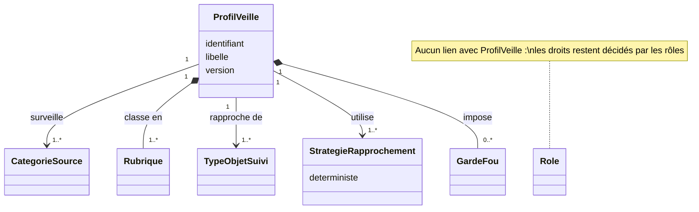
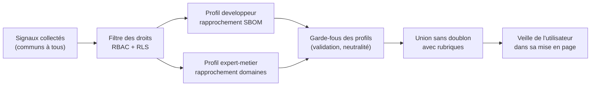

# Fiche capacité : `profils-veille`

| Élément | Valeur |
|---|---|
| Préfixe d'exigences | `PRF` |
| Spec de référence | [`/openspec/specs/profils-veille/spec.md`](/openspec/specs/profils-veille/spec.md) |
| Changements archivés | [`2026-11-19-personnaliser-profils-et-affichage`](/openspec/changes/archive/2026-11-19-personnaliser-profils-et-affichage/proposal.md) |
| Changements archivés, suite | [`2026-11-20-optimiser-ma-veille`](/openspec/changes/archive/2026-11-20-optimiser-ma-veille/proposal.md) — PRF-07 (latence de « Ma veille ») ; [`2026-11-25-durcir-autorisations-et-debits`](/openspec/changes/archive/2026-11-25-durcir-autorisations-et-debits/proposal.md) — PRF-08 (limite de débit) |
| Changement du sprint 10 | [`2026-11-27-accelerer-requetes-chaudes`](/openspec/changes/archive/2026-11-27-accelerer-requetes-chaudes/proposal.md) (PRF-07 modifiée, PRF-09 ajoutée) — archivé |
| Statut de la capacité | livrée ; rapprochement propre au profil `expert-metier` absent (pas de capacité `regintel`) |
| Composants (arc42 §5) | `catalog`, `workspace`, `impact-engine`, `signal`, `API & Security`, `mcp-server` |

## Objectif

[EXIGENCE — ADR-0024 (Accepté)] Permettre à chaque utilisateur de choisir un ou plusieurs **profils de veille**. Un profil décide de ce qu'Argos surveille pour lui et de la façon dont une information est jugée le concerner. Les deux premiers profils sont ceux du dossier v2.4 ; d'autres publics pourront être servis plus tard (demande du porteur, 2026-11-15).

Un profil n'est pas un rôle : il ne donne aucun droit (ADR-0016, PRF-05).

## Acteurs

| Acteur | Interaction | Statut |
|---|---|---|
| Utilisateur | active un ou plusieurs profils | [EXISTANT] — `#/veille/profils`, `PreferencesResourceTest`, E2E `e2e/tests/veille.spec.ts` |
| Administrateur d'espace | propose des profils par défaut à son équipe | [PROPOSITION] |
| Administrateur plateforme | publie un profil au catalogue | [EXISTANT] — par configuration (`argos.catalogue.profils.manifestes`), `ProfilDemonstrationTest` |
| Expert métier | valide les éléments soumis à garde-fou | [EXISTANT] — ADR-0030 (remplace ADR-0018) ; `VeilleProfilsTest#prf06S2FicheValidee` |
| DPO | revoit tout profil concernant des personnes | [PROPOSITION] — ADR-0024 |

## Périmètre et exclusions

Inclus : catalogue, profils actifs, union des veilles, deux profils initiaux, ajout d'un profil, garde-fous. Exclus : la réalisation des profils futurs, chacun relevant de son propre changement.

### Profils initiaux

| Profil | Sources | Objets suivis | Rapprochement | Garde-fous | Statut |
|---|---|---|---|---|---|
| `developpeur` | OSV, NVD, KEV, EPSS, CERT-FR, éditeurs, endoflife.date | projets, composants (SBOM, PURL) | PURL + plage de versions, déterministe | IA sans décision d'impact | [PROPOSITION] — ADR-0010 à ADR-0013 |
| `expert-metier` | Légifrance, net-entreprises, BOSS, DGCL, DGAFP, caisses de retraite | domaines métier, modules produits | nature, NOR, codes modifiés, dictionnaire métier | validation par l'expert avant diffusion ; aucun avis juridique | [PROPOSITION] — ADR-0018 (remplacé par ADR-0030) |

### Manifeste de profil

[EXISTANT — `argos-server/src/main/java/io/argos/catalog/profil/`] Un profil est décrit par un manifeste JSON `catalog/profils/<identifiant>.json`, au format 1 :

| Champ | Contenu | Contrôle au démarrage |
|---|---|---|
| `formatManifeste` | version du format | vaut 1 |
| `identifiant` | minuscules, chiffres et tirets | égal au nom du fichier, unique |
| `version`, `libelle`, `description` | version du pack, textes affichés | renseignés |
| `categoriesSources`, `connecteurs` | sources surveillées et connecteurs de collecte | non vides |
| `rubriques` | `identifiant`, `libelle` et, facultatif, `categories` : catégories de sources que la rubrique range | au moins une, sans doublon ; chaque catégorie déclarée dans `categoriesSources` |
| `typesObjetsSuivis` | objets auxquels les signaux sont rapprochés | non vide |
| `strategies` | `identifiant` et `deterministe` | au moins une, toutes déterministes (ADR-0013) |
| `gardeFous` | `type` et `description` | type parmi `VALIDATION_HUMAINE`, `IA_SANS_DECISION`, `AUCUN_AVIS_JURIDIQUE`, `AUCUN_AVIS_ELIGIBILITE`, `SOURCES_VERIFIEES` |
| `listes` (facultatif) | listes fermées des valeurs suivies : `typeObjet` et `valeurs` (`identifiant`, `libelle`) | type déclaré dans `typesObjetsSuivis`, une liste par type, non vide, valeurs sans doublon |

Les manifestes publiés sont listés par `argos.catalogue.profils.manifestes` ; un profil listé dans `argos.catalogue.profils.retires` n'est plus publié. Un manifeste invalide empêche le serveur de démarrer. La confrontation des connecteurs et des stratégies au code attend leur implémentation (tâche 3.3).

### Exemples de profils futurs (non engagés)

| Profil | Sources possibles | Objets suivis | Rapprochement pressenti | Garde-fous pressentis |
|---|---|---|---|---|
| `artiste` (publié, fiche [`profil-artiste`](profil-artiste.md)) | data.culture.gouv.fr (Licence Ouverte Etalab) et flux RSS/Atom publics d'organismes | discipline, territoire, échéances | discipline + territoire + date limite de candidature | sources aux conditions d'usage vérifiées ; aucun avis d'éligibilité |
| `comedien` | annonces de casting, convention collective et règles de l'intermittence, festivals, offres de formation | spécialités, région, agenda | spécialité + région + date | sources publiques ; aucune donnée personnelle de tiers |
| `politique` | agenda et textes des assemblées, Journal officiel, rapports publics, consultations | thèmes, commissions, territoires | thème + institution + étape de procédure | sources institutionnelles, pluralité, aucune recommandation ni classement partisan par l'IA |

Ces exemples servent à vérifier que le modèle tient ; ils ne sont pas des exigences. Argos étant un produit ouvert à tous les publics ([DÉCISION] — ADR-0025, 2026-11-16), ils sont dans la cible ; leur réalisation suppose encore une revue des sources (licences, conditions d'usage) et des données personnelles.

## Préconditions et déclencheurs

Utilisateur authentifié ; profil publié au catalogue.

## Entrées, sorties et validations

| Entrée / sortie | Contenu | Validation ou contrainte | Statut |
|---|---|---|---|
| Activation / désactivation | `PUT /api/v1/preferences/profils` `{"profilsActifs": [...]}` : remplace l'ensemble | publié au catalogue, sinon refus 400 `PROFIL_INCONNU` ; ensemble vide refusé, 400 `AU_MOINS_UN_PROFIL` (PRF-01) | [EXISTANT] — `PreferencesResource`, `PreferencesResourceTest` |
| Catalogue | `GET /api/v1/catalogue/profils` : identifiant, nom, description, version, rubriques, garde-fous | seuls les profils publiés | [EXISTANT] — `CatalogueResourceTest` |
| Veille restituée | `GET /api/v1/me/veille?page=&size=` : page `{items, page, size, total, profilsActifs}` (50 éléments par défaut, de 1 à 200 ; PRF-09) d'éléments (type, titre, date, profils, rubriques, garde-fous, mention de validation, projets visibles concernés, abonnements `PERSONAL` qui ont retenu l'élément) | union sans doublon des profils actifs et des abonnements `PERSONAL`, rubriques de chaque profil (PRF-02, décision Q-3) ; garde-fous des profils actifs appliqués (PRF-06) ; lectures sous la RLS, limitées aux espaces de l'appelant (PRF-05) | [EXISTANT] — `io.argos.api.veille.VeilleProfilsResource`, `UnionProfils`, `io.argos.api.SignauxAbonnements`, `VeilleProfilsTest`, `VeilleAbonnementsPersonnelsTest`, `UnionProfilsTest` ; affichée par la vue « Ma veille » d'`argos-ui` (`#/veille`) |
| Choix des profils dans l'IHM | vue `#/veille/profils` d'`argos-ui` : profils du catalogue, bascule d'un profil par l'ensemble complet envoyé à `PUT /api/v1/preferences/profils` | aucun contrôle dans l'IHM : le refus du serveur (`AU_MOINS_UN_PROFIL`, `PROFIL_INCONNU`) est affiché tel quel | [EXISTANT] — `argos-ui/src/views/ProfilsVeilleView.vue`, `argos-ui/tests/veille-profils.test.mjs` ; E2E `e2e/tests/veille.spec.ts` « 3.4, 3.9 » (activation d'`expert-metier` en plus de `developpeur`) |
| Fiche réglementaire par MCP | `get_regulatory_changes` : fiches validées seulement, avec `mentionValidation` | aucune fiche en attente ou rejetée, même pour l'expert qui la voit dans la file de relecture (PRF-06) | [EXISTANT] — `OutilsReglementaires`, `ReglementaireMcpTest`, `VeilleProfilsTest` |
| Manifeste de profil | sources, rubriques, objets suivis, stratégies, garde-fous | format 1 validé au démarrage (voir « Manifeste de profil ») ; les stratégies de `developpeur` sont confrontées au moteur d'impact par un test, celles d'`expert-metier` n'ont pas d'implémentation | [EXISTANT] partiel — `ValidateurManifeste`, `CatalogueProfilsTest` |

## Règles métier

| Règle | Exigence(s) | Source | Statut |
|---|---|---|---|
| Au moins un profil actif, cumul possible | PRF-01 | ADR-0024 | [EXISTANT] — service, contrainte en base et tests PRF-01-S1 à S3 |
| Union des profils actifs, sans doublon | PRF-02 | ADR-0024 | [EXISTANT] — un élément relève d'un profil actif quand une rubrique du profil range l'une de ses catégories de sources ; il est restitué une fois, avec les rubriques de chacun de ces profils |
| Sources des abonnements `PERSONAL` ajoutées à l'union, dans la limite des droits | PRF-02 (S3, S4), ABO-04, ABO-05 | décision Q-3 (2026-11-16) | [EXISTANT] — les avis de sécurité retenus par les abonnements `PERSONAL` actifs de l'appelant s'ajoutent à l'union ; un même avis est restitué une fois ; ses projets concernés restent limités aux espaces de l'appelant (`VeilleAbonnementsPersonnelsTest`) |
| Profils initiaux `developpeur` et `expert-metier` | PRF-03 | ADR-0024 ; ADR-0013 ; ADR-0030 (remplace ADR-0018) | [EXISTANT] au catalogue (PRF-03-S1) ; rapprochement de `developpeur` par la règle PURL + plage de versions du moteur d'impact, sans IA (PRF-03-S2) ; rapprochement d'`expert-metier` absent (pas de capacité `regintel`) |
| Ajout d'un profil sans effet sur les autres | PRF-04 | ADR-0024 | [EXISTANT] — la veille ne dépend que des profils actifs : un profil publié n'ajoute ni rubrique, ni élément, ni mention à qui ne l'active pas (`ProfilDemonstrationTest`) |
| Aucun droit accordé | PRF-05 | ADR-0024 ; ADR-0016 ; ABO-05 | [EXISTANT] — tests inter-espaces avec RLS (`ProfilsDeVeilleTest`) et règle ArchUnit `PreferencesIsolationTest` |
| Garde-fous appliqués avant diffusion, partout | PRF-06 | ADR-0024 ; ADR-0030 (remplace ADR-0018) | [EXISTANT] — par le serveur : veille (`/api/v1/me/veille`) et serveur MCP (`get_regulatory_changes`) ; une fiche réglementaire non validée n'est jamais candidate, et le garde-fou `VALIDATION_HUMAINE` d'un profil actif écarte tout élément non validé qu'il range |
| Limite de débit par compte de 60 requêtes par minute sur `GET /api/v1/me/veille` (`argos.veille.debit.requetes-par-minute`), compteur distinct de celui de la recherche ; au-delà, 429 avec `Retry-After`, refus journalisé `LIMITE_DEBIT`, aucune donnée de veille lue | PRF-08 | AUD-SEC-09 ; décision du porteur, 2026-11-24 | [PROPOSITION] — `durcir-autorisations-et-debits` |
| « Ma veille » est restituée par pages au format commun des listes (ADR-0040) : l'union est composée entière, triée par date décroissante (sans date en dernier), puis type et identifiant, et la page demandée en est extraite ; `total` compte les éléments de l'union ; l'IHM affiche le total, la position et les boutons de page | PRF-09 | AUD-PER-06 ; ADR-0040 ; décisions du porteur, 2026-11-27 | [PROPOSITION] — `2026-11-27-accelerer-requetes-chaudes` (`VeillePagineeTest`, `tests/vues/veille.spec.ts`) |
| Les impacts de « Ma veille » sont lus espace par espace sur l'index partiel des impacts actifs (V27) : un petit espace ne parcourt ni les impacts des autres espaces ni les impacts résolus ; les signaux des abonnements sont cherchés par une sous-requête indexée par critère | PRF-07 | AUD-PER-06, AUD-PER-26 | [PROPOSITION] — `2026-11-27-accelerer-requetes-chaudes` |

## Droits d'accès et restrictions

Les droits (RBAC + RLS) s'appliquent avant les profils. Un profil peut seulement restreindre ce qui est restitué, jamais l'élargir.

## Effets de bord observables

Modification des profils actifs de l'utilisateur ; la veille restituée change en conséquence.

## Qualités mesurables

[QUESTION] Aucune cible propre de restitution métier ; voir la cible de restitution du dossier v2.4 §10.

[PROPOSITION] Latence de `GET /api/v1/me/veille` (PRF-07, changement `optimiser-ma-veille`) : p95 < 500 ms avec le jeu de référence de la campagne de performance (décisions K2 et K3 du porteur du projet, 2026-11-19 ; cible de PERF-01), contenu restitué inchangé. Mesures : [rapport de la campagne](../architecture/quality/mesure-performance-api-mcp.md).

## Diagrammes

### DF-PRF-1 — Ce que décrit un profil

- **Question** : de quoi un profil de veille est-il composé, et qu'est-ce qu'il ne contient pas ?
- **Type** : UML classes
- **Portée** : implémentation de `personnaliser-profils-et-affichage`
- **Exigences** : PRF-01, PRF-03, PRF-04, PRF-05

Un profil assemble des briques existantes (connecteurs, stratégies). `Role` est représenté pour montrer l'absence de lien : activer un profil ne donne aucun droit.

### DF-PRF-2 — Veille d'un utilisateur à plusieurs profils

- **Question** : comment se compose la veille d'un utilisateur qui cumule deux profils ?
- **Type** : organigramme
- **Portée** : implémentation de `personnaliser-profils-et-affichage`
- **Exigences** : PRF-02, PRF-05, PRF-06

Les signaux sont collectés une seule fois pour tous. Les droits passent en premier ; chaque profil actif ajoute les éléments qui le concernent ; les garde-fous retirent ce qui n'est pas encore diffusable ; l'union élimine les doublons.

## Critères d'acceptation

Scénarios PRF-01-S1 à PRF-06-S2 de la [spec de référence](/openspec/specs/profils-veille/spec.md) ; PRF-07-S1 et PRF-07-S2 du [delta du changement `optimiser-ma-veille`](/openspec/changes/archive/2026-11-20-optimiser-ma-veille/specs/profils-veille/spec.md) ; PRF-09-S1 à S4 du [delta du changement `2026-11-27-accelerer-requetes-chaudes`](/openspec/changes/archive/2026-11-27-accelerer-requetes-chaudes/specs/profils-veille/spec.md).

## Interprétations introduites par un changement

- « Au moins un profil actif » (PRF-01, décision D3) : non exprimé par la demande, à faire valider.
- Profils proposés par l'équipe : repris de la logique du socle d'équipe (ABO-03) ; désactivables tant qu'un profil reste actif (Q-2, décidé le 2026-11-16). Non implémentés : ils supposent les équipes du module `workspace`.
- Profils appliqués à un utilisateur qui n'a jamais choisi, ou dont tous les profils ont été retirés : profils par défaut de la plateforme (`argos.preferences.profils-par-defaut`, `developpeur` aujourd'hui). Non exprimé par la demande, à faire valider. Les profils proposés par l'équipe n'existent pas ; ces profils par défaut en tiennent lieu.
- Profil activé à la création d'un compte (Q-3 de `comptes-acces`) : l'événement `CompteCree` enregistre `developpeur` dans les préférences du compte s'il n'a encore aucun profil (`io.argos.api.preference.ActivationProfilParDefaut`).
- Clé des préférences : identifiant du compte Argos (table `compte`), relié au sujet OIDC du jeton ; jamais le nom du principal, qui peut changer ou être réattribué. Sous le rôle applicatif `argos_app`, la RLS n'expose à un compte que ses propres préférences.
- [PROPOSITION] « Élément qui relève d'un profil » (PRF-02) : une rubrique du profil range l'une des catégories de sources de l'élément (champ `categories` des rubriques). `developpeur` range `avis-securite` en `securite` ; `expert-metier` range `textes-officiels` en `reglementation`. Non exprimé par la demande, à faire valider.
- [PROPOSITION] Catégories restituées par `GET /api/v1/me/veille` au titre des profils : avis de sécurité qui impactent un projet des espaces de l'appelant (`avis-securite`) et fiches réglementaires validées de ses espaces (`textes-officiels`). Les nouvelles versions, fins de support, normes déclaratives, actualités web et opportunités du profil `artiste` n'y figurent pas encore.
- [PROPOSITION] Portée des garde-fous (PRF-06) : un élément non validé qui relève d'un profil actif imposant `VALIDATION_HUMAINE` n'est pas restitué, même s'il relève aussi d'un autre profil actif. Les garde-fous d'un profil que l'utilisateur n'active pas ne changent pas sa veille (PRF-04) ; la règle propre aux fiches réglementaires (aucune fiche non validée diffusée, ADR-0030) s'applique avant, quel que soit le profil.
- [PROPOSITION] Serveur MCP : les outils répondent à une question explicite sur le périmètre autorisé et ne sont pas filtrés par les profils actifs ; les garde-fous s'y appliquent (`get_regulatory_changes` ne renvoie que des fiches validées, avec leur mention de validation).
- [PROPOSITION] Décision Q-3 dans `GET /api/v1/me/veille` : seuls les abonnements `PERSONAL` actifs de l'appelant s'ajoutent à l'union des profils ; le socle `TEAM` reste restitué par `GET /api/v1/me/watch`, qui reste la restitution complète des abonnements. Les critères interprétés sont ceux de `GET /api/v1/me/watch` (`TECHNOLOGY`, `PACKAGE`, `SOURCE` sur les avis de sécurité publics ; `PROJECT` seulement pour un projet des espaces de l'appelant) ; `VENDOR`, `THEME`, `DOMAIN` et `SEVERITY` ne retiennent rien, et aucun abonnement ne retient de fiche réglementaire.
- [PROPOSITION] Un élément que seuls des abonnements `PERSONAL` retiennent n'a ni profil ni rubrique (aucun profil ne l'a sélectionné) ; le champ `abonnements` nomme son origine. Les garde-fous des profils actifs qui rangent l'une de ses catégories s'appliquent quand même : leurs textes l'accompagnent, et un élément qu'un tel profil ne peut pas diffuser n'est restitué par aucune voie. Un avis retenu à la fois par un profil et par un abonnement garde la rubrique du profil et porte les abonnements.
- [PROPOSITION] Vue « Ma veille » d'`argos-ui` : les éléments sont groupés par leur première rubrique, chacun une seule fois ; ceux sans rubrique forment le groupe « Abonnements personnels ». L'origine (profils, abonnements personnels nommés par leurs critères) est affichée pour chaque élément. La vue est rendue dans la mise en page choisie par l'utilisateur (tâche 2.4).

## Écarts constatés

- La taxonomie des signaux du dossier v2.4 §8.2 est fermée ; ce changement la veut extensible par profil (voir la proposition).
- La restitution par abonnements (`GET /api/v1/me/watch`) ne dépend pas des profils actifs ; la veille par profils (`GET /api/v1/me/veille`) intègre les abonnements `PERSONAL`, pas le socle `TEAM`. `argos-ui` affiche `GET /api/v1/me/veille` (`#/veille`) dans la mise en page choisie par l'utilisateur, après transposition vers le modèle commun des mises en page (`argos-ui/src/contenu/veille-affichee.ts`, conversion de forme seulement) ; parcours E2E `e2e/tests/veille.spec.ts` (2026-11-17).
- `GET /api/v1/me/veille` restitue, pour une fiche réglementaire, la mention « produit par l'IA » (`mentionIa`) quand le résumé vient du modèle et la mention de paternité de la source (`mentionSource` : DILA, Licence Ouverte, date de mise à jour des données). L'outil MCP `get_regulatory_changes` ne restitue pas ces deux mentions.
- Aucun élément réel ne relève à la fois de `developpeur` et d'`expert-metier` : `GET /api/v1/me/veille` donne à chaque élément une seule catégorie de sources selon son type (`avis-securite` ou `textes-officiels`), et les manifestes publiés ne partagent aucune catégorie. [DÉCISION] (porteur du projet, 2026-11-19) : la preuve actuelle est acceptée, sans élément réel commun ni changement de la règle de rattachement ; cette décision révise D8 du 2026-11-18 et répond à Q-6 du changement `personnaliser-profils-et-affichage` (distincte de la Q-6 de `formaliser-chaine-securite-poc`). PRF-02-S1 est prouvé avec ces deux manifestes sur un élément de deux catégories (`UnionProfilsTest`), et de bout en bout avec `developpeur` et le profil de test `demonstration`, qui rangent tous deux les avis de sécurité (`ProfilDemonstrationTest`), et dans l'IHM par l'union sans doublon de deux profils et d'un abonnement (E2E `e2e/tests/veille.spec.ts` « 3.4, 3.9 ») ; tests d'intégration relancés le 2026-11-19 (25 tests, 0 échec).
- La publication d'un profil passe par la configuration (`argos.catalogue.profils.manifestes`), donc par un redémarrage : PRF-04-S1 compare la veille restituée, catalogue enrichi, à celle que définissent les seuls profils actifs.
- Restitution de « Ma veille » (changement `optimiser-ma-veille`, 2026-11-20) : les signaux des avis sont lus en une requête (`SignalQueries.findAll`), et les 200 impacts récents par l'index `project_impact_recents` (migration V21) ; contenu identique à celui de `lot19/base` pour le jeu de référence (réponse comparée octet pour octet), `VeilleLectureGroupeeTest` et `LectureGroupeeSignauxTest`.
- `PreferencesIsolationTest` prouve l'isolement des préférences vis-à-vis du reste de `workspace` ; `api` peut les lire. PRF-05 est prouvé par les tests inter-espaces, pas par cette seule règle.

## Questions ouvertes

| ID | Question | Impact | Destinataire |
|---|---|---|---|
| Q-1 | Argos reste-t-il interne ou s'ouvre-t-il à d'autres publics ? | répondue le 2026-11-16 : produit ouvert (ADR-0025) | porteur du projet |
| Q-2 | Un profil proposé par l'équipe peut-il être désactivé ? | répondue le 2026-11-16 : oui, tant qu'un profil reste actif (PRF-01) [DÉCISION] | Product Owner |
| Q-3 | Un abonnement `PERSONAL` peut-il viser une source hors de ses profils ? | répondue le 2026-11-16 : oui, dans la limite de ses droits ; la source s'ajoute à l'union des profils actifs [DÉCISION] | Product Owner |
| Q-5 | Qui publie un profil au catalogue, après quelle revue ? | PRF-04 | Product Owner / architecte |
| Q-6 | Quelle règle rend un élément réel commun à `developpeur` et `expert-metier` : fiche réglementaire validée et avis de sécurité qu'elle cite fusionnés en un élément, preuve actuelle acceptée, ou attente d'une source commune ? | répondue le 2026-11-19 : preuve actuelle acceptée (`UnionProfilsTest`, `ProfilDemonstrationTest`, E2E « 3.4, 3.9 »), décision D8 révisée, tâche 3.4 cochée [DÉCISION] | porteur du projet |

## Traçabilité

| Exigence | Scénarios | Conception / diagramme | Tâche | Test ou preuve |
|---|---|---|---|---|
| PRF-01 | PRF-01-S1 à PRF-01-S3 | DC-1, DF-PRF-1 | 3.2 | `argos-server/src/test/java/io/argos/api/preference/PreferencesResourceTest.java` — passe |
| PRF-02 | PRF-02-S1 à PRF-02-S4 | DC-2, DF-PRF-2 | 3.4, 3.9 | `argos-server/src/test/java/io/argos/api/veille/VeilleProfilsTest.java` (`prf02UnionDesDeuxProfilsSansDoublon`, `prf02S2ElementDUnProfilInactif`), `UnionProfilsTest.java`, `argos-server/src/test/java/io/argos/api/catalogue/ProfilDemonstrationTest.java#prf02S1ElementCommunADeuxProfilsActifs` ; S3, S4 : `argos-server/src/test/java/io/argos/api/veille/VeilleAbonnementsPersonnelsTest.java` — passent (2026-11-19) ; E2E `e2e/tests/veille.spec.ts` « 3.4, 3.9 » et « 3.9, AFF-02-S2 (PRF-02-S4) » (2026-11-17) |
| PRF-03 | PRF-03-S1, PRF-03-S2 | DC-1, DF-PRF-1 | 3.1, 3.3 | S1 : `CatalogueResourceTest.java`, `CatalogueProfilsTest.java` — passent ; S2 : `argos-server/src/test/java/io/argos/chain/ProfilsDeVeilleTest.java`, `MatchRulesTest.java` — passent |
| PRF-04 | PRF-04-S1 | DF-PRF-1 | 3.5 | `ProfilDemonstrationTest.java` (catalogue, profils actifs et `prf04S1LaVeilleDesAutresUtilisateursEstInchangee`), `UnionProfilsTest#prf04SeulsLesProfilsActifsComptent` — passent |
| PRF-05 | PRF-05-S1 | DC-1, DF-PRF-1, DF-PRF-2 | 3.6 | `argos-server/src/test/java/io/argos/chain/ProfilsDeVeilleTest.java#prf05S1ActivationDUnProfilSansDroitSurLesProjets`, règle ArchUnit `PreferencesIsolationTest.java` — passent |
| PRF-06 | PRF-06-S1, PRF-06-S2 | DC-2, DF-PRF-2 | 3.7 | `VeilleProfilsTest.java` (`prf06S1FicheNonValideeNiVeilleNiMcp`, `prf06S2FicheValidee`, `contratMcpMentionDeValidation`), `argos-server/src/test/java/io/argos/mcp/ReglementaireMcpTest.java`, `UnionProfilsTest.java` — passent |
| PRF-07 | PRF-07-S1, PRF-07-S2 | [`optimiser-ma-veille`](/openspec/changes/archive/2026-11-20-optimiser-ma-veille/design.md) D1, D2, DC-1 | 2.1 à 2.3, 4.2 (`optimiser-ma-veille`) | S1 : `argos-server/src/test/java/io/argos/architecture/LectureGroupeeSignauxTest.java` — passe (2026-11-20) ; mesure de diagnostic du 2026-11-20 (p95 = 60,1 à 82,7 ms) ; campagne `npm --prefix e2e run test:performance` du 2026-11-20 : p95 = 85 ms ([rapport](../architecture/quality/mesure-performance-api-mcp.md)) ; S2 : `argos-server/src/test/java/io/argos/api/veille/VeilleLectureGroupeeTest.java` — passe (2026-11-20) |
| PRF-08 | PRF-08-S1 à PRF-08-S3 | `durcir-autorisations-et-debits` D3 | 3.2, 3.3, 3.4 | `LimiteDebitRechercheVeilleTest` ; campagne de performance (limite relevée par configuration, `e2e/playwright.config.ts`) |
| PRF-07 (modifiée) | PRF-07-S1 à S3 | `2026-11-27-accelerer-requetes-chaudes` D6, D7, D10 | 4.1, 4.2, 7.1 | `VeilleLectureGroupeeTest` (S2) ; campagne `npm --prefix e2e run test:performance` du 2026-11-27 (révision `496add9`, veille paginée, 520 150 impacts dont 500 000 résolus ou écartés) : p95 = 185,5 ms pour le membre du grand espace avec deux abonnements (S1), 67,8 ms pour le membre du petit espace (S3) ([rapport](../architecture/quality/mesure-performance-api-mcp.md)) |
| PRF-09 | PRF-09-S1 à S4 | `2026-11-27-accelerer-requetes-chaudes` D11 | 4.5, 4.6 | `api/veille/VeillePagineeTest` (S1 à S3) ; `argos-ui/tests/vues/veille.spec.ts` et `tests/veille-affichee.test.mjs` (S4) |
