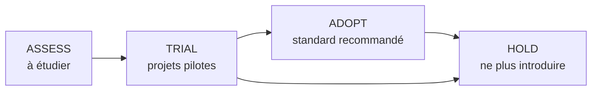

# Fiche capacité : `radar-standards`

| Élément | Valeur |
|---|---|
| Préfixe d'exigences | `RAD` |
| Spec de référence | `/openspec/specs/radar-standards/spec.md` — absente tant qu'aucun changement n'est archivé |
| Changements en cours | [`construire-radar-et-standards`](/openspec/changes/construire-radar-et-standards/proposal.md) (implémenté, non archivé) |
| Statut de la capacité | proposée ; implémentation et tests dans `argos-server`, changement non archivé |
| Composants (arc42 §5) | `catalog`, `release-radar`, `impact-engine`, `alerting` |

## Objectif

[PROPOSITION — `construire-radar-et-standards`] Être la source de vérité d'un espace sur « ce que nous utilisons et comment », et voir venir les sorties et fins de support.

## Acteurs

| Acteur | Interaction | Statut |
|---|---|---|
| Administrateur d'espace | modifie le référentiel de son espace, décide des suggestions de l'IA, règle les jours de rappel | [PROPOSITION] — ACC-03 |
| Utilisateur (membre de l'espace) | consulte référentiel, radar et dette de version ; reçoit rappels et annonces | [PROPOSITION] — PRF-03 |
| IA | suggère un changement de statut, sans effet tant qu'un administrateur ne l'accepte pas | [PROPOSITION] — RAD-02 |
| endoflife.date | fournit sorties, correctifs et fins de support (API publique et gratuite, seule source : Q-2) | [DÉCISION] — Q-2 |

## Périmètre et exclusions

Inclus :

- référentiel par espace et son historique, suggestions de l'IA en attente, annonces de changement de standard ;
- radar par horizon (30 jours, 6 mois, 1 an), rappels J-30, J-7 et J0 paramétrables par espace, dette de version.

Exclus :

- toute source de calendrier autre qu'endoflife.date (Q-2) ;
- un référentiel modèle publié par Argos : chaque espace construit le sien (Q-3) ;
- la saisie manuelle d'une échéance absente du calendrier public (risque de la conception, non traité) ;
- l'écran du radar dans `argos-ui` : la capacité est exposée par l'API REST et le serveur MCP.

## Préconditions et déclencheurs

- Inventaires des projets disponibles (`inventaire-sbom`) : la dette de version et les rappels ne portent que sur les versions présentes dans un inventaire.
- Une technologie n'entre dans le radar que si son entrée du référentiel la relie à un produit endoflife.date (champ `produitCycleVie`, par exemple `postgresql`).
- Tâche quotidienne (`argos.radar.tache.cron`, 06:00 par défaut, fuseau `argos.alerting.fuseau`) : synchronisation du calendrier, dettes de version, rappels.

## Entrées, sorties et validations

| Entrée / sortie | Contenu | Validation ou contrainte | Statut |
|---|---|---|---|
| Entrée du référentiel | clé (PURL sans version), libellé, statut, version recommandée, responsable, justification, date de revue, produit endoflife.date | statut parmi `ADOPT`, `TRIAL`, `ASSESS`, `HOLD` ; version obligatoire pour `ADOPT` ; responsable, justification et date de revue (`AAAA-MM-JJ`) obligatoires ; clé sans version ; produit `^[a-z0-9][a-z0-9._+-]{0,99}$` ; refus `400` qui nomme le champ (`attribut`) | [PROPOSITION] — RAD-01 |
| Suggestion de l'IA | clé, statut proposé, version, justification | enregistrée `EN_ATTENTE` ; acceptée ou rejetée par un administrateur | [PROPOSITION] — RAD-02 |
| Échéance | clé, version ou branche, nature (`SORTIE`, `CORRECTIF`, `FIN_DE_SUPPORT`), date, source `endoflife.date` | source citée ; horizon `30j`, `6m` ou `1a` | [PROPOSITION] — RAD-03 |
| Jours de rappel | liste de jours avant l'échéance | 1 à 10 valeurs distinctes entre 0 et 365 ; `[30, 7, 0]` par défaut | [DÉCISION] — Q-1 |
| Dette de version | projet, composant, version, branche, date de fin de support, version standard de l'espace | une par projet et composant | [PROPOSITION] — RAD-05 |

API REST : `/api/v1/radar/espaces/{espaceId}/` — `standards` (GET, PUT), `standards/historique`, `suggestions`, `suggestions/{id}/decision`, `echeances`, `dettes`, `parametres` (GET, PUT). Outils MCP : `get_technology_standard`, `upcoming_releases`, `check_dependency` (fin de support).

## Règles métier

| Règle | Exigence(s) | Source | Statut |
|---|---|---|---|
| Entrée du référentiel complète et historisée | RAD-01 | dossier v2.4 §8.3 | [PROPOSITION] |
| Modification réservée aux administrateurs de l'espace ; suggestion de l'IA en attente, sans effet direct | RAD-02 | dossier v2.4 §8.3 ; ADR-0013 | [PROPOSITION] |
| Radar par horizon des technologies de l'espace reliées au calendrier | RAD-03 | baseline v2.3 §4 | [PROPOSITION] |
| Rappel d'une sortie ou d'une fin de support aux membres de l'espace dont un projet est concerné, aux jours de rappel de l'espace ; une fin de support ne concerne que les projets dont la version appartient à la branche | RAD-04 | dossier v2.4 §6.4 ; Q-1 | [PROPOSITION] |
| Dette de version quand la fin de support d'une version de l'inventaire est atteinte, avec la version recommandée de l'espace | RAD-05 | dossier v2.4 §6.4 ; ADR-0013 | [PROPOSITION] |
| Annonce d'un changement de statut ou de version recommandée, avec sa justification, aux membres de l'espace dont un projet utilise la technologie ; une création n'est pas annoncée | RAD-06 | dossier v2.4 §8.2 (type STANDARD) | [PROPOSITION] |

Une version appartient à la branche la plus longue dont elle est égale ou qu'elle prolonge par « . » ou « - » (`14.10` → branche `14`).

## Droits d'accès et restrictions

- Consultation par les membres de l'espace ; modification, décision sur une suggestion et jours de rappel par ses administrateurs. Non-membre : `404` ; rôle insuffisant : `403` ; chaque refus est journalisé (`refus_acces`).
- Garde-fou en base (migration `V13`, ADR-0016) : sous `argos_app`, lecture par les membres (`argos_espace_lisible`) et écriture par les administrateurs de l'espace courant (`argos_administre`). Une suggestion n'est créée que par un traitement technique.
- Une correspondance technologie → produit endoflife.date ne sert qu'aux espaces qui l'ont saisie : le calendrier d'un utilisateur MCP ne lit que les correspondances de ses espaces.

## Effets de bord observables

- Messages `RAPPEL` et `ANNONCE` dans la table `alerte` (un par membre, canal `EMAIL` si le compte a une adresse, sinon `DESKTOP`), consultables par `/api/v1/alertes` et diffusés par `EnvoiAlertes` ; clé d'idempotence `cle_radar`.
- Impacts `dette_version` ; copie locale du calendrier (`cycle_vie`) et fraîcheur de chaque produit (`cycle_vie_produit` : `A_JOUR` ou `EN_ERREUR` avec le motif).

## Sécurité

- Adresse d'endoflife.date fixée par la configuration (`argos.radar.endoflife.url`), identifiant de produit contrôlé puis encodé, aucune redirection suivie, délai (`PT10S`) et taille de réponse (1 Mio) bornés ; réponse traitée comme une donnée non fiable (cycle mal formé ignoré, textes tronqués).
- Saisies contrôlées (longueurs, caractères de contrôle refusés), requêtes SQL paramétrées.

## Qualités mesurables

[QUESTION] Aucune cible chiffrée dans les sources.

## Diagrammes

### DF-RAD-1 — Statuts du référentiel

- **Question** : que signifie chaque statut d'une technologie ?
- **Type** : organigramme
- **Portée** : cible proposée
- **Exigences** : RAD-01, RAD-02

Les statuts suivent le principe d'un radar technologique ; chaque changement est justifié, historisé et annoncé aux projets concernés.

## Critères d'acceptation

Scénarios RAD-01-S1 à RAD-06-S1 du changement ; aucun scénario qualité transverse supplémentaire.

## Interprétations introduites par un changement

- [PROPOSITION] « Utilisateurs des projets concernés » (RAD-04, RAD-06) : membres de l'espace du projet, quel que soit leur rôle ; rappels et annonces ne dépendent pas des abonnements.
- [PROPOSITION] Canal des rappels et annonces : `EMAIL` si le compte a une adresse, sinon `DESKTOP`.
- [PROPOSITION] La correspondance avec endoflife.date est saisie par l'administrateur dans l'entrée du référentiel (`produitCycleVie`).
- [PROPOSITION] La suggestion de l'IA est un point d'entrée Java (`ReferentielEspace.suggerer`) en attendant la passerelle IA ; aucune route REST ne la crée.
- [PROPOSITION] La tâche quotidienne est portée par `alerting` (`RappelsRadar`), qui actualise d'abord le radar (`impact.RadarProjets`) : les règles de dépendance des modules (arc42 §5.6) ne permettent pas à `release-radar` d'appeler `inventory` ou `alerting`.

## Écarts constatés

- Les statuts du référentiel et les rappels ne figurent que dans le dossier de proposition v2.4, hors dépôt ; ils sont reportés en arc42 §8.15.
- Pas d'écran du radar dans `argos-ui` : la tâche 4.2 est vérifiée par un parcours de bout en bout au niveau de l'API (`ParcoursRadarTest`).

## Questions ouvertes

| ID | Question | Impact | Destinataire |
|---|---|---|---|
| Q-1 | Les rappels J-30, J-7, J0 sont-ils fixes ou paramétrables par espace ? | répondue le 2026-11-16 : paramétrables par espace, J-30, J-7 et J0 par défaut [DÉCISION] | Product Owner |
| Q-2 | Quelles sources de calendrier en plus d'endoflife.date ? | répondue le 2026-11-16 : endoflife.date seulement (API publique gratuite) ; d'autres sources plus tard [DÉCISION] | porteur du projet |
| Q-3 | Un espace peut-il partir d'un référentiel modèle publié par Argos ? | répondue le 2026-11-16 : non pour l'instant : chaque espace construit son référentiel [DÉCISION] | Product Owner |

## Traçabilité

| Exigence | Scénarios | Conception / diagramme | Tâche | Test ou preuve |
|---|---|---|---|---|
| RAD-01 | RAD-01-S1, RAD-01-S2 | Composants | 1.1 | `RadarStandardsTest.rad01S1StandardComplet`, `rad01S2JustificationManquante` |
| RAD-02 | RAD-02-S1, RAD-02-S2 | Composants | 1.2 | `RadarStandardsTest.rad02S1Lecteur`, `rlsDuReferentiel`, `rad02S2SuggestionDeLIa` |
| RAD-03 | RAD-03-S1 | DC-1 | 2.1 | `RadarStandardsTest.rad03S1Horizon30Jours`, `contratConnecteurEndoflife` |
| RAD-04 | RAD-04-S1 | DC-1 | 2.2 | `RadarStandardsTest.rad04S1RappelAJ30`, `rappelsParametrablesParEspace` |
| RAD-05 | RAD-05-S1 | DC-1 | 2.3 | `RadarStandardsTest.rad05S1VersionPlusMaintenue` |
| RAD-06 | RAD-06-S1 | Composants | 1.3 | `RadarStandardsTest.rad06S1PassageEnHold` |

Tests dans `argos-server/src/test/java/io/argos/chain/` ; parcours de bout en bout : `ParcoursRadarTest`.
