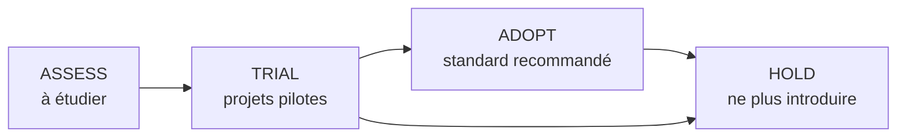

# Fiche capacité : `radar-standards`

| Élément | Valeur |
|---|---|
| Préfixe d'exigences | `RAD` |
| Spec de référence | [`/openspec/specs/radar-standards/spec.md`](/openspec/specs/radar-standards/spec.md) |
| Changements archivés | [`2026-11-16-construire-radar-et-standards`](/openspec/changes/archive/2026-11-16-construire-radar-et-standards/proposal.md) |
| Changement en cours | [`2026-11-25-isoler-erreurs-aux-frontieres`](/openspec/changes/archive/2026-11-25-isoler-erreurs-aux-frontieres/proposal.md) (RAD-07, archivé) ; [`rendre-ingestion-asynchrone`](/openspec/changes/rendre-ingestion-asynchrone/proposal.md) (RAD-07 modifiée) — proposé, implémenté ; [`alimenter-inventaire-et-completer-ihm`](/openspec/changes/alimenter-inventaire-et-completer-ihm/proposal.md) (RAD-08, RAD-09) — implémenté, non archivé |
| Statut de la capacité | livrée ; implémentation et tests dans `argos-server` et `argos-ui` |
| Composants (arc42 §5) | `catalog`, `release-radar`, `impact-engine`, `alerting`, `ai-gateway`, IHM `argos-ui` |

## Objectif

[PROPOSITION — `construire-radar-et-standards`] Être la source de vérité d'un espace sur « ce que nous utilisons et comment », et voir venir les sorties et fins de support.

## Acteurs

| Acteur | Interaction | Statut |
|---|---|---|
| Administrateur d'espace | modifie le référentiel de son espace, décide des suggestions de l'IA, règle les jours de rappel | [PROPOSITION] — ACC-03 |
| Utilisateur (membre de l'espace) | consulte référentiel, radar et dette de version ; reçoit rappels et annonces | [PROPOSITION] — PRF-03 |
| IA (passerelle `ai-gateway`) | suggère, après la synchronisation des cycles de vie, de passer à `HOLD` une version recommandée arrivée en fin de support, sans effet tant qu'un administrateur ne l'accepte pas | [PROPOSITION] — RAD-02, RAD-08 |
| endoflife.date | fournit sorties, correctifs et fins de support (API publique et gratuite, seule source : Q-2) | [DÉCISION] — Q-2 |

## Périmètre et exclusions

Inclus :

- référentiel par espace et son historique, suggestions de l'IA en attente, annonces de changement de standard ;
- radar par horizon (30 jours, 6 mois, 1 an), rappels J-30, J-7 et J0 paramétrables par espace, dette de version ;
- production planifiée des suggestions de l'IA sur les versions recommandées arrivées en fin de support (RAD-08) ;
- vue radar de l'espace dans `argos-ui`, web et desktop (RAD-09).

Exclus :

- toute source de calendrier autre qu'endoflife.date (Q-2) ;
- un référentiel modèle publié par Argos : chaque espace construit le sien (Q-3) ;
- la saisie manuelle d'une échéance absente du calendrier public (risque de la conception, non traité) ;
- la modification du référentiel et des jours de rappel depuis l'IHM : la vue radar ne propose que la décision sur une suggestion ; le reste passe par l'API REST.

## Préconditions et déclencheurs

- Inventaires des projets disponibles (`inventaire-sbom`) : la dette de version et les rappels ne portent que sur les versions présentes dans un inventaire.
- Une technologie n'entre dans le radar que si son entrée du référentiel la relie à un produit endoflife.date (champ `produitCycleVie`, par exemple `postgresql`).
- Tâche quotidienne `argos-radar-quotidien` (`argos.radar.tache.cron`, 06:00 par défaut, fuseau `argos.alerting.fuseau`, le même que celui des horizons du radar REST) : synchronisation du calendrier, dettes de version, suggestions de l'IA (RAD-08), rappels. Une erreur sur un produit ou un espace est journalisée avec sa cause sans interrompre les autres, et une actualisation en échec n'empêche pas les rappels ; une erreur imprévue est relancée une fois les produits et espaces traités : l'exécution se termine en échec visible (arc42 §8.5).

## Entrées, sorties et validations

| Entrée / sortie | Contenu | Validation ou contrainte | Statut |
|---|---|---|---|
| Entrée du référentiel | clé (PURL sans version), libellé, statut, version recommandée, responsable, justification, date de revue, produit endoflife.date | statut parmi `ADOPT`, `TRIAL`, `ASSESS`, `HOLD` ; version obligatoire pour `ADOPT` ; responsable, justification et date de revue (`AAAA-MM-JJ`) obligatoires ; clé sans version ; produit `^[a-z0-9][a-z0-9._+-]{0,99}$` ; refus `400` qui nomme le champ (`attribut`) | [PROPOSITION] — RAD-01 |
| Suggestion de l'IA | clé, statut proposé, version, justification | enregistrée `EN_ATTENTE` ; acceptée ou rejetée par un administrateur ; au plus une suggestion en attente par espace et clé (`ReferentielEspace.suggerer` n'insère pas de doublon) | [PROPOSITION] — RAD-02, RAD-08 |
| Demande de suggestion à l'IA | prompt `suggestion-standard` : libellé de la technologie, version recommandée, date de fin de support, source (données publiques) | sortie validée par schéma : `avis` (1 = suggérer `HOLD`, 2 = ne rien suggérer), `justification` de 600 caractères au plus | [PROPOSITION] — RAD-08 |
| Échéance | clé, version ou branche, nature (`SORTIE`, `CORRECTIF`, `FIN_DE_SUPPORT`), date, source `endoflife.date` | source citée ; horizon `30j`, `6m` ou `1a` | [PROPOSITION] — RAD-03 |
| Jours de rappel | liste de jours avant l'échéance | 1 à 10 valeurs distinctes entre 0 et 365 ; `[30, 7, 0]` par défaut | [DÉCISION] — Q-1 |
| Dette de version | projet, composant, version, branche, date de fin de support, version standard de l'espace | une par projet et composant | [PROPOSITION] — RAD-05 |

API REST : `/api/v1/radar/espaces/{espaceId}/` — `standards` (GET, PUT), `standards/historique`, `suggestions`, `suggestions/{id}/decision`, `echeances`, `dettes`, `parametres` (GET, PUT). Outils MCP : `get_technology_standard`, `upcoming_releases`, `check_dependency` (fin de support). Vue radar de l'IHM : adresse `/#/espaces/{espaceId}/radar` (`RadarView`, module `argos-ui/src/api/radar.ts`), cible des liens des rappels du radar (ALR-09).

## Règles métier

| Règle | Exigence(s) | Source | Statut |
|---|---|---|---|
| Entrée du référentiel complète et historisée | RAD-01 | dossier v2.4 §8.3 | [PROPOSITION] |
| Modification réservée aux administrateurs de l'espace ; suggestion de l'IA en attente, sans effet direct | RAD-02 | dossier v2.4 §8.3 ; ADR-0013 | [PROPOSITION] |
| Radar par horizon des technologies de l'espace reliées au calendrier | RAD-03 | baseline v2.3 §4 | [PROPOSITION] |
| Rappel d'une sortie ou d'une fin de support aux membres de l'espace dont un projet est concerné, aux jours de rappel de l'espace ; une fin de support ne concerne que les projets dont la version appartient à la branche | RAD-04 | dossier v2.4 §6.4 ; Q-1 | [PROPOSITION] |
| Dette de version quand la fin de support d'une version de l'inventaire est atteinte, avec la version recommandée de l'espace | RAD-05 | dossier v2.4 §6.4 ; ADR-0013 | [PROPOSITION] |
| Annonce d'un changement de statut ou de version recommandée, avec sa justification, aux membres de l'espace dont un projet utilise la technologie ; une création n'est pas annoncée | RAD-06 | dossier v2.4 §8.2 (type STANDARD) | [PROPOSITION] |
| Après chaque synchronisation des cycles de vie, la passerelle IA est consultée pour chaque technologie dont la version recommandée a atteint sa fin de support et n'est pas déjà `HOLD` ; une suggestion `HOLD` est enregistrée en attente si l'IA la recommande, sans modifier le référentiel, et jamais en double tant qu'une autre attend ; passerelle indisponible ou sortie refusée : rien n'est enregistré, l'absence est journalisée, les autres espaces sont traités ; version encore supportée : aucune demande à l'IA | RAD-08 | AUD-QUA-17 ; RAD-02-S2 ; ADR-0029 ; décision du porteur du projet, 2026-11-26 | [PROPOSITION] — [`alimenter-inventaire-et-completer-ihm`](/openspec/changes/alimenter-inventaire-et-completer-ihm/proposal.md) ; vérifiée par `SuggestionsRadarTest` |
| Vue radar de l'espace pour tout membre : échéances par horizon, dettes de version, référentiel et suggestions en attente ; la décision sur une suggestion n'est proposée qu'à l'administrateur de l'espace | RAD-09 | AUD-QUA-17 ; AUD-ARC-22 ; RAD-02, RAD-03 ; ADR-0016 (Accepté) | [PROPOSITION] — `alimenter-inventaire-et-completer-ihm` ; vérifiée par `argos-ui/tests/vues/radar.spec.ts` |
| Une clé mal encodée (`pkg:maven/%zz/x`) est refusée en 400 sur le champ `cle`, sans rien modifier ; la modification enregistrée est confirmée sans attendre son annonce, qui s'exécute hors de la requête ; un échec de l'annonce (panne d'accès aux données ou erreur imprévue) ne change pas la réponse, est journalisé avec sa cause et, s'il est imprévu, compté (`argos_evenements_asynchrones_echecs_total`) | RAD-07 | AUD-QUA-20 ; AUD-ARC-09 ; arc42 §8.5 ; ADR-0039 (Proposé) ; décision du porteur du projet, 2026-11-26 | [PROPOSITION] — `isoler-erreurs-aux-frontieres`, `rendre-ingestion-asynchrone` ; vérifiée par `RadarStandardsTest` |

Une version appartient à la branche la plus longue dont elle est égale ou qu'elle prolonge par « . » ou « - » (`14.10` → branche `14`).

## Droits d'accès et restrictions

- Consultation par les membres de l'espace ; modification, décision sur une suggestion et jours de rappel par ses administrateurs. Non-membre : `404` ; rôle insuffisant : `403` ; chaque refus est journalisé (`refus_acces`).
- Garde-fou en base (migration `V12`, ADR-0016) : sous `argos_app`, lecture par les membres (`argos_espace_lisible`) et écriture par les administrateurs de l'espace courant (`argos_administre`). Une suggestion n'est créée que par un traitement technique (`impact.SuggestionsRadar`, appelé par la tâche quotidienne du radar).
- Vue radar : la commande de décision n'apparaît que pour le rôle `ADMINISTRATEUR` lu par `GET /api/v1/espaces/{id}` ; le serveur reste seul juge du droit (RAD-02).
- Une correspondance technologie → produit endoflife.date ne sert qu'aux espaces qui l'ont saisie : le calendrier d'un utilisateur MCP ne lit que les correspondances de ses espaces.

## Effets de bord observables

- Messages `RAPPEL` et `ANNONCE` dans la table `alerte` (un par membre, canal `EMAIL` si le compte a une adresse, sinon `DESKTOP`), consultables par `/api/v1/alertes` et diffusés par `EnvoiAlertes` ; clé d'idempotence `cle_radar` (rappel : échéance et jour de rappel ; annonce : entrée d'historique du changement ; au-delà de 600 caractères, début de la clé et empreinte SHA-256).
- Impacts `dette_version` ; copie locale du calendrier (`cycle_vie`) et fraîcheur de chaque produit (`cycle_vie_produit` : `A_JOUR` ou `EN_ERREUR` avec le motif).

## Sécurité

- Adresse d'endoflife.date fixée par la configuration (`argos.radar.endoflife.url`), identifiant de produit contrôlé puis encodé, aucune redirection suivie, délai (`PT10S`) et taille de réponse (1 Mio) bornés ; réponse traitée comme une donnée non fiable (cycle mal formé ignoré, textes tronqués).
- Saisies contrôlées (longueurs, caractères de contrôle refusés), requêtes SQL paramétrées.
- Suggestions de l'IA : seules des données publiques sont envoyées à la passerelle (libellé de la technologie, version, date de fin de support, source) ; la sortie passe par la validation de la passerelle (ADR-0029) et n'écrit jamais dans le référentiel.

## Qualités mesurables

[QUESTION] Aucune cible chiffrée dans les sources.

## Diagrammes

### DF-RAD-1 — Statuts du référentiel

- **Question** : que signifie chaque statut d'une technologie ?
- **Type** : organigramme
- **Portée** : cible proposée
- **Exigences** : RAD-01, RAD-02

Les statuts suivent le principe d'un radar technologique ; chaque changement est justifié, historisé et annoncé aux projets concernés.

## Critères d'acceptation

Scénarios RAD-01-S1 à RAD-06-S1 du changement archivé ; RAD-07-S1 à RAD-07-S3 du changement `isoler-erreurs-aux-frontieres`, RAD-07 modifiée (S3, S4) par `rendre-ingestion-asynchrone` ; RAD-08-S1 à RAD-08-S4, RAD-09-S1 et RAD-09-S2 du changement [`alimenter-inventaire-et-completer-ihm`](/openspec/changes/alimenter-inventaire-et-completer-ihm/specs/radar-standards/spec.md) ; aucun scénario qualité transverse supplémentaire.

## Interprétations introduites par un changement

- [PROPOSITION] « Utilisateurs des projets concernés » (RAD-04, RAD-06) : membres de l'espace du projet, quel que soit leur rôle ; rappels et annonces ne dépendent pas des abonnements.
- [PROPOSITION] Canal des rappels et annonces : `EMAIL` si le compte a une adresse, sinon `DESKTOP`.
- [PROPOSITION] La correspondance avec endoflife.date est saisie par l'administrateur dans l'entrée du référentiel (`produitCycleVie`).
- [PROPOSITION] La suggestion de l'IA est enregistrée par un point d'entrée Java (`ReferentielEspace.suggerer`), appelé par le producteur planifié `impact.SuggestionsRadar` après la synchronisation des cycles de vie (RAD-08, décision D4 du changement `alimenter-inventaire-et-completer-ihm`) ; aucune route REST ni aucun outil MCP ne la crée.
- [PROPOSITION] Une version recommandée déjà au statut `HOLD` n'est pas soumise à l'IA.
- [PROPOSITION] La tâche quotidienne est portée par `alerting` (`RappelsRadar`), qui actualise d'abord le radar (`impact.RadarProjets`) : les règles de dépendance des modules (arc42 §5.6) ne permettent pas à `release-radar` d'appeler `inventory` ou `alerting`.

## Écarts constatés

- Les statuts du référentiel et les rappels ne figurent que dans le dossier de proposition v2.4, hors dépôt ; ils sont reportés en arc42 §8.15.
- La vue radar d'`argos-ui` ne modifie ni le référentiel ni les jours de rappel ; la tâche 4.2 du changement archivé reste vérifiée par un parcours de bout en bout au niveau de l'API (`ParcoursRadarTest`).
- La durée de la tâche quotidienne du radar dépend des appels à la passerelle IA (un par technologie en fin de support sans suggestion en attente), bornés par les quotas et le délai de la passerelle (IAG-03).
- Une suggestion rejetée par un administrateur peut être proposée de nouveau au passage suivant si la version recommandée reste en fin de support : seul l'état `EN_ATTENTE` empêche une nouvelle demande.
- Un rappel n'est calculé que pour le jour exact (aujourd'hui + N) : un jour où la tâche ne s'exécute pas, ses rappels ne sont pas rattrapés le lendemain.
- L'annonce d'un changement de standard est diffusée dans le fil de la requête `PUT` qui l'a provoqué, après validation de la transaction : la durée de la requête dépend du serveur SMTP et du nombre de membres.
- La lecture du corps d'une réponse endoflife.date est bornée en taille, pas en durée.

## Questions ouvertes

| ID | Question | Impact | Destinataire |
|---|---|---|---|
| Q-1 | Les rappels J-30, J-7, J0 sont-ils fixes ou paramétrables par espace ? | répondue le 2026-11-16 : paramétrables par espace, J-30, J-7 et J0 par défaut [DÉCISION] | Product Owner |
| Q-2 | Quelles sources de calendrier en plus d'endoflife.date ? | répondue le 2026-11-16 : endoflife.date seulement (API publique gratuite) ; d'autres sources plus tard [DÉCISION] | porteur du projet |
| Q-3 | Un espace peut-il partir d'un référentiel modèle publié par Argos ? | répondue le 2026-11-16 : non pour l'instant : chaque espace construit son référentiel [DÉCISION] | Product Owner |

## Traçabilité

| Exigence | Scénarios | Conception / diagramme | Tâche | Test ou preuve |
|---|---|---|---|---|
| RAD-01 | RAD-01-S1, RAD-01-S2 | Composants | 1.1 | `RadarStandardsTest.rad01S1StandardComplet`, `rad01S2JustificationManquante` |
| RAD-02 | RAD-02-S1, RAD-02-S2 | Composants | 1.2 | `RadarStandardsTest.rad02S1Lecteur`, `rlsDuReferentiel`, `rad02S2SuggestionDeLIa` |
| RAD-03 | RAD-03-S1 | DC-1 | 2.1 | `RadarStandardsTest.rad03S1Horizon30Jours`, `contratConnecteurEndoflife` |
| RAD-04 | RAD-04-S1 | DC-1 | 2.2 | `RadarStandardsTest.rad04S1RappelAJ30`, `rappelsParametrablesParEspace` |
| RAD-05 | RAD-05-S1 | DC-1 | 2.3 | `RadarStandardsTest.rad05S1VersionPlusMaintenue` |
| RAD-06 | RAD-06-S1 | Composants | 1.3 | `RadarStandardsTest.rad06S1PassageEnHold` |
| RAD-08 | RAD-08-S1 à S4 | `alimenter-inventaire-et-completer-ihm` design.md D4, DC-2 ; arc42 §6.9 | 2.1 | `impact/SuggestionsRadarTest` (`rad08S1VersionRecommandeeEnFinDeSupport` à `rad08S4VersionEncoreSupportee`, `uneVersionDejaEnHoldNEstPasSoumise`) |
| RAD-09 | RAD-09-S1, RAD-09-S2 | `alimenter-inventaire-et-completer-ihm` design.md D6 | 4.2 | `argos-ui/tests/vues/radar.spec.ts` (Vitest) |
| RAD-07 | RAD-07-S1 à S4 | `isoler-erreurs-aux-frontieres` design.md D2, D4, DC-3 ; `rendre-ingestion-asynchrone` design.md D5, DC-5 | 1.2, 3.1, 3.3 ; 5.1 | `RadarStandardsTest.rad07S1CleMalEncodee`, `rad07S2AnnonceEnPanneApresLEnregistrement`, `rad07S3AnnonceEnErreurImprevueJournaliseeEtComptee`, `rad07S4AnnonceSansAttente` ; boucles du radar : `espaceEnErreurImprevueDansLaTacheQuotidienne`, `produitEnErreurImprevueDansLaSynchronisationDesCycles` |

Tests dans `argos-server/src/test/java/io/argos/chain/` ; parcours de bout en bout : `ParcoursRadarTest`.
