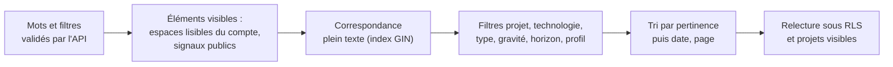

# Fiche capacité : `recherche-veille`

| Élément | Valeur |
|---|---|
| Préfixe d'exigences | `RCH` |
| Spec de référence | [`/openspec/specs/recherche-veille/spec.md`](/openspec/specs/recherche-veille/spec.md) |
| Changements archivés | [`2026-11-18-rechercher-et-filtrer`](/openspec/changes/archive/2026-11-18-rechercher-et-filtrer/proposal.md) |
| Changements en cours | [`durcir-autorisations-et-debits`](/openspec/changes/durcir-autorisations-et-debits/proposal.md) (RCH-06) |
| Statut de la capacité | livrée |
| Composants (arc42 §5) | `signal`, `impact-engine`, `API & Security`, `workspace`, `mcp-server`, IHM — couche contenu |

## Objectif

[EXISTANT — `rechercher-et-filtrer`] Retrouver vite l'information utile et rappeler ses recherches habituelles, sans jamais voir ce qui ne nous est pas destiné.

## Acteurs

| Acteur | Interaction | Statut |
|---|---|---|
| Utilisateur | recherche, filtre, enregistre des vues par l'API REST (portail et client desktop, clients de cette API) | [EXISTANT] — `RechercheVeilleTest` |
| Utilisateur du portail ou du client desktop | recherche, filtre, enregistre, rappelle et supprime des vues dans l'écran « Recherche » de `argos-ui` (routes `/recherche` et `/recherche/vues/:id`) | [EXISTANT] — `argos-ui/tests/recherche.test.mjs` ; E2E `e2e/tests/recherche.spec.ts` (portail) et `e2e/desktop/recherche.spec.ts` (vue enregistrée sur le portail, rappelée dans le client desktop) |
| Assistant IA (client MCP) | recherche des signaux de sécurité par l'outil `search_signals` | [EXISTANT] — `RechercheMcpTest` |

## Périmètre et exclusions

Inclus :

- Éléments cherchés : signaux de sécurité (données publiques) et actualités web (articles de flux, changements de pages surveillées), cloisonnées par espace et par compte.
- Recherche par l'API REST (`GET /api/v1/recherche`), vues enregistrées (`/api/v1/vues`) et outil MCP `search_signals`, qui ne restitue que les signaux de sécurité [PROPOSITION].
- Écran de recherche de `argos-ui`, commun au portail et au client desktop : mots, période (dont « 30 derniers jours »), gravité minimale, technologies, type de contenu, projet, résultats paginés avec liens sources, vues enregistrées. L'écran exige une session ouverte (garde des vues) et appelle l'API avec le jeton porteur de l'utilisateur ; une recherche dispose d'un délai de 20 s et un nouveau chargement annule le précédent.

Exclus :

- La recherche sémantique et les embeddings (ADR-0015 : différés).
- La connexion OIDC de l'IHM (obtention et envoi du jeton), qui relève d'un autre changement.
- Le partage d'une vue entre utilisateurs.

## Préconditions et déclencheurs

Utilisateur authentifié par un jeton OIDC valide ; la recherche est déclenchée à chaque appel, sans index externe à synchroniser.

## Entrées, sorties et validations

| Entrée / sortie | Contenu | Validation ou contrainte | Statut |
|---|---|---|---|
| Recherche | `q` (mots, syntaxe web : mots, "expression", `or`, `-exclusion`), `projet`, `technologie`, `type`, `gravite`, `horizon`, `profil` (répétables sauf `q`, `gravite`, `horizon`), `page`, `taille` | `q` ≤ 500 caractères ; 20 valeurs par filtre ; `type` ∈ {`AVIS_SECURITE`, `ARTICLE`, `CHANGEMENT_PAGE`} ; `gravite` ∈ {`LOW`, `MODERATE`, `MEDIUM`, `HIGH`, `CRITICAL`} ; `horizon` de 1 à 3 650 jours ; `profil` publié au catalogue ; `projet` d'un espace de l'appelant ; `taille` de 1 à 100. Erreur 400 `CRITERE_INVALIDE` avec l'attribut en cause | [EXISTANT] — `RechercheVeilleTest.entreesNonFiables` |
| Résultats | page : éléments (type, identifiant, source, identifiant externe, titre, extrait de 300 caractères, gravité, date, lien, pertinence, projets visibles), `page`, `taille`, `total`, `message` | titre, extrait et lien sont des données externes à rendre comme texte ; seuls les liens `http` et `https` sont restitués | [EXISTANT] — `RechercheVeilleTest` |
| Vue enregistrée | `nom` (1 à 120 caractères, unique par utilisateur), `criteres` (mêmes mots et filtres que la recherche) | 100 vues par utilisateur (`argos.recherche.vues-max`) ; 409 `VUE_EXISTANTE` ou `LIMITE_VUES` | [EXISTANT] — `RechercheVeilleTest.rch04S1VueRappelee` |
| `search_signals` (MCP) | `query`, `technologies`, `packages`, `sources`, `project_ids`, `severity`, `horizon_days`, `limit` | au moins un mot ou un filtre ; `PARAMETRES_INVALIDES` sinon ; titre et résumé en `TexteExterne` | [EXISTANT] — `RechercheMcpTest`, `OutilsConsultationMcpTest` |

## Règles métier

| Règle | Exigence(s) | Source | Statut |
|---|---|---|---|
| Recherche plein texte PostgreSQL dans le titre, le résumé ou le contenu, analysée par les configurations `french`, `english` et `simple` (identifiants d'avis, noms de projets) ; tri par pertinence (`ts_rank`), puis du plus récent au plus ancien ; liste vide accompagnée du message « Aucun élément ne correspond à votre recherche. » | RCH-01 | ADR-0015 (Proposé) ; Q-1 | [EXISTANT] — `RechercheVeilleTest.rch01S1MotTrouve`, `rch01RechercheBilingue`, `rch01S2AucunResultat` |
| Filtres combinés par ET, valeurs d'un même filtre par OU : projet (impact ou rapprochement visible), technologie (mot du texte, écosystème ou paquet affecté, technologie rapprochée), type, gravité minimale (exclut les éléments sans gravité), horizon (éléments des N derniers jours), profil (types relevant des catégories de sources du profil) | RCH-02 | maquette « Fil de veille » ; PRF-02 | [EXISTANT] — `RechercheVeilleTest.rch02S1FiltresCombines` |
| Un élément, un impact, un rapprochement ou un nom de projet d'un espace dont l'utilisateur n'est pas membre n'est jamais renvoyé ni ne fait correspondre un élément ; un projet d'un autre espace en filtre est refusé (404) et le refus journalisé | RCH-03 | ACC-04 ; risque R-17 | [EXISTANT] — `RechercheVeilleTest.rch03S1MotPresentDansUnAutreEspace`, `rch03CloisonnementSousArgosApp`, `RechercheMcpTest` |
| Les projets filtrés sont contrôlés avant la lecture de `page` et `taille` : un projet inconnu et un projet d'un autre espace reçoivent la même réponse 404 (« Ressource introuvable. »), même avec un paramètre de pagination non entier ou hors bornes ; seul le second refus est journalisé | RCH-03 | [DÉCISION — porteur du projet, 2026-11-19 ; H5] (formaliser-chaine-securite-poc, design.md D7, révision H) | [EXISTANT] — `ParametresPaginationTest.rechercheControleLesProjetsAvantLaPagination` |
| Une vue n'est lue, rappelée et supprimée que par son auteur ; la vue d'un autre utilisateur est refusée (404) et le refus journalisé, avec la même réponse qu'une vue inexistante (« Ressource introuvable. ») ; une vue rappelée est rejouée sous les droits courants | RCH-04 | maquette « Mes vues » ; arc42 §8.2 | [EXISTANT] — `RechercheVeilleTest.rch04S1VueRappelee`, `rch04S2VueDUnAutreUtilisateur` |
| Latence API p95 sous la cible Q-05 (500 ms) pour une campagne de recherches filtrées sur le volume Q-2 | RCH-05 | arc42 §10.2 Q-05 ; QS-13 ; Q-2 | [EXISTANT] — mesure du 2026-11-16 : p95 = 250 ms ([rapport QS-13](../architecture/quality/mesure-qs13-recherche.md)) |
| Un profil ne retient que les types d'éléments de ses catégories de sources : `avis-securite` pour les signaux ; les actualités web ne relèvent d'aucune catégorie publiée | RCH-02 | manifestes du catalogue | [PROPOSITION] |
| L'horizon porte sur la date de l'élément (publication, sinon modification ou réception) : éléments des N derniers jours | RCH-02 | maquette « Fil de veille » | [PROPOSITION] |
| Limite de débit par compte de 60 requêtes par minute (`argos.recherche.debit.requetes-par-minute`), commune à `GET /api/v1/recherche` et à `GET /api/v1/vues/{id}/resultats` ; au-delà, 429 avec `Retry-After`, refus journalisé `LIMITE_DEBIT`, aucune recherche exécutée | RCH-06 | AUD-SEC-09 ; décision du porteur, 2026-11-24 | [PROPOSITION] — `durcir-autorisations-et-debits` |

## Droits d'accès et restrictions

- Sélection : la fonction `argos_rechercher_veille` (migration V11), exécutée par le rôle `argos_app` avec le compte courant, applique explicitement les règles de visibilité des politiques RLS (espaces lisibles, actualité de son périmètre citée par une source visible, impacts et rapprochements d'un espace lisible) ; sans compte courant, elle ne renvoie rien.
- Restitution : chaque élément de la page est relu sous la RLS d'`argos_app` ; les projets cités sont limités, en plus, aux espaces de l'appelant.
- Les mots saisis ne sont que des paramètres liés : aucune saisie n'est concaténée au SQL.

## Effets de bord observables

Vues enregistrées (table `workspace_vue`) ; refus d'accès journalisés (`refus_acces`) ; appels MCP journalisés (`mcp_appel`). Aucune autre donnée modifiée.

## Qualités mesurables

| Qualité | Mesure | Statut |
|---|---|---|
| Latence API p95 d'une campagne de 11 recherches filtrées, 120 000 éléments visibles (100 000 actualités de l'espace et 20 000 signaux publics), 100 000 actualités d'un autre espace écartées | 250 ms (cible Q-05 : 500 ms) | [EXISTANT] — `MesurePerformanceRechercheTest`, [rapport QS-13](../architecture/quality/mesure-qs13-recherche.md) |
| Mot présent dans tous les éléments (120 000 résultats classés) | p95 ≈ 3,7 s, hors cible | [EXISTANT] — limite connue, risque R-16 |

## Diagrammes

### DF-RCH-1 — Une recherche filtrée

- **Question** : dans quel ordre droits, mots et filtres s'appliquent-ils ?
- **Type** : organigramme
- **Portée** : implémentation de `rechercher-et-filtrer`
- **Exigences** : RCH-01, RCH-02, RCH-03

Les droits limitent d'abord l'ensemble cherché : un élément d'un autre espace n'entre jamais dans les résultats, et la relecture sous RLS écarte tout élément que la sélection aurait retenu à tort.

## Critères d'acceptation

Scénarios RCH-01-S1 à RCH-05-S1 du changement ; QS-13 (recherche).

## Interprétations introduites par un changement

- Vues strictement personnelles, sans partage (RCH-04) : à faire valider.
- `search_signals` ne restitue que les signaux de sécurité : les actualités web restent hors du serveur MCP tant que leurs champs n'ont pas été réexaminés au regard de MCP-05 [PROPOSITION].
- `search_signals` combine tous ses critères par ET et trie par pertinence, comme l'API REST : rupture du contrat MCP antérieur, qui combinait `technologies`, `packages` et `sources` par OU et triait par date de modification [PROPOSITION].

## Écarts constatés

- Aucun point d'accès ne liste les projets visibles de l'utilisateur : le filtre projet de l'écran propose les projets cités par les résultats affichés ou par une vue rappelée, et accepte l'identifiant d'un projet [PROPOSITION — D8 de `rechercher-et-filtrer`].
- La mesure QS-13 (`MesurePerformanceRechercheTest`) est lancée à la demande et non par `mvn verify` ; la cible n'est tenue que pour des recherches sélectives (un mot présent dans tous les éléments : environ 3,7 s, risque R-16).

## Questions ouvertes

| ID | Question | Impact | Destinataire |
|---|---|---|---|
| Q-1 | Faut-il une recherche bilingue français et anglais (racines des mots) ? | répondue le 2026-11-16 : oui : recherche plein texte PostgreSQL avec les configurations `french` et `english`, sans moteur externe [DÉCISION] | Product Owner |
| Q-2 | Quel volume d'éléments viser par espace pour mesurer la performance ? | répondue le 2026-11-16 : 100 000 éléments par espace pour la mesure de performance [DÉCISION] | porteur du projet |

## Traçabilité

| Exigence | Scénarios | Conception / diagramme | Tâche | Test ou preuve |
|---|---|---|---|---|
| RCH-01 | RCH-01-S1, RCH-01-S2 | Composants, DF-RCH-1, Écran de recherche | 1.1, 1.3, 5.1, 5.2 | `RechercheVeilleTest`, `RechercheMcpTest`, `argos-ui/tests/recherche.test.mjs` |
| RCH-02 | RCH-02-S1 | Composants, DF-RCH-1, Écran de recherche | 1.2, 5.2 | `RechercheVeilleTest.rch02S1FiltresCombines`, `argos-ui/tests/recherche.test.mjs` |
| RCH-03 | RCH-03-S1 | Sécurité et isolation | 1.1, 1.3 | `RechercheVeilleTest.rch03S1MotPresentDansUnAutreEspace`, `rch03CloisonnementSousArgosApp`, `RechercheMcpTest.rch03MotPresentDansUnAutreEspace` |
| RCH-04 | RCH-04-S1, RCH-04-S2 | Composants, Écran de recherche | 2.1, 5.3, 4.2 | `RechercheVeilleTest.rch04S1VueRappelee`, `rch04S2VueDUnAutreUtilisateur`, `argos-ui/tests/recherche.test.mjs`, E2E `e2e/tests/recherche.spec.ts` (portail) et `e2e/desktop/recherche.spec.ts` (vue enregistrée sur le portail, rappelée dans le client desktop) |
| RCH-05 | RCH-05-S1 | Performance | 2.2 | `MesurePerformanceRechercheTest`, [rapport QS-13](../architecture/quality/mesure-qs13-recherche.md) |
| RCH-06 | RCH-06-S1 à RCH-06-S3 | `durcir-autorisations-et-debits` D3 | 3.1, 3.3 | `LimiteDebitRechercheVeilleTest`, `LimiteRechercheTest` (horloge injectée), `LimiteurDebitTest` |
