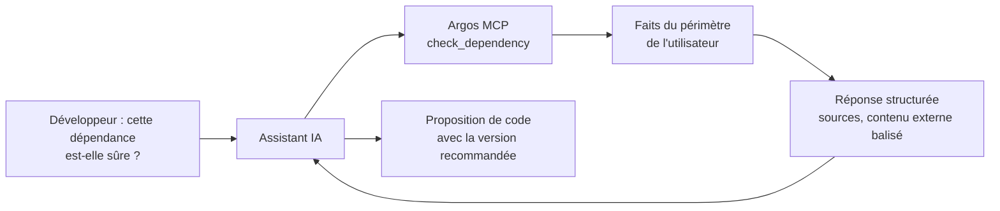

# Fiche capacité : `serveur-mcp`

| Élément | Valeur |
|---|---|
| Préfixe d'exigences | `MCP` |
| Spec de référence | `/openspec/specs/serveur-mcp/spec.md` — absente tant qu'aucun changement n'est archivé |
| Changements en cours | [`exposer-serveur-mcp`](/openspec/changes/exposer-serveur-mcp/proposal.md) (implémenté, non archivé) |
| Statut de la capacité | proposée ; implémentation et tests dans `argos-server`, changement non archivé |
| Composants (arc42 §5) | `mcp-server`, `API & Security`, `audit`, modules métier en lecture |

## Objectif

[EXISTANT — `exposer-serveur-mcp`] Donner aux assistants IA un accès en lecture aux faits d'Argos pour qu'ils vérifient avant de proposer, sans jamais rien modifier ni sortir du périmètre de l'utilisateur.

## Acteurs

| Acteur | Interaction | Statut |
|---|---|---|
| Développeur | interroge Argos depuis son assistant IA, après avoir obtenu un jeton par le flux d'appareil | [EXISTANT] — `AuthentificationMcpTest` |
| Assistant IA (client MCP) | appelle les outils pour le compte de l'utilisateur, en protocole MCP sans état | [EXISTANT] — `ContratOutilsMcpTest` |

## Périmètre et exclusions

Inclus :

- Huit outils de consultation : `search_signals`, `check_dependency`, `get_technology_standard`, `get_project_context`, `upcoming_releases`, `get_security_alerts`, `explain_change`, `get_regulatory_changes`.
- Authentification, cloisonnement, contenu externe balisé, limitation de débit et journal des appels.

Exclus :

- Tout outil d'écriture.
- Les prompts MCP partagés : ajout ultérieur.
- Les ressources MCP : le référentiel des standards se consulte par l'outil `get_technology_standard` [PROPOSITION].

## Préconditions et déclencheurs

L'utilisateur a un compte Argos et un jeton d'accès Keycloak délivré au client `argos-mcp` par le flux d'appareil OAuth 2.0 (RFC 8628) [DÉCISION — Q-3]. Argos ne stocke aucun jeton personnel : il valide le jeton porteur de chaque requête comme pour l'API REST.

## Entrées, sorties et validations

| Entrée / sortie | Contenu | Validation ou contrainte | Statut |
|---|---|---|---|
| Requête MCP | `POST /mcp`, JSON-RPC, en-têtes `MCP-Protocol-Version: 2026-07-28`, `Mcp-Method`, `Mcp-Name` et champs `_meta` du protocole sans état | jeton OIDC valide (signature, émetteur, audience `argos-server`, expiration), sinon 401 ; version de protocole 2026-07-28 seulement (`quarkus.mcp.server.supported-protocol-versions`) | [EXISTANT] — `AuthentificationMcpTest`, `ContratOutilsMcpTest` |
| Appel d'outil | nom de l'outil, paramètres | schéma d'entrée publié par l'outil ; paramètres invalides : erreur `PARAMETRES_INVALIDES` sans appel métier | [EXISTANT] — `OutilsConsultationMcpTest` |
| Réponse | `structuredContent` conforme au schéma de sortie de l'outil : faits, sources, champs `TexteExterne` | périmètre de l'utilisateur (MCP-04) | [EXISTANT] — `ContratOutilsMcpTest`, `CloisonnementMcpTest` |
| Erreur d'outil | résultat `isError` dont le texte commence par un code stable : `NON_AUTORISE`, `INTROUVABLE`, `PARAMETRES_INVALIDES`, `LIMITE_DEBIT`, `INDISPONIBLE` | aucune donnée partielle | [PROPOSITION] — codes définis par ce changement |
| Outil inconnu | erreur JSON-RPC `-32602` | aucune donnée modifiée, aucun appel journalisé | [EXISTANT] — `ContratOutilsMcpTest` |

## Règles métier

| Règle | Exigence(s) | Source | Statut |
|---|---|---|---|
| Huit outils de consultation, annotés `readOnlyHint`, aucun outil d'écriture | MCP-01 | ADR-0014 (Proposé) | [EXISTANT] — `ContratOutilsMcpTest` |
| `check_dependency` : failles qui affectent la version (même règle de plage que la corrélation, COR-01), sources, standards des espaces de l'utilisateur, version recommandée, fin de support ; composant inconnu signalé sans rien inventer | MCP-02 | ADR-0014 (Proposé) | [EXISTANT] — `OutilsConsultationMcpTest` |
| Appel sans jeton valide refusé avant l'outil (401) ; personne sans compte refusée (`NON_AUTORISE`) et journalisée | MCP-03 | ADR-0014 (Proposé) ; ACC-01 | [EXISTANT] — `AuthentificationMcpTest` |
| Ressource d'un autre espace : `INTROUVABLE`, rien sur la ressource, refus journalisé ; requêtes sous RLS du rôle `argos_app` | MCP-04 | ACC-04 ; ADR-0016 | [EXISTANT] — `CloisonnementMcpTest` |
| Texte d'une source externe renvoyé dans un champ `TexteExterne` (nature `CONTENU_EXTERNE_NON_FIABLE`, source, texte, troncature, longueur d'origine), tronqué à 2 000 caractères | MCP-05 | risque R-11 ; Q-2 | [EXISTANT] — `ContenuExterneMcpTest` |
| 60 appels par minute et par utilisateur sur fenêtre glissante ; refus `LIMITE_DEBIT` journalisé ; chaque appel journalisé (compte, outil, paramètres, durée, issue) | MCP-06 | ADR-0014 (Proposé) ; Q-1 | [EXISTANT] — `LimiteDebitMcpTest` |
| `get_regulatory_changes` ne renvoie que les fiches validées par un expert et rappelle les garde-fous du profil `expert-metier` | MCP-07 | PRF-06 ; ADR-0018 (Proposé) | [EXISTANT] — `ReglementaireMcpTest` |

## Droits d'accès et restrictions

Identiques au portail : l'appelant et ses espaces sont établis par le même `CallerResolver` que l'API REST, à chaque requête (une révocation s'applique dès l'appel suivant). Les lectures d'espace s'exécutent sous le rôle `argos_app` avec la RLS en garde-fou (ADR-0016). Les standards et les fiches renvoyés sont filtrés sur les espaces dont l'utilisateur est membre, en plus du filtre du point d'extension.

## Effets de bord observables

- Une ligne par appel d'outil dans la table `mcp_appel` (migration V9, module `audit`) : compte ou sujet OIDC, outil, paramètres sérialisés et bornés à 2 000 caractères, durée, issue (`SUCCES`, `PARAMETRES_INVALIDES`, `INTROUVABLE`, `REFUS_ACCES`, `REFUS_LIMITE`, `ERREUR`). Le résultat renvoyé n'y est jamais recopié. Le rôle `argos_app` n'a aucun droit sur cette table.
- Les refus d'accès, de limite et d'inscription sont aussi inscrits au journal unique des refus `refus_acces` avec la ressource `MCP tools/call <outil>`, sans paramètre (ACC-06).
- Aucune donnée métier n'est modifiée.

## Qualités mesurables

| Qualité | Valeur | Statut |
|---|---|---|
| Limite de débit | 60 requêtes par minute et par utilisateur, `argos.mcp.debit.requetes-par-minute` | [DÉCISION — Q-1] |
| Longueur maximale d'un texte externe | 2 000 caractères (points de code), `argos.mcp.contenu-externe.longueur-max` | [DÉCISION — Q-2] |
| Temps de réponse | cible arc42 §8 « API/MCP p95 < 500 ms hors appels externes/IA » ; non mesurée | [QUESTION] |

## Diagrammes

### DF-MCP-1 — Une question posée à l'assistant

- **Question** : comment une question du développeur devient-elle une réponse sourcée ?
- **Type** : organigramme
- **Portée** : implémenté
- **Exigences** : MCP-02, MCP-04, MCP-05

L'assistant s'appuie sur des faits d'Argos plutôt que sur ses connaissances datées ; Argos ne renvoie que ce que l'utilisateur peut voir. La chaîne d'un appel (authentification, limite, lecture, balisage, journal) est le diagramme DC-1 du [`design.md` du changement](/openspec/changes/exposer-serveur-mcp/design.md#dc-1--appel-dun-outil-mcp).

## Critères d'acceptation

Scénarios MCP-01-S1 à MCP-07-S1 du changement, couverts par les tests de `argos-server/src/test/java/io/argos/mcp/` ; QS-12 (sécurité) pour l'injection et le cloisonnement.

## Interprétations introduites par un changement

- [PROPOSITION] Le référentiel des standards, le calendrier des sorties et les fiches réglementaires sont lus par trois points d'extension en lecture : `io.argos.catalog.standard.ReferentielStandards`, `io.argos.releaseradar.CalendrierSorties`, `io.argos.regintel.FichesReglementaires`. Le référentiel et le calendrier sont implémentés par `construire-radar-et-standards` (`ReferentielStandardsEnBase`, `CalendrierEndoflife`, restreints aux espaces de l'appelant) ; les fiches réglementaires par `suivre-veille-reglementaire` (`FichesEnBase`, lecture sous la RLS avec le compte de l'appelant). Les tests de MCP-02-S1 et de MCP-07-S1 utilisent ces implémentations réelles.
- [PROPOSITION] Champs externes balisés : titre et résumé des signaux, notes du calendrier des sorties, titre officiel des textes réglementaires. Les identifiants (identifiant d'avis, alias, PURL, sévérité déclarée) ne sont pas balisés mais restent dans leurs champs propres : aucun texte d'une source n'entre dans un champ rédigé par Argos, comme l'explication d'`explain_change`. Le test MCP-05 couvre `search_signals` ; les identifiants libres d'une future source (veille web) devront être réexaminés.
- [PROPOSITION] `explain_change` explique l'évolution d'un signal : versions successives de l'avis, dates, impacts dans le périmètre de l'utilisateur ; explication produite par Argos, sans IA et sans texte de la source.
- [PROPOSITION] Seule la version de protocole 2026-07-28 (sans état) est admise : un client limité aux versions avec session est refusé. Paramétrable par `quarkus.mcp.server.supported-protocol-versions`.
- [PROPOSITION] Le compteur de débit est tenu en mémoire de l'instance unique (ADR-0017, ADR-0026).
- [PROPOSITION] Le module `mcp` dépend de `api.security` (établissement de l'appelant) et de lui seul dans `api` (`ModuleBoundariesTest.mcpNeLitQueLaSecuriteDeLApi`).

## Écarts constatés

- La liste complète des huit outils figure dans le dossier de proposition v2.4 (§8.7, hors dépôt) ; baseline v2.3 n'en cite que deux.
- La durée de conservation du journal `mcp_appel` n'est fixée par aucune source.

## Questions ouvertes

| ID | Question | Impact | Destinataire |
|---|---|---|---|
| Q-1 | Quelle limite de débit par utilisateur ? | répondue le 2026-11-16 : 60 requêtes par minute et par utilisateur, paramétrable [DÉCISION] | porteur du projet |
| Q-2 | Quelle longueur maximale pour un texte externe renvoyé ? | répondue le 2026-11-16 : 2 000 caractères, paramétrable [DÉCISION] | architecte |
| Q-3 | Comment un IDE obtient-il son jeton (flux d'appareil OAuth, jeton personnel) ? | répondue le 2026-11-16 : flux d'appareil OAuth 2.0 (RFC 8628) de Keycloak ; Argos ne stocke aucun jeton personnel [DÉCISION] | architecte / sécurité |

## Traçabilité

| Exigence | Scénarios | Conception / diagramme | Tâche | Test ou preuve |
|---|---|---|---|---|
| MCP-01 | MCP-01-S1, MCP-01-S2 | D1 | 2.1, 3.2, 3.4 | `ContratOutilsMcpTest` |
| MCP-02 | MCP-02-S1, MCP-02-S2 | DC-1 | 3.1 | `OutilsConsultationMcpTest` |
| MCP-03 | MCP-03-S1 | DC-1 | 1.1, 2.2 | `AuthentificationMcpTest` (dont `jetonDuFluxAppareilAccepteSurMcp`) |
| MCP-04 | MCP-04-S1 | DC-1 | 2.2, 3.2 | `CloisonnementMcpTest` |
| MCP-05 | MCP-05-S1 | DC-1 | 2.3 | `ContenuExterneMcpTest` |
| MCP-06 | MCP-06-S1 | DC-1 | 2.4 | `LimiteDebitMcpTest` |
| MCP-07 | MCP-07-S1 | DC-1 | 3.3 | `ReglementaireMcpTest` |

Tests dans [`argos-server/src/test/java/io/argos/mcp/`](/argos-server/src/test/java/io/argos/mcp/). Configuration d'un assistant : [guide de déploiement](../deploiement/synology-et-pc.md#connecter-un-assistant-ia-mcp).
