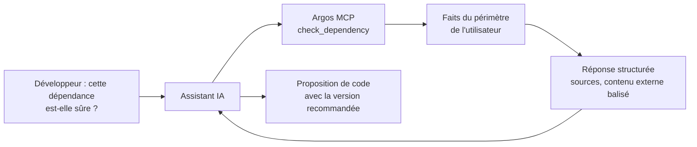

# Fiche capacité : `serveur-mcp`

| Élément | Valeur |
|---|---|
| Préfixe d'exigences | `MCP` |
| Spec de référence | `/openspec/specs/serveur-mcp/spec.md` — absente tant qu'aucun changement n'est archivé |
| Changements en cours | [`exposer-serveur-mcp`](/openspec/changes/exposer-serveur-mcp/proposal.md) (proposé) |
| Statut de la capacité | proposée |
| Composants (arc42 §5) | `mcp-server`, `API & Security`, modules métier en lecture |

## Objectif

[PROPOSITION — `exposer-serveur-mcp`] Donner aux assistants IA un accès en lecture aux faits d'Argos pour qu'ils vérifient avant de proposer, sans jamais rien modifier ni sortir du périmètre de l'utilisateur.

## Acteurs

| Acteur | Interaction | Statut |
|---|---|---|
| Développeur | interroge Argos depuis son assistant IA | [PROPOSITION] — ADR-0014 (Proposé) |
| Assistant IA (client MCP) | appelle les outils pour le compte de l'utilisateur | [PROPOSITION] — ADR-0014 (Proposé) |

## Périmètre et exclusions

Inclus :

- Outils, ressources en lecture (référentiel des standards) et contrôle d'accès.

Exclus :

- Tout outil d'écriture.
- Les prompts MCP partagés : ajout ultérieur.

## Préconditions et déclencheurs

Utilisateur authentifié et jeton délivré à son assistant (Q-3).

## Entrées, sorties et validations

| Entrée / sortie | Contenu | Validation ou contrainte | Statut |
|---|---|---|---|
| Appel d'outil | nom de l'outil, paramètres | schéma de l'outil | [PROPOSITION] |
| Réponse | faits structurés, sources, contenu externe balisé | périmètre de l'utilisateur (MCP-04) | [PROPOSITION] |

## Règles métier

| Règle | Exigence(s) | Source | Statut |
|---|---|---|---|
| Outils en lecture seule | MCP-01 | ADR-0014 (Proposé) | [PROPOSITION] |
| Vérification d'une dépendance | MCP-02 | ADR-0014 (Proposé)  | [PROPOSITION] |
| Authentification des appels | MCP-03 | ADR-0014 (Proposé)  | [PROPOSITION] |
| Aucune fuite de périmètre | MCP-04 | ACC-04  | [PROPOSITION] |
| Contenu externe balisé | MCP-05 | risque R-11  | [PROPOSITION] |
| Limitation de débit et journal | MCP-06 | ADR-0014 (Proposé)  | [PROPOSITION] |
| Garde-fous des profils | MCP-07 | PRF-06  | [PROPOSITION] |

## Droits d'accès et restrictions

Identiques au portail : rôles et espaces de l'utilisateur (ACC-04) ; garde-fous des profils (PRF-06).

## Effets de bord observables

Journal des appels ; aucune modification de donnée.

## Qualités mesurables

[QUESTION] Aucune cible chiffrée dans les sources ; voir les questions ouvertes.

## Diagrammes

### DF-MCP-1 — Une question posée à l'assistant

- **Question** : comment une question du développeur devient-elle une réponse sourcée ?
- **Type** : organigramme
- **Portée** : cible proposée
- **Exigences** : MCP-02, MCP-04, MCP-05

L'assistant s'appuie sur des faits d'Argos plutôt que sur ses connaissances datées ; Argos ne renvoie que ce que l'utilisateur peut voir.

## Critères d'acceptation

Scénarios MCP-01-S1 à MCP-07-S1 du changement ; QS-12 (sécurité) pour l'injection et le cloisonnement.

## Interprétations introduites par un changement

- Troncature du contenu externe (MCP-05) : longueur à fixer (Q-2).

## Écarts constatés

- La liste complète des huit outils figure dans le dossier de proposition v2.4 (§8.7, hors dépôt) ; baseline v2.3 n'en cite que deux.

## Questions ouvertes

| ID | Question | Impact | Destinataire |
|---|---|---|---|
| Q-1 | Quelle limite de débit par utilisateur ? | non : paramétrable | porteur du projet |
| Q-2 | Quelle longueur maximale pour un texte externe renvoyé ? | non : paramétrable | architecte |
| Q-3 | Comment un IDE obtient-il son jeton (flux d'appareil OAuth, jeton personnel) ? | oui pour MCP-03 | architecte / sécurité |

## Traçabilité

| Exigence | Scénarios | Conception / diagramme | Tâche | Test ou preuve |
|---|---|---|---|---|
| MCP-01 | MCP-01-S1, MCP-01-S2 | D1 | 2.1, 3.2, 3.4 | à écrire |
| MCP-02 | MCP-02-S1, MCP-02-S2 | DC-1 | 3.1 | à écrire |
| MCP-03 | MCP-03-S1 | DC-1 | 1.1, 2.2 | à écrire |
| MCP-04 | MCP-04-S1 | DC-1 | 2.2, 3.2 | à écrire |
| MCP-05 | MCP-05-S1 | DC-1 | 2.3 | à écrire |
| MCP-06 | MCP-06-S1 | DC-1 | 2.4 | à écrire |
| MCP-07 | MCP-07-S1 | DC-1 | 3.3 | à écrire |
