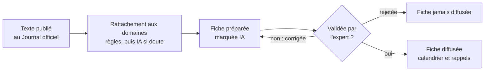

# Fiche capacité : `veille-reglementaire`

| Élément | Valeur |
|---|---|
| Préfixe d'exigences | `REG` |
| Spec de référence | `/openspec/specs/veille-reglementaire/spec.md` — absente tant qu'aucun changement n'est archivé |
| Changements en cours | [`suivre-veille-reglementaire`](/openspec/changes/suivre-veille-reglementaire/proposal.md) (implémenté, non archivé) |
| Statut de la capacité | implémentée, non archivée |
| Composants (arc42 §5) | `reg-intel`, `source-ingestion`, `catalog`, `ai-gateway`, `scm-connector`, `alerting` (arc42 §5.4.3) |
| Décision | [ADR-0030](../architecture/adr/0030-veille-reglementaire-expert-metier.md) (Proposé), mise à jour d'ADR-0018 (Proposé) |

## Objectif

[EXISTANT — `suivre-veille-reglementaire`] Les experts métier d'un espace reçoivent les textes du Journal officiel qui touchent leurs domaines, avec une fiche fiable et un calendrier ; aucune analyse n'est diffusée avant leur validation.

## Acteurs

| Acteur | Interaction | Statut |
|---|---|---|
| Administrateur de l'espace | définit les domaines, les règles de rattachement, les experts et les jours de rappel | [EXISTANT] — `ReglementaireResource` |
| Expert métier | membre CONTRIBUTEUR ou ADMINISTRATEUR désigné pour un domaine ; voit, corrige, valide ou rejette les fiches de ses domaines, fait avancer le suivi | [EXISTANT] — `ExpertiseFiches` ; ADR-0030 (Proposé) |
| Membre de l'espace | consulte les fiches validées et le calendrier ; reçoit les rappels si son profil `expert-metier` est actif | [EXISTANT] — PRF-06 |
| Administrateur plateforme | consulte l'état de la source et rejoue la collecte d'un jour | [EXISTANT] |
| DILA (jeux de données JORF) | publie les archives quotidiennes du Journal officiel sous Licence Ouverte | [DÉCISION] — Q-1 ; [EXISTANT] — `ArchivesJorf` |
| GitHub, GitLab | hébergent la demande d'évolution associée à un texte | [DÉCISION] — Q-3 ; [EXISTANT] — `DemandesEvolution` |

## Périmètre et exclusions

Inclus :

- Textes du Journal officiel lus dans les archives JORF de la DILA ; codes consolidés modifiés repérés par les liens de ces textes.

Exclus :

- L'API PISTE de Légifrance, tant que ses conditions d'usage ne sont pas vérifiées (Q-1).
- La lecture des archives LEGI (codes consolidés) : les liens « version consolidée » pointent vers Légifrance.
- Les autres sources réglementaires (normes déclaratives, sites ministériels) : pages surveillées par `veille-rss-web`.
- Tout avis juridique.
- L'écran de l'IHM web : la capacité est exposée par l'API REST et le serveur MCP.

## Préconditions et déclencheurs

Domaines, règles et experts configurés dans l'espace (aucun dictionnaire type : Q-4). Collecte quotidienne à 06:30 (`argos.reglementaire.collecte.cron`), rappels à 07:15 (`argos.reglementaire.rappels.cron`), fuseau `argos.alerting.fuseau`.

## Entrées, sorties et validations

| Entrée / sortie | Contenu | Validation ou contrainte | Statut |
|---|---|---|---|
| Archive JORF | index et `JORF_AAAAMMJJ-HHMMSS.tar.gz` | `GET` sans redirection, délai et tailles bornés ; XML sans DTD ni entité externe (refus de tout `DOCTYPE`) | [EXISTANT] |
| Texte officiel | identifiant `JORFTEXT…`, nature, NOR, ministère, titre, dates de publication et d'effet, codes et articles modifiés | enregistré une seule fois par identifiant (REG-01) ; données externes non fiables, texte brut borné | [EXISTANT] |
| Règle du dictionnaire | type `NATURE`, `MINISTERE`, `NOR`, `CODE`, `MOT_CLE` et valeur | 200 règles au plus par domaine ; préfixe NOR en lettres | [EXISTANT] |
| Fiche | résumé, articles modifiés, date d'effet (« date à confirmer » sinon), domaines et leur origine, liens vers le texte publié et sa version consolidée, mentions IA, validation, avis juridique et source | invisible des non-experts avant validation (REG-05) ; résumé obligatoire pour valider | [EXISTANT] |
| Demande d'évolution | adresse d'un ticket ou d'une demande de fusion GitHub ou GitLab | forge configurée seulement ; état lu en lecture seule ; demande inexistante refusée | [EXISTANT] |

## Règles métier

| Règle | Exigence(s) | Source | Statut |
|---|---|---|---|
| Collecte quotidienne sans doublon ; reprise du jour manqué, source `DEGRADE` en cas d'échec | REG-01 | ADR-0030 (Proposé) | [EXISTANT] — `CollecteReglementaire` |
| Qualification par les règles de l'espace ; proposition IA marquée avec sa confiance si aucune règle ne s'applique (natures `LOI`, `ORDONNANCE`, `DECRET`, `ARRETE`, 20 propositions au plus par espace et par collecte) | REG-02 | ADR-0013 (Proposé), ADR-0030 (Proposé) | [EXISTANT] — `Qualification`, `PreparationFiches` |
| Date de publication et date d'effet distinctes ; « date à confirmer » sans date extraite ; date proposée par l'IA affichée comme proposition | REG-03 | ADR-0030 (Proposé) | [EXISTANT] — `DatesTexte` |
| Fiche préparée et marquée « produit par l'IA » et « en attente de validation » ; sans IA, préparée sans résumé | REG-04 | IAG-04, ADR-0029 (Proposé) | [EXISTANT] — `AnalyseIa` |
| Fiche visible des seuls experts de ses domaines avant validation ; corrections et décisions historisées | REG-05 | PRF-06 | [EXISTANT] — RLS V16, `ExpertiseFiches` |
| Suivi nouveau → en analyse → sans impact / impact produit → spécifié → livré ; « spécifié » exige une demande d'évolution | REG-06 | ADR-0030 (Proposé) | [EXISTANT] — `CycleVie` |
| Calendrier des fiches validées ; rappels J-90, J-30, J-7, réglables par espace | REG-07 | Q-2 | [EXISTANT] — `EcheancesReglementaires`, `RappelsReglementaires` |
| Lien vers une demande d'évolution GitHub ou GitLab | REG-08 | Q-3 | [EXISTANT] — `DemandesEvolution` |

## Droits d'accès et restrictions

- Configuration des domaines, règles, experts et rappels : administrateurs de l'espace (politiques `argos_administre`, migration V16).
- Lecture, correction, validation, rejet, transitions et demande d'évolution d'une fiche en attente : experts d'un des domaines de la fiche, membres CONTRIBUTEUR ou ADMINISTRATEUR (fonction `argos_expert_fiche`).
- Fiches validées et calendrier : tout membre de l'espace ; serveur MCP : fiches validées seulement (MCP-07).
- Fiche hors périmètre : réponse 404 et refus journalisé ; action d'un non-expert sur une fiche visible : 403 journalisé.
- Les profils n'accordent aucun droit (PRF-05) ; le profil `expert-metier` actif désigne seulement les destinataires des rappels.

## Effets de bord observables

Textes et fiches enregistrés ; jours collectés et état de la source (`GET /api/v1/reglementaire/collecte`) ; historique des corrections et décisions ; rappels `RAPPEL` (clé `REGLEMENTAIRE|fiche|date|J-n`) sur le canal `EMAIL`, sinon `DESKTOP` ; appels IA tracés dans `ia_appel`.

## Qualités mesurables

[QUESTION] Aucune cible chiffrée dans les sources (durée d'une collecte réelle sur le NAS à mesurer).

## Diagrammes

### DF-REG-1 — Parcours d'un texte officiel

- **Question** : quelles étapes un texte suit-il avant d'être diffusé ?
- **Type** : organigramme
- **Portée** : existant
- **Exigences** : REG-02, REG-04, REG-05

Rien n'est diffusé au-delà des experts tant que la fiche n'est pas validée. Vue d'exécution : arc42 §6.6.

## Critères d'acceptation

Scénarios REG-01-S1 à REG-08-S1 du changement, tous couverts par un test qui passe (voir la traçabilité).

## Interprétations introduites par un changement

- [DÉCISION] Domaines et dictionnaire métier propres à chaque espace (ADR-0025) ; expert désigné par un administrateur parmi les membres CONTRIBUTEUR ou ADMINISTRATEUR — ADR-0030 (Proposé).
- [PROPOSITION] « Utilisateurs du domaine » destinataires des rappels : experts des domaines de la fiche et membres de l'espace dont le profil `expert-metier` est actif ; toute fiche validée est lisible de tous les membres de l'espace.
- [PROPOSITION] Une fiche validée ou rejetée n'est plus corrigée ; une demande d'évolution ne s'associe qu'à un texte « impact produit » ou au-delà.
- [PROPOSITION] La première collecte ne lit que le jour courant ; la reprise remonte au plus 31 jours.

## Écarts constatés

- ADR-0018 nomme les MKP et les modules RH d'un éditeur ; ADR-0030 (Proposé) le met à jour (expert métier, domaines par espace, données ouvertes JORF).
- Le titre de la tâche 2.1 parle d'un « connecteur Légifrance avec repli LEGI/JORF » : selon Q-1, le connecteur lit les seules archives JORF de la DILA, sans l'API PISTE.

## Questions ouvertes

| ID | Question | Impact | Destinataire |
|---|---|---|---|
| Q-1 | Les conditions d'usage de l'API Légifrance autorisent-elles un produit diffusé, éventuellement commercial ? | répondue le 2026-11-17 : source principale : jeux de données LEGI et JORF de la DILA, publiés sur data.gouv.fr sous Licence Ouverte / Open Licence (réutilisation gratuite, commerciale comprise, avec mention de la source : https://www.data.gouv.fr/datasets/legi-codes-lois-et-reglements-consolides) ; l'API PISTE de Légifrance n'est pas utilisée tant que ses conditions d'usage ne sont pas vérifiées [DÉCISION] | porteur du projet |
| Q-2 | À quelles échéances envoyer les rappels avant une entrée en vigueur ? | répondue le 2026-11-17 : J-90, J-30 et J-7 avant l'entrée en vigueur, paramétrables [DÉCISION] | Product Owner |
| Q-3 | Quel outil de suivi externe relier (Jira, GitHub, GitLab) ? | répondue le 2026-11-17 : GitHub et GitLab, par les adapters `scm` existants ; pas de Jira [DÉCISION] | porteur du projet |
| Q-4 | Faut-il fournir des dictionnaires métier types à la création d'un espace ? | répondue le 2026-11-17 : non pour l'instant : chaque espace construit son dictionnaire [DÉCISION] | Product Owner |

## Traçabilité

| Exigence | Scénarios | Conception / diagramme | Tâche | Test ou preuve |
|---|---|---|---|---|
| REG-01 | REG-01-S1, REG-01-S2 | DC-1 | 1.1, 2.1 | `CollecteReglementaireTest` (`reg01S1RejeuSansDoublon`, `reg01S2SourceIndisponiblePuisRepriseDuJourManque`), `LecteurJorfTest` |
| REG-02 | REG-02-S1, REG-02-S2 | DC-1 | 2.2, 2.3 | `QualificationEtDatesTest.reg02S1…`, `VeilleReglementaireTest.reg02S1Reg02S2Reg04S1…` |
| REG-03 | REG-03-S1, REG-03-S2 | DC-1 | 2.4 | `QualificationEtDatesTest.reg03S1…`, `reg03S2…` ; `CollecteReglementaireTest` |
| REG-04 | REG-04-S1 | DC-1 | 3.1 | `VeilleReglementaireTest.reg02S1Reg02S2Reg04S1…` |
| REG-05 | REG-05-S1, REG-05-S2 | DC-1, DC-2 | 3.2 | `VeilleReglementaireTest.reg05S1Reg05S2…`, `rlsSousArgosApp` |
| REG-06 | REG-06-S1, REG-06-S2 | DC-2 | 3.3 | `QualificationEtDatesTest.reg06S1…`, `reg06S2…` ; `VeilleReglementaireTest.reg06Reg08S1…` |
| REG-07 | REG-07-S1 | DC-1 | 3.4 | `VeilleReglementaireTest.reg07S1RappelAvantEcheanceEtCalendrier` |
| REG-08 | REG-08-S1 | DC-2 | 3.4 | `VeilleReglementaireTest.reg06Reg08S1…`, `DemandesEvolutionTest` |

Parcours de bout en bout (tâche 5.2) : `ParcoursReglementaireTest`. Code : `argos-server/src/main/java/io/argos/regintel/`, `ingestion/legi/`, `catalog/dictionnaire/`, `api/reglementaire/` ; migration `V16__veille_reglementaire.sql`.
