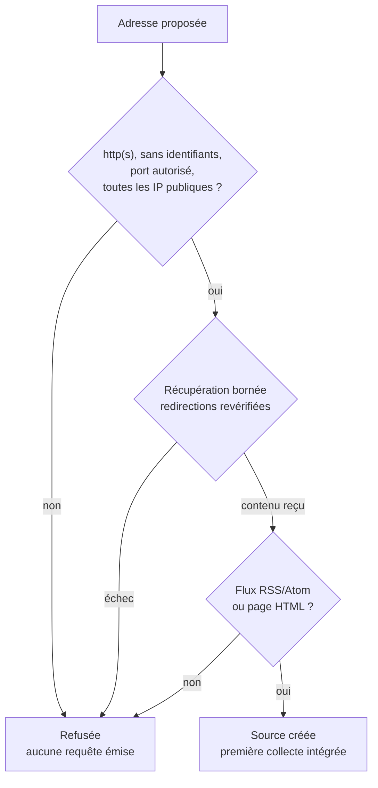

# Fiche capacité : `veille-rss-web`

| Élément | Valeur |
|---|---|
| Préfixe d'exigences | `WEB` |
| Spec de référence | [`/openspec/specs/veille-rss-web/spec.md`](/openspec/specs/veille-rss-web/spec.md) |
| Changements archivés | [`2026-11-16-collecter-veille-rss-web`](/openspec/changes/archive/2026-11-16-collecter-veille-rss-web/proposal.md) |
| Statut de la capacité | livrée ; code et tests dans `argos-server` |
| Composants (arc42 §5) | `source-ingestion`, `signal`, `impact-engine` |
| Décision | [ADR-0028](/docs/architecture/adr/0028-collecteur-veille-web-integre.md) (Proposé) : collecteur intégré au serveur |

## Objectif

[PROPOSITION — `collecter-veille-rss-web`] Suivre blogs, notes de version et pages choisis par chacun, sans exposer Argos aux adresses et contenus malveillants.

## Acteurs

| Acteur | Interaction | Statut |
|---|---|---|
| Utilisateur | ajoute, collecte et supprime ses sources personnelles ; consulte les actualités de ses sources et de celles de ses espaces | [EXISTANT] — `VeilleWebResource` |
| Administrateur d'espace | ajoute, collecte et supprime les sources de l'espace | [EXISTANT] — `VeilleWebResource` |
| Membre d'un espace | consulte les sources et les actualités de l'espace | [EXISTANT] — RLS de la migration V10 |
| Sites et flux externes | publient le contenu | [EXISTANT] — simulés par un serveur HTTP local dans les tests |

## Périmètre et exclusions

Inclus :

- ajout de flux RSS/Atom et de pages surveillées, au niveau d'un espace ou à titre personnel ;
- collecte planifiée, déduplication et restitution des actualités avec leurs sources ;
- rapprochement par nom de technologie, au niveau « à vérifier ».

Exclus :

- moteur de recherche web, contournement de murs payants ;
- rendu JavaScript des pages surveillées ;
- résumé produit par une IA : la passerelle IA relève du changement `encadrer-appels-ia`.

## Préconditions et déclencheurs

Utilisateur authentifié (ADR-0008, ADR-0027). Collecte déclenchée à l'ajout de la source, par le planificateur (sources échues, toutes les `argos.veille-web.cadence`) ou à la demande du propriétaire ou d'un administrateur de l'espace.

## Entrées, sorties et validations

| Entrée / sortie | Contenu | Validation ou contrainte | Statut |
|---|---|---|---|
| Demande de source | portée (`ESPACE` ou `PERSONNELLE`), espace, type (`FLUX` ou `PAGE`), adresse, libellé facultatif | adresse `http(s)` publique sur un port autorisé, enregistrée sous sa forme canonique ; contenu qui est un flux RSS/Atom ou une page HTML (WEB-01, WEB-03) | [EXISTANT] |
| Source | état `ACTIVE` ou `EN_ERREUR`, échecs consécutifs, motif du dernier échec, prochaine collecte | — | [EXISTANT] |
| Actualité | type (`ARTICLE` ou `CHANGEMENT_PAGE`), titre, lien, date, contenu, sources citées | contenu en texte brut, marqué `CITATION_EXTERNE` et `fiable = false` (WEB-04) ; titre et texte peuvent contenir des caractères de balisage en clair (`<script>` issu d'entités doublement encodées) : l'IHM les affiche comme du texte, échappé, jamais comme du HTML | [EXISTANT] |
| Détail d'une actualité | actualité, résumé extractif (`EXTRAIT_V1`), rapprochements | — | [EXISTANT] |

Erreurs : 400 avec le code du motif (`ADRESSE_INVALIDE`, `ADRESSE_INTERDITE`, `REDIRECTION_INTERDITE`, `TROP_DE_REDIRECTIONS`, `DELAI_DEPASSE`, `CONTENU_TROP_VOLUMINEUX`, `REPONSE_HTTP`, `ERREUR_RESEAU`, `FLUX_INVALIDE`, `PAGE_INVALIDE`) et un message propre au motif, sans hôte ni adresse IP ; 409 `LIMITE_SOURCES`, `SOURCE_EXISTANTE`, `COLLECTE_EN_COURS` ; 429 `LIMITE_DEBIT` avec `Retry-After: 60`.

API : `POST|GET /api/v1/veille-web/sources`, `DELETE /api/v1/veille-web/sources/{id}`, `POST /api/v1/veille-web/sources/{id}/collectes`, `GET /api/v1/veille-web/actualites`, `GET /api/v1/veille-web/actualites/{id}`.

## Règles métier

| Règle | Exigence(s) | Source | Statut |
|---|---|---|---|
| Une adresse est enregistrée seulement si elle renvoie un flux valide (type `FLUX`) ou une page HTML (type `PAGE`) ; sinon refus `FLUX_INVALIDE` ou `PAGE_INVALIDE`, aucune source créée | WEB-01 | ADR-0028 (Proposé) | [EXISTANT] |
| La première collecte suit l'ajout ; chaque source est ensuite collectée toutes les heures (`argos.veille-web.frequence`) | WEB-01 | Q-2 | [EXISTANT] |
| Une page surveillée garde un instantané (texte par blocs, empreinte SHA-256) ; un contenu différent crée une actualité datée dont le texte est l'aperçu des blocs ajoutés, à défaut retirés | WEB-02 | ADR-0028 (Proposé) | [EXISTANT] |
| Adresse refusée (`ADRESSE_INTERDITE`) si son port n'est pas autorisé (80 et 443 par défaut, `argos.veille-web.ports-autorises`), si son hôte est introuvable ou si une adresse IP de l'hôte, après résolution DNS, appartient à une plage refusée (liste en arc42 §8.3, IPv4 embarquées dans IPv6 comprises) ; contrôle refait à chaque collecte et à chaque redirection (5 au plus) ; 10 s et 2 Mio par récupération, lecture du contenu comprise (un serveur qui se tait après ses en-têtes est coupé à l'échéance) | WEB-03 | risque R-12 ; arc42 §8.3 | [EXISTANT] |
| Le message d'un refus et le motif enregistré pour une source en erreur sont propres au motif : ni hôte, ni adresse IP, ni statut HTTP, ni destination de redirection ; le détail est écrit dans le journal applicatif | WEB-03 | constat de relecture ; arc42 §8.3 | [EXISTANT] |
| Une collecte en échec fait passer la source `EN_ERREUR` avec son motif ; la tentative suivante attend fréquence × 2^(échecs − 1), au plus × 8 ; un échec de la première collecte, après l'enregistrement de la source, laisse la source `EN_ERREUR` | WEB-03 | conception, gestion des erreurs | [EXISTANT] |
| Un passage du planificateur collecte au plus 200 sources échues (`argos.veille-web.sources-par-passage`) et n'en commence plus après 4 minutes (`argos.veille-web.duree-max-passage`) ; la collecte d'une source est sérialisée : une collecte à la demande pendant une autre collecte de la même source reçoit 409 `COLLECTE_EN_COURS` | WEB-01, WEB-02 | constat de relecture | [EXISTANT] |
| Le contenu collecté est réduit à du texte brut et restitué comme citation non fiable ; le résumé est un extrait déterministe ; aucun lien collecté n'est récupéré | WEB-04 | risque R-11 | [EXISTANT] |
| Le texte brut n'est pas échappé : des entités doublement encodées (`&amp;lt;script&amp;gt;`) donnent `<script>` en clair dans le titre ou le texte stocké ; l'IHM doit échapper ces champs à l'affichage | WEB-04 | constat de relecture | [EXISTANT] |
| Un article reçu par plusieurs sources a une seule empreinte (lien normalisé, à défaut identifiant, à défaut titre et texte) et est restitué une fois avec toutes ses sources visibles | WEB-05 | arc42 §6.1 | [EXISTANT] |
| La déduplication se fait dans le périmètre de la source : le propriétaire pour une source personnelle, l'espace pour une source d'espace ; une source ne fixe ni ne révèle le contenu vu dans un autre périmètre ; un article présent dans plusieurs périmètres visibles est restitué une fois (ligne d'un espace de préférence, puis la plus ancienne) avec les citations de tous ces périmètres | WEB-05 | constat de relecture ; ADR-0016 | [EXISTANT] |
| Une actualité citée par une source d'espace est rapprochée des projets de cet espace dont un composant porte le nom de technologie mentionné ; niveau `A_VERIFIER` seulement, aucun impact projet, aucune alerte | WEB-06 | ADR-0013 (Proposé) ; ALR-02 | [EXISTANT] |
| Une source personnelle ne produit aucun rapprochement | WEB-06 | [PROPOSITION] : rien de la veille personnelle n'est révélé aux autres membres | [EXISTANT] |
| 50 sources personnelles par utilisateur au plus (`argos.veille-web.sources-personnelles-max`) ; une adresse n'est suivie qu'une fois par propriétaire ou par espace, comparée sous sa forme canonique (schéma et hôte en minuscules, port par défaut et fragment retirés) | — | Q-3 | [EXISTANT] |
| Ajout d'une source (réussi ou refusé) et collecte à la demande limités ensemble à 10 requêtes par minute et par compte (`argos.veille-web.debit.requetes-par-minute`) ; au-delà, 429 `LIMITE_DEBIT`, refus inscrit au journal des refus | — | constat de relecture ; arc42 §8.3 | [EXISTANT] |
| Les sources et actualités personnelles sont supprimées avec le compte de leur propriétaire, comme les préférences et les alertes | — | constat de relecture | [EXISTANT] |

## Droits d'accès et restrictions

[EXISTANT] Une source personnelle n'est visible, collectée et supprimée que par son propriétaire. Une source d'espace est visible des membres de l'espace, créée, collectée et supprimée par ses administrateurs : un membre d'un autre rôle reçoit 403, un non-membre 404 ; chaque refus est journalisé (ACC-06). Une actualité n'est visible que dans son périmètre (son propriétaire ou les membres de son espace) et si une source visible la cite ; seules les sources visibles sont citées ; un rapprochement n'est visible que des membres de son espace. Ces règles sont appliquées par `VeilleWebResource` puis, sous le rôle `argos_app`, par les politiques RLS de la migration V10.

## Effets de bord observables

Sources, actualités, citations et rapprochements enregistrés ; état et motif d'erreur de chaque source ; aucune alerte, aucun impact projet.

## Qualités mesurables

[QUESTION] Aucune cible chiffrée de performance dans les sources. Bornes de sécurité : 10 s et 2 Mio par récupération, 5 redirections, ports 80 et 443, 10 requêtes de récupération par minute et par compte, 200 sources et 4 minutes par passage du planificateur.

## Diagrammes

### DF-WEB-1 — Acceptation d'une adresse

- **Question** : quand une adresse proposée est-elle acceptée ?
- **Type** : organigramme
- **Portée** : existant
- **Exigences** : WEB-01, WEB-03

Une adresse n'est acceptée que si elle mène à un serveur public et renvoie un contenu exploitable.

## Critères d'acceptation

Scénarios WEB-01-S1 à WEB-06-S1 du changement, couverts par `argos-server/src/test/java/io/argos/chain/VeilleWebTest.java` et `ParcoursVeilleWebTest.java` ; constats de relecture couverts par `VeilleWebTest`, `LimiteDebitVeilleWebTest`, `io/argos/signal/web/CollecteWebTest.java` et les tests unitaires de `io/argos/ingestion/web/`.

## Interprétations introduites par un changement

- Aperçu de la modification d'une page (WEB-02) : blocs de texte ajoutés (« Ajouté : … »), à défaut retirés, 500 caractères au plus [PROPOSITION].
- Résumé d'un article (WEB-04) : extrait déterministe des premières phrases, 280 caractères au plus, sans IA [PROPOSITION].
- Nom de technologie (WEB-06) : portée d'un paquet npm à portée (`@angular/core` → `angular`), sinon nom du paquet, 3 caractères au moins, recherché comme mot entier [PROPOSITION].
- Sources d'espace sans limite de nombre ; leur création est réservée aux administrateurs [PROPOSITION].
- Les refus d'une demande de source réutilisent les erreurs communes du domaine : `DonneeInvalide` (HTTP 400, code du motif de refus ou `DONNEE_INVALIDE`, attribut en cause) et `RegleViolee` (HTTP 409, `LIMITE_SOURCES`, `SOURCE_EXISTANTE`, `COLLECTE_EN_COURS`) ; la RLS est appliquée par `ContexteBase`, seul mécanisme de contexte de cloisonnement du module `workspace` emprunté par `signal` [PROPOSITION].
- Limite de débit : 10 requêtes par minute et par compte, commune à l'ajout et à la collecte à la demande, par le limiteur à fenêtre glissante `api.security.LimiteurDebit` partagé avec le serveur MCP [PROPOSITION].
- Un hôte introuvable est refusé comme un hôte interdit (`ADRESSE_INTERDITE`) ; Teredo, 100::/64 et 64:ff9b::/32 hors du préfixe NAT64 bien connu sont refusés quelle que soit l'IPv4 embarquée [PROPOSITION].
- Dans un passage du planificateur, aucune source n'est commencée après 4 minutes, durée inférieure à la cadence de 5 minutes [PROPOSITION].

## Écarts constatés

- La passerelle IA n'existe pas encore : le scénario WEB-04-S1 est vérifié sur le résumé extractif ; la vérification avec la passerelle IA réelle reste à faire avec `encadrer-appels-ia`.
- Rebinding DNS : le client HTTP résout l'hôte une seconde fois après le contrôle (risque résiduel, ADR-0028).
- L'IHM ne présente pas encore les sources ni les actualités web.

## Questions ouvertes

| ID | Question | Impact | Destinataire |
|---|---|---|---|
| Q-1 | Utiliser FreshRSS et changedetection.io en services séparés (AGPL pour FreshRSS) ou un collecteur intégré ? | répondue le 2026-11-16 : collecteur intégré au serveur, à bibliothèques sous licence permissive ; ni FreshRSS (AGPL) ni changedetection.io [DÉCISION] ; ADR-0028 | porteur du projet |
| Q-2 | À quelle fréquence collecter ? | répondue le 2026-11-16 : toutes les heures, paramétrable [DÉCISION] | Product Owner |
| Q-3 | Combien de sources personnelles par utilisateur au maximum ? | répondue le 2026-11-16 : 50 sources personnelles par utilisateur, paramétrable [DÉCISION] | porteur du projet |

## Traçabilité

| Exigence | Scénarios | Conception / diagramme | Tâche | Test ou preuve |
|---|---|---|---|---|
| WEB-01 | WEB-01-S1, WEB-01-S2 | DC-1, DF-WEB-1 | 1.1, 2.1, 2.2, 3.1 | `VeilleWebTest` : `fluxAtomValideCreeLaSourceEtSesArticlesApparaissent`, `adresseSansFluxRefuseeSansCreerDeSource` |
| WEB-02 | WEB-02-S1 | DC-1 | 1.1, 3.1 | `VeilleWebTest.pageSurveilleeModifieeCreeUnElementDateAvecApercu` |
| WEB-03 | WEB-03-S1, WEB-03-S2 | DC-1, DF-WEB-1 | 2.1 | `GardeAdressesTest`, `RecuperateurWebTest`, `VeilleWebTest` : `adressePriveeRefuseeSansRequete`, `redirectionVersAdresseLocaleMetLaSourceEnErreur`, `refusSansIndiceReseau` ; `LimiteDebitVeilleWebTest` ; `CollecteWebTest` |
| WEB-04 | WEB-04-S1 | DC-1 | 3.3 | `VeilleWebTest.articlePiegeCiteCommeDonneeSansEffetSurLesImpacts` ; `LecteursTest.entitesDecodeesConserveesEnTexteBrutAEchapperALAffichage` |
| WEB-05 | WEB-05-S1 | DC-1 | 3.2 | `VeilleWebTest` : `memeArticleDansDeuxFluxRestitueUneFoisAvecSesDeuxSources`, `contenuDUneSourcePersonnelleCloisonneParCompte` |
| WEB-06 | WEB-06-S1 | DC-1 | 3.4 | `VeilleWebTest` : `articleSurUneTechnologieUtiliseeRapprocheAVerifierSansAlerte`, `sourcePersonnelleNInjecteRienDansUnEspace` |
